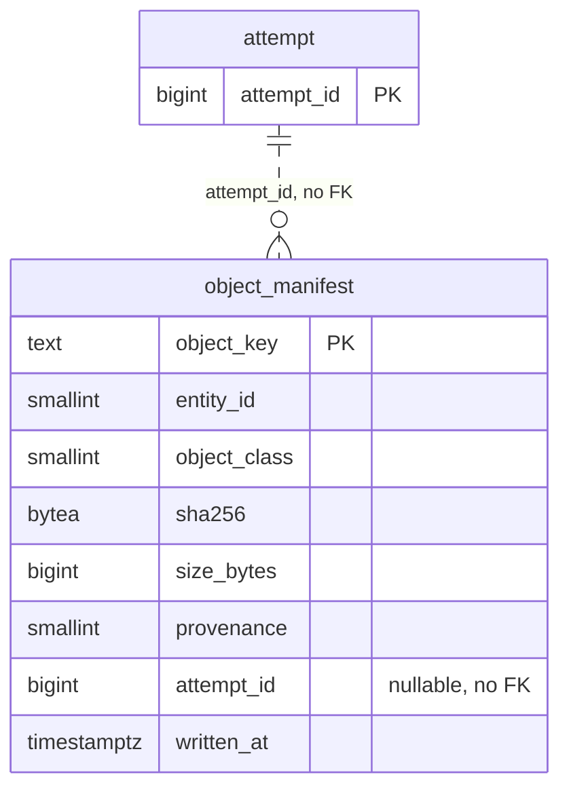

# P3b1 V002 schema design (for owner review)

**Status: DRAFT for owner review. Nothing in this document is approved.** The approval, if the owner gives it, is recorded only as the line `approved-schema-p3b-sha256:` in `docs/evidence/decisions.md` (AP-7), with the output of `sed 's/\r$//' docs/ledger/schema-design-p3b.md | sha256sum`, after the owner has answered the Decision sheet. Until then no SQL file exists and task T11 (migration V002) does not start. If an answer differs from a recommendation, this text is changed to say so before the hash is taken. Written 2026-10-19 by the T9 implementer from the plan P3b1 (`docs/superpowers/plans/2026-10-19-p3b-evidence-stores.md`: D-E6, A6, the sections "Port and model changes" and "Semantics", and tasks T9 to T12), the approved P3a document `docs/ledger/schema-design.md` (not edited), the SP-L report (`docs/spikes/SP-L.md`, the evidence volume model) and the specification (5.4, 11.1, 11.2, 11.5). No PostgreSQL server exists on the machine where this was written, so no statement in this document has been executed; the first run on a server is the checkpoint CP-1 after T11 and T12.

**How to read it.** Read the Decision sheet (next section) first and answer it. Everything after the sheet is approved by exception: name the table or constraint you want changed. The sections follow the contents list of task T9 (spec 11.1 "Placement and shape"). The document is short because V002 adds one table, one index and one trigger and changes nothing that exists.

**Three facts to hold in mind while reading.**

1. **This document reverses one thing you already approved.** The approved P3a document (section 8) classified `object_manifest` as partitioned by `written_on`. Decision D1 reverses that and gives the reason. It is the only decision on the sheet that contradicts an approved text; D2 to D5 are new. Section 7 lists every statement of the approved document that this one supersedes.
2. **Every number is an estimate with its derivation, none is measured** (section 6). The volume is the SP-L planning model (400 raw bytes a record, 500 reports a file, 1 percent of files sent again), not an observation, and the byte counts are a bottom-up count of PostgreSQL row and index layout written from recollection of how PostgreSQL stores rows; they are good to about plus or minus 40 percent, as in the P3a document. Units: MB is 10^6 bytes, GB 10^9, TB 10^12; 5 years are 1,826 days, as in the P3a document.
3. **V002 adds one table and nothing else.** No existing table, column, constraint, function or sequence changes (the table `attempt` gets no column), so `V001__core.sql`, its recorded checksum and the approved P3a document stay as they are.

## Decision sheet

Costs to change later, as in the P3a document: **low** = one new migration, nothing rewritten; **medium** = a migration plus moving or back-filling data, planned work; **high** = rewriting the largest table, or the old form is lost. Sizes are for the evidence volume model of SP-L (464,000 evidence objects a day, section 6) and for 5 years of 1,826 days without purging; they are estimates.

| # | The question in plain words | My recommendation | Disk (a day / 5 years) | Cost to change later |
|---|---|---|---|---|
| D1 | **OI-4, D-E6.** Is the manifest table cut into one piece per day, as section 8 of the approved P3a document proposed, or one table whose primary key is the object key? | **One table, the object key as its primary key.** A unique key on a table cut by day must contain the day, so it cannot refuse the same object key arriving on another day with another hash, and refusing exactly that is what makes the stored hash evidence (section 4). | About 165 to 170 MB a day, about 0.30 TB in 5 years. The cut-by-day layout needs a second table of all keys and adds about 290 B a row: about 134 MB a day (+83 percent). | Medium, and growing with every year of rows (a new table, a copy of hundreds of millions of rows, a swap) |
| D2 | Does the database refuse UPDATE and DELETE on a manifest row? | **Yes.** A row trigger reuses the function of V001 that the three insert-only tables of V001 use. The write-time hash is the evidence; nothing may rewrite it. | None. Nothing runs on the insert path. | Low (add or drop a trigger) |
| D3 | Does `attempt_id` carry a foreign key to `attempt`? | **No.** After a restore from backup the evidence tier is ahead of the database; objects adopted from it name attempts whose rows are not in the restored database. `attempt` itself stays unchanged. | None. | Low to add while no row names a missing attempt; medium afterwards (the orphans must be cleared before the key can be validated) |
| D4 | Is the key column compared byte by byte (`COLLATE "C"`) instead of by the database default collation? | **Yes.** The evidence store lists keys in UTF-16 code-unit order, which for the ASCII key alphabet is byte order; paging by "keys after this one" and the prefix range read must give the same order from the ledger. | None. | Medium (changing the collation of a key column rewrites the table and its index under an exclusive lock, and the adapter's range predicate must be re-checked) |
| D5 | Are manifest rows ever purged? | **No purge in release 1.** The rows are kept as long as the objects they describe; an archive or purge design is due before the first production quarter, the same date the owner set for the ledger (P3a sheet row 4). | The table grows about 60 to 62 GB a year; 0.30 to 0.31 TB after 5 years is about 0.18 percent of the P3a ledger estimate of 166 TB. | Low (a purge is a later design; it has to go around the trigger of D2 on purpose) |

Also asked at this stop (OI-7): how many minutes did reading and deciding this take, for the effort record?

The decisions are written out with their options in section 5.

## 1. Entity-relationship diagram

V001 has 18 tables (approved P3a document, section 1, not redrawn). V002 adds a 19th, `object_manifest`. The dotted line is a reference that is resolved by the adapter and has no foreign key (D3).



No sequence and no identity column is added: the key is the evidence-store key of the object, which the caller already holds.

## 2. The table

Format of the two machine-read blocks: the same as in section 2 of the approved document and read by the same reader (task T11 reads them against the statements of `V002__evidence_manifest.sql`). Each block is one Markdown table; the first cell of every row is the name in backticks, in the constraint block the second cell too, and the third cell (the kind) is plain text; the first row after the header separator is the first entry. Anything outside the blocks is prose. The words in the retention column are those of the approved document: **PERMANENT** = kept as long as the record it describes must be kept (no purge in release 1, D5).

`object_manifest` carries `entity_id smallint NOT NULL DEFAULT 1` like every table of V001 except the four named in the approved document (D-S12; one reporting entity in release 1; row-level security is reserved, RSV-1). Its instant column `written_at` is `timestamptz` bound from the injected `Clock`, with no SQL default (D-S13), so the test `noTimeOrRandomnessDefaultsInTheMigrations` stays true for V002.

<!-- schema:tables -->
| Table | Primary key | Foreign keys | Unique and partial-unique constraints | Partition key | Rows a day (50M-record day) | Retention class | PII | entity_id | Notes |
|---|---|---|---|---|---|---|---|---|---|
| `object_manifest` | `object_manifest_pk` (object_key) | none (`attempt_id` names an `attempt` row without a foreign key, D3) | none besides the primary key | none (unpartitioned, D1; the PostgreSQL rule that a unique index contains the partition key does not arise) | about 464,000 for all slices (SP-L model: 100,000 sealed files; 101,000 each of DeliveryIntent, TransportResult and FeedbackReceived; 10,000 each of BatchAdmitted, VersionAssigned and landing objects; 1,000 RecoveryDecision; 30,000 enrichment objects); P3b1 itself writes about 201,000 (two per attempt: the sealed file and the DeliveryIntent object) | PERMANENT | no | yes | Columns `object_key text COLLATE "C"` (the evidence key, 1 to 512 characters of the key alphabet and slashes), `entity_id`, `object_class smallint` (codes 1 to 7), `sha256 bytea` (32 bytes, the hash of the object bytes as stored, written once), `size_bytes bigint`, `provenance smallint` (WRITTEN 1, ADOPTED_AT_RESTORE 2), `attempt_id bigint` NULL, `written_at timestamptz`. Insert-only (trigger `object_manifest_immutable`, D2). Partial index `object_manifest_attempt_idx` (attempt_id) WHERE attempt_id IS NOT NULL. No updated-by-design column: the list of tables that are updated by design in the approved document gains nothing. |
<!-- /schema:tables -->

Rows enter through `recordObjects` (port `ManifestLedger`, task T10), all or nothing in one unit. The only caller on the seal path is `beginSending`, which runs it inside the SENDING unit, after the state change and the attempt row (so the manifest rows are the last statements of the unit); later slices call it from their own units. The statements are a JDBC batch `INSERT ... ON CONFLICT ON CONSTRAINT object_manifest_pk DO NOTHING`, then one `SELECT object_key, sha256 ... WHERE object_key = ANY (?)`, and a comparison of each stored hash with the offered one in Java. The comparison only decides between "same, nothing to do" and "different, `ManifestConflictException`, the whole unit rolls back"; the uniqueness stays the constraint's. The first row wins (its provenance, attempt and time are kept). Reading is by key (`manifestRow`) or by range (`manifestRows`: `WHERE object_key >= prefix AND object_key < prefix followed by U+007F AND object_key > after ORDER BY object_key LIMIT n`, which uses the primary-key index and relies on D4).

<!-- schema:constraints -->
| Constraint, index or trigger | Table | Kind |
|---|---|---|
| `object_manifest_pk` | `object_manifest` | PK |
| `object_manifest_hash_check` | `object_manifest` | CHECK |
| `object_manifest_size_check` | `object_manifest` | CHECK |
| `object_manifest_attempt_idx` | `object_manifest` | INDEX |
| `object_manifest_immutable` | `object_manifest` | TRIGGER |
<!-- /schema:constraints -->

Notes on the list. (a) `object_manifest_hash_check` is `CHECK (octet_length(sha256) = 32)` and `object_manifest_size_check` is `CHECK (size_bytes >= 0)`. They are structural: neither fixes a set of codes. The approved document (section 2, note g) kept CHECK constraints out of V001 because a database CHECK on state and outcome codes would turn every new code of a later slice into a migration; `object_class` and `provenance` stay unchecked for the same reason (a third provenance, for example for an orphan adopted by a sweep, spec 5.4, would be a new code in `Codes` and no migration). Open question 2 asks whether the two structural checks should stay. (b) `object_manifest_attempt_idx` is a partial index `ON object_manifest (attempt_id) WHERE attempt_id IS NOT NULL`; open question 1 says that no P3b1 port method reads by attempt. (c) `object_manifest_immutable` is `BEFORE UPDATE OR DELETE FOR EACH ROW EXECUTE FUNCTION reject_modification()`, the function of V001 (`RAISE EXCEPTION USING ERRCODE = '55000'`), so V002 depends on that function existing; nothing runs on the INSERT path. DDL (drop of the table) and `TRUNCATE` are not blocked by a row trigger, as in V001 (approved document, note d). (d) Every constraint and index is named explicitly; adapter code maps a violation to its meaning by SQLState and constraint name, never by message text. (e) The table has no foreign key, so no lock is taken on another table by an insert.

**Proposed text of the migration (a reading aid, not a file; T11 creates the script only after the approval, with exactly these statements):**

```sql
CREATE TABLE object_manifest (
  object_key text COLLATE "C" NOT NULL, entity_id smallint NOT NULL DEFAULT 1, object_class smallint NOT NULL,
  sha256 bytea NOT NULL, size_bytes bigint NOT NULL, provenance smallint NOT NULL, attempt_id bigint,
  written_at timestamptz NOT NULL,
  CONSTRAINT object_manifest_pk PRIMARY KEY (object_key),
  CONSTRAINT object_manifest_hash_check CHECK (octet_length(sha256) = 32),
  CONSTRAINT object_manifest_size_check CHECK (size_bytes >= 0));
CREATE INDEX object_manifest_attempt_idx ON object_manifest (attempt_id) WHERE attempt_id IS NOT NULL;
CREATE TRIGGER object_manifest_immutable BEFORE UPDATE OR DELETE ON object_manifest FOR EACH ROW EXECUTE FUNCTION reject_modification();
```

### Columns (reading aid; the machine-read blocks above are the contract)

| Table | Columns (type; all NOT NULL unless marked NULL) |
|---|---|
| `object_manifest` | object_key text COLLATE "C" (an evidence key, for example `sealed/ab/` and 64 hex digits, or a journal key); entity_id smallint DEFAULT 1; object_class smallint (SEALED_FILE 1, JOURNAL_A 2, JOURNAL_B 3, LANDING_BATCH 4, ENRICHMENT_RESPONSE 5, SIGNED_MANIFEST 6, OTHER 7); sha256 bytea (32); size_bytes bigint (0 or more); provenance smallint (WRITTEN 1, ADOPTED_AT_RESTORE 2); attempt_id bigint NULL; written_at timestamptz |

## 3. Constraint summary by purpose

| Purpose (spec) | Mechanism |
|---|---|
| One write-time hash per object key, for ever (spec 5.4 and 11.1: the signed manifest is built from the ledger's write-time hashes) | `object_manifest_pk`; the first row wins; another hash for the key is `ManifestConflictException` |
| A re-put of the same bytes is a no-op, another hash is an alarm (spec 11.2, idempotent shipping) | `ON CONFLICT ON CONSTRAINT object_manifest_pk DO NOTHING`, then the comparison of the stored hash |
| A recorded hash cannot be edited or removed | `object_manifest_immutable` |
| A stored hash has the length of a SHA-256 and a size is not negative | `object_manifest_hash_check`, `object_manifest_size_check` |
| The ledger lists keys in the order of the evidence store | `COLLATE "C"` on `object_key` (D4) |
| The objects of one attempt can be found | `object_manifest_attempt_idx` (no reader in P3b1, open question 1) |
| The seal either records its objects or changes nothing | no constraint: the rows are inserted in the unit of `beginSending`, and a conflict rolls the unit back |

## 4. Why the table is not partitioned

The approved document (section 8) proposed `object_manifest` as "partitioned by `written_on`" with the unique key (object_key, written_on). Reasons for the reversal in D1:

1. **The unique key cannot do its job.** PostgreSQL requires every unique index of a partitioned table to contain the partition key, so the key would be (object_key, written_on), and two rows for one object key written on two different days are two different keys. The write-time hash is evidence only if the second write of a key with another hash is refused. A second write of a key is not rare: a retry after a crash, a re-shipped journal object, a restore replay, or the same sealed bytes sealed again for a resend (sealed files are content-addressed, so the same bytes are one object) can come on any later day. This is the same problem as the cross-partition `decision_seq` (approved document, section 4), where the unpartitioned `decision_head` closes the gap. For the manifest the equivalent would be a registry of every key and its day (the alternative below).
2. **The alternative does not make retention cheap either.** The cut-by-day layout needs the registry (key, day) as an unpartitioned table with its own primary key, one more index insert per object into an index that sees the keys of every day. The registry lives as long as the manifest does, so dropping an old day frees only about 55 percent of the bytes of a row (the partition's share, about 351 of 633 B, section 6.4); the registry still needs deletes. The only gain would be a cheaper drop of the partitions, and D5 does not purge in release 1.
3. **One structure, one arbiter.** With one unpartitioned table the conflict is decided by one named constraint (`ON CONFLICT ON CONSTRAINT object_manifest_pk`). Open question 5 of the approved document (that form on a partitioned parent) does not arise.

**Shape of the unit.** The manifest rows are the last statements of the SENDING unit (after the state change and the attempt row), so the unit holds locks on the manifest only for the shortest time before the commit. There is no dictionary row: `object_class` and `provenance` are smallint codes pinned in `Codes`, not rows of a lookup table, so nothing is created inside the unit that a concurrent unit would wait for (the finding SQL-1 of the P3a final review, review focus EF21 of the plan). There is no hot row: rows are never updated and there is no counter. Two waits remain, both correct and rare: two units that record the same key at the same moment (for example two deliveries of byte-identical sealed files) serialise on the key, the second waiting for the first to finish, and the insert point of the primary-key index is its right-hand end for the keys that rise (journal keys of one scope), which at 2.3 rows a second from P3b1 (5.4 a second for all slices, 32.2 a second if all of a day's objects arrive in the 4-hour burst window of the model, section 6.1) is far from a contention level. These statements are reasoning from how PostgreSQL behaves, not measurements; `PgSealScenarioIT#concurrentSealsOfDifferentDeliveriesDoNotWaitForEachOther` (T14b, CP-2) is the test that looks at the first.

**Retention and personal data.** Retention class PERMANENT: the rows are the ledger's record of what was written to the evidence tier and are kept as long as the objects are (the periods are those of spec 11.6; enforcing them is P4). PII `no`: the table stores keys, hashes, sizes, codes and times. A key is built by the journal key rule from the scope (environment, route, LEI, authority), the restore epoch, the type, a subject id and an ordinal; the operator name of an `OperatorAction` is in the object's payload and never in its key, and no payload is stored here. The subject id is caller text within the key alphabet, and the key rule cannot know what it names; the P3b1 callers pass attempt ids and batch ids. The same limit applies to the evidence tier's own listing.

## 5. Decisions for the owner (detail)

Each decision gives the options, the recommendation, the disk effect and the cost to reverse. Sizes: section 6.

**D1 (OI-4, D-E6): partitioning of `object_manifest`.** Options: (a) one unpartitioned table with `object_manifest_pk` on `object_key` alone (recommended); (b) the layout of section 8 of the approved document: `object_manifest` partitioned by `written_on` (a partition a day) with the key (object_key, written_on), plus an unpartitioned registry of every key and the day it was first written, so that a later write of the key can be found and compared. Reason: section 4. In (b) a conflicting write needs two steps: the registry insert, then a lookup of the first day's partition to compare hashes. Disk: (a) section 6; (b) adds a registry row (about 132 B of heap and 150 B of index) and about 6 B for the extra column in the partitioned table, so about 290 B a row, about 134 MB a day and about 49 GB a year more, 83 percent more than the heap and key index of (a). Reverse: medium. The table is empty until the first seal, so the choice is cheapest now; later it is a new table, a copy of every row and a swap of the table under the write path.

**D2: insert-only enforcement.** Options: (a) trigger `object_manifest_immutable` calling `reject_modification()` (recommended); (b) no trigger, the application never updates. Reason: the write-time hash is what the signer's manifest and `verify` compare the evidence tier against (spec 5.4); an UPDATE of `sha256`, by an operator's mistake or a defect, would rewrite the evidence silently. The trigger costs nothing on INSERT and one function call per UPDATE or DELETE attempt. Limits, as for the three insert-only tables of V001 (approved document, decision 9): `ON CONFLICT ... DO NOTHING` never updates a row, so it never fires the trigger; `TRUNCATE`, `DROP TABLE` and the other DDL are not blocked, and the application role needs no `TRUNCATE`, `UPDATE` or `DELETE` privilege (a deployment grant: roles and GRANT are not part of P3b1, as in P3a); a superuser or the table owner can disable the trigger, and tamper evidence is the evidence tier plus the signed manifest (P3c). Any purge decided later has to go around the trigger on purpose (D5). Disk: none. Reverse: low.

**D3: no foreign key from `attempt_id`.** Options: (a) none (recommended); (b) `FOREIGN KEY (attempt_id) REFERENCES attempt (attempt_id)`. Reason: the database is restored from backup and made current from the evidence tier (I10, spec 11.5 B). Objects adopted from the evidence tier by replay get rows with provenance ADOPTED_AT_RESTORE (spec 11.5 B, step 2), and the attempt they belong to may have no row in the restored database; a foreign key would refuse the adoption exactly when it is needed. The foreign key is not rejected for contention: in the normal seal the attempt row is inserted in the same unit just before the manifest rows, so the key-share lock would be on a row the unit itself created. P3b1 writes no adopted row (`ADOPTED_AT_RESTORE` is only an allowed value until P4). `attempt` is not changed in any case (no column, no constraint). Disk: none either way. Reverse: low while no row names a missing attempt, medium after.

**D4: byte-order collation of the key.** Options: (a) `object_key text COLLATE "C"` (recommended); (b) the database default collation. Reason: the evidence store lists keys "in UTF-16 code-unit order" (Javadoc of `EvidenceStore.list`), which for the ASCII key alphabet (`A-Z a-z 0-9 . _ = , + -` and `/`) is byte order. `manifestRows` pages with `object_key > after ORDER BY object_key LIMIT n` and reads a prefix as the range from the prefix up to the prefix followed by U+007F; both are correct only when the column compares byte by byte. Under a linguistic collation, from recollection, case and punctuation are compared in separate passes or ignored and the bound U+007F means nothing, so the ledger would return other keys, or the same keys in another order, than the store: a wrong result, not only a slower one. Linguistic collations also change with operating-system or library upgrades, which can silently invalidate an index; `"C"` never changes. The default collation of the official PostgreSQL image is, from recollection, `en_US.utf8`; nothing in the repository asserts the collation of the test database, and the column-level clause makes that irrelevant. V001 has no `COLLATE` clause anywhere (its text columns are only compared for equality), so this is the first use. Equality, the `= ANY (?)` read and the primary key work the same under `"C"`. Disk: none. Reverse: medium. The plan has no test that fails when the clause is missing (open question 4).

**D5: no purge in release 1.** Options: (a) keep every row, state the size, decide on archiving before the first production quarter (recommended, the owner's position for the ledger in P3a sheet row 4); (b) fix a horizon now. Facts: the table grows about 169 million rows and about 60 to 62 GB a year (section 6), 847 million rows and 0.30 to 0.31 TB after 5 years. The evidence tier is the legal record and is retained for at least 5 years (spec 11.6); once an object has been removed after its retention a manifest row for it is no longer needed, but a row removed while its object still exists would make `verify` report that object as an ORPHAN, so a purge has to follow the evidence tier's retention, which P3b1 does not enforce (retention enforcement is P4). An unpartitioned table can lose old rows only by `DELETE` (blocked by D2, so a purge needs a deliberate bypass) or by a rewrite. Reverse: low, because nothing is built now that closes a door.

## 6. Sizing

All figures are estimates; the method and its error band are in the second of the three facts at the top. Nothing here was measured on a server.

### 6.1 Rows a day

The SP-L evidence volume model (`docs/spikes/SP-L.md`, "Evidence volume"): 100,000 sealed files; 324,000 journal objects (`BatchAdmitted` and `VersionAssigned` 10,000 each, `DeliveryIntent`, `TransportResult` and `FeedbackReceived` 101,000 each, `RecoveryDecision` 1,000, `OperatorAction` counted as 0); 10,000 landing objects; 30,000 enrichment responses: 464,000 objects. Derivation: 100,000 + 324,000 + 10,000 + 30,000 = 464,000. Per year 464,000 x 365 = 169.4 million rows; over 1,826 days 847 million rows. P3b1 writes only the rows of the SENDING unit: the sealed file and the `DeliveryIntent` object of each attempt, 100,000 + 101,000 = 201,000 a day (43 percent of the rows); the others are written by the slices that produce those objects, all after P3b1. Rates: 201,000 / 86,400 s = 2.3 rows a second; 464,000 / 86,400 s = 5.4 a second; 464,000 / 14,400 s (a 4-hour window) = 32.2 a second, the burst of the model. One SENDING unit records two rows in P3b1; the port allows at most 8 (`AttemptIntent`).

### 6.2 Key length

The key length decides most of the row. Rendered lengths (the key rules of tasks T2 and T5; a scope of 43 characters, the example of the plan's tests, `PRODUCTION,ARM-ONE,5493001KJTIIGC8Y1R12,FCA`):

| Object | Rows a day | Key shape | Characters |
|---|---|---|---|
| sealed file | 100,000 | `sealed/` (7), 2 hex digits, `/`, 64 hex digits: 7 + 2 + 1 + 64 | 74 |
| DeliveryIntent (class a) | 101,000 | `journal/` (8), scope (43), `/`, `e` and 12 digits (13), `/a/` (3), wire name (14), `/`, shard (9), `/`, subject (12), `/`, ordinal (12): 8 + 43 + 1 + 13 + 3 + 14 + 1 + 9 + 1 + 12 + 1 + 12 | 118 |
| TransportResult, FeedbackReceived (class b) | 101,000 each | `journal/` (8), scope (43), `/`, `e` and 12 digits (13), `/b/` (3), 8 digits, `/`, 16 digits: 8 + 43 + 1 + 13 + 3 + 8 + 1 + 16 | 93 |
| BatchAdmitted (class a, scope `control`, subject a 64-digit hex batch id and `=7`) | 10,000 | as class a with scope 7, wire name 13, shard `x` (1), subject 66: 8 + 7 + 1 + 13 + 3 + 13 + 1 + 1 + 1 + 66 + 1 + 12 | 127 |
| VersionAssigned (class b) | 10,000 | as class b | 93 |
| landing object | 10,000 | key rule of P7a, assumed | 100 |
| RecoveryDecision (class a) | 1,000 | as DeliveryIntent with a name of 16 characters | 120 |
| enrichment response | 30,000 | key rule of P5, assumed | 100 |

Weighted mean: (100,000 x 74 + 101,000 x 118 + 2 x 101,000 x 93 + 10,000 x 127 + 10,000 x 93 + 10,000 x 100 + 1,000 x 120 + 30,000 x 100) / 464,000 = 44,424,000 / 464,000 = 95.7, taken as 96 characters. Journal keys are 70 percent of the rows (324,000 / 464,000), so each 10 characters more in the scope add about 7 characters to the mean key and about 16 B to a row (5 percent). The longest possible key, 512 characters, is far below the size limit of a B-tree entry (about 2.7 kB, from recollection) and is a test case (`aKeyOfFiveHundredTwelveCharactersAndASizeOfOneTerabyteAreStored`).

### 6.3 Row and index entry

- **Heap row.** Header 24 B (23 B plus the 1-byte null bitmap, as `attempt_id` may be NULL). Data: key 97 B (96 characters and a 1-byte length header), 1 B padding, `entity_id` 2, `object_class` 2, `sha256` 33 (32 and a 1-byte header), 1 B padding, `size_bytes` 8, `provenance` 2, 6 B padding, `attempt_id` 8 (absent when NULL), `written_at` 8: 160 B without and 168 B with `attempt_id`. Row 184 or 192 B, plus the 4 B line pointer, 188 or 196 B, plus 0.3 percent for page headers (24 B in 8,192 B): 189 or 197 B; taken as **195 B**.
- **Primary-key index entry.** 8 B entry header and the 97 B key datum: 105 B, rounded up to 112 B, plus the 4 B line pointer: 116 B. Leaf pages are about 90 percent full where keys arrive in order (the journal keys of one scope and type rise with the attempt id, ordinal or sequence number) and about 69 percent where they arrive at random (the sealed file keys, 22 percent of the rows); taken as 80 percent overall: 116 / 0.80 = 145 B, plus about 1.5 percent for the inner pages: 147 B; taken as **150 B**.
- **Attempt index entry.** 8 B header and an 8 B `bigint`: 16 B, plus 4 B: 20 B, at 90 percent fill (attempt ids rise): 22 B, only for rows that have an attempt id: at least the 201,000 rows of P3b1, at most all 464,000. Duplicate values are stored once with a list of row pointers in recent PostgreSQL versions (recollection), so the true figure is lower; the upper bound is used.

### 6.4 Result

| Part | Per row | A day (464,000 rows) | A year (365 days) | 5 years (1,826 days) |
|---|---|---|---|---|
| Heap | 195 B | 90.5 MB | 33.0 GB | 165.2 GB |
| Primary-key index | 150 B | 69.6 MB | 25.4 GB | 127.1 GB |
| Attempt index | 22 B on 201,000 to 464,000 rows | 4.4 to 10.2 MB | 1.6 to 3.7 GB | 8.1 to 18.6 GB |
| **Total** | about 355 to 367 B (heap and key index 345 B) | **164.5 to 170.3 MB** | **60.0 to 62.2 GB** | **300 to 311 GB** |

Arithmetic: 464,000 x 195 B = 90.5 MB; 464,000 x 150 B = 69.6 MB; 201,000 x 22 B = 4.4 MB and 464,000 x 22 B = 10.2 MB; sums 164.5 and 170.3 MB; x 365 and x 1,826 give the other columns. Against the ledger estimate of the approved document (about 91 GB a day, 166 TB in 5 years) the manifest is 0.18 percent (305 GB / 166,000 GB).

**The alternative of D1 (b).** Registry row: header 24 B, key 97 B, 3 B padding, `written_on` 4 B: 128 B, plus 4 B pointer: 132 B; registry key index 150 B (as above); the partitioned table's row gains the 4-byte `written_on` column, about 6 B with padding, and its index entry stays 112 B (the 4-byte date fits in the padding after the key). 132 + 150 + 6 = 288 B, taken as 290 B: 464,000 x 288 B = 133.6 MB a day, 48.8 GB a year, 83 percent of the 345 B of heap and key index. The partition's share of a row is 345 + 6 = 351 B of 633 B in all (55 percent).

**Against the plan's quick sketch.** The plan (task T9 contents) gave about 250 B a row with its index entry, 116 MB a day and 42 GB a year for the rows "and about as much for the key index", so about 232 MB a day and 85 GB a year in all. The sketch gives no derivation; the count above starts from the key lengths of section 6.2. The count is about 28 percent lower (about 167 MB a day against 232, 61 GB a year against 85). This document uses the count; both are inside the band of plus or minus 40 percent.

**Caveats.** The method is not calibrated against a measurement of this table (the P3a document checked its method against one measured row and found it high by about 15 percent for a different table). The volume is a planning model. The key lengths of the landing objects and enrichment responses are assumed, as their key rules belong to later slices. The first measurement possible is a table filled on a server; the plan has no task for it (open question 5).

## 7. What this document changes in the approved P3a document, and what it leaves alone

The approved document `docs/ledger/schema-design.md` is frozen (its SHA-256 `5ed500918349603304a7552fbc00ab4ef3ce6adc3ac442e028b5e68488ea1792` and the checksum of `V001__core.sql`, `1fa65ca834cf60c72c0609cbc5f932dd5a41191621a880dab63a121869975769`, were re-computed when this document was written and are unchanged). It is not edited; where it says something different, this document, once approved, governs `object_manifest`.

| Statement in the approved P3a document | Where | Position of V002 |
|---|---|---|
| `object_manifest`: owner slice P3b, partitioned by `written_on`, unique key (object_key, **written_on**), 464,000 rows a day | section 8 | **Superseded by D1.** Unpartitioned, primary key (object_key). The row count is kept. |
| `journal_seq` (class b counter row): owner slice P3b | section 8 | Moved to P3d, its first producer, by the plan P3b1 (table of departures). Not in V002. |
| "The 18 tables of V001"; "Only `decision` is partitioned among the 18 tables" | sections 1 and 4 | Still true of V001. With V002 the schema has 19 tables and still only `decision` is partitioned. |
| "No `CHECK` constraints other than the singleton check" | section 2, note g | V001 is unchanged. V002 adds two structural CHECK constraints (hash length, size not negative), not code-set checks; open question 2. |
| The tables that are updated by design | section 2 | Unchanged: `object_manifest` is insert-only. |

Left alone on purpose: every V001 table, including `attempt` (no column is added; the attempt id of an object is on the manifest row, not the other way round); the sequences; the function `reject_modification()` (used, not changed); the signed-manifest tables, the `retention` rows and the key tables (P3c; `SIGNED_MANIFEST` is only an `object_class` code here); the class (b) counter `journal_seq` and `delivery_event` (P3d); any role or GRANT (deployment design for the first runtime consumer).

## 8. From each constraint to the test that proves it

Names are those of tasks T10 and T12 of the plan; none exists yet, they are built after this document is approved. The contract methods run on the in-memory adapter in every build and on PostgreSQL in the CI job `ledger-pg`; `PgConstraintsIT` methods expect the SQLState and the constraint name; the `*IT` classes skip locally and are verified at CP-1.

| Constraint or mechanism | Proving tests |
|---|---|
| `object_manifest_pk` (one hash per key, first row wins) | contract `ManifestLedgerContract#recordingTheSameKeyAndHashAgainChangesNothing`, `#recordingTheSameKeyWithAnotherHashIsAConflictAndStoresNothingOfTheCall`; `LeaseDeliveryLedgerContract#aConflictingObjectRollsTheSendingTransitionBack`; `PgConstraintsIT#duplicateObjectKeyIsRejected` (23505 and `object_manifest_pk`); the schema mutant `DROP CONSTRAINT object_manifest_pk` (seventh entry of `SchemaMutants`, class `NoManifestKeyPgLedgerContractIT`) |
| `object_manifest_hash_check`, `object_manifest_size_check` | `PgConstraintsIT#aShortHashAndANegativeSizeAreRejected` (23514 and each name); contract `ManifestLedgerContract#duplicateKeysInOneCallAndNegativeSizesAreRejectedBeforeAnyWrite` (the port refuses before the database does) |
| `object_manifest_immutable` | `PgConstraintsIT#updateAndDeleteOfObjectManifestRowsAreRejected` (55000) |
| `object_manifest_attempt_idx` | no test: it has no reader in P3b1 (open question 1); `SchemaDocMatchesMigrationsTest` (T11) checks that it exists by name and kind |
| The seal records its objects in the SENDING unit, after the state change, or records nothing | `LeaseDeliveryLedgerContract#beginSendingRecordsItsObjectsInTheSameUnit`, `#aStaleLeaseOrAStateMismatchRecordsNoObject`, `#anIntentWithoutObjectsBehavesAsBefore` |
| Written time is the ledger time; provenance and first row are kept | `ManifestLedgerContract#aRecordedEntryIsReadBackWithItsWriteTimeHashAndTheLedgerTime`, `#adoptedAtRestoreProvenanceIsKeptAndALaterWrittenRecordDoesNotChangeIt` |
| Key order and prefix range (D4) | `ManifestLedgerContract#rowsAreListedInKeyOrderWithPrefixAfterAndLimit`, `#aLimitAboveTheCapReturnsAtMostOneThousandRows`; `PgManifestTest#theRangeBoundsCoverAllAsciiKeysWithThePrefix`. **Gap:** open question 4. |
| Longest key and largest size | `ManifestLedgerContract#aKeyOfFiveHundredTwelveCharactersAndASizeOfOneTerabyteAreStored` (both adapters, EF22) |
| Statement text without values | `PgManifestTest#everyValueIsABindParameter` |
| No foreign key from `attempt_id` (D3), no cut by day (D1) | **Gap:** no named test fails if either is changed; open question 4 |
| Document equals script; hash recorded | `SchemaDocMatchesMigrationsTest` (T11, one document per script): `tablesInEachDocumentEqualTheTablesOfItsScript`, `constraintsInEachDocumentEqualTheNamedObjectsOfItsScript`, `approvedDocumentDigestsAreRecorded`, `v002ChecksumIsRecorded`; `MigratorIT` (V002 applies after V001) |
| V001 and its document untouched | `v001ChecksumIsRecorded` and the V001 half of `approvedDocumentDigestsAreRecorded`, unchanged |

## 9. Owner checklist and open questions

**Owner checklist** (the agent ticks nothing; AP-7 is recorded by the owner):

- [ ] The Decision sheet is answered (D1 to D5).
- [ ] The ER diagram and the table block were read by exception (tables or constraints to change are named).
- [ ] The constraint list (section 2) and the insert-only rule (D2) were read.
- [ ] The reasons for not partitioning (section 4) were read, including that the approved P3a text is reversed.
- [ ] The sizing (section 6) is accepted as estimates.
- [ ] The list of statements of the approved P3a document that this one supersedes (section 7) was read.
- [ ] The test mapping (section 8) was read, including the two gaps.
- [ ] The reading and deciding minutes are given (OI-7).
- [ ] `approved-schema-p3b-sha256:` is recorded in `docs/evidence/decisions.md` (AP-7).

**Open questions** (each has a stated default; none blocks the stop):

1. `object_manifest_attempt_idx` has no reader in P3b1: the port `ManifestLedger` reads by key and by key range only, and `verify` (T15) reads the attempt row from the attempt side. Its readers would be the restore reconstruction and the attempt-level checks of P4 (spec 11.5). It costs 4.4 to 10.2 MB a day and one more index insert per row with an attempt id. Default: keep it, because creating an index on an empty table is free and creating it later on hundreds of millions of rows is a long build. Alternative: leave it to the slice that reads it.
2. V002 has two CHECK constraints (hash length 32, size not negative) although V001 deliberately has none beyond the singleton check (approved document, section 2, note g). The reason given there, new codes becoming migrations, does not apply to a hash length. Default: keep them; they protect the one column that is evidence.
3. The primary key is the key alone, not (entity_id, object_key) as the lease and endpoint keys are: the evidence store has one key space and its keys carry the LEI in the scope, so two entities cannot collide. Default: as proposed; with several entities in one store the key rule carries the entity.
4. Three requirements on the content of tests the plan names but does not describe, one for each decision that has no proving test: (a) for D1, the conflict test (`recordingTheSameKeyWithAnotherHashIsAConflictAndStoresNothingOfTheCall`) makes its second call two days after the first, by advancing the `Clock`, the case a table cut by day cannot see; (b) for D3, a contract method that records an object naming an attempt id that has no attempt row (`aManifestRowMayNameAnAttemptThatHasNoAttemptRow`); (c) for D4, the order test (`rowsAreListedInKeyOrderWithPrefixAfterAndLimit`) uses keys that differ in case and in `.`, `-`, `_`, `=`, `,`, `+` and digit against letter, so that a default collation fails it on PostgreSQL. Default: the controller adds these to T10 (shared suite, no new class) if the owner confirms D1, D3 and D4.
5. The size figures are not measured. A check at CP-1 that fills a scratch table with 1,000,000 rows of the key mix and reads `pg_total_relation_size` would replace section 6 with a measurement; the plan has no such task. Default: not done; the estimate stands until a realistic run.
6. OI-7: the owner's reading and deciding minutes are not yet provided.
