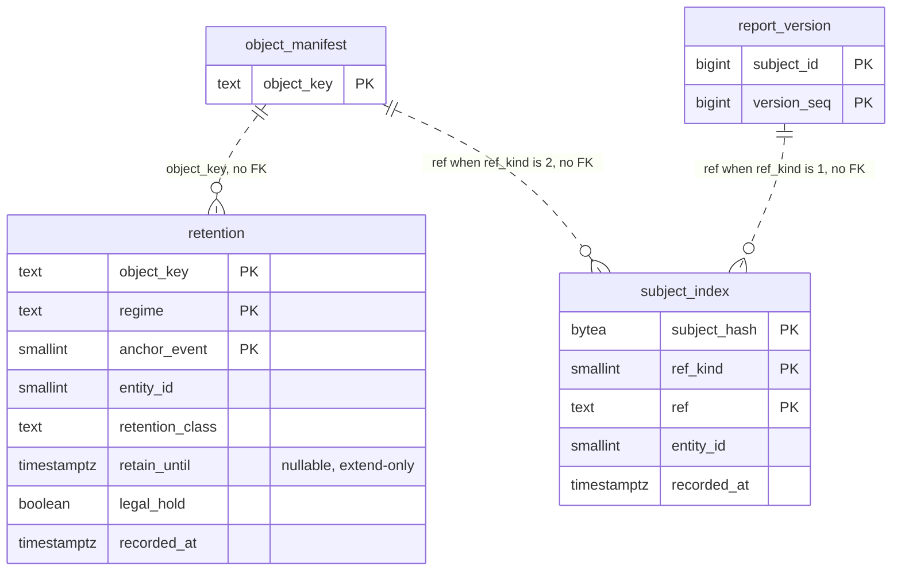

# P3c1 V003 schema design (for owner review)

**Status: DRAFT for owner review. Nothing in this document is approved.** The approval, if the owner gives it, is recorded only as the line `approved-schema-p3c-sha256:` in `docs/evidence/p3c-decisions.md` (AP-7), with the output of `sed 's/\r$//' docs/ledger/schema-design-p3c.md | sha256sum`, after the owner has answered the Decision sheet. Until then no SQL file exists and task T11 (migration V003) does not start. If an answer differs from a recommendation, this text is changed to say so before the hash is taken. Written 2026-10-26 by the T2 implementer from the plan P3c1 (`docs/superpowers/plans/2026-10-26-p3c-keys-manifests.md` at commit `603f8a3`: assumptions A3, A8, A9, A10 and A12, decisions D-K1, D-K4, D-K5, D-K6 and D-K8, the sections "Port and model changes" and "Scope check", and tasks T2, T8, T10, T11 and T12), the approved P3a document `docs/ledger/schema-design.md` and the approved P3b document `docs/ledger/schema-design-p3b.md` (neither is edited), the SP-L report (`docs/spikes/SP-L.md`, the evidence volume model, as the P3b document uses it) and the specification (5.6, 11.1, 11.6). No PostgreSQL server exists on the machine where this was written, so no statement in this document has been executed; the first run on a server is the checkpoint CP-1 after T11 and T12.

**How to read it.** Read the Decision sheet (next section) first and answer it. Everything after the sheet is approved by exception: name the table or constraint you want changed. The sections follow the order of the P3b document. The document is short because V003 adds two tables, two indexes, one function and one trigger and changes nothing that exists.

**Four facts to hold in mind while reading.**

1. **D1 is not a question.** The owner approved the plan (AP-1) with assumption A3: the wrapped data key travels inside each encrypted object, so V003 has no key tables. D1 is shown so that the absence is visible. An answer against D1 stops T3 to T6 and re-opens the envelope format D-K1; it is not a change of this document alone.
2. **This document changes one thing you already approved.** The approved P3a document (section 8) classified the data-subject index as "yes, encrypted". Decision D4 stores keyed hashes and references only and encrypts nothing at rest, and gives the reason. D2 to D3 and D5 to D7 are new. Section 7 lists every statement of the approved documents that this one supersedes.
3. **Every number is an estimate with its derivation, none is measured** (section 6). The volume is the SP-L planning model (the figures the P3b document uses), not an observation, and the byte counts are a bottom-up count of PostgreSQL row and index layout written from recollection of how PostgreSQL stores rows, good to about plus or minus 40 percent, as in the P3a and P3b documents. Units: MB is 10^6 bytes, GB 10^9, TB 10^12; 5 years are 1,826 days, as in the P3a document. The size of `subject_index` is not estimated at all (section 6.5).
4. **V003 adds two tables and nothing else that exists changes.** No existing table, column, constraint or sequence changes. `V001__core.sql`, `V002__evidence_manifest.sql`, their recorded checksums and the two approved documents stay as they are. V003 uses no function of V001 (it adds its own), so it does not depend on `reject_modification()`.

## Decision sheet

Costs to change later, as in the P3a document: **low** = one new migration, nothing rewritten; **medium** = a migration plus moving or back-filling data, planned work; **high** = rewriting the largest table, or the old form is lost. Disk figures are for the three encrypted classes of the SP-L model (140,000 `retention` rows a day) and for 5 years of 1,826 days without purging; they are estimates (section 6).

| # | The question in plain words | My recommendation | Disk (a day / 5 years) | Cost to change later |
|---|---|---|---|---|
| D1 | **Settled by AP-1 and A3, shown, not offered.** Does the database hold the data keys (key tables)? | **No key tables.** The wrapped key is inside each envelope; the tier is readable with the KEKs alone (I10, spec 11.5 B.0). Shredding is the destruction of a KEK cohort in the KMS, not a row delete. | None. | Medium. The envelope has a version byte; a deletable key table needs a new envelope version, a table and a migration. An answer against D1 stops T3 to T6. |
| D2 | **Extend-only retention.** Does the database itself refuse to shorten a `retain_until`, to turn a date into NULL, or to change the key, regime, anchor or class of a row? | **Yes, option (a):** a row trigger `retention_extend_only` (BEFORE UPDATE). `legal_hold` and `recorded_at` stay updatable. No DELETE trigger. Option (b) has no trigger and leaves extend-only to the adapter. | A function call per UPDATE of a row; nothing on INSERT. No disk. | Low (add or drop a trigger and its function) |
| D3 | **Regime as text.** Is the regime stored as the text of its id (`mifir.eu.rts22`) or as the smallint of the `regime` dictionary table of V001? | **Text, `COLLATE "C"`** (EF21: a dictionary row would be created inside the seal unit and make concurrent seals wait; the regime id is not known to the ledger before the first decision). | About 4 MB a day more than a smallint (section 6.4); about 7 GB in 5 years. | Medium (changing a primary-key column type rewrites the table and its index) |
| D4 | **Data-subject index.** Is the index of keyed hashes and references stored in plain columns, deletable by row, with nothing encrypted at rest? | **Yes.** A keyed hash (HMAC-SHA-256 under a KMS key) is not reversible without the key, and it must be comparable by equality, so it cannot be encrypted at rest. Rows are deleted with the artifact. This replaces "yes, encrypted" of the P3a table. | Not estimated (section 6.5). | Low while the table is empty; medium after (a re-index under a new scheme) |
| D5 | **Expiry index.** Does `retention` get a partial index that lists due, unheld rows in order of date? | **Yes:** `retention_expiry_idx` on `(retain_until, object_key)` where the date is known and the row is not held. The expiry job of P4 needs it; creating it later on hundreds of millions of rows is a long build. | About 17.5 MB a day, 32 GB in 5 years (part of the totals). | Low now (empty table), a long build later |
| D6 | **Byte-order collation of the key columns.** Are `object_key`, `regime` and `ref` compared byte by byte (`COLLATE "C"`)? | **Yes**, as D4 of V002: the ports page and range-read these keys in the order of the evidence store (UTF-16 code units, which for the key alphabet is byte order). | None. | Medium (rewrites the table and its index under an exclusive lock) |
| D7 | **No purge in release 1.** Does anything built in P3c1 delete a `retention` or `subject_index` row? | **No.** The expiry and destruction job is P4 (deferred by OI-10); it deletes the rows with their object (`removeSubjectRefs` for the index). Nothing in this slice deletes. | The table grows about 23 GB a year (about 115 GB in 5 years) for the three classes; up to 83 GB a year if every evidence object is registered. | Low (a purge is a later design; the tables have no DELETE trigger, so it needs no bypass) |

Also asked at this stop (OI-7): how many minutes did reading and deciding this take, for the effort record?

The decisions are written out with their options in section 5.

## 1. Entity-relationship diagram

V001 and V002 have 19 tables (V001 approved document, section 1, and the V002 document, not redrawn). V003 adds a 20th and a 21st, `retention` and `subject_index`. The dotted lines are references that are resolved by the adapter and have no foreign key (section 4).



No sequence and no identity column is added: the keys are the evidence-store key of the object, the regime id and the code of the anchor, which the caller already holds, and the keyed hash with the reference. No table holds a key, a wrapped key or a KEK id (D1).

## 2. The tables

Format of the two machine-read blocks: the same as in section 2 of the approved documents and read by the same reader (task T11 reads them against the statements of `V003__retention_and_subject_index.sql`). Each block is one Markdown table; the first cell of every row is the name in backticks, in the constraint block the second cell too, and the third cell (the kind) is plain text; the first row after the header separator is the first entry. Anything outside the blocks is prose. The words in the retention column are those of the approved P3a document: **PERMANENT** = kept as long as the record it describes must be kept.

Both tables carry `entity_id smallint NOT NULL DEFAULT 1` like every table of V001 except the four named in the approved P3a document (D-S12; one reporting entity in release 1; row-level security is reserved, RSV-1). Their instant columns `retain_until` and `recorded_at` are `timestamptz` bound from the injected `Clock` or the claim, with no SQL default (D-S13), so the test `noTimeOrRandomnessDefaultsInTheMigrations` stays true for V003 (the function below holds none of the words that test looks for).

The columns of `retention` are those of the specification (11.6, `retention(artifact, regime, anchor_event, retain_until, legal_hold)`; `artifact` is the column `object_key`) plus `entity_id`, `retention_class` (the class name of OI-6, for example `sealed`) and `recorded_at` (the ledger clock when the row was first written).

<!-- schema:tables -->
| Table | Primary key | Foreign keys | Unique and partial-unique constraints | Partition key | Rows a day (50M-record day) | Retention class | PII | entity_id | Notes |
|---|---|---|---|---|---|---|---|---|---|
| `retention` | `retention_pk` (object_key, regime, anchor_event) | none (`object_key` names an evidence object, usually one with an `object_manifest` row, without a foreign key, section 4) | none besides the primary key | none (unpartitioned) | about 140,000 for the three encrypted classes of the SP-L model (100,000 sealed files, 10,000 landing objects, 30,000 enrichment responses, one regime and one OBJECT_WRITTEN row each); up to 464,000 if every evidence object is registered; EMIR, SFTR and CFTC termination rows add rows that are not estimated | PERMANENT (a row is kept as long as its object; the expiry job of P4 deletes it with the object) | no (evidence keys, class names, dates and flags; the wiring rule that no key under an encrypted namespace holds a natural-person identifier is in the plan, Scope check) | yes | Columns `object_key text COLLATE "C"` (1 to 512 characters), `regime text COLLATE "C"` (the regime id, at most 128 characters), `anchor_event smallint` (OBJECT_WRITTEN 1, TERMINATION 2), `entity_id`, `retention_class text` (1 to 100 characters of `A-Z a-z 0-9 . _ -`), `retain_until timestamptz` NULL while the anchor is unknown, `legal_hold boolean`, `recorded_at timestamptz`. `retain_until` is extend-only (trigger `retention_extend_only`, D2; the adapter writes `GREATEST`, which ignores NULL). One `legal_hold` flag per artifact: a new row of a held artifact is held (the adapter inserts it held). Partial index `retention_expiry_idx` (D5). Epoch markers (`control/`) never get a row. Not updated by design apart from `retain_until`, `legal_hold` and `recorded_at` (the last is only ever set on insert). |
| `subject_index` | `subject_index_pk` (subject_hash, ref_kind, ref) | none (`ref` names a report version or an evidence object, by `ref_kind`, without a foreign key, section 4) | none besides the primary key | none (unpartitioned) | not estimated (section 6.5) | PERMANENT (a row is kept as long as the artifact it names; `removeSubjectRefs` deletes it with the artifact) | pseudonymous (a keyed hash of an identifier of a natural person; section 5, D4); `ref` holds no identifier | yes | Columns `subject_hash bytea` (32 bytes, HMAC-SHA-256), `ref_kind smallint` (REPORT_VERSION 1, EVIDENCE_OBJECT 2), `ref text COLLATE "C"` (1 to 512 characters, the key text rules of the ports), `entity_id`, `recorded_at timestamptz`. Rows are inserted idempotently and deleted by (ref_kind, ref). Index `subject_index_ref_idx` (ref_kind, ref) serves that delete. The value never reaches the table, only its keyed hash. |
<!-- /schema:tables -->

Rows enter `retention` through `recordRetention` (port `RetentionLedger`, tasks T8 and T11), all or nothing in one unit, claims sorted by (object_key, regime, anchor_event) before the first statement. The statement is a JDBC `INSERT ... ON CONFLICT ON CONSTRAINT retention_pk DO UPDATE SET retain_until = GREATEST(retention.retain_until, EXCLUDED.retain_until)` (class and `recorded_at` stay; a value replaces an empty date and an empty date never replaces a value). The trigger of D2 lets this statement through: the date it writes is never earlier and never NULL where the old one was a value. `setRetentionHold` updates `legal_hold` of every row of one artifact, which the trigger also lets through. `expiredRetention` lists due rows by `retain_until <= ?` and not held, outside `control/`, ordered by (retain_until, object_key, regime, anchor_event). Rows enter `subject_index` through `indexSubjects` with `ON CONFLICT ON CONSTRAINT subject_index_pk DO NOTHING` and leave through `DELETE ... WHERE ref_kind = ? AND ref = ?`. The text of the statements is T11 and T12; this document is the schema they run on.

<!-- schema:constraints -->
| Constraint, index or trigger | Table | Kind |
|---|---|---|
| `retention_pk` | `retention` | PK |
| `retention_expiry_idx` | `retention` | INDEX |
| `retention_extend_only` | `retention` | TRIGGER |
| `subject_index_pk` | `subject_index` | PK |
| `subject_index_hash_check` | `subject_index` | CHECK |
| `subject_index_ref_idx` | `subject_index` | INDEX |
<!-- /schema:constraints -->

Notes on the list. (a) `subject_index_hash_check` is `CHECK (octet_length(subject_hash) = 32)`. It is structural: it fixes no set of codes. `anchor_event` and `ref_kind` stay unchecked for the reason of note (g) of the approved P3a document and note (a) of the V002 document: a new code of a later slice would otherwise be a migration. `retention` has no CHECK constraint at all (the port bounds the key, the class and the date range; section 5, D6 and the columns table). (b) `retention_expiry_idx` is a partial index, `ON retention (retain_until, object_key) WHERE retain_until IS NOT NULL AND NOT legal_hold`; it is not unique, so the reader of the constraint block calls it INDEX. (c) `retention_extend_only` is a `BEFORE UPDATE ... FOR EACH ROW` trigger on the function `retention_extend_only()`, which is created in the same script and raises with SQLSTATE `55000` as `reject_modification()` of V001 does. The function and the trigger have the same name in two different namespaces, which PostgreSQL allows; the reader of the constraint block lists only the trigger. If D2 is answered with option (b), the function, the trigger and the row `retention_extend_only` are removed from the script and from the block and the script has four statements. (d) Every constraint and index is named explicitly; adapter code maps a violation to its meaning by SQLState and constraint name, never by message text. (e) The tables have no foreign key, so no lock is taken on another table by an insert. (f) DDL (drop of a table) and `TRUNCATE` are not blocked by a row trigger, as in V001 (approved document, note d).

**Proposed text of the migration (a reading aid, not a file; T11 creates the script only after the approval, with exactly these statements):**

```sql
CREATE TABLE retention (
  object_key text COLLATE "C" NOT NULL, regime text COLLATE "C" NOT NULL, anchor_event smallint NOT NULL,
  entity_id smallint NOT NULL DEFAULT 1, retention_class text NOT NULL, retain_until timestamptz,
  legal_hold boolean NOT NULL, recorded_at timestamptz NOT NULL,
  CONSTRAINT retention_pk PRIMARY KEY (object_key, regime, anchor_event));
CREATE INDEX retention_expiry_idx ON retention (retain_until, object_key) WHERE retain_until IS NOT NULL AND NOT legal_hold;
CREATE TABLE subject_index (
  subject_hash bytea NOT NULL, ref_kind smallint NOT NULL, ref text COLLATE "C" NOT NULL,
  entity_id smallint NOT NULL DEFAULT 1, recorded_at timestamptz NOT NULL,
  CONSTRAINT subject_index_pk PRIMARY KEY (subject_hash, ref_kind, ref),
  CONSTRAINT subject_index_hash_check CHECK (octet_length(subject_hash) = 32));
CREATE INDEX subject_index_ref_idx ON subject_index (ref_kind, ref);
CREATE FUNCTION retention_extend_only() RETURNS trigger LANGUAGE plpgsql AS $$
BEGIN
  IF NEW.object_key IS DISTINCT FROM OLD.object_key
     OR NEW.regime IS DISTINCT FROM OLD.regime
     OR NEW.anchor_event IS DISTINCT FROM OLD.anchor_event
     OR NEW.retention_class IS DISTINCT FROM OLD.retention_class
     OR (OLD.retain_until IS NOT NULL AND (NEW.retain_until IS NULL OR NEW.retain_until < OLD.retain_until)) THEN
    RAISE EXCEPTION USING ERRCODE = '55000', MESSAGE = 'retention rows are extend-only';
  END IF;
  RETURN NEW;
END;
$$;
CREATE TRIGGER retention_extend_only BEFORE UPDATE ON retention FOR EACH ROW EXECUTE FUNCTION retention_extend_only();
```

Six statements with D2 option (a), four without it (the last two go). The text obeys the rules of the script splitter (`ScriptCatalogue`): no line inside the function body starts with two hyphens, the pair of dollar signs appears only around the function body (once at the opening line, once at the closing line `$$;`), and every other statement ends at a line whose last character is a semicolon. V003 has a comment header like V002; the header is not part of the statements. The trigger fires for every UPDATE of a row, including the `GREATEST` upsert that finds a row and the hold update; it does not fire for INSERT and DELETE.

### Columns (reading aid; the machine-read blocks above are the contract)

| Table | Columns (type; all NOT NULL unless marked NULL) |
|---|---|
| `retention` | object_key text COLLATE "C" (an evidence key, for example `sealed/ab/` and 64 hex digits); regime text COLLATE "C" (a regime id, lower-case dotted, at most 128 characters); anchor_event smallint (OBJECT_WRITTEN 1, TERMINATION 2); entity_id smallint DEFAULT 1; retention_class text (a class name, 1 to 100 characters, no COLLATE: it is only compared for equality); retain_until timestamptz NULL (whole microseconds, year 0000 to 9999, which the port enforces); legal_hold boolean; recorded_at timestamptz |
| `subject_index` | subject_hash bytea (32); ref_kind smallint (REPORT_VERSION 1, EVIDENCE_OBJECT 2); ref text COLLATE "C" (1 to 512 characters); entity_id smallint DEFAULT 1; recorded_at timestamptz |

## 3. Constraint summary by purpose

| Purpose (spec) | Mechanism |
|---|---|
| One retention row per artifact, regime and anchor event (spec 11.6) | `retention_pk`; a second claim for the same triple updates the row (the date can only grow) |
| Retain-until dates are recorded as fixed and extend-only (spec 11.6) | the adapter's `GREATEST`, and as a second defence `retention_extend_only` (D2); on P-SEALED the verifier compares the store with the same row |
| An open anchor (EMIR termination) is a NULL date that takes a value once and never returns to NULL | nullable `retain_until`; `GREATEST` and the trigger |
| Legal hold is separate from the date | the column `legal_hold`, updatable; the trigger does not look at it |
| The expiry job finds due, unheld rows in date order | `retention_expiry_idx` (D5); the query also excludes `control/` keys |
| Keys and pages come back in the order of the evidence store | `COLLATE "C"` on `object_key`, `regime` and `ref` (D6) |
| One index row per (hash, kind, reference); a repeat is a no-op | `subject_index_pk`, `ON CONFLICT ... DO NOTHING` |
| A stored hash has the length of an HMAC-SHA-256 | `subject_index_hash_check` |
| The rows of one reference can be deleted without a scan | `subject_index_ref_idx` (the reader is `removeSubjectRefs`) |
| No key material in the database (spec 11.5 B.0, I10) | no key table (D1); an envelope carries its wrapped key |

## 4. Why there are no foreign keys, and no key tables

1. **No key tables (D1).** The wrapped data key, the KEK id and the nonce are inside each envelope (D-K1). A key table would be a second record that must be backed up and restored with the evidence tier, and a restore from the evidence tier alone (I10, "the database is restored from backup and made current from the evidence tier") would have to rebuild it. With the key inside the object, the tier is readable with the KEKs alone. The price is that a data key cannot be deleted on its own: the unit of destruction is the KEK cohort, a UTC year (Departure (2) of the plan). A deletable key table would reverse this; it is not offered.
2. **`retention.object_key` has no foreign key to `object_manifest`.** The retention row of a sealed object is written right after the sealed put and before the SENDING unit that writes the manifest row (D-K4, the seal hook), so the manifest row may not exist yet, and a row written for a seal that never commits only over-retains. Landing and enrichment objects get their rows from writers of later slices. After a restore the evidence tier is ahead of the database (the argument of D3 of the V002 document). A foreign key would refuse the registration exactly when it is needed.
3. **`subject_index.ref` has no foreign key.** `ref_kind` decides what `ref` names (a report version or an evidence object), so one column cannot reference two tables, and the object may not have a manifest row. When an artifact reaches the end of its retention the job of P4 destroys the KEK, then deletes the index rows with `removeSubjectRefs`, which is idempotent; a foreign key would make the order of deletion a constraint and a crash between the two steps an error.
4. **Both tables are unpartitioned.** The key of `retention` is the evidence key, which carries no date, and the arbiter of the upsert is the primary key alone (`ON CONFLICT ON CONSTRAINT retention_pk`); a unique key of a table cut by day would have to contain the day and could not refuse the same artifact arriving on another day (the argument of D1 of the V002 document). At 51 million rows a year for the three classes (section 6.1) this needs no cut.

**Shape of the unit.** No dictionary row is created in any unit: `regime` is text (D3), and `anchor_event` and `ref_kind` are smallint codes pinned in `Codes`, not rows of a lookup table, so nothing is created that a concurrent seal would wait for (EF21, the finding SQL-1 of the P3a final review). The retention row is written by a `RetentionRegistrar` call outside the SENDING unit, in its own unit of the ledger. Two units that claim the same (artifact, regime, anchor) at the same moment serialise on the key and the second waits for the first to finish (both writes are `GREATEST`, so the order does not change the result); the trigger adds no lock. These statements are reasoning from how PostgreSQL behaves, not measurements.

**Retention and personal data.** `retention` rows hold evidence keys, class names, dates and flags, no personal data. The rule that no evidence key under an encrypted namespace holds a natural-person identifier is a wiring rule (plan, Scope check; P5 and P7a key small or low-entropy landing and enrichment objects by a surrogate id); this table cannot check it. `subject_index` holds the keyed hash of an identifier of a natural person (a trader named in the investment-decision or execution-within-firm fields, spec 11.6) and the reference of the artifact that names that person. The hash is not reversible without the `INDEX_HMAC` key, but anybody who holds the key and a candidate identifier can compute the hash and confirm it, and so the hash is pseudonymous data, not anonymous data [R: GDPR recital 26 and the usual reading of pseudonymisation; this is for the DPO, who is asked under OI-5]. The key is held in the KMS and is not in the database.

## 5. Decisions for the owner (detail)

Each decision gives the options, the recommendation, the disk effect and the cost to reverse. Sizes: section 6.

**D1 (settled by AP-1 and A3; shown, not offered): no key tables.** Options: (a) none, the wrapped key in the envelope (the plan); (b) a table of wrapped data keys, one row per object or per day and KEK, deletable by row, so that a single object can be shredded. Reason for (a): section 4, point 1. In (b) the envelope would carry only a key id, the tier would no longer be readable with the KEKs alone, and a restore from the evidence tier could not rebuild the keys. If the owner wants (b), the answer is a stop for T3 to T6 and re-opens D-K1 of the plan (the envelope format), not an edit of this document. Disk: none in (a). Reverse: medium (a new envelope version and a table; objects already written keep their form).

**D2: extend-only enforcement.** Options: (a) trigger `retention_extend_only` (recommended); (b) no trigger, the adapter writes `GREATEST` and the application never shortens. The trigger raises (SQLSTATE `55000`) when the object key, the regime, the anchor event or the class of an updated row differs from the old row, or when a non-NULL `retain_until` becomes NULL or earlier; it lets `legal_hold` and `recorded_at` change, and it lets a NULL date take a value. Reason: a retain-until that is shorter in the ledger than in the store would make the expiry list name an object too early; on P-WORM the store refuses to shorten, on P-SEALED the only detection is `verify` (spec 11.6), which compares the store with this very row. An UPDATE by an operator's mistake or a defect would shorten the row silently; the trigger costs one function call per UPDATE of a row and nothing on INSERT. There is no DELETE trigger: the expiry job of P4 deletes a row together with its object and a trigger would force it to go around the guard. Limits: `TRUNCATE`, `DROP TABLE` and other DDL are not blocked; a superuser or the table owner can disable the trigger; the application role needs no `TRUNCATE` or `DELETE` privilege until P4 (a deployment grant, as in P3a); the trigger does not guard `entity_id`, which is 1 in release 1 (open question 2). Under (b) a shortened row is still found by `RetentionVerifier` where the store disagrees. Disk: none. Reverse: low.

**D3: the regime as text.** Options: (a) `regime text COLLATE "C"` (recommended, the reading of the plan and of EF21); (b) `regime_id smallint` referencing the `regime` dictionary of V001 (where the decision rows keep it). Reason: the dictionary row is created on first use of a regime, and doing that inside a seal or registration unit is the pattern SQL-1 found in P3a (a row created in a long unit makes concurrent units wait); the ports pass `Regime` as its id text and the verifier needs the text. The cost of text is the id in every row and in the primary-key index entry (about 16 B each for a 15-character id such as `mifir.eu.rts22`, against 2 B each for a smallint: about 28 B more a row, about 4 MB a day for 140,000 rows, 7 GB in 5 years; section 6.4). Reverse: medium: changing the type of a primary-key column rewrites the table and its index, and the adapter must resolve ids.

**D4: the data-subject index is keyed hashes and references, nothing encrypted at rest.** Options: (a) plain columns holding the HMAC and the reference (recommended); (b) the P3a classification "yes, encrypted", for example the hash column encrypted with a deterministic scheme or the whole table in an encrypted tablespace. Reason: the index exists so that an access request for one person can find every artifact that names them, which is an equality lookup on the hash; a hash that is encrypted with a random nonce cannot be looked up, and a deterministic encryption of a hash adds a second key and no protection the HMAC key does not already give, because the hash is useless without the `INDEX_HMAC` key to compute candidates. The value of the identifier never reaches the table. What the table does disclose to a reader of the database without the key is the number of artifacts that name one (pseudonymous) person; the owner and the DPO (OI-5) should read that as the accepted residue. Rows are deleted with the artifact. Disk: not estimated. Reverse: low while the table is empty, medium after (a re-index under a new scheme, which a key rotation of `INDEX_HMAC` needs in any case, plan Scope check).

**D5: the partial expiry index.** Options: (a) `retention_expiry_idx` on `(retain_until, object_key)` where `retain_until IS NOT NULL AND NOT legal_hold` (recommended); (b) no index; the expiry job scans. Reason: the job lists due rows in order of date and pages through them; without the index each page is a scan of up to hundreds of millions of rows. The predicate leaves out open anchors and held rows, which the job never lists, so those rows cost no index entry. The index covers the first two columns of the four-column order of `expiredRetention`; rows of one object under several regimes tie on the first two columns and PostgreSQL orders those few itself [R]; the result does not depend on the index, only the speed (open question 3). A `legal_hold` update moves a row in or out of the index (it is not a HOT update, and neither is the `GREATEST` upsert, since `retain_until` is indexed). Disk: section 6.4. Reverse: low on an empty table; creating it later on hundreds of millions of rows is a long build.

**D6: byte-order collation.** Options: (a) `COLLATE "C"` on `object_key`, `regime` and `ref` (recommended); (b) the database default collation. Reason: the same as D4 of the V002 document. The evidence store lists keys in UTF-16 code-unit order (Javadoc of `EvidenceStore.list`), which for the ASCII key alphabet is byte order. `retentionRows` pages with "artifacts after this one" in the order (artifact, regime, anchor) and reads a prefix as a range; `subjectRefs` pages with `(ref_kind, ref) > (?, ?)`; both are correct only when the columns compare byte by byte, and under a linguistic collation they would return other rows than the in-memory adapter, a wrong result and not only a slower one. `retention_class` has no clause because it is compared only for equality. Disk: none. Reverse: medium. The plan names no test that fails when the clause is missing (open question 4).

**D7: no purge in release 1.** Options: (a) build no deletion in P3c1 (recommended); (b) fix a horizon now. Facts: `retention` grows about 51 million rows and about 23 GB a year for the three classes (255.6 million rows and 115 GB after 5 years), and up to 169 million rows and 83 GB a year if every evidence object is registered; `subject_index` is not estimated. The evidence tier is the legal record and is retained for at least 5 years (spec 11.6); a row removed while its object still exists would hide that object from the expiry list and from `RetentionVerifier`, so a purge has to follow the retention of the object, which is P4. The tables carry no DELETE trigger, so the job of P4 needs no bypass. Reverse: low, because nothing is built now that closes a door.

## 6. Sizing

All figures are estimates; the method and its error band are in the third of the four facts at the top. **Nothing here was measured on a server.** The first measurement is a read of `pg_total_relation_size('retention')` at CP-1, if the checkpoint run is given a workload; the plan has no task that fills the table with a realistic volume (open question 5).

### 6.1 Rows a day

The SP-L evidence volume model, as the V002 document section 6.1 uses it: 100,000 sealed files, 324,000 journal objects, 10,000 landing objects, 30,000 enrichment responses: 464,000 evidence objects a day. The three classes that P3c1 encrypts (assumption A5, OI-5) are `sealed/`, `landing/` and `enrichment/`; journal objects get no `retention` row in P3c1 (assumption A8). Derivation: 100,000 + 10,000 + 30,000 = **140,000 rows a day** for the three classes (one regime and one OBJECT_WRITTEN row per object; a resend of the same sealed bytes, 1 percent of files in the model, updates the existing row and adds none). The upper bound is a row for every one of the 464,000 objects. Per year: 140,000 x 365 = 51.1 million rows (464,000 x 365 = 169.4 million); over 1,826 days 255.6 million (847.3 million). Rates: 140,000 / 86,400 s = 1.6 rows a second; 464,000 / 86,400 s = 5.4 a second; 464,000 / 14,400 s (the 4-hour burst window of the model) = 32.2 a second. Rows that would be added by an artifact reported under a second regime, and the TERMINATION rows of open anchors, are not estimated: the model has no figure for either.

### 6.2 Key length

The key length decides most of the row. Rendered lengths are those of the V002 document section 6.2: a sealed file key is 74 characters (`sealed/`, 2 hex digits, `/`, 64 hex digits); the landing and enrichment key rules belong to P7a and P5 and are assumed to be 100 characters. Weighted mean of the three classes: (100,000 x 74 + 10,000 x 100 + 30,000 x 100) / 140,000 = 11,400,000 / 140,000 = 81.4, taken as 82 characters. For all 464,000 objects the V002 document gives 96. The regime id is taken as 15 characters (`mifir.eu.rts22` has 14; the model bound is 128). The class name is taken as 7 characters (`sealed` 6, `landing` 7, `enrichment` 10: mean 6.9). The longest possible key, 512 characters, plus the longest regime, 128, is far below the size limit of a B-tree entry (about 2.7 kB, from recollection) and is a test case (`aKeyOf512CharactersIsStored`).

### 6.3 Row and index entries

Method as in section 6.3 of the V002 document: PostgreSQL layout from recollection; short variable-length values carry a 1-byte header and no alignment; `smallint` aligns to 2 bytes and `timestamptz` to 8.

- **Heap row, three classes.** Header 24 B (23 B plus the 1-byte null bitmap, as `retain_until` may be NULL). Data: key 83 B (82 characters and the header), regime 16 B (offset 99), 1 B padding, `anchor_event` 2 (offset 102), `entity_id` 2 (104), `retention_class` 8 B (112), `retain_until` 8 (offset 112 is already aligned, so 120), `legal_hold` 1 (121), 7 B padding, `recorded_at` 8 (136): 136 B of data. Row 160 B, plus the 4 B line pointer, 164 B, plus 0.3 percent for page headers: 164.5 B, taken as **165 B**. All 464,000 objects (key 97 B): offsets 97, 113, pad to 114, 116, 118, class 126, `retain_until` at 128 to 136, `legal_hold` 137, `recorded_at` at 144 to 152: 152 B of data, row 176 B, 180 B with the pointer, 180.5 B, taken as **181 B**. A row with a NULL `retain_until` is 8 B shorter.
- **Primary-key index entry.** Three classes: 8 B entry header, key 83 B, regime 16 B (99), 1 B padding, `anchor_event` 2 B: 110 B, rounded to 112 B, plus the 4 B line pointer: 116 B. Leaf pages are about 90 percent full where keys arrive in order and about 69 percent where they arrive at random; 71 percent of these rows are sealed files whose keys are hashes (random) and 29 percent landing and enrichment keys that are assumed to rise: 0.71 x 0.69 + 0.29 x 0.90 = 0.75. 116 / 0.75 = 154.7 B, plus about 1.5 percent for the inner pages: 157 B, taken as **160 B**. All objects: 8 + 97 + 16 + 1 + 2 = 124 B, rounded to 128 B, plus 4 B: 132 B; at the 80 percent fill used in the V002 document: 165 B, plus 1.5 percent: 167.5 B, taken as **170 B**.
- **Expiry index entry (partial).** 8 B header, `retain_until` 8 B, key 83 B: 99 B, rounded to 104 B, plus 4 B: 108 B. The dates rise with time (the write instant plus a fixed period), so the pages fill to about 90 percent: 108 / 0.90 = 120 B, plus 1.5 percent: 121.8 B, taken as **125 B**. All objects: 8 + 8 + 97 = 113 B, 120 B, 124 B with the pointer, 137.8 B at 90 percent, 139.8 B, taken as **140 B**. Every row of P3c1 is in the index (all dates are known and no row is held); a held row or an open anchor is not.

### 6.4 Result

| Part | Per row, three classes | A day (140,000 rows) | A year (365 days) | 5 years (1,826 days) |
|---|---|---|---|---|
| Heap | 165 B | 23.1 MB | 8.4 GB | 42.2 GB |
| Primary-key index | 160 B | 22.4 MB | 8.2 GB | 40.9 GB |
| Expiry index | 125 B | 17.5 MB | 6.4 GB | 32.0 GB |
| **Total** | **450 B** | **63.0 MB** | **23.0 GB** | **115 GB** |

| Part | Per row, every object | A day (464,000 rows) | A year (365 days) | 5 years (1,826 days) |
|---|---|---|---|---|
| Heap | 181 B | 84.0 MB | 30.7 GB | 153.4 GB |
| Primary-key index | 170 B | 78.9 MB | 28.8 GB | 144.1 GB |
| Expiry index | 140 B | 65.0 MB | 23.7 GB | 118.7 GB |
| **Total** | **491 B** | **227.8 MB** | **83.2 GB** | **416 GB** |

Arithmetic: 140,000 x 450 B = 63.0 MB; 464,000 x 491 B = 227.8 MB; the other columns are the day figure x 365 and x 1,826; the parts are rounded, so their sums differ from the totals in the last digit. Against the ledger estimate of the approved P3a document (about 91 GB a day, 166 TB in 5 years) `retention` is 0.07 percent for the three classes and 0.25 percent if every object is registered (115 GB and 416 GB of 166,000 GB).

**Dead rows of a resend.** A resend of the same sealed bytes (1 percent of 100,000 files a day in the model, 1,000 rows) runs the upsert on an existing row, which writes a new row version [R: PostgreSQL writes one for every `DO UPDATE`] with new entries in both indexes: about 1,000 x 450 B = 0.45 MB a day that autovacuum has to reclaim. This is small and is not in the totals.

**The regime as text (D3).** A 15-character id costs about 16 B in the heap row and 16 B in the primary-key entry (14 B more in each place than the 2 B of a smallint): about 28 B a row, 3.9 MB a day for 140,000 rows, 1.4 GB a year, 7.2 GB in 5 years. The expiry index does not hold the regime.

**Against the plan's quick sketch.** The plan (task T2) gave "about 250 to 420 B a row with its two indexes". The sketch has no derivation; the count above starts from the key lengths and the layout and gives 450 B for the three classes and 491 B for every object, 7 and 17 percent above the top of the sketch. Both are inside the band of plus or minus 40 percent of each other. This document uses the count.

**Caveats.** The method is not calibrated against a measurement of these tables (the P3a document found its method high by about 15 percent for another table). The volume is a planning model, the landing and enrichment key lengths are assumed, and the regime id length is assumed.

### 6.5 `subject_index` is not estimated

One row is written per (data subject, report version or evidence object). In the release 1 universe of the specification defaults (D14: LEI clients, equities on EEA venues; spec 11.6 for the traders) the data subjects are the traders named in the investment-decision and execution-within-firm fields, and the number of distinct traders and of reports per trader is not known. Natural-person clients, which would add identifiers, are routed to UNDETERMINED in release 1 and so add none. The row has a fixed part (a 33 B hash value, two 2 B codes, an 8 B instant and the row header) and a reference of 1 to 512 characters that is indexed twice (once in the primary key behind the hash, once in `subject_index_ref_idx`), so a volume would need a figure for the reference length too. No figure is given here; the first measurement possible is the table filled by the first real source system, which P3c1 does not have.

## 7. What this document changes in the approved documents, and what it leaves alone

The approved documents `docs/ledger/schema-design.md` (P3a, V001) and `docs/ledger/schema-design-p3b.md` (P3b1, V002) are frozen by the digests recorded in `docs/ledger/decisions.md` and `docs/evidence/decisions.md`. They are not edited; where they say something different, this document, once approved, governs `retention` and `subject_index`.

| Statement in an approved document | Where | Position of V003 |
|---|---|---|
| `retention`, key tables, data-subject index: owner slice P3c, not partitioned, "key tables small; data-subject index grows with natural persons" | P3a document, section 8 | **Key tables do not exist (D1).** `retention` and `subject_index` are two tables, unpartitioned, as the row says; the growth of `subject_index` is not estimated (6.5). |
| The data-subject index: PII "yes, encrypted (P3c)" | P3a document, section 8 | **Superseded by D4.** Keyed hashes and references, nothing encrypted at rest; the table is pseudonymous data. |
| `timer` rows: owner slice P3c | P3a document, section 8 | Not in V003. The timer tables move with the split of P3c to P3c2 (V004). |
| "The 18 tables of V001"; "Only `decision` is partitioned among the 18 tables"; V002 makes 19 | P3a section 1 and 4; V002 document, section 1 | Still true of V001 and V002. With V003 the schema has 21 tables and still only `decision` is partitioned. |
| "No `CHECK` constraints other than the singleton check" | P3a document, section 2, note g | V001 is unchanged. V003 adds one structural CHECK (hash length 32), not a code-set check. |
| `reject_modification()` is the one trigger function of the insert-only tables | V001, V002 document | Unchanged and not used by V003. V003 adds a second trigger function, `retention_extend_only()`, for an update guard, not an insert-only guard. |

Left alone on purpose: every table of V001 and V002; the sequences; `reject_modification()`; the signed-manifest and `timer` tables (P3c2, V004); the class (b) counter and `delivery_event` (P3d); any role or GRANT (deployment design for the first runtime consumer); any key table (D1); the `report_version.body_encoding` column (V001 already has it and the code 1 for the encrypted form is an adapter change, T12, not a migration).

## 8. From each constraint to the test that proves it

Names are those of tasks T8, T10, T11 and T12 of the plan; none exists yet, they are built after this document is approved. The contract methods run on the in-memory adapter in every build and on PostgreSQL in the CI job `ledger-pg`; `PgConstraintsIT` methods expect the SQLState and the constraint name; the `*IT` classes skip locally and are verified at CP-1.

| Constraint or mechanism | Proving tests |
|---|---|
| `retention_pk` (one row per artifact, regime and anchor) | contract `RetentionLedgerContract#twoRegimesGiveTwoRowsAndOneRegimeTwiceGivesOne`; `PgConstraintsIT#aSecondRetentionRowForOneArtifactRegimeAnchorIsRejected` (23505 and `retention_pk`); the schema mutant `DROP CONSTRAINT retention_pk` (eighth entry of `SchemaMutants`, class `NoRetentionKeyPgLedgerContractIT`, caught by the contract method above, expected failure `MISSING_ARBITER`) |
| `retention_extend_only` (D2) | `PgConstraintsIT#aRetainUntilCannotBeShortenedBySql` and `#aNonNullRetainUntilCannotBecomeNull` (SQLSTATE 55000); the contract methods `aLaterRetainUntilReplacesAndAnEarlierOneIsIgnored`, `anOpenAnchorTakesAValueAndNeverBecomesOpenAgain` and `aHoldAppliesToEveryRowOfTheArtifact` on PostgreSQL show that the adapter's own statements pass the trigger. **Gap:** no named test changes the key, regime, anchor or class of a row by SQL; open question 2 |
| `retention_expiry_idx` (D5) | `SchemaDocMatchesMigrationsTest` checks that it exists by name and kind; contract `RetentionLedgerContract#expiredRetentionListsOnlyDueUnheldRowsInOrder`, `#walkingExpiredRetentionInPagesOfThreeReturnsEveryDueRowOnce` and `#expiredRetentionNeverListsControlKeys` for the result; `PgRetentionTest#theExpiryQueryExcludesControlKeysAndHeldRows` for the statement. **Gap:** no test shows that the index is used; open question 3 |
| Legal hold of an artifact; a new row of a held artifact is held | contract `RetentionLedgerContract#aHoldAppliesToEveryRowOfTheArtifact`, `#aClaimRecordedAfterAHoldIsHeldToo`, `#aHoldOnAnUnknownArtifactIsRefused`; `PgRetentionTest#theInsertTakesTheHoldOfTheArtifact` (statement shape; the behaviour is unobserved until CP-1) |
| Key order, prefix range and paging (D6) | `RetentionLedgerContract#rowsOfOneArtifactAreNeverSplitAcrossPages`; `SubjectIndexLedgerContract#walkingThePagesWithAfterReturnsAllRefsOnceAndInOrder`; `PgRetentionTest#claimsAreWrittenInKeyOrder`. **Gap:** as for V002, no named test fails if the clause is missing; open question 4 |
| Values the real store can hold | `RetentionLedgerContract#aKeyOf512CharactersIsStored`, `#aRetainUntilOutsideTheStorableRangeIsRefused`, `#anInvalidClassNameIsRefused`; `SubjectIndexLedgerContract#aRefOf512CharactersIsStored`, `#aRefWithAControlCharacterOrOver512IsRefused` (both adapters, KF16) |
| `subject_index_pk` (one row per hash, kind, reference) | contract `SubjectIndexLedgerContract#indexingTheSameEntryTwiceIsOneRow`; `PgConstraintsIT#aDuplicateSubjectIndexRowIsRejected` (`subject_index_pk`); the schema mutant `DROP CONSTRAINT subject_index_pk` (ninth entry, class `NoSubjectIndexKeyPgLedgerContractIT`) |
| `subject_index_hash_check` | `PgConstraintsIT#aSubjectIndexRowOfTheWrongHashLengthIsRejected` (23514 and the name) |
| `subject_index_ref_idx` | `SubjectIndexLedgerContract#removeDeletesOnlyTheNamedRef` and `#removeOfAnUnknownRefReturnsZero` for the result; `SchemaDocMatchesMigrationsTest` for its existence by name and kind |
| A call that writes nothing is not acknowledged as durable (D-K8, KF22) | `PgSubjectIndexTest#aCallThatInsertsOrDeletesNothingEndsWithTheBarrier`; `PgRetentionTest#recordingAnExistingClaimStillWrites` (the statement order is shown; the write itself is unobserved) |
| No foreign key, no cut by day, no key table (D1, section 4) | **Gap:** no named test fails if any is added; open question 4 |
| Statement text without values | `PgRetentionTest` and `PgSubjectIndexTest` (every value is a bind parameter, as `PgManifestTest#everyValueIsABindParameter`) |
| Document equals script; hash recorded | `SchemaDocMatchesMigrationsTest` (T11, one document per script): `tablesInEachDocumentEqualTheTablesOfItsScript`, `constraintsInEachDocumentEqualTheNamedObjectsOfItsScript`, `approvedDocumentDigestsAreRecorded`, `v003HoldsExactlyTheStatementsOfTheProposedTextOfItsDocument`, the checksum pin of V003; `MigratorIT` (V003 applies after V002) |
| V001 and V002, their documents and their pins untouched | the V001 and V002 halves of `approvedDocumentDigestsAreRecorded`, `v001ChecksumIsRecorded`, `v002ChecksumIsRecorded`, unchanged |

## 9. Owner checklist and open questions

**Owner checklist** (the agent ticks nothing; AP-7 is recorded by the owner):

- [ ] The Decision sheet is answered (D2 to D7; D1 is settled by AP-1 and A3).
- [ ] The ER diagram and the table block were read by exception (tables or constraints to change are named).
- [ ] The constraint list (section 2) and the extend-only rule (D2) were read.
- [ ] The reasons for the absence of key tables and of foreign keys (section 4) were read.
- [ ] The change to the P3a classification of the data-subject index (D4) was read, with the residue it states.
- [ ] The sizing (section 6) is accepted as estimates, and the absence of an estimate for `subject_index` (6.5) was read.
- [ ] The list of statements of the approved documents that this one supersedes (section 7) was read.
- [ ] The test mapping (section 8) was read, including the gaps.
- [ ] The reading and deciding minutes are given (OI-7).
- [ ] `approved-schema-p3c-sha256:` is recorded in `docs/evidence/p3c-decisions.md` (AP-7).

**Open questions** (each has a stated default; none blocks the stop):

1. `retention` has the columns `entity_id` and `retention_class` beyond the specification's list, and a `recorded_at` set from the ledger clock. Default: keep them; the class is needed by the verifier and the policy of gate G8, and `entity_id` follows D-S12.
2. The trigger of D2 does not guard `entity_id`. It is 1 in release 1 and an update of it by SQL is outside every code path of P3c1. Default: as proposed, because the plan names exactly four guarded columns; alternatively `entity_id` is added to the condition (one more `OR` line, no change of the table). Separately, the plan names no test that changes the key, regime, anchor or class of a row by SQL (gap in section 8). Default: if the owner confirms D2 (a), the controller adds `PgConstraintsIT#theKeyRegimeAnchorAndClassOfARowCannotBeChangedBySql` to T11 (no new class).
3. `retention_expiry_idx` covers (retain_until, object_key) while `expiredRetention` orders by (retain_until, object_key, regime, anchor_event) and pages by a four-column row comparison. Rows that tie on the first two columns are rare (one object under two regimes with the same date). Default: as proposed; correctness does not depend on the index. Alternative: index all four columns (about 25 B a row more). No plan task looks at a query plan; the question is open until a run on a server with rows.
4. Four requirements on the content of tests the plan names but does not describe, one for each decision that has no proving test: (a) for D6, the paging tests of both contracts use keys and references that differ in case and in `.`, `-`, `_`, `=`, `,`, `+` and digit against letter, so that a default collation fails them on PostgreSQL; (b) for D3, a regime id that differs from another only in case or in a dot is a different row on both adapters; (c) for D1 and section 4, no test is proposed (a test that asserts the absence of an object is not worth its upkeep); (d) the T11 test that a retention row may name an artifact that has no `object_manifest` row (`aRetentionRowMayNameAnArtifactThatHasNoManifestRow`). Default: the controller adds (a), (b) and (d) to T8, T10 and T11 (shared suites, no new class) if the owner confirms D3 and D6.
5. The size figures are not measured. A check at CP-1 that fills a scratch `retention` table with 1,000,000 rows of the key mix and reads `pg_total_relation_size` would replace section 6.4 with a measurement; the plan has no such task. Default: not done; the estimate stands until a realistic run.
6. OI-7: the owner's reading and deciding minutes are not yet provided.
