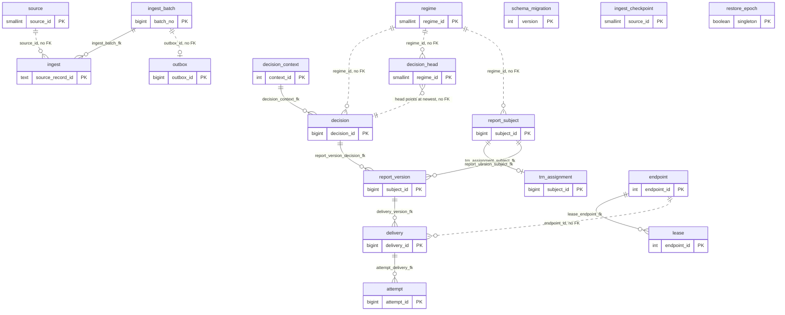

# P3a ledger schema design (for owner review)

**Status: DRAFT for owner review. Nothing in this document is approved.** The approval, if the owner gives it, is recorded only as the line `approved-schema-sha256:` in `docs/ledger/decisions.md` (AP-7), after the owner has answered the Decision sheet. Until then no SQL exists and no task that needs the schema (T10 onward) starts. Written 2026-10-18 by the T2 implementer from the plan (`docs/superpowers/plans/2026-10-17-p3a-ledger-core.md`, "Schema decisions for the T2 document", D-S1 to D-S17), the SP-L report (`docs/spikes/SP-L.md`), `docs/spikes/open-items.md` (D-1, D-6) and the specification (6.3, 10, 11.1, 17.4). The spike SQL (`spikes/spike-l/src/main/resources/ledger-sketch.sql`) was design reading only.

**How to read it.** Read the Decision sheet (next section) first and answer it. Everything after the sheet is approved by exception: name the table or constraint you want changed. The sections follow the contents list of task T2 (spec 11.1 "Placement and shape").

**Two facts to hold in mind while reading.**

1. **L-4 FAILED and is open.** In SP-L the memory-limited runs managed about 2,500 records a second against 3,470 offered, and the cause is not established (decision D-1, OI-3). The layouts below are chosen without its answer. The task T21 collects capacity information afterwards. Section 7 says why the layout proposed here is larger than the one SP-L tested, which makes the L-4 question more important, not less.
2. **The decision body does not meet the specification's size band in the encoding the plan proposes** (measured in this task, section 7). That is decision 5 on the sheet.

## Decision sheet

Costs to change later: **low** = one new migration script, nothing rewritten; **medium** = a migration plus moving or back-filling data, planned work; **high** = rewriting the largest table, or the old form is lost. Sizes are for the specification's day of 50 million records and for 5 years of 1,826 days without offloading old data. They are estimates, good to about plus or minus 40 percent, except the decision body (measured, section 7.2); the real tables are measured by T21. Words: a *piece* is one partition of the decisions table; the *head* is the one row per chain that points at its newest decision.

| # | The question in plain words | My recommendation | Disk (a day / 5 years) | Cost to change later |
|---|---|---|---|---|
| 1 | **OI-4, D-S1.** The decisions table is the biggest. Cut it into one piece per day or one per month? | **Daily.** Old days can then be dropped quickly, and a normal lookup touches one day (evidence in section 5). | The same data either way; 1,826 pieces after 5 years instead of 60. | Medium |
| 2 | **OI-5, D-S5.** Where do ingested source records go: one big table with one uniqueness rule, or SP-L's layout (a table cut by day plus a second table that only catches duplicates across days)? | **One big table.** One place decides every duplicate, and there is no second table to keep consistent. | About 14.6 GB / 26.7 TB. SP-L's layout measured 16.6 GB / 30.3 TB. | Medium |
| 3 | **Cross-source.** Two different sources deliver the same new trade at the same moment, and no rule in the specification decides it. Prevent it with an extra table, or accept a rare miss? | **Accept the risk and document it.** Both rows are stored; a check query would find the clash afterwards, but that query is not in the plan yet and costs one extra method in T19 (open question 9). | The extra table would add about 7.9 GB / 14.4 TB and one more write per new trade. Accepting the risk adds nothing. | Medium (the extra table would have to be back-filled) |
| 4 | **OI-6, D-S14.** How long do we keep rows in the tables that are not cut into pieces? | **Keep everything in release 1,** and decide on archiving before the first production quarter. | The whole ledger: about 91 GB a day / 166 TB, not counting the report bodies (unmeasured, perhaps +20 GB a day, section 7.1). The six uncut tables are about 51 GB a day / 93 TB of that, likewise without the report bodies. | High (such a table shrinks only by deleting rows or by a rewrite) |
| 5 | **OI-7, D-S6.** How is the explanation of a decision stored (rule path, citations, flags)? | **E2: the whole explanation, compressed and self-contained, for now.** It is about 800 B a row, outside the specification's band of 300 to 500 B; a variant that is 16 percent smaller (E2-slim) is described in section 5. | E2: **40 GB / 73 TB** for the decisions alone. E2-slim: 33.5 GB / 61 TB. SP-L's smaller form (E1) kept only the rule path. | Low for new rows (a version byte allows a smaller form later); written rows keep their form |
| 6 | **D-S17.** Which facts about a decision get their own column, so they can be searched without opening the explanation? | **Add four:** outcome, circuit-open flag, entity id, body-format code. The circuit flag is needed to list decisions made while a rule circuit was open (P2a open item 1); reason code and evaluation time stay in the body. | About 7 to 8 B a row: 0.35 to 0.4 GB / 0.6 to 0.7 TB. Against SP-L's sketch row (which had outcome) the extra is about 5 B. | High for the four (largest table); low for the two left out |
| 7 | **D-S4.** Two decisions with the same sequence number can land in different pieces, and no database index sees across pieces. Rely on the application's check against the head plus a check query, or add a database trigger that checks at commit? | **Application check plus check query, no trigger.** A trigger costs CPU on every insert while L-4 is open; only someone writing SQL around the application could create the duplicate. | None. | Low (add the trigger) |
| 8 | **D-S3.** Where is a re-delivered decision recognised as already stored? | **Inside each piece** (the key includes the date, and a re-delivery repeats its date). | None. The alternative needs a separate key table, at least 7.9 GB a day. | High |
| 9 | **D-S16.** Make decisions, report versions and TRN assignments refuse change after they are written? | **Yes.** A database trigger refuses UPDATE and DELETE on those three tables; dropping a whole old piece is still allowed. | None. | Low |
| 10 | **OI-8.** Micro-batch size for sizing. | No schema effect; decided at T21 with measurements. | None. | None |

Also asked at this stop (OI-15): how many minutes did reading and deciding this take, for the effort record?

The decisions are written out with their options in section 5.

## 1. Entity-relationship diagram

The 18 tables of V001 (D-S15). Solid lines are foreign keys that exist in the schema. Dotted lines are references that are resolved by the adapter and have no foreign key (reasons in section 2). Tables of later slices are listed in section 8 and are not drawn.

Sequences (all `CACHE 1`, D-S15): `decision_id_seq` (explicit, never GENERATED, so that `LIKE` creates no sequence per partition), `delivery_id_seq`, `attempt_id_seq`. Other generated keys (`regime_id`, `source_id`, `endpoint_id`, `context_id`, `batch_no`, `subject_id`, `outbox_id`) are `GENERATED ALWAYS AS IDENTITY`; `outbox_id` follows D-S11 (the plan's T10 text still names an `outbox_id_seq`, which the approved document supersedes).

## 2. The tables

Format of the two machine-read blocks (T11's test `SchemaDocMatchesMigrationsTest` reads them): each block is one Markdown table; the first cell of every row is the name in backticks; the first row after the header separator is the first entry. Anything outside the blocks is prose.

Words used in the retention column: **PERMANENT** = kept as long as the record it describes must be kept (no purge in release 1, D-S14); **OPERATIONAL** = working data, may be removed once complete (no purge is built in P3a); **DICTIONARY** = tiny lookup table; **SCHEMA** = migration history.

Every table except `schema_migration`, `regime`, `source` and `restore_epoch` carries `entity_id smallint NOT NULL DEFAULT 1` (D-S12; one reporting entity in release 1; row-level security is reserved, RSV-1). Every instant column is `timestamptz` bound from the injected `Clock` (no SQL default) except `schema_migration.applied_at` and the `date` columns (`as_at`, `decision_as_at`, `prev_as_at`; D-S13). Rows carry no personal data (spec 5.6) with one exception: **`report_version.body` is plain canonical JSON of the derived report until P3c** and so may hold natural-person data. Remedy: no real data may enter the PostgreSQL adapter until P3c replaces the plain form (`body_encoding` 0 is plain, 1 is reserved for the encrypted form); the flag is carried in the table below. No other column of any table is assumed to be personal data: LEIs, MICs, TRNs, event identities, digests and source record ids identify firms, venues and reports, not natural persons.

<!-- schema:tables -->
| Table | Primary key | Foreign keys | Unique and partial-unique constraints | Partition key | Rows a day (50M-record day) | Retention class | PII | entity_id | Notes |
|---|---|---|---|---|---|---|---|---|---|
| `schema_migration` | `schema_migration_pk` (version) | none | none | none | 0 (one row per script) | SCHEMA | no | no | `applied_at` is the only column with a SQL default. |
| `regime` | `regime_pk` (regime_id) | none | `regime_name_key` (regime) | none | 0 (a handful) | DICTIONARY | no | no | Resolve-or-insert by the adapter, once per distinct value per unit. |
| `source` | `source_pk` (source_id) | none | `source_name_key` (source) | none | 0 (a handful) | DICTIONARY | no | no | As `regime`. |
| `endpoint` | `endpoint_pk` (endpoint_id) | none | `endpoint_key` (entity_id, environment, submission_route, submitting_entity_lei, destination_authority) | none | 0 (a handful) | DICTIONARY | no | yes | The four-part `EndpointKey` of the port. |
| `decision_context` | `decision_context_pk` (context_id) | none | `decision_context_sha_key` (context_sha) | none | 10 to 10,000 (a context is shared by every record of a batch and across batches while the pins are unchanged) | PERMANENT | no | yes | `pack_digest`, `circuit_epoch`, `engine_build`, `body` are NULL in a stub row (D-S7). The only UPDATE is the stub fill. |
| `decision` | `decision_pk` (decision_id, as_at) | `decision_context_fk` (context_id to `decision_context`) | `decision_idem_key` (regime_id, event_identity, context_id, input_digest, as_at) | RANGE on `as_at` (date, one partition a UTC day) | 50,000,000 | PERMANENT | no | yes | Fixed columns of D-S17: `outcome smallint NOT NULL`, `circuit_open boolean NOT NULL DEFAULT false`, `entity_id`, `body_encoding smallint NOT NULL`, `body bytea NOT NULL`; links `prev_decision_id bigint` and `prev_as_at date` (NULL for the first decision of a chain); keys `regime_id`, `event_identity`, `decision_seq`, `context_id`, `input_digest`. Optional `reason_code` and `evaluated_at`: not proposed (decision 6). Insert-only (trigger `decision_immutable`). Partial index `decision_circuit_open_idx` (context_id, as_at) WHERE circuit_open. |
| `decision_head` | `decision_head_pk` (regime_id, event_identity) | none (a probe on the hot path while L-4 is open) | none | none (unpartitioned, spec 6.3) | 24,000,000 new chains (SP-L model) plus one update per correction | PERMANENT | no | yes | Columns `regime_id`, `event_identity`, `decision_seq`, `decision_id`, `as_at date`, `outcome smallint NOT NULL` (D-S17), `entity_id`. Advanced by compare-and-set in the unit that inserts the decision. |
| `ingest_batch` | `ingest_batch_pk` (batch_no) | none | `ingest_batch_id_key` (batch_id) | none | 10,000 (N = 5,000) | PERMANENT | no | yes | `batch_id` text lives only here; `source_id`, `result bytea` (non-NEW dispositions as (ordinal, code) pairs plus the entry count), `outbox_id` (no FK), `created_at`. `result` is updated by design. |
| `ingest` | `ingest_pk` (source_id, source_record_id, source_version) | `ingest_batch_fk` (batch_no to `ingest_batch`) | `ingest_event_version_key` (event_identity, source_id, source_version) | none | 50,000,000 (new versions only; STALE, no-op and conflict entries store nothing) | PERMANENT | no | yes | Columns `event_identity`, `content_hash bytea`, `batch_no bigint`, `landed_on timestamptz`. |
| `ingest_checkpoint` | `ingest_checkpoint_pk` (source_id, stream) | none | none | none | 0 growth (one row per stream; upserted per batch) | OPERATIONAL | no | yes | `state bytea`, `batch_no`. Updated by design. |
| `outbox` | `outbox_pk` (outbox_id) | none | `outbox_kind_subject_key` (kind, subject_id) | none | 20,000 (a DECIDE_BATCH and a SEQUENCE item per batch) | OPERATIONAL | no | yes | `kind smallint`, `subject_id text`, `state smallint`; partial index `outbox_pending_idx` on pending rows. Claiming is P3d. |
| `report_subject` | `report_subject_pk` (subject_id) | none | `report_subject_key` (regime_id, event_identity, leg) | none | 50,000,000 | PERMANENT | no | yes | `leg smallint`, `last_version_seq`. `last_version_seq` is updated by design. |
| `trn_assignment` | `trn_assignment_pk` (subject_id) | `trn_assignment_subject_fk` (subject_id to `report_subject`) | `trn_assignment_lei_trn_key` (executing_lei, trn) | none | 50,000,000 | PERMANENT | no | yes | `key_id`, `assigned_at`. Insert-only (trigger `trn_assignment_immutable`). Assigned once, never re-derived. |
| `report_version` | `report_version_pk` (subject_id, version_seq) | `report_version_subject_fk` (subject_id to `report_subject`), `report_version_decision_fk` (decision_id, decision_as_at to `decision`) | `report_version_decision_subject_key` (decision_id, subject_id) | none | 50,000,000 | PERMANENT | **yes: `body` is plain canonical JSON until P3c** | yes | `decision_id`, `decision_as_at date NOT NULL`, `action`, `logical_hash bytea`, `body bytea`, `body_encoding smallint`, `origin smallint`. Insert-only (trigger `report_version_immutable`). Size of `body` unmeasured, section 7. |
| `delivery` | `delivery_pk` (delivery_id) | `delivery_version_fk` (subject_id, version_seq to `report_version`; not checked while `subject_id` is NULL) | `delivery_key` (endpoint_id, endpoint_epoch, business_key, version_seq); partial `delivery_in_flight` (endpoint_id, business_key) WHERE state IN (SENDING, AWAITING_ACK, IN_DOUBT) AND NOT gate_released | none | 50,000,000 | PERMANENT | no | yes | `state smallint`, `gate_released boolean`, `subject_id bigint` (NULL only for the bare `createDelivery` path), `batch_id` (open question 3). Indexes `delivery_subject_version_idx` and partial `delivery_sending_idx` (endpoint_id WHERE state = SENDING). Updated by design. |
| `attempt` | `attempt_pk` (attempt_id) | `attempt_delivery_fk` (delivery_id to `delivery`) | none | none | 100,000 (one per sealed file, SP-L volume model) | PERMANENT | no | yes | `lease_restore_epoch`, `lease_counter` (the fencing token, compared as a pair), `artifact_sha256`, `file_name`, `commit_issued boolean`, `created_at`; index `attempt_delivery_idx`. `commit_issued` is updated by design. |
| `lease` | `lease_pk` (entity_id, endpoint_id) | `lease_endpoint_fk` (endpoint_id to `endpoint`) | none | none | 0 growth (one row per endpoint; updated on renew) | OPERATIONAL | no | yes | `restore_epoch`, `counter`, `holder`, `expires_at`, `released`. No expiry predicate in the fence (D-S10). Updated by design. |
| `restore_epoch` | `restore_epoch_pk` (singleton) | none | none | none | 0 (one row) | OPERATIONAL | no | no | Single row: `singleton boolean` with `restore_epoch_singleton_check`, `epoch bigint`. Raised by `declareRestoreEpoch`. |
<!-- /schema:tables -->

Why some references have no foreign key. `decision`, `decision_head`, `report_subject` and `ingest` refer to `regime` or `source` by id, and `delivery` refers to `endpoint` by id, with no foreign key: every insert would take a share lock on the same one or two dictionary rows, and with four concurrent writers at 3,470 records a second that is a known source of lock-manager contention that SP-L never exercised (its sketch had no foreign keys). The adapter always resolves these ids from the dictionary in the same unit. The same concern applies to `decision_context_fk` (all records of a batch share one context row); the plan keeps that foreign key, and open question 2 asks whether T21 should measure it with and without.

`ingest_batch_fk` is kept for a different reason: the `ingest_batch` row it points at is inserted in the same unit, so no other unit contends for its key-share lock. It still adds one key probe for every row of the largest insert path while L-4 is open; that cost is part of what T21 measures (open question 2 covers both keys).

<!-- schema:constraints -->
| Constraint, index or trigger | Table | Kind |
|---|---|---|
| `schema_migration_pk` | `schema_migration` | PK |
| `regime_pk` | `regime` | PK |
| `regime_name_key` | `regime` | UNIQUE |
| `source_pk` | `source` | PK |
| `source_name_key` | `source` | UNIQUE |
| `endpoint_pk` | `endpoint` | PK |
| `endpoint_key` | `endpoint` | UNIQUE |
| `decision_context_pk` | `decision_context` | PK |
| `decision_context_sha_key` | `decision_context` | UNIQUE |
| `decision_pk` | `decision` | PK |
| `decision_idem_key` | `decision` | UNIQUE |
| `decision_context_fk` | `decision` | FK |
| `decision_circuit_open_idx` | `decision` | INDEX |
| `decision_immutable` | `decision` | TRIGGER |
| `decision_head_pk` | `decision_head` | PK |
| `ingest_batch_pk` | `ingest_batch` | PK |
| `ingest_batch_id_key` | `ingest_batch` | UNIQUE |
| `ingest_pk` | `ingest` | PK |
| `ingest_event_version_key` | `ingest` | UNIQUE |
| `ingest_batch_fk` | `ingest` | FK |
| `ingest_checkpoint_pk` | `ingest_checkpoint` | PK |
| `outbox_pk` | `outbox` | PK |
| `outbox_kind_subject_key` | `outbox` | UNIQUE |
| `outbox_pending_idx` | `outbox` | INDEX |
| `report_subject_pk` | `report_subject` | PK |
| `report_subject_key` | `report_subject` | UNIQUE |
| `trn_assignment_pk` | `trn_assignment` | PK |
| `trn_assignment_subject_fk` | `trn_assignment` | FK |
| `trn_assignment_lei_trn_key` | `trn_assignment` | UNIQUE |
| `trn_assignment_immutable` | `trn_assignment` | TRIGGER |
| `report_version_pk` | `report_version` | PK |
| `report_version_decision_subject_key` | `report_version` | UNIQUE |
| `report_version_subject_fk` | `report_version` | FK |
| `report_version_decision_fk` | `report_version` | FK |
| `report_version_immutable` | `report_version` | TRIGGER |
| `delivery_pk` | `delivery` | PK |
| `delivery_key` | `delivery` | UNIQUE |
| `delivery_in_flight` | `delivery` | PARTIAL_UNIQUE |
| `delivery_version_fk` | `delivery` | FK |
| `delivery_subject_version_idx` | `delivery` | INDEX |
| `delivery_sending_idx` | `delivery` | INDEX |
| `attempt_pk` | `attempt` | PK |
| `attempt_delivery_fk` | `attempt` | FK |
| `attempt_delivery_idx` | `attempt` | INDEX |
| `lease_pk` | `lease` | PK |
| `lease_endpoint_fk` | `lease` | FK |
| `restore_epoch_pk` | `restore_epoch` | PK |
| `restore_epoch_singleton_check` | `restore_epoch` | CHECK |
<!-- /schema:constraints -->

Notes on the list. (a) `decision_circuit_open_idx` is a partial index `ON decision (context_id, as_at) WHERE circuit_open` (rare rows). (b) `outbox_pending_idx` is `ON outbox (outbox_id) WHERE state = <pending code>`. (c) `delivery_sending_idx` is `ON delivery (endpoint_id) WHERE state = <SENDING code>`; the takeover sweep uses exactly that predicate (D-S9). (d) The three triggers call one function `reject_modification()` (`RAISE EXCEPTION USING ERRCODE = '55000'`); each is `BEFORE UPDATE OR DELETE FOR EACH ROW`, and `decision_immutable` is created on the partitioned parent so that it applies to every partition (it is cloned to each partition when the partition is attached, to be shown by `PgConstraintsIT#updateAndDeleteOfInsertOnlyTablesAreRejected`, which addresses a partition directly). Nothing runs on the INSERT path. DDL (drop or detach of a partition) and `TRUNCATE` are not blocked by a row trigger. (e) The foreign key `report_version_decision_fk` has a retention consequence: a decision partition cannot be dropped while any `report_version` row refers to it, so decisions that were reported live exactly as long as their versions (intended: a reported decision must stay explainable). (f) Every constraint is named explicitly; adapter code maps a violation to its meaning by SQLState and constraint name, never by message text (Convention 6). (g) Not in the list, by design: no `CHECK` constraints other than the singleton check (state and outcome codes are pinned in code by `Codes`, and a database CHECK would turn every new code of a later slice into a migration); no foreign key from `decision_head`.

**Tables that are updated by design** (all others are insert-only in practice, and three are insert-only by trigger, D-S16): `decision_head`; `report_subject.last_version_seq`; `delivery`; `attempt.commit_issued`; `lease`; `outbox`; `ingest_batch.result`; `ingest_checkpoint`; `restore_epoch`; and the stub fill of `decision_context` (D-S7). The plan's D-S16 list omits `ingest_checkpoint` and `restore_epoch`; both are updated by design (an upsert per batch; a raise on restore) and are listed here so that the list is complete.

### Columns (reading aid for V001; the machine-read blocks above are the contract)

| Table | Columns (type; all NOT NULL unless marked NULL) |
|---|---|
| `schema_migration` | version int; name text; sha256 text (64 hex); applied_at timestamptz DEFAULT now() |
| `regime` | regime_id smallint identity; regime text |
| `source` | source_id smallint identity; source text |
| `endpoint` | endpoint_id int identity; entity_id; environment text; submission_route text; submitting_entity_lei text; destination_authority text |
| `decision_context` | context_id int identity; entity_id; context_sha bytea (32); pack_digest bytea NULL; circuit_epoch bigint NULL; engine_build text NULL; body text NULL (canonical JSON of the `DecisionContext`) |
| `decision` | decision_id bigint DEFAULT nextval('decision_id_seq'); as_at date; entity_id; regime_id smallint; event_identity text; decision_seq bigint; context_id int; input_digest bytea (32); prev_decision_id bigint NULL; prev_as_at date NULL; outcome smallint; circuit_open boolean DEFAULT false; body_encoding smallint; body bytea |
| `decision_head` | regime_id smallint; event_identity text; decision_seq bigint; decision_id bigint; as_at date; outcome smallint; entity_id |
| `ingest_batch` | batch_no bigint identity; entity_id; batch_id text; source_id smallint; result bytea; outbox_id bigint NULL; created_at timestamptz |
| `ingest` | source_id smallint; source_record_id text; source_version bigint; entity_id; event_identity text; content_hash bytea (32); batch_no bigint; landed_on timestamptz |
| `ingest_checkpoint` | source_id smallint; stream text; entity_id; state bytea; batch_no bigint |
| `outbox` | outbox_id bigint identity; entity_id; kind smallint; subject_id text; state smallint |
| `report_subject` | subject_id bigint identity; entity_id; regime_id smallint; event_identity text; leg smallint; last_version_seq bigint |
| `trn_assignment` | subject_id bigint; entity_id; executing_lei text; trn text (1 to 52 characters of [A-Za-z0-9], spec limit); key_id text; assigned_at timestamptz |
| `report_version` | subject_id bigint; version_seq bigint; entity_id; decision_id bigint; decision_as_at date; action text; logical_hash bytea (32); body bytea; body_encoding smallint (0 plain, 1 reserved); origin smallint; created_at timestamptz |
| `delivery` | delivery_id bigint (delivery_id_seq); entity_id; endpoint_id int; endpoint_epoch bigint; business_key text; version_seq bigint; state smallint; gate_released boolean DEFAULT false; subject_id bigint NULL; batch_id NULL (open question 3); created_at timestamptz |
| `attempt` | attempt_id bigint (attempt_id_seq, allocated before the insert); entity_id; delivery_id bigint; lease_restore_epoch bigint; lease_counter bigint; artifact_sha256 bytea (32); file_name text; commit_issued boolean DEFAULT false; created_at timestamptz |
| `lease` | entity_id; endpoint_id int; restore_epoch bigint; counter bigint; holder text; expires_at timestamptz; released boolean |
| `restore_epoch` | singleton boolean DEFAULT true; epoch bigint |

## 3. Constraint summary by purpose

| Purpose (spec) | Mechanism |
|---|---|
| No second row for the same source version (spec 10) | `ingest_pk`; same event identity and source version under another record id: `ingest_event_version_key` |
| A redelivered decision is a no-op (spec 6.3) | `decision_idem_key`, insert first (`ON CONFLICT ... DO NOTHING`), then the head compare-and-set (D-L2) |
| One linear chain per (regime, event identity) | `decision_head_pk` plus the compare-and-set on `decision_seq`; across partitions only by the head (section 4) |
| One subject per (regime, event identity, leg) | `report_subject_key` |
| One TRN per subject, one subject per (executing LEI, TRN) (spec 10) | `trn_assignment_pk`, `trn_assignment_lei_trn_key` |
| One version per (decision, subject) | `report_version_decision_subject_key`; gapless `version_seq` under the subject row lock |
| One in-flight delivery per (endpoint, business key) | partial unique `delivery_in_flight` |
| One delivery per (endpoint, epoch, business key, version) | `delivery_key` |
| One current lease per endpoint, fenced by the token pair | `lease_pk`; the token (restore epoch, counter) is compared as a pair in every fenced statement |
| One outbox item per (kind, subject) | `outbox_kind_subject_key` |
| History cannot be edited | `decision_immutable`, `report_version_immutable`, `trn_assignment_immutable` |

## 4. The partitioned table and the partition-key rule

Only `decision` is partitioned among the 18 tables (every other table is classified in section 8 or has no partition key in the table above). PostgreSQL requires every unique index on a partitioned table to contain the partition key; the key here is `as_at`, a `date` holding the UTC date of the decision's `asAt` instant (`Partitions.dateOf`; the instant itself lives in the body). `Partitions.dateOf` refuses an instant outside [2000-01-01, 2200-01-01) before anything is written, and partition names are fixed-format (`decision_p20261009`) with date-literal bounds, so no time-zone or locale setting is involved.

- **`decision_pk` (decision_id, as_at)** contains `as_at`.
- **`decision_idem_key` (regime_id, event_identity, context_id, input_digest, as_at)** contains `as_at`. It is partition-local: it recognises a redelivery because a redelivery repeats the `as_at` of its first decision (same stage, same inputs, same pinned time). The P0 test `redeliveryOfTheFirstDecisionAfterATradeDateChangeIsNoop` covers the case where the chain moved to another date in between: the insert goes to the first date's partition, hits the key and is skipped; the head is never touched (D-L2). What the key cannot do is reject the same (event, context, digest) arriving under a different `as_at`: that insert lands in another partition and is then either refused by the head compare-and-set (its expected head is stale) or accepted as a legitimate superseding decision (its expected head is current). That is the defined behaviour of a re-evaluation, and the residual of decision 8.
- **`decision_id` is globally unique only by its sequence**, because a partitioned primary key must contain `as_at`. For that reason every reference to a decision carries `as_at`: `report_version.decision_as_at`, `decision_head.as_at`, `decision.prev_as_at`. A duplicated `decision_id` in two partitions (for example after a careless sequence reset) would therefore not make any reference ambiguous; resuming sequences above the maximum found after a restore is a P4 hand-off (sequences are created with `CACHE 1`).
- **Cross-partition duplicate `decision_seq`** (a correction that changes trade date puts the next decision of the same chain into another partition): no unique index on a partitioned table can see across partitions (SP-L finding; the sketch needed a separate unpartitioned structure for the same reason). It is enforced by the unpartitioned `decision_head`: the insert of a decision with `decision_seq` n is followed by `UPDATE decision_head ... WHERE decision_seq = n - 1` (or the first insert of the head row for n = 1), and zero affected rows rolls the whole unit back with `DecisionHeadConflictException`; a loser re-reads the head and re-evaluates. Backed by the integrity query `DUPLICATE_DECISION_SEQ` (T19) and by the characterisation test `PgDecisionsIT#theUniqueIndexesAloneCannotSeeAcrossPartitions`, which shows that the indexes alone would accept the duplicate. Residual (decision 7): someone writing SQL around the adapter could create the duplicate; the query finds it, a deferred trigger would prevent it.
- **Creating a partition.** On demand, before the unit that needs it, on a separate connection in one transaction under `pg_advisory_xact_lock` (purpose 2), skipped when `pg_inherits` already lists it: `CREATE TABLE 
 (LIKE decision INCLUDING DEFAULTS INCLUDING CONSTRAINTS INCLUDING INDEXES)` then `ALTER TABLE decision ATTACH PARTITION 
 FOR VALUES FROM ('d') TO ('d+1')`. `LIKE ... INCLUDING INDEXES` copies the primary key, the unique constraint and the partial index, so the attach adopts them instead of building them; defaults copy the sequence default. Foreign keys and row triggers of the parent are applied to the partition by the attach (to be shown by the tests named above, not assumed).
- **Lock level of ATTACH PARTITION against PARTITION OF. NOT CONFIRMED in this task.** The plan asks for this to be confirmed against the PostgreSQL 18 documentation. This task may not make a request to any host other than Maven Central, and no copy of the documentation is on this machine, so it could not be read. From recollection of the documentation: `ALTER TABLE ... ATTACH PARTITION` takes SHARE UPDATE EXCLUSIVE on the parent (it does not block inserts or reads of other partitions) and ACCESS EXCLUSIVE on the table being attached (empty and new here), while `CREATE TABLE ... PARTITION OF` takes ACCESS EXCLUSIVE on the parent. That recollection is the premise of the plan's choice of the two-step form. The position is therefore: **keep ATTACH** (it is the safer choice whichever way the documentation reads); the owner or the controller can check the two pages ("ALTER TABLE" and "CREATE TABLE" in the PostgreSQL 18 manual); and the test `PgDecisionsIT#creatingAPartitionDoesNotBlockInsertsIntoOtherPartitions` (T16, run at CP-2) measures the effect on the real server regardless of what the documentation says.
- **Retention is a partition drop** (DDL, 26 ms at 1,826 partitions in SP-L), subject to the foreign-key consequence in note (e) above.
- **The other 17 tables have no partition key**, so the rule does not arise for them; section 8 states, for each table of a later slice that may be partitioned, the unique key and the partition-key column it contains.

**Mechanism that enforces each constraint of the P3 exit criterion** (the "Constraint clause": seeded duplicates, including the cross-partition duplicate `decision_seq`): the named constraints of section 3, the head compare-and-set for the cross-partition case, and the partial unique index for the in-flight rule. The tests that prove each are mapped in section 9.

## 5. Decisions for the owner (detail)

Each decision gives the options, the recommendation, the disk effect and the cost to reverse. Sizes: section 7. The layouts are chosen without the answer to L-4. The *head* is the single `decision_head` row per chain that points at its newest decision.

**Decision 1 (OI-4, D-S1): partition granularity of `decision`.** Options: (a) daily on the UTC date of `as_at`, with `as_at` carried by `decision_head` (recommended); (b) monthly. SP-L evidence: head then one pruned partition 0.14 ms on 30,000 to 270,000 rows in cache (INCONCLUSIVE by the noise margin, and a cached lookup, not a lookup in a day-sized or multi-year ledger); an unpruned lookup 146, 104 and 255 ms at 30, 365 and 1,826 daily partitions with 30 populated days (not monotonic, INCONCLUSIVE); monthly 0.72 ms, but all 30 populated days fell into one partition so the case is not comparable; drop 26 ms for a daily partition and 313 ms for a populated monthly one (9 million rows). With (a) no normal read is an unpruned lookup. Disk: identical data either way (the decision table is 40.0 GB a day, 73.0 TB in 5 years, section 7); 1,826 partitions after 5 years against 60. Reverse: medium (partitions are DDL; a change of granularity is a data move).

**Decision 2 (OI-5, D-S5): ingest layout.** Options: (a) one unpartitioned `ingest` table with the global key `ingest_pk` and the spec-10 key `ingest_event_version_key`, plus `ingest_batch` (recommended); (b) SP-L's layout, `ingest` partitioned by trade date plus an unpartitioned registry to catch same-version conflicts across dates. Reason: spec 10 names the unique key, and an unpartitioned table makes it directly enforceable by one mechanism; (b) needs two structures kept consistent. Disk (a): about 14.6 GB a day, 26.7 TB in 5 years (estimate: about 290 B a row with a `bigint` batch number; a text batch id would add about 3 GB a day, which is why the batch id lives only in `ingest_batch`). (b): 8.7 plus 7.9 GB a day measured, 16.6 GB / 30.3 TB. Reverse: medium. The cost of (a) is that old ingest rows can only leave by deletion (decision 4).

**Decision 3 (cross-source): two different sources landing the same new event identity in the same instant.** Spec 10 has no constraint that decides it: `ingest_event_version_key` includes `source_id`, and `source_conflict` is detected by reading before inserting. Under concurrency two batches of two sources both read "no row" and both insert. Options: (a) **best effort with a documented residual risk** (recommended): both rows are stored under their own source, and an integrity query over `ingest_event_version_key` (it leads with `event_identity`, so it is an index scan) reports an event identity with more than one source after the fact. What the pipeline does with the second row before that query has run is the design of P7a (the decision by the pipeline, spec 7), not of this schema. The window is two concurrent batches of two sources with the same previously unseen event, so it is narrow, but it exists, and the query that finds it is not part of the T19 list (adding it is one method, see open question 9); (b) a registry table `ingest_event_source (event_identity PK, source_id)`, SP-L's `ingest_registry` in another form: one random-key insert per new event, which makes the clash a constraint violation. Disk (b): about 7.9 GB a day, 14.4 TB in 5 years (SP-L measured 157.6 B a row for the similar table). Reverse: from (a) to (b) is medium (back-fill, then clean up existing clashes). The chosen position will be stated in D-S5 after the stop.

**Decision 4 (OI-6, D-S14): growth and retention of the tables that are not partitioned.** Options: (a) no purge in release 1, sizes stated here, and an archive decision before the first production quarter (recommended, the plan's default); (b) fix a purge horizon now and partition the large tables to make it cheap. Facts: P3a partitions only `decision`. The other big tables (head 3.2, ingest 14.6, subjects 5.2, TRNs 11, versions 8, deliveries 9 GB a day, estimates) hold about 51 GB a day, about 93 TB in 5 years (not counting the report bodies, unmeasured, perhaps +20 GB a day, section 7.1), and cannot be dropped piece by piece; the old rows of an uncut table leave only by `DELETE` (slow, leaves bloat for vacuum) or by a rewrite. The ledger is operational: the legal record is the evidence tier, and the ledger can be restored from backup and made current from it (I10), so an archive or purge policy for the ledger is a legitimate later choice, but it is cheaper to partition a table before it holds billions of rows than after. Reverse of (a): high for the large tables.

**Decision 5 (OI-7, D-S6, A13): decision body encoding.** Options: **E2** (A13 as built in T14): a version byte and the deflated canonical JSON of the whole body with a fixed dictionary of the common keys; self-contained (no pack needed to explain a decision). **E2-slim** (not in the plan; measured here for information): the same, without the five keys that already sit in fixed columns (`eventIdentity`, `regime`, `decisionContextId`, `inputDigest`, `outcome`); the full body is rebuilt on read from the columns and the dictionaries, losslessly, so `replayDigest` is unchanged. **E1** (SP-L): rule ordinals only, 335 B, needs the pack to render rule ids, and in SP-L it held only the evaluated path, not the citations, flags, reason code, legs, attributes or evaluation time, so a complete E1 row would be larger than 335 B (unmeasured). **E3**: `jsonb`, 983 B, outside the band. Measured E2 size (section 7): about 800 B a row at the mean path length, **outside the 300 to 500 B band of spec 5.6**; no measured E2 row is inside it (smallest 584 B); E2 at the mean is about the size of E3. Consequence stated plainly: SP-L criterion L-5 (row size at most 500 B, PASS for E1) **does not apply to this ledger**; the decision rows alone become 40 GB a day and 73 TB in 5 years (spec 5.6: 15 to 25 GB a day, 27 to 46 TB). Recommendation: take E2 now, because it is the only form that is self-contained and complete and the version byte lets a smaller form be introduced for new rows later at low cost; take the E2-slim saving (16 percent) if you prefer to start smaller; do not read this as meeting the band. The real row size on the real table is measured by T21. Disk: E2 40.0 GB / 73.0 TB; E2-slim 33.5 GB / 61.2 TB; E1-like 17.3 GB / 31.6 TB (path only, not like for like). Reverse: low for rows written afterwards; rows already written stay in their form.

**Decision 6 (D-S17): fixed columns of `decision` and `decision_head`.** Proposed fixed: `decision.outcome`, `decision.circuit_open` (set by the adapter when the body flags contain `circuit=open`, that is reason `EXEC_CIRCUIT_OPEN`), `decision.entity_id`, `decision.body_encoding`, and `decision_head.outcome` (so that P3d's completeness job can join heads of outcome REPORT to `report_subject`). Reason: the P2a hand-off requires `EXEC_CIRCUIT_OPEN` decisions to be enumerable per rule and per pack digest; with an opaque body nothing is selectable, and a later back-fill of the largest table is expensive under forward-only migrations. Enumeration goes through the partial index `decision_circuit_open_idx` and `decision_context`, per rule through the body flag of that small set. Optional columns `reason_code smallint` and `evaluated_at timestamptz`: **not proposed**. A smallint reason code needs a code dictionary and the plan builds none (reason codes are pack-defined strings such as `MIFIR.N03.EXCLUDED`), and `evaluated_at` is not searched by any P3a read; both stay in the body, and a nullable column added later costs a migration and no rewrite. Disk: the four fixed columns cost about 7 B a row, 8 B with alignment (0.35 to 0.4 GB a day, 0.6 to 0.7 TB in 5 years); 2 B of that is `outcome`, which the SP-L sketch row already had, so against the sketch the addition is about 5 B. The 12 B used in the row estimate of section 7.2 is the whole difference between the V001 row and the sketch row, including the chain links; it is not the cost of this decision. Up to 10 B more with both optional columns. Reverse: high for the fixed set, low for the optional pair.

**Decision 7 (D-S4): chain linearity across partitions.** Head compare-and-set plus the integrity query, no trigger (recommended); alternative, a deferred constraint trigger checked at commit. Reason: a row trigger on `decision` costs CPU on the hot path while L-4 is open. Residual: section 4. Disk: none. Reverse: low.

**Decision 8 (D-S3): the idempotency key includes `as_at` and sits inside each partition.** The alternative, a key that spans partitions, needs its own unpartitioned table with one key row per decision, at least the 7.9 GB a day SP-L measured for the similar `ingest_registry` and probably more because the key is longer. Disk: none for the recommendation. Reverse: high.

**Decision 9 (D-S16): insert-only enforcement.** Triggers on `decision`, `report_version` and `trn_assignment` (section 2, note (d)). Roles, GRANT and SECURITY DEFINER are not part of P3a (deployment design for the first runtime consumer). A superuser or the table owner can disable the triggers; tamper evidence is the evidence tier (R4). Disk: none. Reverse: low.

**Decision 10 (OI-8):** micro-batch N, no schema effect, decided at T21.

## 6. INTERP-3 and BRK-04: effect on the schema

**INTERP-3 (OI-2, option A, T3).** The circuit epoch is part of `DecisionContext` (omitted from the canonical form when 0, so every existing context id is unchanged). Schema effect: `decision_context.circuit_epoch bigint NULL` (stored for enumeration; the epoch is also inside `decision_context.body`) and `decision.circuit_open` with its partial index. The unique key of spec 6.3 is unchanged; a decision made under an open circuit and its re-evaluation after the close have different context ids, so the ledger supersedes instead of treating the re-evaluation as a redelivery. Limit (D-L1): `RuleCircuit.epoch()` is process-local, so after a restart it is 0 and the durable per-pack-digest epoch (`pack_circuit`, a P3d table) is a blocker for closing P2a open item 1; no column of the 18 tables changes when that arrives.

**BRK-04.** The decision context is stored as canonical JSON text (`decision_context.body`), so a state component (the last accepted report of the key) is an additive field of `DecisionContext`, omitted when absent like the epoch, and needs no column. `input_digest` is computed by the engine and stored by the ledger, never recomputed. The state fold needs the delivery state machine and is P3d; the first user is P12.

## 7. Sizing

### 7.1 The SP-L table (50M-record day; E1) and this design

SP-L measured a sketch whose rows have four to nine columns. The V001 rows are wider (more columns, more indexes), so the estimates for the tables other than `decision` and `decision_head` are higher than SP-L's figures. Estimates use a bottom-up count (heap tuple, index entries, 70 percent fill for random keys), checked against SP-L's measured decision row, which this method overstates by about 15 percent; read them as plus or minus 40 percent.

| Table | SP-L bytes a record | SP-L GB a day | This design, GB a day | 5 years, TB | Basis |
|---|---|---|---|---|---|
| `decision` (E2, mean path) | 334.93 (E1, path only) | 16.75 | **40.0** | 73.0 | measured here, section 7.2 |
| `decision_head` | 60.09 | 3.00 | 3.2 | 5.8 | SP-L plus 6 B for `as_at` and `outcome` |
| `ingest` | 174.90 (partitioned) | 8.74 | 14.6 | 26.7 | estimate, about 290 B a row |
| `ingest_registry` | 157.57 | 7.88 | not built (decision 2) | n/a | |
| `ingest_batch` | n/a | n/a | 0.002 | 0.004 | estimate, 10,000 batches |
| `report_subject` | 103.55 | 5.18 | 5.2 | 9.5 | SP-L |
| `trn_assignment` | 0.12 | 0.006 | 11 | 20.1 | estimate; SP-L's figure means the sketch wrote almost no TRN rows and is not representative; this design has one row per subject (about 230 B with two indexes) |
| `report_version` (without `body`) | 75.98 | 3.80 | 8 | 14.6 | estimate; the sketch had four columns; this has `action`, a 32 B hash, two more keys and a second unique index |
| `delivery` | 68.36 | 3.42 | 9 | 16.4 | estimate; this design adds `delivery_key`, `subject_id` and `delivery_subject_version_idx` |
| `attempt`, `outbox`, `lease`, `ingest_checkpoint`, `restore_epoch`, dictionaries | | 0.03 | 0.03 | 0.05 | SP-L |
| **Total** | | **48.80** | **about 91** | **about 166** | |

With E2-slim the total is about 85 GB a day (154 TB); with an E1-like decision about 68 GB a day (125 TB); with the cross-source registry (decision 3b) 7.9 GB a day more. **Report bodies are not in the totals.** `report_version.body` holds the derived report; SP-L did not measure it and the specification does not size it. As an illustration only, at the 400 bytes a record that SP-L assumed for a raw record, the bodies add 20 GB a day (36.5 TB in 5 years), which would make `report_version` the second largest table. That is open question 4.

**What this means for L-4.** SP-L's L-4 run limited memory so that the table-to-memory ratio matched a day of 48.8 GB. This design is about 1.9 times that. The decision table is 2.4 times larger than the one SP-L loaded (E2 against E1). So the layout proposed here is a harder case than the one that failed, which is a reason to treat decision 5 and decision 4 as sizing inputs for the L-4 consequence (OI-3) and not as settled.

### 7.2 E2 size, measured (T2 step 1)

A throwaway test in `regpack-model` (not committed; deleted afterwards) built the canonical JSON of the `DecisionTypesTest` body and of five representative bodies and two stress bodies with `DecisionCodec.bodyToMap` and `Json.canonical`, and deflated them with the JDK `Deflater` at level 6 (zlib wrapper, 6 B). "With dictionary" is a fixed dictionary of the field names and enum names only (no values), the form T14 describes; the dictionary used here is a stand-in, not the final one. Event identities, digests and rule ids are synthetic; the rule ids are sequential, which compresses better than real ones would.

| Body | Steps | JSON B | Deflate level 6 | With dictionary (E2) | E2-slim, with dictionary |
|---|---|---|---|---|---|
| `DecisionTypesTest` body | 1 | 630 | 440 | **277** | 170 |
| B1 DO_NOT_REPORT, 1 citation | 3 | 788 | 492 | **341** | 207 |
| B2 REPORT, 2 citations, action attribute | 21 | 1,914 | 667 | **491** | 362 |
| B3 REPORT, 2 legs, 3 citations | 40 | 3,071 | 799 | **615** | 484 |
| B4 UNDETERMINED, circuit open, 4 flags | 12 | 1,177 | 508 | **390** | 243 |
| B5 REPORT_BY_OTHER, no citations | 8 | 899 | 431 | **308** | 162 |
| S1 stress | 105 | 6,422 | 1,007 | 817 | 683 |
| S2 stress | 200 | 11,338 | 1,304 | 1,110 | 964 |

Row estimate = SP-L's fixed part of the row 291 B (heap and both indexes, from its measured 335 B at the mean 21.5 steps of E1) plus 4 B (bytea header and version byte) plus the body plus 12 B, the net difference between the V001 row and the SP-L sketch row. That 12 B includes the chain links `prev_decision_id` and `prev_as_at`; it is not the cost of the D-S17 columns (decision 6). Result for E2 (with dictionary): 584, 648, **798** (B2, the mean path), 922, 697, 615 B for the six bodies; 1,124 and 1,417 B for the stress bodies; without the dictionary the mean is about 974 B (the size of E3, 983 B). For E2-slim: 477, 514, **669**, 791, 550, 469 B. **Comparison.** The band of spec 5.6 is 300 to 500 B and E1 measured 335 B. No E2 body is inside the band (the smallest row is 584 B); two E2-slim bodies are (the two shortest). The two 64-character hex digests of the body and one per citation quote do not compress below 32 B each and are most of a short body; each evaluated step adds about 7 to 8 B. The estimate is good to plus or minus 30 B per row and carries the caveats of section 7.1. The size on the real table is unmeasured until T21.

## 8. Tables of later slices (classification only)

Spec 11.1 lists these tables. Their columns and constraints are designed by their own slice (spec ownership rule: a table with no owner in the plan is a spec defect to be assigned; those are marked "unassigned"). Rows a day are rough upper bounds from the SP-L volume model (100,000 sealed files and 101,000 feedback files a day, 10,000 batches). "Partitioned" is a proposal; for each table proposed as partitioned, the unique key carries the partition-key column, as the PostgreSQL rule requires.

| Table | Owner slice | Partitioned | If yes: unique key with its partition-key column | Rows a day | Retention class | PII |
|---|---|---|---|---|---|---|
| `artifact` / `file` | P8 (assembler) | no | n/a | 100,000 | PERMANENT | no (bytes live in the evidence tier) |
| `file_member` | P8 | yes, by `sealed_on` date | (delivery_id, file_id, **sealed_on**) | 50,000,000 | PERMANENT | no |
| `feedback` | P8 | no | n/a | 101,000 | PERMANENT | no |
| `delivery_event` | P3d | yes, by `occurred_on` date | (delivery_event_id, **occurred_on**) | about 100,000 if events are per file (SP-L), up to about 250,000,000 if every record state change is an event (about 5 events per delivery): **a sizing risk for the P3d plan** | PERMANENT | no |
| `queue_item` | P3d | no | n/a | operational, small | OPERATIONAL | no |
| `parked_event` | P3d | no | n/a | operational, small | OPERATIONAL | no |
| `operator_command`, `operator_command_item` | unassigned (proposed P9a) | no | n/a | operational, small | PERMANENT (audit) | possibly operator ids |
| `approval` | P9b | no | n/a | a handful | PERMANENT (audit) | operator ids |
| `endpoint_epoch` registry | P3d | no | n/a | 0 | PERMANENT | no |
| `timer` | P3c | no | n/a | operational | OPERATIONAL | no |
| `reconciliation_run`, `reconciliation_item` | P4 | no | n/a | small | PERMANENT | no |
| `object_manifest` | P3b | yes, by `written_on` date | (object_key, **written_on**) | 464,000 (SP-L volume model) | PERMANENT | no |
| `journal_seq` (class b counter row) | P3b | no | n/a | 0 growth | OPERATIONAL | no |
| `enrichment_response` | P5 | no | n/a | 30,000 | PERMANENT | no (hashes and provenance) |
| `validation_finding` | P5 | yes, by `found_on` date | (finding_id, **found_on**) | BLOCKER and WARNING findings only | PERMANENT | no |
| `incident` | P4 | no | n/a | rare | PERMANENT | possibly operator ids |
| `access_event` | unassigned (proposed P10a) | yes, by `occurred_on` date | (access_event_id, **occurred_on**) | by console use | PERMANENT (audit) | yes (who read what) |
| `firm_profile_version` | unassigned (proposed P9b) | no | n/a | rare | PERMANENT | no |
| `overlay`, `interpretation_pin` | unassigned (proposed P9b) | no | n/a | rare | PERMANENT | no |
| `pack_activation` | P9b | no | n/a | rare | PERMANENT | no |
| `pack_circuit` | P3d (D-L1) | no | n/a | 0 growth | OPERATIONAL | no |
| `retention`, key tables, data-subject index | P3c | no | n/a | key tables small; data-subject index grows with natural persons | PERMANENT | the data-subject index: yes, encrypted (P3c) |
| identifier index (trade id, TRN, LEI, ISIN) | P7a | to be decided by P7a (volume 4 keys x 50,000,000) | n/a | up to 200,000,000 | PERMANENT | no |
| `ingest_schedule`, `ingest_run` | P7a | no | n/a | small | OPERATIONAL | no |
| reference snapshots and cross references | P5 | no | n/a | by snapshot | PERMANENT | no |
| `opening_state` | reserved (OI-9: incumbent unknown) | n/a | n/a | n/a | n/a | n/a |
| `remediation_run` | reserved (RSV-5) | n/a | n/a | n/a | n/a | n/a |

## 9. From each exit-criterion constraint to the test that proves it

Test names are those of T15 to T20 of the plan (contract-suite methods run on the in-memory adapter in every build and on PostgreSQL in the CI job `ledger-pg`). `PgConstraintsIT` methods expect the SQLState and constraint name; they and the other `*IT` classes skip locally and are verified at the checkpoints.

| Constraint or mechanism | Proving tests |
|---|---|
| `ingest_pk` | `PgConstraintsIT#duplicateIngestKeyIsRejected`; contract `concurrentBatchesWithTheSameIngestKeyCreateExactlyOneVersion`, `sameVersionSameHashIsNoop`; schema mutant `DROP CONSTRAINT ingest_pk` |
| `ingest_event_version_key` | `PgConstraintsIT#duplicateEventSourceVersionUnderAnotherRecordIdIsRejected` |
| `decision_idem_key` | `PgConstraintsIT#duplicateDecisionIdempotencyKeyInOnePartitionIsRejected`; contract `redeliveryOfTheFirstDecisionAfterATradeDateChangeIsNoop`; `PgDecisionsIT#aRedeliveryNeverAdvancesTheHead`; mutant |
| `decision_head_pk` and the compare-and-set | `PgConstraintsIT#duplicateHeadIsRejected`; contract `concurrentDecisionCommitsWithTheSameExpectedHeadHaveExactlyOneWinner`; mutant |
| **Cross-partition duplicate `decision_seq`** | `PgDecisionsIT#crossPartitionDuplicateDecisionSeqIsRejectedByTheHead`; the characterisation `#theUniqueIndexesAloneCannotSeeAcrossPartitions`; `LedgerIntegrityIT#duplicateDecisionSeqIsFound` (no schema mutant is possible; the characterisation is its teeth) |
| `report_subject_key` | `PgConstraintsIT#duplicateSubjectKeyInOneRegimeIsRejectedButAnotherRegimeIsNot`; contract `subjectKeyIsScopedByRegime`, `legsGetTheirOwnSubjectsAndChains`; mutant |
| `trn_assignment_lei_trn_key`, `trn_assignment_pk` | `PgConstraintsIT#duplicateTrnForOneLeiIsRejectedButAnotherLeiIsNot`, `#secondTrnForOneSubjectIsRejected`; contract `aSecondSubjectWithTheSameTrnAndLeiIsRejectedAtomically`, `trnIsAssignedOnceAndSharedByNewtCancAndRenewt`; mutant |
| `report_version_decision_subject_key`, gapless `version_seq` | `PgConstraintsIT#duplicateVersionForADecisionAndSubjectIsRejected`, `#aVersionRaceOnTheSameDecisionAndSubjectIsRejectedByTheKeyAndLeavesNoGap`; contract `versionSeqIsGaplessPerSubjectUnderConcurrentUnits` |
| `delivery_key` | `PgConstraintsIT#duplicateDeliveryKeyIsRejected` |
| **`delivery_in_flight`** (I2, I6 ledger half) | `PgConstraintsIT#secondInFlightDeliveryForOneBusinessKeyIsRejected`; contract `inFlightGuardAllowsOnlyOneDeliveryPerBusinessKey`, `concurrentBeginSendingForSameBusinessKeyAppliesExactlyOnce`, `inFlightGuardAlsoCoversAwaitingAckAndInDoubt`; `PgFencingIT#concurrentTransitionsIntoAnInFlightStateHaveOneWinner`; mutant `DROP INDEX delivery_in_flight` |
| `attempt_pk` | `PgConstraintsIT#duplicateAttemptIdIsRejected`; `PgFencingIT#allocatedAttemptIdsAreNeverReusedAfterARollback` |
| `outbox_kind_subject_key` | `PgConstraintsIT#duplicateOutboxItemForOneKindAndSubjectIsRejected` |
| Foreign keys | `#versionWithoutSubjectIsRejected` (`report_version_subject_fk`), `#versionWithAnUnknownDecisionIsRejected` (`report_version_decision_fk`), `#deliveryWithoutVersionIsRejected` (`delivery_version_fk`) |
| Insert-only triggers | `PgConstraintsIT#updateAndDeleteOfInsertOnlyTablesAreRejected` (one case against a partition addressed directly) |
| **Fenced lease and marker** (I9, I6 ledger half) | `lease_pk` and the token pair: `PgFencingIT#theTokenPairIsComparedAsAWholeAcrossEpochs`, `#anAcquireWaitsForAnInFlightBeginSendingAndSweepsItsDelivery`, `#anAcquireWaitsForAnInFlightMarkerCas`, `#aLostConnectionAtTheMarkerCommitSendsNothing`; contract `takeoverDuringAnInProgressUploadAbortsTheOldSenderAtTheGate`, `stallAfterTokenCheckResumesAfterTakeoverAndTheMarkerCasFails`, `restoreThenZombieSenderIsFencedAtTheGate`, `concurrentAcquireGrantsExactlyOneHolder` |
| `restore_epoch_singleton_check` | no test named in the plan; proposed one method (open question 9) |
| Partition handling | `PgDecisionsIT#concurrentUnitsForANewDateCreateOnePartition`, `#aFailedPartitionCreationFailsTheUnitClosed`, `#creatingAPartitionDoesNotBlockInsertsIntoOtherPartitions`, `#asAtNearUtcMidnightLandsInTheUtcPartition`, `#currentDecisionFetchTouchesOnePartition` |
| Schema document equals `V001` | `SchemaDocMatchesMigrationsTest` (T11: both machine-read blocks, the recorded digest) |

## 10. Owner checklist and open questions

**Owner checklist** (the agent ticks nothing; AP-7 is recorded by the owner):

- [ ] The Decision sheet is answered (decisions 1 to 9; decision 10 is T21's).
- [ ] The ER diagram and the table block were read by exception (tables or constraints to change are named).
- [ ] The constraint list (section 2) and the immutability rule were read.
- [ ] The partition-key paragraph (section 4) was read, including that the lock-level premise is not confirmed.
- [ ] The sizing (section 7) is accepted as estimates, and the E2 result (outside the band) is acknowledged.
- [ ] The classification of later-slice tables (section 8) was read, including the "unassigned" owners.
- [ ] The test mapping (section 9) was read.
- [ ] The reading and deciding minutes are given (OI-15).
- [ ] `approved-schema-sha256:` is recorded in `docs/ledger/decisions.md` (AP-7).

**Open questions** (each has a stated default; none blocks the stop):

1. The lock levels of ATTACH PARTITION and PARTITION OF are not confirmed against the PostgreSQL 18 manual (section 4). Default: keep ATTACH.
2. `decision_context_fk` makes every decision insert take a share lock on the one context row its batch shares, and `ingest_batch_fk` adds a key probe to every `ingest` insert. SP-L had no foreign keys. Should T21 measure the insert paths with and without each? Default: keep both foreign keys (correctness first; dropping one is a `DROP CONSTRAINT`, cost low).
3. `delivery.batch_id`: the plan lists the column without a type or a use in P3a. Proposed: `bigint` NULL holding `ingest_batch.batch_no` of the micro-batch that produced the delivery (NULL for the bare `createDelivery`), no foreign key; a text batch id would add about 3.5 GB a day. P3d's sequencer is its first reader.
4. The size of `report_version.body` is unmeasured and could make it the largest table after `decision` (section 7.1). Default: unmeasured until T21 or the first realistic report body (P6b onward).
5. `ON CONFLICT ON CONSTRAINT decision_idem_key` names a unique constraint of a partitioned parent. T16 relies on it. If PostgreSQL 18 refuses that form on a partitioned parent, T16 uses the column-list inference form (`ON CONFLICT (regime_id, event_identity, context_id, input_digest, as_at)`) and the schema does not change; the mutant `DROP CONSTRAINT decision_idem_key` still fails because the arbiter is missing.
6. The L-4 consequence (OI-3, D-1) is open: this design is about 1.9 times the volume SP-L tested (section 7.1).
7. The tables in section 8 marked "unassigned" have no owning plan slice. Proposed owners are in the table.
8. The count of `delivery_event` rows (section 8) is a sizing risk for P3d: per-file events (SP-L's model) or per-record state changes.
9. Two small test additions that this document implies and the plan does not name: a check query for the after-the-fact cross-source clash (decision 3a; one more `LedgerIntegrity` kind) and `PgConstraintsIT#aSecondRestoreEpochRowIsRejected`. Each adds one method to T19 and T18. Default: add them only if the owner confirms decision 3a, or confirms the singleton check.
10. OI-15: the owner's reading and deciding minutes are not yet provided.
