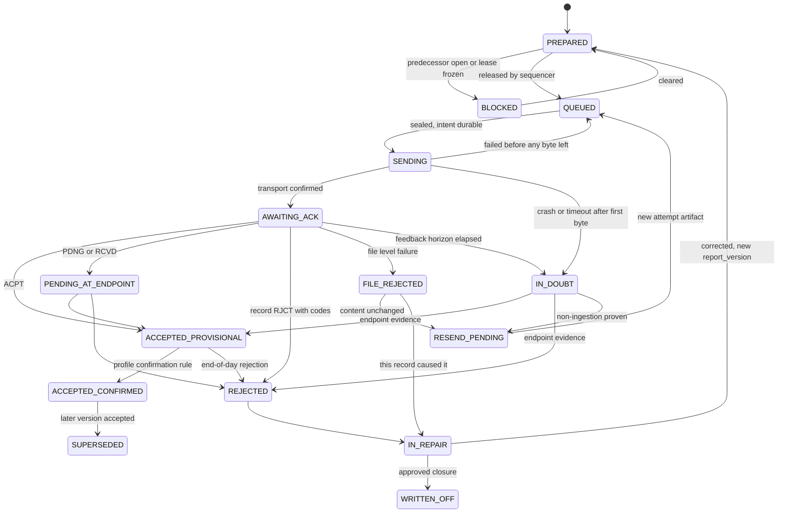

# Brainstorming brief: regulatory and financial reporting platform

As-of 2026-10-08. Prepared for a superpowers-style brainstorming session: present 2-3 approaches with trade-offs and one recommendation, ask the user one clarifying question at a time (section 6 is ordered for that), then write the design spec. Design only; no product code.

Inputs synthesised: research briefs 01-08 including each "Independent verification" section (which wins over the brief body), design approaches A, B and C, the fact-check digest, and a three-lens judge panel. No input contains measurements: every performance or capacity figure here is a hypothesis to be settled by a spike (section 7).

**Revision 2 (2026-10-08, completeness-critic pass).** A critic found gaps in revision 1; this revision closes them in place. What changed, in short: (1) the HOLD/PDNG contradiction is resolved (5.6.1); (2) new chapters 5.17-5.26 cover ingest faults, source completeness, cut-over, feedback anomalies, destination outage and environments, remediation, time and reference-data staleness, the Firm Profile register, key management and DORA/exit; (3) security and privacy (5.14), identity (5.7.1), change control (5.5.4), the question order (section 6), the MVP increments (7.2) and the traceability and oracle rules (7.4) are rewritten; (4) ten over-engineered items are marked post-v1 (3.5, 5.16). New facts added in this pass, with as-of 2026-10-08: Azure immutable-storage limits (Microsoft Learn page ms.date 2026-08-18, read 2026-10-08), DORA article structure (mirror texts plus the ESMA DORA page Level 2 list, read 2026-10-08), the EU Commission adequacy page for the UK (read 2026-10-08). Everything else in the new chapters is design, not verified fact, and every number in them is a placeholder to be set by a spike or by Compliance. The web-search quota was exhausted during this pass, so only direct primary-document fetches were possible; EUR-Lex remained unreadable (script-rendered).

## 0. Summary

- **Recommendation: "C+"**. Take Approach C (signed Regime Packs plus a thin generic engine, Java 25, PostgreSQL 18, WORM evidence tier) as the base, and graft the best correctness mechanisms from A (durable-before-effect, completeness invariant, crash-point fault matrix, offline-verifiable evidence) and B (per-record XSD, reconciliation evidence and failure attribution, nightly reproduction test, fenced sender leases), while cutting C's up-front cost (buy the expression layer, scalar executor first, no chunked executor, no child-process connector protocol). Kafka stays an optional source adapter only.
- **Why**: C won two of three judge lenses (regulatory assurance 8.6, delivery risk 6.5), A won the operations lens (7.0 against 6.5 for C), B placed last on all three lenses (6.8, 3.5, 3.5). Unweighted means: C 7.2, A 6.6, B 4.6. No approach is disqualified; each has a flaw that the hybrid resolves (section 3.5).
- **Stack**: Java 25 LTS modular monolith (one codebase, role flag, image flavours), PostgreSQL 18 with synchronous standby, S3 Object Lock (v1 evidence tier; Azure immutability behind the same port after a spike, see 1.5), JAXP/StAX for ISO 20022 XML and XSD 1.0. Flip conditions are in section 4.
- **Scope assumption (1.11)**: transaction-level, per-record regulatory reporting with a lifecycle (new, amend, cancel, feedback, resend). Aggregate or template reporting (COREP/FINREP and other XBRL taxonomies, AnaCredit, Solvency II QRTs, MMSR), MiFIR transparency, MAR STOR, short-selling notifications and US regimes (CAT, TRACE, Form PF) are not in scope; the pack format has no aggregation primitive. The user confirms this in Q2.
- **MVP**: EU MiFIR RTS 22 as in force today, one CSV-over-SFTP source, one SFTP destination (a simulator first), full evidence, acknowledgement, resend and restore loop, plus source-completeness reconciliation and a cut-over slice (section 7). Revision 2 also trims ten items to post-v1 (3.5, T1-T10).
- **Ask the user first** (section 6): Q1a who operates the platform (in-house, vendor product, multi-tenant SaaS) and Q1b what regulatory role it plays (own reports, delegated or group reporting, ARM/DRSP). Those answers decide tenancy, DORA scope, liability handling, whether Kafka is ever justified, and how licence risk is handled; Q10 (named Compliance owner) follows immediately because it is a hard gate.
- **Gates that can stop work**: Legal reading of the ISDA DRR licence (repo `LICENSE.md` unread, docs say "free for non-commercial use"); Legal sign-off on shipping or fetching SWIFT-licensed ESMA XSDs and on derived facet metadata and workbook-derived text shipped inside packs; a named Compliance owner for rule content; a spec-freeze paper exercise that encodes EMIR lifecycle events in the pack format (SP-G); spike results (sections 7 and 8).

## 1. Verified domain digest

Status key: **V** verified in a primary text by the second-pass fact-check; **C** corrected by that pass (the corrected statement is given); **U** unverified or unscheduled; **F** future or scheduled; **S** secondary or vendor source only. Numbers in the Src column are the research briefs. Anything marked U or S must not be treated as a design premise.

### 1.1 What is in force and what is moving

| Topic | Fact the design depends on | Status | Src |
|---|---|---|---|
| EU MiFIR in force | Art. 26 (consolidated 9 Jan 2024) + RTS 22 (Delegated Reg. 2017/590, applicable since 3 Jan 2018) + ESMA Guidelines 2016/1452 + technical reporting instructions v1.6 (29 May 2018) + validation rules v1.7 (31 May 2022). Reporting is ISO 20022 XML, file based. | V | 02 |
| MiFIR Review | Reg. 2024/791 rewrote Art. 26, but the changes apply only when a revised RTS 22 applies (Art. 54(3)). No revised RTS 22 exists; ESMA's 23 Jun 2025 report proposed none; the Art. 26(9) date of 29 Sep 2025 passed without a draft. The EU application date is unscheduled. The claim "not before 1 Oct 2027" has no checkable source and is not used. EU activation is therefore event-triggered. | V; date U | 02, 08 |
| ESMA "report once" | Final report of 2 Jul 2026: integrated model "toward H2 2031", conditional on Level 1 changes by mid-2028. Independent of Level 1: back-reporting 5 to 3 years (rec 3), RTS 22 Art. 2(5) changes (rec 4), deprioritised optional fields 32, 50, 53, 62 and field 63 values (rec 5). The report is ESMA's Art. 26(11) assessment, so 29 Mar 2028 is a statutory backstop and not a trigger. | V | 02, 03, 08 |
| UK MiFIR | FCA PS26/15 (3 Aug 2026): new regime (Handbook MAR 13 orders, MAR 14 transaction reporting, MAR 15 reference data; ARM rules in SUP 17A per a secondary reading) in force **3 Apr 2028**, flexible supervision from 3 Aug 2026. ISDA's "2027" expectation is stale for the UK. FCA draft schema and validation rules were published 2 Oct 2026 on the MDP page, outside CP26/34 (closes 6 Nov 2026): watch both. Final Transaction Reporting User Pack by 3 Apr 2027. | V | 02, 04 |
| UK 2028 field model | 52 fields, renumbered 1-52. Not "EU 65 minus a list": field 56 is also removed, fields 8 and 17 are replaced by Boolean client indicators, package price fields are added, field 25 goes (conditional single-sided reporting instead). Load it as its own versioned schema. | C | 02 |
| UK scope relief | UK-venue-only instruments and FX derivatives leaving scope is supervisory forbearance until HM Treasury repeals the legislative scope. FX relief requires UK EMIR data to be filed and excludes UK branches of third-country firms that do not file it. Rules need a forbearance window separate from legal validity. | C | 02 |
| RTS 25 | The repeal of RTS 25 by Delegated Reg. 2025/1155 "from 2 Mar 2026" could not be verified and may conflate the 2 Mar 2026 RTS 1/RTS 2 application date. Keep field 28 timestamp granularity tied to the current RTS 25 text. | U | 02 |
| EMIR Refit | EU live 29 Apr 2024, UK 30 Sep 2024. Reconciliation Phase II (87 to 148 reconcilable fields) is effective-dated per TR (about 29 Apr 2026 by the ESMA workbook formula; 27 Apr from a secondary blog); UK reconciliation start 28 Sep 2026. All of these dates are now in the past. Forward: ASIC CS 48 proposed 1 Mar 2027 (F, needs ministerial consent); next active-account report 31 Jan 2027 (F); EMIR Art. 7b RTS (Delegated Reg. 2026/305, in force 26 Feb 2026); ESMA recommendation 7 (simplify errors-and-omissions notifications). | V; F | 03, 05 |
| Other regimes | SFTR (auth.052/070/071, state 079/085/086, status advice 084), CFTC (Tech Spec v3.2, action types NEWT/MODI/CORR/EROR/TERM/REVI/PRTO/VALU/MARU), ASIC (auth.030.001.04, auth.108.001.02), MAS, HKMA, JFSA exist with the same lifecycle shape. Outside v1; the pack structure must accommodate them. MAS/HKMA/JFSA details rest on vendor or search summaries. | V / S | 03 |
| Operational resilience | DORA applies since 17 Jan 2025 (Art. 12: backup policy, periodic restore tests, restoration on segregated systems, per-function RTO/RPO, post-incident reconciliations). Art. 12 text was verified on a mirror only; "data reporting service providers" there means APA, CTP and ARM, so scope depends on the platform's entity type. EU Cyber Resilience Act manufacturer reporting applies from 11 Sep 2026; main obligations 11 Dec 2027. Beyond Art. 12 (read on mirror texts only, 2026-10-08): Art. 2(1) covers investment firms (point e), data reporting service providers (point m) and ICT third-party service providers (point u); Art. 17-19 incident management, classification (criteria in the RTS CELEX 2024/1772) and reporting of major incidents (RTS and ITS OJ L 2025/301 and 2025/302); Art. 24-27 testing (TLPT RTS OJ L 2025/1190); Art. 28 third-party risk (28(3) register of information, ITS OJ L 2024/2956; 28(8) exit strategies), Art. 30 key contractual provisions (subcontracting RTS OJ L 2025/532); see 5.26. Article numbers come from a mirror and the ESMA DORA page, not EUR-Lex. | V date; U scope | 05, 06, 07; revision 2 |

### 1.2 MiFIR reportability: the nineteen gates

Reason code family is `MIFIR.<node>.<outcome>`; each carries a structured citation, the pack version and the reference-data snapshot id (research brief 02, section 3.2). Several nodes rest on ESMA Guidelines sections that the second pass did not re-read (5.6.2, 5.14, 5.20, 5.23, 5.24, 5.28, 5.30), so the node table is a verified skeleton and not a Compliance-approved rule set: see section 8.

| Node | Decision | Legal basis | Outcome codes (examples) |
|---|---|---|---|
| N01 | Is the entity obliged (investment firm, incl. EU branches of third-country firms)? | MiFIR 26(1), 26(8); RTS 22 14 | NOT_OBLIGED; VENUE_REPORTS_26_5 |
| N02 | Acquisition or disposal with ownership change? | RTS 22 2(1)-(3); GL 5.6.1, 5.20 | NOT_A_TRANSACTION |
| N03 | Excluded event? (a)-(o): SFT, clearing/settlement, netting, custody, novation/assignment, compression, fund units, exercise/conversion, predetermined events, notional changes, index changes, DRIP, employee plans, tender offers, collateral | RTS 22 2(5) | EXCLUDED.2_5_x |
| N04 | Carve-back? (i): IPO, secondary offering, placing, debt issuance; (a): SFT with ESCB counterparty | RTS 22 2(5) last sub-paragraph | INCLUDED_CARVEBACK.2_5_x |
| N05 | Simultaneous acquisition and disposal (hit own order) | RTS 22 2(4); GL 5.6.1 | REPORT_2_4 |
| N06 | Did the firm execute (or only receive-transmit)? | RTS 22 3(1)-(2) | NOT_EXECUTED |
| N07 | Art. 4 transmission with all conditions met? | RTS 22 3(2), 4; GL 5.3.3, 5.26.3 | TRANSMIT_NO_REPORT; REPORT_AOTC_TRANSMIT_TRUE |
| N08 | Instrument in scope? 26(2)(a) traded on a venue, (b) underlying is, (c) index/basket of; an ISIN alone is not enough (Q&A 1699 (e)). N08f (F): post-Review venue-only condition for OTC derivatives and new 26(2)(d) for Art. 8a(2) classes | MiFIR 26(2) | IN_SCOPE_26_2_A/B/C; OUT_OF_SCOPE |
| N09 | Is the instrument known in our reference snapshot for the trade date? This is a local classification only: PDNG and CON-411/412/471/472 are NCA-side outcomes that arrive as feedback after on-time submission (5.6.1) | TRI 3.3 and para 26; CON-410/411/412/471/472 | REFDATA_KNOWN; REFDATA_LAG_EXPECTED (REPORT with flag: submit by `due_at`, track PDNG up to 7 days); REFDATA_UNKNOWN (REPORT with flag plus a WARNING task). Local HOLD is a validation disposition, never a decision outcome |
| N10 | Route to competent authority (home, branch, third-country branch) | MiFIR 26(1), 26(8); RTS 22 14, 15(7) | ROUTE_HOME_CA; ROUTE_BRANCH_HOME |
| N11 | Report cardinality (DEAL for client = two reports; MTCH/AOTC = one; block plus INTC allocations) | GL 5.1, 5.2, 5.23 | TWO_REPORTS; SINGLE_REPORT; BLOCK_PLUS_ALLOCATIONS_INTC |
| N12 | Who submits (self, ARM, venue) and who is accountable | MiFIR 26(7); RTS 22 15 | SUBMIT_SELF/ARM/VENUE |
| N13 | Party identification (LEI status, natural-person IDs, CONCAT) | RTS 22 5-7, 13; Annex II | BLOCK_NO_LEI; DQ_NATID |
| N14 | Venue field and TVTIC (MIC, XOFF, XXXX, SI) | Table 2 fields 3, 36, 37; CON-030 | VENUE_MIC; XOFF; XXXX; SI_MIC |
| N15 | Instrument reference fields 42-56 required? | Table 2; GL 5.7.1 | REFFIELDS_REQUIRED/NOT_APPLICABLE |
| N16 | Complex trade (one transaction, several instruments, one price) | RTS 22 12; GL 5.35.9; Q&A 1699 | PACKAGE_FIELD40 |
| N17 | Timeliness: close of the following working day on the NCA calendar | MiFIR 26(1); GL 5.7.2.1 | ON_TIME; LATE_T1 (incident) |
| N18 | Lifecycle and duplicates (key = field 4 + field 2) | Table 2 fields 1, 2, 4; CON-023/024/025 | NEW; CANCEL; CORRECTION_CANCEL_NEW; DUPLICATE_BLOCKED |
| N19 | NCA outcome and resend routing | TRI 6.3 | ACPT; PART; RJCT; PDNG; RCVD |

Facts attached to the gates:

- **Art. 26(7) liability (C).** The firm is *not* responsible for failures attributable to an ARM or trading venue it uses (subject to Art. 66(4) MiFID II) but must take reasonable steps to verify completeness, accuracy and timeliness of what was filed for it. The earlier wording "firm stays liable" is wrong. The platform must record the submission route, attribute each failure (firm, ARM, venue, NCA, unknown) and run a scheduled, evidenced reconciliation against NCA/ARM feedback.
- **Table 2 has 65 fields** (EU, RTS 22 Annex I). The validation workbook v1.7 has 223 rule IDs (maximum 284): 120 "XML schema", 94 "Application" in 96 rows, 8 "Not implemented in the XML schema" (name fields 9, 10, 13, 14, 18, 19, 22, 23; no error code), and 1 pointer row. There are **96 distinct CON codes** (CON-412 and CON-472 sit on continuation rows of rules 220 and 148), so rule to error code is one-to-many. Import by CON code, never by row count (C).
- **RTS 22 Art. 2(5)(m)** is a four-cumulative-condition test (published dates, no unilateral variation, 10-business-day gap, EUR 1,000 one-off or EUR 500 per month caps), and (i) has an IPO/placing/debt carve-back: model each as a structured, separately cited condition. The FCA-hosted Art. 2 text is the pre-amendment text dated 01/04/2022, not 2021 (C). EUR-Lex consolidated text was never read; later amendments are not excluded (U).
- **Lifecycle**: a cancellation carries only fields 2, 4, 6; a correction is cancel then new with the same TRN; a rejected record was never loaded, so it is resent as new and never cancelled; new and cancel go in separate files, cancel first (ESMA recommends it; the AFM requires cancel first and waiting for feedback; contact the AFM after 6 hours without feedback; files after 22:00 CET are processed next day). Price unknown: report `PNDG`, then CANC + NEWT with the real price (Q&A 1702). Back reporting up to 5 years (CON-281).
- **Unscheduled but certain to move first**: the Art. 2(5) exclusions (ESMA recs 3-5 are Level 2/3 and need no Level 1 act). Treat exclusion rules as the most volatile content and keep pending packs for (g), (i), (m), (n).

### 1.3 Submission and response lifecycle

| Topic | Fact | Status | Src |
|---|---|---|---|
| MiFIR messages | `auth.016.001.01` (transaction data, `<New>`/`<Cxl>`) and `auth.031.001.01` (status advice) at usage guideline 1.1.0 (`*_ESMAUG_Reporting_1.1.0.xsd`); Business Application Header `head.001.001.01_ESMAUG_1.0.0.xsd` (a different version: **pin schema versions per message, not one global 1.1.0**); envelope `head.003.001.01`. The MiFIR zip uses XSD 1.0 constructs only (no assert/alternative/openContent). | V / C | 02, 04 |
| MiFIR feedback | File statuses ACPT/PART/RJCT/RCVD/RMDR/INCF/CRPT/WARN; record statuses in use ACPT/PDNG/RJCT/RCVD (ACPD, WARN "not used" in v1.6). Feedback by R+1. XSD or BAH failure (FIL-104/105) rejects the whole file; content rules reject only the record. PDNG (CON-411/471) resolves within 7 days, then ACPT or RJCT (CON-412/472). Lack of feedback is not a reason to stop reporting. NCAs add national rules (`AAX-NNN`) and cut-offs. | V | 02, 05 |
| EMIR messages | Inbound auth.030 (trade), auth.108 (margin). Outbound auth.092 (rejections), 091 (reconciliation), 106 (warnings), 107/109 (trade/margin state), activity files; envelope head.003 + head.001. Versions differ by TR: auth.030.001.03 and auth.092.001.03 evidenced for 2023; ISO's May 2024 maintenance defines .04 variants; **no EU/UK cut-over date is documented**, so message ids and versions are per-TR onboarding data (C). | V; U (cut-over) | 03, 06 |
| EMIR feedback ladder | (1) file level (authentication, size, name, XSD: whole file "corrupted"); (2) immediate record-level feedback within 60 minutes (all failed codes plus XPath); (3) end-of-day reports due 06:00 UTC to entities and 12:00 UTC to authorities on the next TARGET2/T2 working day. A schema-valid file is "accepted" even if every record fails. Acceptance is provisional until end-of-day reports agree. | V | 03, 05 |
| EMIR rules | Error code `EMIR-VR-<table digit><3-digit item>-<2-digit seq>`; the code-to-condition mapping is explicit in the ESMA workbook (ESMA's own examples print a one-digit suffix: parse leniently). One NEWT/POSC per counterparty + UTI; after EROR only REVI; reporting timestamp must be at or before TR receipt and not older than the day before receipt. Re-stamping the timestamp on resend is a **design choice, not a TR rule**. Strict ISO UTI pattern applies to NEWT/POSC only; other action types may contain `: . - _`. Conditional checks on absent fields run against the last accepted report plus latest TSR only when the event date is T or T-1, so local pre-validation cannot fully predict TR results. | C | 03, 04 |
| Reconciliation | Pairing before matching; scope "outstanding or outstanding in the last 30 calendar days", exit after 31 days non-outstanding (Guidelines 593); auth.078 inter-TR pairing is REGIS-TR-specific, not an ESMA requirement. Reconciliation status never changes whether a report was accepted. | C | 03 |
| TR specifics | REGIS-TR (documented to implementation level, Jul 2025): SFTP (1 GB inbound, RSA-3072, temp name then rename, 4-minute wait before a parallel connection) and portal (50 MB, 20 files); **REST was explicitly unavailable at the 2023 UAT launch**; extra outcomes INCF (bad file name), NAUT (not authorised), record-level WARN. DTCC GTR: four validation stages, NACK semantics (content dated 2021). KDPW, LSEG UnaVista, ICE, CME: specs gated or old. UnaVista-style ARM guide: **file name at most 40 characters including extension**, at most 100,000 reports per file, cancels loaded before news. FCA MDP: SFTP with certificates in the entity portal, confidential Market Interface Specification, ITE conformance, extract limited to one request per day. | C | 03, 06 |
| ISDA ACK rates | 100% (MAS) and 98.2% (EMIR Refit) are single-bank interview anecdotes about acknowledgement, not rejection-rate baselines. | C | 01, 03 |

### 1.4 Data quality and identifiers

| Topic | Fact | Status | Src |
|---|---|---|---|
| Algorithms | LEI: ISO 7064 MOD 97-10 (letters to 10-35, remainder 1). ISIN: Luhn over letter-expanded digits (ESMA CON-410 cites ISO 6166:2013 Annex C). FIGI: letters to values, double the values at the 2nd, 4th, 6th, 8th, 10th positions **from the left** of the 11-character payload (the ISIN-style parity fails on all seven test vectors), sum digits, check = (10 - sum mod 10) mod 10; the vectors were recalled from memory and need confirming against the OMG specification. UPI: ISO 4914, 12 characters, check algorithm third-party. UTI: ISO 23897, at most 52 characters, LEI prefix. | V; FIGI U | 04 |
| Time dominates | Nearly every reference rule is "valid at the trade date"; some also need the submission date. GLEIF publishes only current state (Golden Copy three times daily; no status history), so we build our own LEI status intervals. ESMA's own FIRDS guidance recommends valid-from/valid-to plus latest-record flag. Keep the snapshot id used by each validation so past decisions can be reproduced. | V | 04 |
| LEI status per role | MiFIR buyer/seller and non-MiFID executing entity: LAPSED allowed, as-of trade date. MiFID-firm executing entity: LAPSED only if a submission-date re-check passes. MiFIR submitting entity: as-of submission date, LAPSED allowed. EMIR Counterparty 1: LAPSED not allowed, as-of reporting timestamp, skipped for old events. Parameterise by (regime, role, as-of anchor, allowed statuses). | C | 04 |
| FIRDS lookup | Not a flat (ISIN, MIC, trade date) lookup: EEA-venue trades use that key; XOFF, SI and non-EEA organised-platform trades need validity on any EEA venue or SI and only when fields 47/48 are empty; MIC `XXXX` requires the ISIN to be **absent** (CON-361). FIRDS reference XSD is v1.2.1 (22 Jun 2022). | C | 04 |
| Formats | Quantity 18/17 (units) or 18/5 (monetary/nominal); price 18/13, 11/10 (percent/yield), `PNDG`, `NOAP`; price in the major currency unit (convert GBX/GBp first); ISO 4217 rejects XAG, XAU, XBA, XBB, XBC, XBD, XDR, XEU, XFU, XPD, XPT, XXX. **Basis points: the XSD enforces 18/17 while rule 107 text says 18/5**: use the XSD as the hard gate and confirm 18/5 with the receiving NCA. Timestamp granularity and UTC discipline are not enforced by the XSD (only `xs:dateTime` with a `Z` pattern). | C | 04 |
| Pinning | Pin regulator workbooks and XSDs by content hash and retrieval date, not the date on ESMA's page (the EMIR workbook page says 2023-09-06 while the file carries an Oct 2025 template update). MIC list: published second Monday, effective fourth Monday (next 2026-10-12). FCA CFI validation version 2026-10-10. Natural-person IDs: ESMA validates only 3-35 characters, valid country prefix and charset; CONCAT embeds DOB (CON-073). | C | 04 |
| Licence | The ESMA MiFIR XSDs carry a SWIFT MyStandards header: no re-sale and **no authorising external end users beyond internal use** unless SWIFT agrees in writing. Do not bundle XSDs; fetch at deploy, pin by hash; Legal sign-off needed even for shipping to customers. | C | 04 |
| XSD engines | JAXP/StAX (XSD 1.0) is in the JDK. libxml2 is thinly maintained, not abandoned (maintainer stepped down 2025-09-15, releases 2.15.0 to 2.15.4 continued to 2026-09-04) and its "XSD 1.0 only" status rests on a 2011 post. Xerces-J has an official separate XSD 1.1 package but the community mostly uses unofficial builds; Saxon-EE is commercial. Pure Rust and Go validators are experimental. XSD 1.1 buys nothing for the ESMA MiFIR schemas; the EMIR schema's XSD level is unverified. | C | 04, 07 |

### 1.5 Evidence, retention and recovery

| Topic | Fact | Status | Src |
|---|---|---|---|
| No evidence format | No regulation prescribes one. The need is assembled from retention rules, record-quality rules (MiFID Org Reg 2017/565 Art. 72(1): reconstitute each key stage, prior contents of corrections ascertainable, records not capable of manipulation; read on a UK as-adopted copy, EU consolidated not read), reconciliation duties (RTS 22 Art. 15; ESMA EMIR Guidelines; CFTC 45.14) and, for US scope, SEC 17a-4(f). FCA Market Watch 81 and 74 support findings on reconciliation, data lineage and record keeping only, **not** "missing audit trail of errors and fixes". | C | 05 |
| Retention basis | MiFIR Art. 25(1): 5 years for investment-firm order and transaction data (venues: Art. 25(2)). **MiFID II Art. 16(6) states no period**; the "5 years, up to 7 on request" sentence is in Art. 16(7) and covers communications recordings. EMIR Art. 9(2) and SFTR Art. 4(4): at least 5 years after termination; TRs 10 years (Art. 80(3)); CFTC 45.2: 5 years after final termination. Treat 7 years as an NCA-request or legal-hold override, not a general clock. | C | 05 |
| Back-reporting vs retention | The back-reporting horizon (EU 5 years, 3 recommended at Level 2/3 with unknown date; UK 3 years supervisory from 3 Aug 2026, firm from 3 Apr 2028) is a separate, effective-dated, per-regime setting. ESMA maintains the 5-year record-keeping obligation, so the 5-year replay floor stands. | C | 05, 08 |
| UK legal basis | RTS 22 Art. 15 (notification, reconciliation, ARM-correction records) is UK-retained text flagged as revoked by 2023 c.29 and replaced from 3 Apr 2028 by MAR 14, whose testing, reconciliation and incident-management duties are primary-verified in PS26/15. | C | 05, 08 |
| WORM | S3 Object Lock compliance mode cannot be shortened or removed (only deleting the AWS account), needs versioning; Azure locked time-based retention may be extended, not shortened, but a locked **container-level** policy allows **at most five increases** over its lifetime (version-level policies have no cap), the container policy audit log keeps only up to seven retention commands for locked policies, and **changes to version-level retention policies and legal holds are not audited** by that log; the feature is incompatible with point-in-time restore and last-access tracking and is not supported on accounts with NFS 3.0 or SFTP enabled (Microsoft Learn "Immutable storage for blob data", ms.date 2026-08-18, read 2026-10-08). The retention engine (5.10) must therefore keep legal hold separate from retain-until so that extensions are rare, and add its own audit of every retention change. S3 legal hold is independent of the retention period. Both are Cohasset-assessed, but **S3 variable retention (event hold + duration) is new and the Cohasset coverage of it is unverified**: use fixed, extend-only retain-until dates and claim no 17a-4(f) posture. Compliance-mode mistakes are irreversible: use governance mode outside production. | C | 05 |
| Ledger stores | PostgreSQL 18 (released 2025-09-25; supported to 2030-11-14; temporal `WITHOUT OVERLAPS`, checksums on by default; synchronous replication makes commits wait for the standby and block if it is unavailable). pgBackRest was declared unmaintained on 2026-04-27 and revived 2026-05-18: prefer base backup plus WAL with few tool dependencies. SQLite WAL is single-writer, same-host; Litestream is asynchronous and beta. immudb is BSL 1.1 whose grant bars hosted/embedded offering only "in order to compete with Codenotary's paid version(s)" (legal review still needed); KurrentDB has restrictive terms; QLDB was retired 2025-07-31; Kafka is not an event store. | C | 05 |
| Tamper evidence | Hash chains and RFC 9162 Merkle checkpoints are tamper-evident, not tamper-proof, and need an externally anchored head. Their **legal weight in EU/UK supervision is unproven** (regulators ask for reconstructability, not cryptography); eIDAS 2.0 electronic-ledger and qualified time-stamp effects were not checked. EDPB blockchain guidelines (7 Jul 2026) are an analogy only: keep personal data out of the chain (keyed hashes, envelope encryption, crypto-shredding) and obtain DPO sign-off. | U | 05 |
| Idempotency pattern | Business key + monotonic version + content hash + single in-flight guard. Acknowledgements are asynchronous, so delivery is at-least-once with a durable write-ahead "attempt started" record and an explicit IN_DOUBT state. Failed before any byte left is safely retryable; anything after the first byte is IN_DOUBT until endpoint evidence says otherwise. EMIR names TR change, M&A and delegation change as duplicate-risk events. | V | 03, 05 |

### 1.6 ISDA DRR, FINOS CDM and the Rune DSL

| Topic | Fact | Status | Src |
|---|---|---|---|
| Coverage | **Nine** rule sets delivered (CFTC, SEC, CSA Canada, EU EMIR, UK EMIR, ASIC, MAS, HKMA, JFSA; SEC is listed in ISDA's June 2026 letter but absent from the Nov 2025 delivered table, so its release date is unknown). The infohub's "14 regimes across nine jurisdictions" is a commitment count that includes MiFIR and SFTR. MiFIR/SFTR/FinfraG are not delivered; the ISDA infohub on 2026-10-08 still says the extension is "in process". Roadmap: RTS 22 build 2Q, RTS 1/2 build 3Q, **"MiFID II test" 4Q 2026**. The DRR 7.0.0 docs do list an "ESMA / MIFIR RTS22" pipeline with ten test packs and 186 samples; its maturity is unstated. Do not wait for DRR MiFIR. | C | 01, 08 |
| Access and licence | Artefacts (`com.regnosys.drr:rosetta-source`, ISDA Maven repository) are **anonymously readable**: access is not the blocker. The ISDA DRR License (effective 19 Sep 2023) grants use and redistribution "without modifications and solely as part of a Larger Work", with a broad s4(b) indemnity from the licensee (distribution, purchase, sale, reproduction, display or use of the Larger Work), naming limits (s5), 30-day cure termination (s8); JAMS arbitration applies only if a party is a US person or entity. A separate "Version 1.0" (7 Nov 2022) exists. The DRR docs home page says the product is proprietary and **free only for non-commercial use** and links a repo `LICENSE.md` that returned 404. Whether the code artefacts fall under the PDF's definition ("methodology and documentation") is unclear. **Do not plan to fork, adapt or embed DRR rules or code until Legal reads the repo licence**; keep any DRR adapter optional. | C | 01, 07, 08 |
| Versions | DRR 7.14.0 and 8.0.0-dev.28 are built on CDM 6.29.0 and Rune DSL 9.95.x, JDK 21 enforced at build time, Java 11 bytecode. DRR is not on CDM 7 or Rune 10: do not assume CDM 7 features (functional FpML mappings, new JSON format). | C | 01 |
| Execution | Rune's Java generator is the only complete one (rune-dsl #1044, #1409, #1410, #1411, opened 2026-09-25): Java behaviour is the de facto semantics and no conformance suite exists. CDM publishes a Python distribution (finos-cdm 7.5.0) that generates Rune functions, Java-native functions are stubs; **whether DRR runs without a JVM is unverified**. A private C#/.NET CDM 7 implementation with conformance tests is proposed for FINOS (common-domain-model #5169, Approved) but has no ReportFunction. | C | 01, 06, 07 |
| What DRR does not do | DRR stops at generation and pre-validation of messages; firms build submission, acknowledgement handling and eligibility scoping themselves. That resend and de-duplication sit outside DRR is our inference, not an ISDA statement. Eligibility rules return only a Boolean (no reason). Regime applicability is supplied by the firm as enriched input. The Gentek AI traceability tool is a development-history audit trail built from working-group minutes, not runtime per-submission lineage, so **R4 evidence stays entirely in our layer**. | C | 01 |
| Concepts to copy | Body/corpus/segment/provision citations (`docReference`/`regulatoryReference`, with `rationale` and `rationale_author`), separate timing/eligibility/field rules, report definitions, projections as a separate tested stage, shared `common` layers, test packs with committed expected outputs regenerated and reviewed, peer-review governance. Contributions are open to repository members, not anyone. | V | 01, 08 |

### 1.7 Connectivity

- No single integration tool is adopted as the connector layer: Camel (JVM, six-monthly LTS; 4.18 supports Java 17/21 only, Java 25 needs 4.22), NiFi (full application), Redpanda Connect (CDC and several sinks behind an enterprise licence; no IBM MQ/JMS/FIX/Db2 inputs), Airbyte (connectors Elastic License 2.0; hosted edition needs legal review), Vector (no SQL/SFTP/MQ/FIX sources), Kafka Connect (needs a cluster). Adopt the *shape* of the Airbyte/Singer contract: `spec / check / discover / read(state) -> records + checkpoints`, opaque state, commit before checkpoint acknowledgement. (V, 06)
- Every source tool is at-least-once (Debezium states it has no built-in dedup; Kafka Connect source exactly-once needs distributed Connect and carries documented correctness caveats). Effectively-once is **at-least-once plus idempotent landing**, owned by our ledger. (V, 06)
- Outbound destinations are mostly SFTP/file plus XML responses; the abstraction must model the acknowledgement shape (sync, async file, async message, portal-only). ESMA requires ISO 20022 XML for EMIR rejection and reconciliation feedback, so a schema-driven XML acknowledgement parser is the right default; parser versions are data. (C, 06)
- WASM is not a v1 connector model. WASI 0.3 has an outbound `wasi:http` client and TCP sockets (TLS still draft), so HTTPS-based REST or ack-polling adapters could be sandboxed later; SQL, MQ, SFTP and FIX cannot. (C, 06)
- Drivers: ADBC release 25 is only at rc0, `LicenseRef-PBL` (mssql, redshift) is undefined and Oracle/Teradata drivers are commercial; no Db2 or Sybase driver exists. JDBC/ODBC in a JVM image is the pragmatic route. SAP `go-ase` is archived (read-only since 2025-05-22) and must not be listed as an option; Rust `tiberius` 0.13.0 shipped 2026-09-25 and is no longer "stale". Vault is BUSL 1.1 (use OpenBao or cloud secret managers; a client integration is fine). (C, 06, 07)

### 1.8 Technology stack facts

- Weighted stack scores (judgement, not benchmarks): JVM 4.4, .NET 3.6, Go 3.2, Rust 3.0; the order holds if the DRR criterion is dropped (4.4, 3.8, 3.4, 3.2) or efficiency weights are doubled (4.3, 3.7, 3.3, 3.2). The decisive asymmetry is that only the Java Rune generator executes functions; the second pass noted .NET is closer to viable than the brief said (CDM #5169). (C, 07)
- Java 25 LTS GA 2025-09-16; Temurin 25 supported to at least Sep 2031 (V); next LTS Java 29 around Sep 2027 (secondary only). JEP 519 compact object headers (opt-in in 25): 22% less heap and 8% less CPU in one SPECjbb2015 setting, a benchmark and not a DRR guarantee. Rune tooling builds on JDK 21 (Xtend); generated code is Java 8+ compatible; split toolchain only matters if we ever build Rune models. (V, 07)
- The GraalVM claim "no JDK 26/27/28 builds, Java 29 planned" could not be verified (primary pages 403; the cited discussion does not support it). Native-image stays strictly optional. (U, 07)
- No credible cross-language benchmark exists; Rune-generated objects are immutable with builders, so allocation is high (inference). DuckLabs announced on 2026-08-26 that it is joining AWS (MIT licence and Foundation stewardship unchanged): any analytic executor sits behind an interface. (C, 07, 08)
- OpenTelemetry is stable on Java and .NET for traces, metrics and logs. FIPS 140-3: Go has a native module (CMVP #5247); Java needs a validated provider (unverified). (V, 07)

### 1.9 Rule-engine landscape

No off-the-shelf engine meets every requirement. DMN/FEEL (borrow decision-table semantics, hit policies and static gap/overlap analysis), CEL (borrow typed, side-effect-free, non-Turing-complete expressions with cost estimation; numerics are likely int64/double and decimal and date support is **unverified**; no vectorised implementation), OPA (borrow signed bundles and failure-keeps-active-bundle activation), Cedar (borrow analysis ideas only), Rune (copy the citation model), SQL/DuckDB (best set-based executor but a code-execution surface, no citation model), Datalog (selective use for cross-references only), Starlark and Wasm (last resort). Recommended: a small purpose-built pack format of decision tables plus a CEL-shaped expression subset compiled to one IR. (V, 08)

### 1.10 Still unverified (carry into the design as assumptions to test)

EU revised RTS 22 application date; RTS 25 repeal; EUR-Lex consolidated text of RTS 22 and Art. 15; ESMA Q&A from 2024; DTCC, ICE, CME, LSEG and KDPW technical specifications; message versions per TR; XSD level of the EMIR schema; GLEIF API rate limit; eIDAS 2.0 ledger effects; Cohasset coverage of S3 variable retention; whether DRR runs without a JVM; DRR repo licence and RTS 22 pipeline maturity; cel-java decimal and date behaviour; Java SFTP library fitness (not covered by any brief); all performance and capacity numbers; DORA Art. 12 and Art. 17-30 text beyond mirrors; the FIGI test vectors; the FIRDS publication timing (T+1 by 08:00 CET) rests on TRI v1.6 (2018) and FIRDS download instructions rev 3 (2022), newer revisions not looked for; the expiry of the EU adequacy decision for the UK (renewed 19 Dec 2025, expiry not stated on the Commission page); EUR-Lex consolidated RTS 22 Art. 15 (read only on the UK as-adopted copy).

### 1.11 Scope boundary and assumed product category (revision 2)

The brief had silently equated "regulatory and financial reporting" with transaction-level reporting. The assumption is now explicit and is confirmed in Q2.

**Assumption:** transaction-level, per-record regulatory reporting with a lifecycle (new, amend or correct, cancel), an acknowledgement or feedback loop and deadlines measured per record.

| Regime family | Position | Why |
|---|---|---|
| EU MiFIR transaction reporting (RTS 22) | In scope, MVP | Section 7 |
| EMIR, UK EMIR (trade repositories); SFTR; CFTC Part 45 style; ASIC, MAS, HKMA, JFSA | In scope for the architecture (same lifecycle shape), packs after the MVP; EMIR is the second vertical | Sections 1.3, 5.5 |
| UK MAR 14 | In scope after final rules (3 Apr 2028) | 1.1 |
| Aggregate and template reporting: COREP/FINREP and other XBRL taxonomies, AnaCredit, Solvency II QRTs, MMSR, Form PF | **Out of scope.** Different shape (aggregation across records, templates and taxonomies, cross-template validation formulas, XBRL output). The pack format has no aggregation primitive; hosting such reports later means a new pack kind and engine extension, not a pack | Assumption, confirm in Q2 |
| MiFIR transparency (RTS 1/2, APA/SI/CTP publication) | Out of scope: market-data publication, different latency and shape | same |
| MAR suspicious transaction and order reports (STOR) | Out of scope: case-driven narrative notification, no batch lifecycle | same |
| Short-selling notifications; MiFID II commodity position reports; CSDR settlement-discipline reports | Not scoped. Record-level and plausibly a later pack, but obligations, thresholds and destinations were not researched here | same |
| US regimes: CAT, TRACE | Not scoped; both are record-level and lifecycle-shaped but need their own research | same |

Regulation identifiers and article numbers for the out-of-scope regimes were not researched in this brief and must not be quoted from it.

**Standards for input and output** (to be confirmed per field in Table 2 and recorded in the connector and projection chapters): ISO 20022 XML is the v1 regulatory output and CSV the second MVP projection (5.13); FIX or FIXML is an input format via tier B only; FpML and CDM are reachable only through the optional DRR path; XBRL and SWIFT MX or FileAct are not v1.

## 2. Requirement map

Ratings are the honest post-review ratings for the recommended C+ design (strong / adequate / weak). Section references point to section 5 unless stated.

| Req | Capability that satisfies it | Where it lives | Rating and caveat |
|---|---|---|---|
| R1 High-performance reporting for institutions | Streaming ingestion in bounded micro-batches; batched distinct-key reference lookups; scalar rule executor first with a benchmark gate before any faster executor; StAX streaming XML writer; virtual threads for I/O, bounded pools for CPU; bulk per-record rows written with asynchronous commit | Engine (decide/derive/validate), assembler, ledger (5.2, 5.3, 5.10) | **Adequate, unmeasured.** Rule evaluation is not the real bottleneck: XML build, XSD validation, reference lookups, ledger writes and WORM PUTs are. PostgreSQL scales up, not out. Reporting arrives in end-of-day bursts, so the sizing basis is the burst rate and not the daily average (capacity model in 5.10). Spikes SP-R, SP-L, SP-X, SP-M decide, and SP-L and SP-X run at a 50M-per-day-equivalent burst before the spec freezes. |
| R2 Maintainable, minimal lifecycle, robust, efficient | Regulation is signed data (a pack release, not a redeploy); thin regime-agnostic engine; moving-parts budget of three versioned runtime components (JVM engine, PostgreSQL with standby, object store); one codebase, role flag, three image flavours; LTS-aligned stack; CycloneDX SBOM and licence allow-list in CI | Pack control plane (5.5), packaging (5.2), stack (4) | **Maintainability strong; lifecycle adequate-to-weak** (we own a small language, compiler, pack registry, signing and impact tooling; mitigated by buying the expression layer and cutting scope); **efficiency adequate** (JVM footprint above Rust, mitigated by streaming and flat records). The rating is made against the operational dependency register in 5.2 (KMS/HSM, secrets, Git and CI, observability, backup, egress proxy, connectors image and the Java and PostgreSQL upgrade playbooks), not against the count of three versioned components alone. Approach A is better on footprint and parts count; that is the price of the JVM ecosystem and DRR fit. |
| R3 Many data sources | Versioned connector contract (`spec / check / discover / read(state, limits)`), tier A native (files on local/SFTP/S3/ADLS/GCS; CSV, delimited/fixed-width TXT, XML, JSON/NDJSON; JDBC as-of extracts; HTTPS pull/webhook; Kafka-protocol consumer), tier B vendor drivers in the `connectors` image (Oracle, Db2, Sybase, MQ/JMS, Snowflake), tier C landing-zone manifests (customer-run CDC, warehouse extracts) | Connectors and landing zone (5.12) | **Adequate.** "All types of databases" is delivered as a supported-source matrix with a conformance suite per connector, not a v1 promise. No tool is adopted wholesale (section 1.7). The MVP proves one file source only, so connector conformance, JDBC memory behaviour and streaming or API sources are untested by it: one JDBC as-of extract and one API or Kafka source are either added to the acceptance test (if Q5 names them) or are explicit v1.1 commitments (7.2). |
| R4 Historical logging that evidences exactly what was reported | Two tiers: insert-only bitemporal PostgreSQL ledger plus WORM evidence (exact bytes sent, raw responses, landing batches, pack/registry/reference snapshots, archived engine builds, journal objects, a daily signed manifest of object hashes written to WORM; lane hash chains and Merkle checkpoints are post-v1); evidence manifest per report; offline `verify` (a manifest check in v1); signed evidence bundle | Ledger and evidence tier (5.10, 5.11) | **Strong.** DRR's traceability tool does not help here (development history, not runtime). Hash-chain legal weight is unproven. |
| R5 Financial-world output formats and transfer | Pack-owned report schemas; declarative projections to ISO 20022 XML (StAX writer), CSV and fixed-width TXT; per-record XSD plus whole-file XSD gate; effective-dated destination profiles (file name rules, ordering, limits, calendars); SFTP, HTTPS and file-drop adapters; MQ and REST only against confirmed specs | Assembler, profiles, transports (5.13) | **Adequate.** Destination specs are partly gated (FCA MIS, TR specs); the simulator encodes our assumptions until onboarding. The MVP ships two projections (ISO 20022 auth.016 and an ARM-style CSV, increment S5) so the declarative projection spec is proven format-neutral and does not bake in XML or XSD assumptions. |
| R6 Acknowledgements matter; unaccepted records flagged and queued for resend | Delivery state machine with profile-supplied status vocabularies, ack deadlines and feedback horizons; IN_DOUBT; breach flags; three queues (transport resend, repair, DQ quarantine/HOLD) written in the same transaction as the state change; daily completeness invariant | State machine, queues, timekeeper (5.8, 5.9) | **Strong.** Any ledger design can do the basics; the differentiators are IN_DOUBT handling and the completeness proof. |
| R7 A model like ISDA DRR | The Regime Pack mirrors DRR's constructs one-for-one (authority/corpus/provision hierarchy, timing/eligibility/field rules, report definitions, projections, enrichment interface, `common` layers, regenerate-and-review test packs, peer-review governance) and adds structured reasons, runtime lineage, event-triggered effective dating, signed hot-swap and submission state. DRR itself is an optional provider behind the same `RegimeProvider` contract | Regime Pack format (5.5); DRR seam (5.5.6) | **Strong for the model; DRR execution deferred.** DRR's MiFIR is undelivered and its licence unsettled. Optional JDK 21 `drr` image only after Legal clearance. **Generality is unproven until the second regime** and the canonical model is transaction-centric because MiFIR is (EMIR needs trade versus position level, event dates, valuation and collateral records, UTI chains and per-UTI sequencing): a paper exercise that encodes EMIR NEWT, MODI, TERM, EROR, REVI and VALU in the pack format is a spec-freeze gate (SP-G, 7.3). |
| R8 Reportability logic configurable so changes apply easily | Rules as data: decision tables plus CEL-shaped expressions; maker/checker/approver, CI with static analysis and impact report, semver verified from the diff, KMS-held signing key, atomic swap between batches, rollback by digest; firm overlays and pinned interpretations without a code release; shadow mode | Pack control plane (5.5, 5.5.4) | **Strong, with a v1 caveat:** authoring is Git/YAML plus spreadsheet round-trip; there is no analyst UI in v1. "Applied easily" is made measurable in 5.5.4 item 10 (lead-time target and a Compliance-user CSV round-trip acceptance test AT-8). |
| R9 Classify each transaction and link the reason to the legal requirement | A decision record for every candidate (negatives too): outcome, reason code `MIFIR.<node>.<outcome>`, rule path, structured citations with role (BASIS, EXCEPTION, INTERPRETATION, GUIDANCE) and quote hash into a Legal Source Registry, pack digest, as-at; multi-condition exclusions modelled as separately cited conditions; legal vs supervisory-forbearance effective dating; `explain` | Decision engine, registries (5.5.2, 5.5.3) | **Strong.** CI proves citations resolve, not that the law was read correctly: a named Compliance owner is required per pack. |
| R10 Data-quality pre-validations (requirements, XSD, LEI/ISIN logic) | Six-layer pipeline (syntactic, identifier, reference data, regime conditional, cross-record, final gate), severities BLOCKER/WARNING/INFO, dispositions PASS/HOLD/QUARANTINE, regulator rules imported by CON code, CON-code coverage dashboard, `predictability` flag and predicted-vs-actual delta metric | Validation pipeline (5.6) | **Strong.** Prose conditions are transcribed by hand; local prediction cannot fully match the destination. |
| R11 Cross references (entities, instruments, transactions/orders, reference data) | Typed nodes and bitemporal `xref_edge` rows in PostgreSQL with recursive CTEs (LEI parents, instrument underlyings and listings, venue segment-to-operating MIC, order to execution to allocation, UTI chains, package ids); reference-data service with sealed snapshots | Canonical model and reference-data service (5.4) | **Adequate.** No graph engine; scale and authoring effort unproven. v1 uses typed relational reference tables with validity ranges, which meet every MVP check (equities, LEI clients); the generic bitemporal `xref_edge` graph is deferred until a rule needs multi-hop traversal (5.4). |
| R12 Trackability; no duplicate reporting | Keys in 5.7: pack-declared business key pinned to `endpoint_epoch`, TRN assigned once and stored, monotonic `version_seq`, `logical_hash` no-op suppression, partial unique in-flight index, fenced sender lease, successor gates, `trace(business_key)` | Ledger and sequencer (5.7) | **Strong.** |
| R13 Recoverability | Durable-before-effect invariant; WORM journal objects; `RecoveryDecision` on every start; restore algorithm with in-doubt resolution against endpoint evidence; transport probes; restore-epoch fence; five-crash-point fault matrix as a release gate; warm standby on the roadmap | Recovery (5.11) | **Strong on design, adequate on operations:** resolution depends on endpoints offering queryable evidence (portal-only TRs may not), and v1 standby is cold for the application tier. |
| R14 Build follows brainstorm, design spec, plan, TDD subagent-driven implementation | This brief is the brainstorm input; the spec chapters are the contracts (pack format, ledger schema, state machine, profile schema, connector contract); section 7 is the plan decomposition; pure-function crates, golden packs, in-memory ports, a deterministic destination simulator and crash-point fixtures are the TDD units | Section 7 | **Adequate-to-strong.** TDD proves consistency with golden cases, not with the law. When subagents build the product, golden cases must not be circular: oracle-independence rules, golden-case provenance and an R1-R14 traceability matrix with exit criteria per plan are in 7.4. |

## 3. Candidate approaches

Three genuinely distinct approaches were designed and reviewed by a three-lens judge panel. Section 3.5 states the recommendation, which is a hybrid.

### 3.1 The candidates

| | A. "Keel": lean single deployable | B. Streaming platform | C. Model-driven Regime Packs |
|---|---|---|---|
| Thesis | One static binary, one data directory, one WORM bucket; regulation as signed data; correctness from a durable-before-effect rule | Kafka-compatible log between stateless role workers; correctness from PostgreSQL ledger constraints; scale by partitions | Regulatory knowledge lives in signed Regime Packs; a thin generic engine runs ingestion, ledger, submission, queues, evidence, recovery |
| Stack | Rust, SQLite WAL journal plus projection, WORM, bytecode rule VM, own plugin protocol | Java 25, Kafka 4.x, PostgreSQL 18 with standby, WORM, three image flavours | Java 25 modular monolith, PostgreSQL 18 with standby, WORM, reference interpreter plus chunked executor |
| Versioned runtime parts | 3 (binary, data dir, WORM); plus a JVM plugin host if estates run Oracle, Db2 or MQ | About 8 (brokers, PostgreSQL and standby, WORM, JVM images, DRR image, secrets, observability) | About 3 (JVM process, PostgreSQL and standby, WORM) |
| Wins on | Footprint, parts count, evidence ordering, completeness proof, crisp recovery | Horizontal throughput, backpressure, replay-at-scale, reconciliation evidence | Explainability, change control, duplicate-prevention thinking, mainstream stack |
| Concedes | Connector breadth, hiring, automatic failover, in-process DRR | Lifecycle cost, the largest restore matrix, ledger still scales up only | Owns a language, compiler and pack control plane forever; slowest to first report |

### 3.2 Judge panel

| Lens | A | B | C | Winner |
|---|---|---|---|---|
| 1 Regulatory assurance and audit | 7.9 | 6.8 | **8.6** | C |
| 2 Performance, resources and operations | **7.0** | 3.5 | 6.5 | A |
| 3 Delivery risk and evolvability | 5.0 | 3.5 | **6.5** | C |
| Unweighted mean (convenience only) | 6.6 | 4.6 | **7.2** | C |

### 3.3 Trade-offs in brief

**A. Keel (Rust, single binary).**
- Strengths: lowest steady-state footprint (no JVM, no broker, no DB server, no GC); the strictest evidence ordering (no first byte, source ack or file move until the justifying journal entry is durable in WORM); the only daily completeness invariant (every REPORT decision maps to an accepted version or an open queue item); crisp recovery with journalled `RecoveryDecision`, SFTP temp-name-then-rename probes, a lease fence for a zombie node, two-approver forced resend, `verify --deep` and a five-crash-point fault matrix; explicit not-built list and spikes-first discipline.
- Weaknesses: R3 is self-rated weak (Oracle, Db2, Sybase and MQ need a JVM host, which erodes the one-binary claim); a bespoke storage layer (journal, segment shipper, watermarks, compare-and-swap lease) on the crown-jewel path; Rust scores last in the stack evaluation (3.0 against 4.4; XSD 2/5, DB drivers 2/5, MQ 2/5, hiring 2/5); single-node SQLite (about 300M live keys) with cold standby; 11 slices before a first report.
- Flaws: the TRN is HMAC-derived with no rule that it is assigned once and stored (key rotation or loss at restore could reissue TRNs, giving silent duplicates and un-cancellable originals); sends fail closed whenever the WORM store is unreachable and the only escape accepts RPO above zero (an outage longer than the T+1 margin becomes a missed deadline); DORA Art. 12 redundancy left to a rationale.

**B. Streaming platform.**
- Strengths: partition scale-out and backpressure; portable ledger-anchored correctness (partial unique in-flight index, fenced endpoint leases, deterministic event ids); the best reconciliation and attribution evidence (`reconciliation_run`, `attributed_to`); per-record XSD on a one-record wrapper; a nightly reproduction test; replay-at-scale shadow runs for rule-change impact.
- Weaknesses: the log adds no assurance (every audit guarantee lives in PostgreSQL) while adding failure modes; about eight versioned parts and a four-way restore matrix (Kafka-only, PostgreSQL-only, WORM-only, both lost); the headline scale is unearned (50M records a day is about 580 per second on average against a T+1 deadline, and the ledger still scales up only); Kafka has no timers, so a ledger timekeeper is needed anyway; its own text says a ledger-as-queue monolith is the better product unless the customer already runs Kafka and CDC, is multi-tenant SaaS, or has very high volume.
- Flaw: pack activation across a worker fleet is unfenced, so identical trades at the same as-at can be decided under different pack digests concurrently.

**C. Regime Packs (model-driven).**
- Strengths: best explainability (every decision, negatives included, carries a reason code, structured citations, pack digest and dual effective dates) and best change-control evidence (maker/checker/approver attestation, impact report digest, firm overlays with interpretation pins); the strongest duplicate-prevention thinking (TRN assigned once, `event_identity` conflicts go to UNDETERMINED, `endpoint_epoch` for TR change, porting, delegation change and M&A, successors BLOCKED until the predecessor is accepted); `predictability` flags and a coverage report for regulator rules with no implementation; mainstream stack with about three operational components and the largest hiring pool.
- Weaknesses: durable-before-effect is implied, not a hard fail-closed invariant; the completeness control is weaker than A's; field lineage is recomputed by `explain`, so long-term explainability needs archived engine builds; per-record real-XSD validation is not specified; resend "same bytes, re-stamped" is loose about fresh BAH ids and file names; pack-declared business keys could change dedupe semantics across pack versions; the heaviest R2 cost (language, compiler, IR, registry, signing) and the slowest path to a first report (increment 1 is parser, type checker, IR and two executors).
- Conditional flaw: if the whole language is built before any business value, time to first report is the longest of the three. Acceptable only with scope cuts.

### 3.4 Recommendation

**Recommended: C+**, meaning Approach C as the base with specific grafts from A and B and specific cuts to C.

Why C as the base: it wins the two lenses that decide whether the product survives its first regulator conversation and its first regulatory change (assurance 8.6, delivery 6.5); its lifecycle cost is the best of the mainstream-stack options (three parts); and its main weakness (language cost) is the easiest to cut by scope and by buying. Why not A as the base: it wins only the operations lens, and its advantage there is the footprint of a stack the stack evaluation scores last, while its R3 answer reintroduces a second runtime. Why not B: last on every lens; the log is not needed at the plausible volume envelope.

### 3.5 Exactly what C+ takes, from where, and why

**Kept from C (base).** Regime Pack with a thin regime-agnostic engine and firm overlays; dual legal/supervisory effective dating and event-triggered activation; PostgreSQL 18 plus WORM, with the evidence tier never rebuilt and the database rebuildable from it; RPO split (0 for intents, attempts, responses, sealed files; at most about one minute for re-derivable per-record decisions); TRN assigned once; `event_identity` conflict to UNDETERMINED; `endpoint_epoch`; `predictability` and the regulator-rule coverage report; flagged on-time submission for reference-data lag with a bounded HOLD only for recoverable conditions (5.6.1); `explain`; nightly determinism sample; evidence manifest with a daily signed manifest of object hashes (Merkle checkpoints post-v1, see the trims below); regulatory-clock board; the decision gate after increment 3b with its Java-expression fallback (now gate-first, see the trims below).

**Grafted from A.**

| Graft | Why | Lands in |
|---|---|---|
| Durable-before-effect as a fail-closed engine invariant (no first byte, source ack or source-file move until the delivery intent, sealed bytes and justifying journal entry are durable); v1 fails closed and the degraded-mode waiver is specified but not built (5.10, T3) | Removes the "attempt visible only at the endpoint inside the loss window" class by construction; closes C's gap | Plan P3 |
| Daily completeness invariant | The omission and errors-and-omissions control that C and B lack | P3, P9 |
| `RecoveryDecision` journalled on every start; SFTP temp-name-then-rename probes; two-approver forced resend and write-off; restore-epoch fence; `verify --deep` as a release gate | Makes recovery testable and shrinks IN_DOUBT | P4 |
| Five-crash-point fault-injection matrix over abstracted clock, filesystem, network and store, plus the destination simulator, as the acceptance suite from the first increment | R13 and R14 in one artefact | P0, P4 |
| Offline `verify` CLI and signed evidence bundle | An auditor can check without the platform | P4 |
| CON-code coverage dashboard; predicted-versus-actual rejection delta metric | Honest view of validation depth | P5, P9 |
| Pinned interpretation records (INT-xxxx) activatable without a pack release; `engine_min` and versioned built-ins | Configurability for non-engineers without widening the language | P2, P9 |
| Spikes first with numeric exit criteria; a written not-built list; the concrete MVP acceptance test | Delivery discipline (lens 3) | P1, section 7 |
| Three-queue split (transport resend, repair, DQ quarantine) | Clear operator contract | P3 |
| Language-neutral ledger, pack and profile formats | Keeps the stack flip cheap | P2, P3 |

**Grafted from B.**

| Graft | Why | Lands in |
|---|---|---|
| Buy the expression layer (cel-java) behind the executor interface after a one-week spike on decimal, date, null and error semantics | Removes the largest avoidable chunk of up-front language cost | P1, P2 |
| Per-record XSD validation on a one-record wrapper plus the whole-file gate at seal, with an automatic bisect path when the file gate fails | One bad record can never reject a whole file | P5, P8 |
| `reconciliation_run`/`reconciliation_item` as first-class evidence; `submitted_via` and `attributed_to` (FIRM, ARM, VENUE, NCA, UNKNOWN); capture of ARM-initiated cancels and corrections | Serves Art. 26(7) "reasonable steps to verify" and RTS 22 Art. 15 | P3, P4 |
| Nightly reproduction test (replay a sampled day on pinned versions, compare artifact SHA-256) and a byte-identical replay exit gate | Determinism and tamper alarm | P4 |
| Deterministic event ids `H(parent_event_id, stage, stage_version, pack_digest)` | Redelivery or replay is a harmless no-op. **Post-v1 (T8):** natural unique keys already absorb redelivery in v1 | P3 (v1.1) |
| Ledger-based timekeeper (ack deadlines, T+1, bounded-HOLD re-drive and expiry, EOD checkpoints, retry backoff, calendar re-evaluation) | Timers survive restarts | P3 |
| Fenced per-endpoint sender leases (lease fencing token, distinct from the regulatory `endpoint_epoch`; checked at the SENDING transition and at send time, per-statement fencing is v1.1, T2) | A stale sender cannot transmit | P3 |
| Kafka as an optional source adapter only, with B's fit test recorded as the reason | Streaming and CDC sources cheap, brokers never ours | P7 |
| Walking skeleton on in-memory ports | First rules and golden cases run in days | P0 |
| One codebase, one version, a role flag and image flavours (`core`, `connectors`, `drr`) | Replaces C's child-process connector tier on a JVM | P7 |
| Record the digest actually used on every decision; ledger-ordered activation barrier | Closes B's skew flaw if roles are ever split | P9 |
| B's alert catalogue; a moving-parts count in the spec (more than about three versioned runtime components is a design-review trigger) | Operations baseline and lifecycle guard | P9 |
| Batched distinct-key reference lookups per micro-batch | Keeps the hot path clean | P5 |

**Refinements to C itself (from the judge panel).** Archive and keep runnable every engine build used for production decisions (image digest plus dependency lock in the evidence tier) and persist a compact rule path per decision, so `explain` and reproduction stay valid for five years and more. Pin business-key definitions to the `endpoint_epoch`, so a pack release cannot change dedupe semantics mid-epoch (a new definition starts a new epoch under a MAJOR change). A resend creates a **new attempt artifact** with a fresh BAH message id, file name and timestamp per profile, linked to the original by `logical_hash`; it is not literally the same bytes. Gate successor versions on AFM-style feedback (profile parameter `successor_gate`), not just "CANC not rejected". Batch DeliveryIntents into one WORM flush for per-message REST or MQ destinations. Bisect a failed whole-file XSD gate to the offending records.

**Cut from C.** The chunked columnar executor (built only if the benchmark gate fails); the tier-B child-process connector protocol (specified, not built); a DuckDB/SQL executor; any Rune-like textual language; a SQLite profile.

**Trimmed in revision 2 (YAGNI; each is post-v1 unless the stated trigger fires).** The completeness critic flagged these as over-engineered for a first release; the schema reserves the fields so none is a rewrite.

| # | Trimmed item | v1 replacement | Trigger to build it |
|---|---|---|---|
| T1 | Lane hash chains plus RFC 9162 Merkle checkpoints plus a bespoke verifier (5.10) | Content hash per object plus a **daily signed manifest of object hashes** written to WORM; `verify` is a manifest check. The brief already says the chain's legal weight is unproven and the design must not depend on it | A supervisor or auditor asks for chain proofs, or an external anchor becomes a requirement |
| T2 | `lease_epoch` on every state-changing statement plus a restore-epoch conditional-write fence (5.7, 5.11) | One lease row with a **fencing token checked in the SENDING transition and at send time**, and a **restore flag checked at start-up**; the old node is network-isolated at restore | Warm standby (v1.1) |
| T3 | Two-approver local-spool degraded-mode waiver (5.10) | **Fail closed** with a multi-zone evidence store, an outage-age alert against the earliest `due_at` and a manual runbook; the waiver is specified as option W1 | Q8 or an SLA analysis (evidence-store availability against the T+1 margin) demands it |
| T4 | Building the pack language, compiler, IR and signing before need is proven | **Gate-first:** S0-S3b run on decision tables plus the bought expression layer with the reference interpreter (P2a) behind the same decision contract; the type checker, full static analysis, IR canonicalisation, signing and impact tooling (P2b) wait until the gate passes, and the funded Java-expression fallback skips P2b | The S3b gate passes (rule count, Compliance authoring demand, derivation fitness) |
| T5 | Generic bitemporal `xref_edge` graph with recursive CTEs (5.4) | Typed relational reference tables with validity ranges | A rule needs multi-hop traversal |
| T6 | Shadow mode, mutation testing, rule-hit index and forward-mode impact sizing for the first signed change (5.5.4) | Golden tests, a replay diff over the golden corpus plus a retained stratified sample, structural semver, maker/checker/approver, atomic activation | A pack change is too risky to approve on corpus replay alone |
| T7 | Dual legal/supervisory/event effective dating, `AS_REPORTED`/`AS_CORRECTED` resolver, `imports` and `common` packs, overlay option machinery (5.5) | Legal window and `AS_REPORTED` only; other fields reserved in the schema; one lineage (RTS 22) exists | The second regime (EMIR) or the first remediation run (5.22, which needs `AS_CORRECTED`) |
| T8 | Deterministic per-stage event ids `H(parent, stage, stage_version, pack_digest)` on every record (5.7) | Natural unique keys (`ingest_key`, `event_identity`, `business_key`, `version_seq`, and decision key `(report_subject, decision_context, input_digest)`) absorb redelivery; stages are idempotent functions of pinned inputs | A role split across processes |
| T9 | FIGI, BIC, UPI and national-ID check-digit validators (5.6 L2) | LEI, ISIN, MIC, ISO 4217/3166, CFI and the TRN/UTI shape rules; no MiFIR equities rule consumes the others and the FIGI vectors are unverified | A rule or destination consumes them |
| T10 | Thirteen overlapping identity concepts and a twenty-plus alert catalogue | One documented identity model (5.7.1) and eight alerts with runbooks (5.15) | Operational need |

**Not taken from A.** Rust and SQLite as the system of record; the bespoke journal, segment shipper, watermark and compare-and-swap lease protocol as a storage engine; the custom bytecode VM; the Keel Connector Protocol as a v1 build. **Not taken from B.** Kafka as the data plane; topic topology, partition re-keying and DLQ machinery; Kafka-loss restore drills; a worker fleet.

### 3.6 How each judged flaw is resolved

| Flaw | Resolution in C+ |
|---|---|
| B: pack activation skew across a fleet | One active engine per deployment (modular monolith, active/standby; a deployment may hold several entity partitions, defined in 5.14); activation applied between batches in a ledger-ordered sequence; the digest used is recorded on every decision; a barrier is mandatory if roles are ever split |
| B: about eight moving parts and a four-way restore matrix | Not adopted; moving-parts budget in the spec; restore matrix has two cases (database lost, evidence tier unreachable) |
| A: TRN not assigned once | TRN assigned at first `report_version`, stored with its key version, never re-derived; derivation keys are retained for restore |
| A: fail-closed sends when WORM is unreachable; no warm standby | v1 fails closed with a multi-zone evidence store, an alert on evidence-tier outage age against the earliest `due_at`, a manual runbook and a synchronous standby from day one; the time-boxed two-approver local-spool waiver (RPO above zero recorded, auto-drain) is specified in 5.10 as option W1 and built only if Q8 or an SLA analysis demands it; warm application standby on the roadmap |
| A: SQLite ceiling and plugin tier becoming load-bearing | PostgreSQL from the start behind a `LedgerStore` port; vendor drivers hosted in the `connectors` image built from the same codebase |
| C: language cost and slow first report | Scalar executor only, cel-java bought pending SP-R, chunked executor gated, walking skeleton first, **gate-first sequencing (T4)**: decision gate after increment 3b (scope plus derivations) with a funded fallback (Java expressions behind the same decision contract), and the heavy pack tooling (P2b) built only after the gate |
| C: durable-before-effect informal; decisions lost up to a minute on an untested claim | Invariant formalised; nightly reproduction test; only re-derivable bulk rows use asynchronous commit |

## 4. Stack recommendation

| Layer | Choice | Notes |
|---|---|---|
| Language and runtime | **Java 25 LTS** (Temurin or another OpenJDK build), modular monolith with hexagonal ports around reference data, validator, executors, connectors and transports | No preview features. `-XX:+UseCompactObjectHeaders`; virtual threads for I/O fan-out (IBM MQ in client mode to avoid native-frame pinning); bounded platform-thread pools for CPU work. Plan the 25 to 29 move for Sep 2027 onward. Kotlin only if the team insists. GraalVM native-image is an optional later experiment, never a baseline. |
| Operational ledger | **PostgreSQL 18**, synchronous standby (quorum commit in production, because commits block if a single sync standby is lost), PITR from base backup plus WAL | Partial unique indexes, `SKIP LOCKED` queues, `WITHOUT OVERLAPS` for reference-data validity. Per-transaction `synchronous_commit` off only for re-derivable bulk rows. Depend on few backup tools (pgBackRest 2026 scare). Behind a `LedgerStore` port. |
| Evidence tier | **v1: S3 Object Lock** (compliance mode in production, governance mode elsewhere) or an S3-compatible store with object lock; a plain directory in development only. **Azure immutability is a second profile behind the same port** after a spike on version-level policies (a locked container-level policy allows at most five retention increases and version-level changes are not audited by the platform log; no SFTP or NFS 3.0 on the evidence account; see 1.5) | Fixed, extend-only retain-until dates plus a separately modelled legal hold. No claim of 17a-4(f) posture. Natural-person data envelope-encrypted so expiry can crypto-shred. The evidence account belongs to the customer (5.26). |
| XML and XSD | JAXP/StAX streaming, XSD 1.0 | Xerces-J (official XSD 1.1 package) or Saxon-EE behind the validator port if a destination ever needs XSD 1.1. libxml2 stays out. XSDs are fetched and hash-pinned, not shipped. |
| Rule expressions | cel-java (Apache-2.0) behind an `Expression` port, pending SP-R; fallback is a minimal in-house CEL-shaped subset over `BigDecimal` | Packs cannot define functions; vetted built-in library for LEI mod 97, ISIN Luhn, dates, decimals. |
| Connectors | JDBC vendor drivers, IBM MQ client, Java SFTP library (candidates such as Apache MINA SSHD or SSHJ are not evaluated in any brief: spike SP-S), vendor cloud SDKs for S3, ADLS Gen2 and GCS | In-process Java interfaces in v1; the out-of-process wire form is specified, not built. |
| Observability | OpenTelemetry Java (stable), Prometheus metrics, structured logs without payload PII | Primary operator view is the regulatory-clock board. |
| Supply chain | One container image per flavour (jlink runtime), CycloneDX SBOM, dependency scanning, mirrored Maven repository, licence allow-list in CI | Serves DORA and the Cyber Resilience Act. Dependency CVEs mean a vendor rebuild and a stated security-release SLA. |
| Test | JUnit 5, in-memory ports, deterministic fault simulator, destination simulator; Testcontainers for integration (availability not verified) | Pack golden cases are the TDD unit. |

**Not used in v1:** libxml2, DuckDB/DataFusion/Arrow in the core, Kafka as the data plane, Camel/NiFi/Airbyte/Redpanda Connect/Vector as the connector layer, immudb, KurrentDB, QLDB, Litestream as the primary store, Starlark/Wasm plugin lanes.

### 4.1 Conditions under which the stack flips

| Trigger | Flip to | What survives unchanged |
|---|---|---|
| Governance mandates .NET, or the C# Rune/CDM implementation (CDM #5169) gains `ReportFunction` parity with a conformance suite (rune-dsl #1410) | .NET 10 LTS (to 2028-11-14) | Packs, IR, golden corpus, ledger schema |
| A single binary with no database server is mandated (edge or small customers) **and** estates are files, PostgreSQL and SQL Server only (no Oracle, Db2 or MQ) **and** DRR execution is not required | Approach A shape (Rust or Go, SQLite or PostgreSQL `LedgerStore`) | Formats, contracts, state machine |
| FIPS 140-3 certification, hiring or build time dominates, or the memory spikes fail on the JVM | Go (native FIPS module, CMVP #5247) | Same |
| Benchmark gate SP-R fails | Add a faster executor in order: closure-compiled scalar, chunked columnar, then a Rust executor behind the IR (second runtime; only if XSD and connectors stay isolated) | Pack format |
| Full-history replay for impact analysis is too slow | Add a SQL executor (DuckDB or DataFusion) behind the interface; pin versions (DuckDB 2.0 is due 2026-10-21; DuckLabs is joining AWS, licence unchanged) | Pack format |
| Multi-tenant SaaS, or a customer that already runs Kafka and CDC with a platform team, with a need for independent stage scaling or intraday feedback at high volume | Move toward B: a Kafka-protocol log behind a `Log` port between stages; ledger stays PostgreSQL | Ledger, packs, profiles |
| A single PostgreSQL cannot hold the volume (sizing spike fails, roughly above 10M records a day with long retention) | Partition offload to WORM Parquet first, then shard by tenant or endpoint (not built) | Keys, state machine |
| A customer mandates SQL Server or Oracle as the ledger store | A second `LedgerStore` profile; decline unless commercially justified (test matrix cost) | Contracts |
| A destination requires XSD 1.1 | Stay on the JVM (Xerces-J XSD 1.1 package or Saxon-EE) | Everything |
| A customer mandates Azure Blob as the evidence store (revision 2) | Second evidence profile behind the `ObjectStore` port after a spike: version-level immutability (a locked container-level policy allows at most five retention increases), the platform's own audit of retention changes (version-level changes are not audited by Azure), no SFTP or NFS 3.0 on the evidence account, no point-in-time restore on it | Everything else |
| A supervisor, auditor or contract demands chain proofs (revision 2) | Build the post-v1 lane hash chains and signed Merkle checkpoints (T1) on the reserved `ledger_entry` and `anchor` tables | Evidence tier, manifests |
| Q8 or an SLA analysis shows the evidence-store outage risk is unacceptable (revision 2) | Build the local-spool waiver W1 (T3) | Fail-closed default |
| DRR becomes licence-cleared and valuable, or "run DRR" becomes a day-one requirement | Add the `drr` image (JDK 21, DRR pinned to CDM 6.29 and Rune 9.x, per-regime pins such as `drr.emir-eu@7.14.0+cdm6.29.0`) behind `RegimeProvider` | Core |
| GraalVM support for the next LTS is confirmed and a spike shows native-image is materially better | Optional native-image build profile, still JVM | Everything |
| Rune toolchain, DRR licence or Maven access changes adversely | Re-run the stack evaluation | n/a |

Do not flip on raw CPU speed alone: the workload is I/O, XML and database bound, and the expectation that Rust beats the JVM on raw CPU is not a measured result for this workload.

## 5. Proposed high-level architecture (C+)

### 5.1 Design invariants

These eleven invariants are the spec's backbone; each is testable and each maps to a fault-injection or invariant test.

| # | Invariant | Mechanism |
|---|---|---|
| I1 | **Durable-before-effect.** No first byte to a destination, no acknowledgement to a source, no move or delete of a source file until the record that justifies it is durable. "Durable" means: ledger state committed on PostgreSQL with synchronous-standby acknowledgement, and bytes or journal objects acknowledged by the evidence store. Fail closed. | 5.10 |
| I2 | Correctness comes from ledger constraints (unique keys, partial unique in-flight index, fenced leases), not from messaging semantics or exactly-once claims. | 5.7 |
| I3 | Every stage is a deterministic, idempotent function of pinned inputs. Natural unique keys absorb redelivery (deterministic per-stage event ids are post-v1, T8); no wall clock, randomness or locale in rules; UTC only; decimal arithmetic. Wall-clock use is confined to the timekeeper and send gate, both behind the clock-offset gate (5.23). | 5.3, 5.5.5 |
| I4 | Regulation is data. Rules, reason codes, citations, validation catalogues, destination profiles and schema pins are signed data. Regime logic found in engine code is a design alarm. | 5.5 |
| I5 | Every candidate gets a decision with a reason and citations, negatives included. UNDETERMINED never silently becomes DO_NOT_REPORT. | 5.5.2 |
| I6 | Silence is neither success nor failure. No blind resend; automatic resend is limited to content the endpoint provably never ingested. | 5.8 |
| I7 | Everything is pinned and recorded: pack digest, overlay, interpretation pins, reference snapshots, mapping version, schema and workbook hashes, engine build. | 5.5, 5.10 |
| I8 | Completeness is proven daily in two directions. **Downstream:** every REPORT decision (and every REPORT_BY_OTHER decision) maps to an accepted or confirmed version or an open queue item. **Upstream:** every expected source record maps to an ingested record and a decision (expected = ingested = decided, with explained exceptions), proven against an independent population where one exists and labelled UNPROVEN where not. | 5.9, 5.18 |
| I9 | One sender per endpoint, fenced by a lease fencing token (checked at the SENDING transition and at send time) and by a restore flag checked at start-up. | 5.7, 5.11 |
| I10 | The evidence tier is never rebuilt; the database is rebuildable from it. | 5.10, 5.11 |
| I11 | Production and non-production never mix: a non-production destination, credential or acknowledgement can never satisfy a production completeness, acceptance or retention rule. | 5.21 |

### 5.2 Components and packaging

```mermaid
flowchart LR
  SRC["Sources: files, SFTP, S3/ADLS/GCS, JDBC, HTTPS, Kafka topics, MQ"] --> CON["Connector SPI (tiers A, B, C)"]
  CON --> LZ[("Landing zone: content-addressed batches")]
  CON --> ING["Ingestion ledger and checkpoints"]
  LZ --> CAN["Canonicaliser: source-mapping packs"]
  subgraph RT["Regime runtime: generic engine, no regime logic"]
    ENR["Enrich: reference-data service"] --> DEC["Decide: scope tables"] --> DER["Derive: field rules"] --> VAL["Validate: layers 1-5"]
    EXE["Executor port: reference interpreter"] -.-> DEC
  end
  CAN --> ENR
  subgraph CP["Control plane"]
    REG[("Pack, overlay and legal-source registry")] --> CI["Pack CI: analysis, golden tests, impact report"] --> ACT["Approve, sign, activate"]
  end
  ACT ==> RT
  VAL --> VER["report_version + outbox (sync commit)"]
  subgraph SUB["Submission"]
    VER --> SEQ["Per-key sequencer"] --> ASM["Assembler: project, per-record XSD, file gate"] --> SEAL["Seal: bytes to evidence tier, intent journal"] --> TX["Sender: SFTP, HTTPS, file drop (lease-fenced)"]
    FBK["Feedback engine: profile parsers, correlator"] --> SM["State machine"] --> Q["Queues: resend, repair, DQ/HOLD"]
  end
  TX --> DST["NCA / ARM / trade repository / venue"] --> FBK
  Q --> SEQ
  TIM["Timekeeper"] -.-> SM
  PG[("PostgreSQL 18 + sync standby: ledger, reference data, xref")]
  WORM[("Evidence tier: WORM object store")]
  RT --> PG
  SUB --> PG
  SEAL --> WORM
  FBK --> WORM
  PG -. "journal objects, daily signed manifest" .-> WORM
  OBS["OpenTelemetry, metrics, regulatory-clock board"] -.- PG
  DRR["Optional DRR provider (drr image, gated)"] -.-> DEC
```



**Packaging.** One codebase and one version; a role flag (`ingest`, `engine`, `assembler`, `sender`, `feedback`, `timekeeper`, `control-plane`) selects roles, and all roles run in one JVM process by default. Three image flavours: `core`, `connectors` (adds vendor JDBC and MQ drivers), `drr` (JDK 21, DRR jars pinned to CDM 6.29 and Rune 9.x; absent unless adopted). One active node per deployment holds the sender lease for each (entity partition, endpoint) pair; a cold standby is restored from the evidence tier in v1, a warm standby (replaying journal objects, promoted by epoch) follows in v1.1. **Moving-parts budget:** three versioned runtime components (JVM engine, PostgreSQL with standby, object store) *plus* the operational dependencies in the register below; exceeding either triggers a design review. **Operator lifecycle:** upgrade is drain, replace, restart; database migrations are forward-only expand/contract; regulatory change is a pack activation, not a deployment.

**Operational dependency register (revision 2).** The three-component count excludes the following. R2 is rated on this list.

| Dependency | v1 status | Owner | Patch or change cadence | Failure impact |
|---|---|---|---|---|
| JVM runtime (Java 25 now, Java 29 around Sep 2027, secondary source) | Mandatory | Vendor (image), customer (host) | LTS train; upgrade playbook is a spec item | Security exposure; no regulatory function lost on a delayed upgrade |
| PostgreSQL 18 major upgrades (supported to 2030-11-14) | Mandatory | Customer or managed service | Quarterly minors, one major per few years; major-upgrade playbook is a spec item | Ledger unavailable: sends stop (fail closed) |
| Evidence object store with object lock | Mandatory | Customer account (5.26) | Provider-managed | Sends stop (fail closed); outage alert |
| KMS/HSM (pack and manifest signing, envelope KEKs) | Mandatory | Customer or cloud | Provider-managed; key lifecycle in 5.25 | No new pack activations or evidence writes; running packs unaffected |
| Secrets manager (OpenBao or cloud secret manager) | Mandatory (credentials by reference) | Customer | Provider-managed | Sends fail on credential resolution |
| Git and CI for pack release | Mandatory for pack changes | Customer or vendor | Runner and plugin patching | No pack changes; running packs unaffected; emergency path (5.5.4) needs it too |
| Signer service in front of the signing key (5.5.4) | Mandatory | Vendor | With the engine | No new signed packs |
| Observability stack (OpenTelemetry collector, Prometheus, alert routing, on-call tooling) | Mandatory for the clock board and the eight alerts | Customer | Provider-managed | Blind operation; the alert path must itself be monitored |
| Backup tooling (base backup plus WAL, few tool dependencies) | Mandatory | Customer | With PostgreSQL | No restore path |
| Read replica or shipped bundle for auditors | Optional | Customer | With PostgreSQL | Auditors read the primary: not allowed |
| SFTP egress proxy with static IPs | Customer-provided where a destination requires it | Customer network team | Network change control | Destination blocks the source address: sends fail |
| `connectors` image with vendor JDBC and MQ drivers | Optional | Vendor, driver vendors | Driver vendors' schedules; SBOM per release | One source type unavailable |
| Destination simulator | Test only | Vendor | With the engine | None in production |
| `drr` image (JDK 21, CDM 6.29, Rune 9.x) | Optional, Legal-gated | Vendor | Pinned | None unless adopted |

Vendor obligations that are spec items rather than defaults: a stated security-release SLA (value to be set by the vendor; none is asserted here), the Java and PostgreSQL upgrade playbooks, and versioning of the pack format and `engine_min`.

### 5.3 Data flow

1. **Land.** A connector yields a batch and an opaque checkpoint; a file is eligible only when its completion marker is present, and incomplete, unparseable, oversized or control-total-mismatched input follows the fault taxonomy of 5.17. Order: object written to the landing zone (content-addressed, idempotent), then one PostgreSQL transaction records the ingest row, checkpoint and outbox row, then the source is acknowledged. A crash between the steps leaves a harmless orphan object and a redelivered batch that is a no-op through `ingest_key`.
2. **Canonicalise.** A versioned source-mapping pack produces canonical events. Drift on a reportable field fails closed (records go to the DQ queue; nothing is guessed); drift on a non-reportable column is a WARNING recorded in the batch metadata (5.17).
3. **Enrich.** Reference lookups run per micro-batch on distinct ISINs, LEIs and MICs; the snapshot ids are stamped on the input so the rule evaluation itself performs no I/O.
4. **Decide.** Scope tables classify every candidate (REPORT, DO_NOT_REPORT, REPORT_BY_OTHER, UNDETERMINED; HOLD is not an outcome) and write a decision record, negatives included. A batch pins one pack digest, one overlay digest and one Firm Profile version (5.24). A record that throws or overruns the executor budget becomes UNDETERMINED with an error reason (5.17).
5. **Derive.** Field rules build the report record(s) (N11 cardinality may yield a market-side and a client-side report) with static field-to-rule-to-citation lineage.
6. **Validate.** Layers 1-5 run; BLOCKERs go to the DQ queue (QUARANTINE); a reference-data miss is classified by 5.6.1: instruments the NCA will resolve itself (publication lag, PDNG) are submitted on time with a flag; only conditions with a recovery path inside the window become a bounded HOLD whose expiry action is submit-with-flag unless a certain reject would result, never a silent block; PASS continues.
7. **Version.** PASS writes `report_version` (TRN assigned once if new), `delivery` (PREPARED) and an outbox row in one synchronous transaction. Re-derivable bulk rows (decisions, validation results) use asynchronous commit.
8. **Sequence, assemble, seal, send.** The sequencer releases per business key subject to the profile's gates; the assembler groups records into files per profile, runs per-record XSD validation on a one-record wrapper, projects the bytes, runs the whole-file gate and seals; the seal procedure of 5.10 then sends.
9. **Feedback.** Raw responses go to the evidence tier first, are parsed per profile, correlated by business key, and drive the state machine; every transition that needs action inserts its queue item in the same transaction. Scheduled reconciliation runs compare an **independent population of firm records** (not the feed the engine consumed, 5.18) with NCA/ARM data and leave `reconciliation_run` evidence; feedback anomalies follow 5.20.
10. **Evidence.** Journal objects, content hashes, the daily signed manifest, the evidence manifest, retention clocks and bundles (5.10); lane hash chains and Merkle checkpoints are post-v1 (T1).

### 5.4 Canonical model, reference data and cross-references

**Canonical model** (transaction-centric because MiFIR is; order and execution linkage kept for R11):

| Entity | Natural key | Notes |
|---|---|---|
| Party (legal entity, natural person) | LEI; country + national ID or CONCAT | Natural-person data is envelope-encrypted and never enters the chain |
| Instrument | ISIN (+ MIC listing); UPI for OTC | CFI, FIGI, issuer LEI, underlying ISIN or index |
| Venue | segment MIC | parent operating MIC, operator LEI |
| Order | order id | linked to executions (RTS 24 record-keeping itself is out of scope) |
| Execution | firm LEI + venue MIC + venue execution id (pack-declared `event_identity`) | capacity DEAL/MTCH/AOTC, price, quantity, timestamps |
| Transmission | transmitting firm + order | Art. 4 conditions and fields 25-27 |
| LifecycleEvent | event type + source version | NEW, AMEND, CANCEL, CORRECTION |
| Allocation / Package | allocation id; package or complex-trade id | INTC allocations; field 40 |
| Report schemas | **pack-owned and versioned**, not canonical | `mifir.eu.rts22.table2@1.1.0` (65 fields); `mifir.uk.mar14.table2` (52 fields, renumbered); never "EU minus a list" |

Canonical values: scaled decimals, UTC timestamps, explicit enumerations, absence modelled explicitly (no three-valued NULL).

**Reference-data service.** Sealed, versioned snapshots with ids stamped on every decision: GLEIF Golden Copy ingested into our own **LEI status-interval table** (GLEIF keeps no history); ESMA FIRDS full plus delta (stream-parsed, valid-from/valid-to plus latest flag); MIC monthly list; ISO 4217 and 3166; CFI; later ANNA DSB (cost-recovery licence). PostgreSQL 18 `WITHOUT OVERLAPS` enforces non-overlapping validity. `revalidate --as-of D --snapshot S` reproduces a past decision. Every lookup takes explicit as-of dates (trade date and submission date). **A snapshot id is a monotonic load sequence of a dataset's interval tables** (a high-water mark with stored deltas), not a file copy: the evidence tier holds each source file and delta as loaded, once, plus periodic compaction, so GLEIF three times a day plus FIRDS daily does not multiply WORM cost; reproduction rebuilds the interval tables to the stored load sequence. Staleness limits, loader integrity checks and the stale-data policy per dataset are in 5.23.

**Cross-reference model (R11).** *v1 (T5):* typed relational reference tables with validity ranges (LEI to parent, instrument to listings and underlying, venue segment to operating MIC, order to execution to allocation) meet every MVP check for equities and LEI clients. *Target model, built when a rule needs multi-hop traversal:* typed nodes plus **bitemporal `xref_edge` rows** (valid-from/to, recorded-from/to, source, snapshot id) in PostgreSQL, traversed with recursive CTEs. Edges: legal entity to parent and ultimate parent (GLEIF relationships), BIC, operated MIC and branch-of; instrument to CFI, FIGI, issuer LEI, underlying ISIN or index and UPI; venue segment to operating MIC; transaction report to executing entity, buyer, seller, decision maker, transmitting firm, instrument, venue, TVTIC and action-type history; order to execution (via TVTIC) to allocation; lifecycle links (Prior UTI, subsequent position UTI, package id, complex-trade component id). This powers LEI-status-versus-counterparty checks, order/transaction linkage, UTI chains and duplicate detection. No graph database; Datalog only if a measured need appears.

### 5.5 Regime Pack, rules, reason codes and legal basis

#### 5.5.1 Pack anatomy and format

A pack is versioned, content-addressed (SHA-256 of canonical form), signed, and immutable once published.

```
mifir.eu.rts22-2.3.0/
  pack.yaml        id, semver, regime, jurisdiction, valid{legal, supervisory, event}, as_at_field,
                   engine_min, input-schema digest, imports{pack@digest}, supersedes
  model/           report schemas (field facets CI-checked equal to the pinned XSD), canonical input schema
  scope/           decision tables: nodes N01-N09, N16 (hit policy FIRST, explicit priority/overrides)
  route/           N10-N12 (competent authority, cardinality, submission route)
  derive/          field rules (N13-N15), each with rule_ref and citations
  validate/        layered rules with regulator ids (CON-nnn, EMIR-VR-tfff-nn), severity, disposition, predictability
  lifecycle.yaml   business_key, trn policy, correction rules, successor_gate, due_at rule (N17-N19)
  endpoints/       destination profiles (5.8)
  refdata.yaml     datasets and as-of anchors used
  reasons.yaml  sources.yaml  rationales.yaml  interpretations.yaml
  tests/           golden cases and property tests
  CHECKSUMS  ATTESTATION   (maker, checker, approver, CI run, impact-report digest)
```

```yaml
- id: S-N03-2_5_e   node: N03   priority: 300             # scope table, hit policy FIRST
  when: "event.kind in ['NOVATION','ASSIGNMENT']"
  outcome: DO_NOT_REPORT   reason: MIFIR.N03.EXCLUDED.2_5_e
  cite: [{src: rts22, path: "art/2/par/5/pt/e", role: BASIS}]   rationale: RAT-0011
  valid: {legal: {from: 2018-01-03}, supervisory: null}
- id: V-040   layer: 3   severity: BLOCKER   disposition_on_fail: QUARANTINE
  regulator: {rulebook: "esma65-8-2594@sha256:...", rule: "014", codes: [CON-040], impl: APPLICATION}
  predictability: full
  when: "t2.f5_investment_firm == true"
  assert: "lei.valid(t2.f4, role=EXEC_MIFID_FIRM, asof=[trade_date, submission_date])"
business_key: [t2.f4, t2.f2]                              # lifecycle.yaml, pinned to endpoint_epoch
trn: {assign: once, derive: "base32(hmac(tenant_key@key_id, event.identity, leg))[:26]"}
correction: {unaccepted: new_version_NEWT, accepted: [CANC, NEWT], cancel_first: true,
             separate_files: true,
             successor_gate: {mode: FEEDBACK_ACCEPTED, max_wait: "<Compliance-owned, bounded by due_at>",
                              on_expiry: ESCALATE}}     # illustrative; see 5.21(d)
```

**v1 scope of the pack schema (T7).** v1 implements the `valid.legal` window and `AS_REPORTED` resolution only. The `supervisory` and `event` windows, `imports`/`common` packs and overlay option machinery beyond the three declared MiFIR options are reserved in the schema and built with the second regime or the first remediation run, whichever comes first. The Firm Profile (5.24) is an input to the pack like a reference snapshot, not part of it.

**Language.** YAML (CSV/XLSX round-trip) plus a CEL-shaped, non-Turing-complete expression subset: bool, int, scaled decimal, string, UTC timestamp, date, enum, list; explicit absence (`has(x)`); evaluation errors yield UNDETERMINED; no loops, I/O, clock or user-defined functions; a per-rule cost ceiling; a vetted built-in library (LEI mod 97-10, ISIN Luhn, CFI, MIC, dates, decimals) versioned and pinned through `engine_min`. Static analysis in CI finds gaps, overlaps, unreachable and shadowed rows. No Rune-like textual language in v1.

**Regime shape.** Separate lineages, not forks: `mifir.eu.rts22` (in force); a staged `mifir.eu.review` activated by a recorded legal event; `mifir.uk.mar14` from 2028-04-03 with its own schema. Shared logic lives in `common` packs imported by pinned digest. Firm **overlays** choose among options a base pack declares (give-up interpretation, OTC-with-ToTV-underlying treatment, Art. 4 for own-account dealing), set parameters and add source mappings; they cannot delete or reorder base rules.

#### 5.5.2 Decision record, outcomes and reason codes

```
{ decision_id, decision_seq, supersedes_decision_id, event_identity, leg, report_subject, regime,
  decision_context_id,   // dictionary row: pack_id/version/digest, overlay_digest, interpretation_pins[],
                         // refdata_snapshot_ids[], firm_profile_version, mapping_version, engine_build, executor
  as_at, evaluated_at,
  outcome: REPORT | DO_NOT_REPORT | REPORT_BY_OTHER | UNDETERMINED,      // HOLD is not an outcome (5.6.1)
  flags[]: e.g. REFDATA_LAG_EXPECTED, LATE_T1,
  reason_code, node, rule_ids_hit[], path[{table, rule_id, row_id}], citations[], input_digest }
```

**One decision concept, one current pointer.** The `decision` table is insert-only. Re-evaluation (a held record's reference data arrives, a hold expires, an interpretation pin or Firm Profile version changes, a remediation run) inserts a **superseding** row with a higher `decision_seq` and `supersedes_decision_id`; nothing is updated. The **current decision** of a `report_subject` is the row with the highest `decision_seq` (a `decision_current` view or pointer table maintained in the same transaction); downstream stages and the completeness invariant read only the current row, audit reads see the whole chain. The unique key of a decision is `(report_subject, decision_context_id, input_digest)`, so a redelivered stage is a no-op. **Granularity:** a decision is made per candidate (`event_identity`) for the execution-level nodes (N01-N09, N11); N11 expands a REPORT into legs (market side, client side, allocation), each leg becoming a `report_subject` with its own derive, validate and version chain, and from there decisions and validation results are per `report_subject`. R9 classification is therefore per candidate, completeness (I8) per `report_subject`.

**Row size and capacity.** The earlier figure of about 100 bytes was too low: three SHA-256 digests alone (pack, overlay, input) are 96 bytes. The digests, snapshot ids and engine build are normalised into the `decision_context` dictionary (one row per distinct tuple, referenced by a small integer), leaving `input_digest` (32 bytes) as the only per-row digest. The planning figure is nevertheless **300-500 bytes per decision including indexes** until SP-L measures it: at 50M a day that is 15-25 GB a day, roughly 27-46 TB over five years for decisions alone (arithmetic: 50M x 300 B = 15 GB; x 500 B = 25 GB; x 1,826 days), before report versions, deliveries, attempts and feedback. Rows carry no personal data and are partitioned by trade date. Field lineage is not stored per field: field-to-rule-to-citation is static per pack digest and `explain(decision_id)` recomputes the dynamic part. Because that recomputation needs the original engine, every production engine build is archived (image digest plus dependency lock) in the evidence tier, and the rule-hit id per record is always stored. UNDETERMINED goes to the DQ queue, never silently to DO_NOT_REPORT. `ReasonCode{code, label, category EXCLUSION/INCLUSION/OUT_OF_SCOPE/DATA_QUALITY/DEFAULT, default_outcome, valid_from, valid_to, owner}`; codes follow `MIFIR.<node>.<outcome>`.

#### 5.5.3 Legal Source Registry and effective dating

- **Legal Source Registry:** `source_id`, version label, `retrieved_at`, `content_sha256`, best-effort ELI pointer, provisions `{path, quote, quote_sha256, status, role}`. Our own provision-path scheme plus quote hash is the key (ELI fragment support is unverified). `role` separates BASIS and EXCEPTION (the law) from INTERPRETATION and GUIDANCE (Guidelines, Q&A, NCA material), so a decision distinguishes "the law says" from "we interpret". Multi-condition provisions (Art. 2(5)(m), (i)) are separately cited conditions.
- **Dual effective dating** (v1 builds the `legal` window only, T7; the rest is reserved in the schema): `legal` and `supervisory` windows differ (UK forbearance until HM Treasury repeals the scope); an `event` trigger stages EU packs without a date. Activating an event is a governed, recorded action by an authorised approver citing the legal event.
- **Version selection:** `resolve(regime, as_at, mode)` with `mode = AS_REPORTED` (the pack actually active, what we told the regulator) or `AS_CORRECTED` (what should have applied; v1 implements `AS_REPORTED` only, and `AS_CORRECTED` arrives with the first remediation run, 5.22, which is the workflow that needs it). The date that selects the version (trade/execution, due, submission, correction) is a per-regime manifest field `as_at_field` and a **Legal decision** (section 8).
- **Interpretation pins:** `INT-xxxx` records (rationale, approver, date) activate a pinned option without a pack release; they are signed overlay records and appear on every affected decision.
- CI proves that citations resolve and quote hashes match. It cannot prove the law was read correctly, so golden cases need a named Compliance owner.

#### 5.5.4 Change control, impact analysis and activation

1. **Maker** opens a Git change (tables, citations, rationale).
2. **CI**: schema check, static analysis (gaps, overlaps, shadowed rows, cost), golden and property tests, coverage gates (every row hit, every reason code reachable, every cited provision exercised; mutation tests are post-v1, T6), and the **impact report**: replay baseline and candidate over retained canonical inputs with reference data as at each trade; transition matrix by rule, provision, instrument class, entity and period; "reason changed, outcome same" list; consequences (newly reportable means missed or back-reportable reports; newly non-reportable but already reported means cancellations or error handling). v1 replays the golden corpus plus a retained stratified sample; full replay over a bounded window for exclusion-rule changes is used when SP-R shows it is affordable. The rule-hit index and the forward mode that sizes a staged pack on the open population are post-v1 (T6).
3. **Semver is the maximum of the structural diff and the corpus diff.** A corpus-coverage hole must not turn an outcome-changing edit into PATCH. *Structural rule:* any edit to a scope row's `when`, `outcome`, `priority` or validity window, and any change to a derivation that can alter a field value, is **MAJOR by construction**. PATCH is limited to edits the structural diff can prove outcome-neutral (rationale text, labels, citation quote-hash repairs, added tests). MINOR is additive and outcome-neutral (new reason codes on existing outcomes, new WARNING or INFO validation rules, new golden cases). A corpus replay can only escalate the class, never lower it; a MAJOR whose corpus diff is empty is flagged in the impact report as a coverage gap.
4. **Checker** (independent of the maker) reviews the diff and impact report. **Compliance approves (a) any MAJOR and (b) any scope-table row, overlay option, Firm Profile field or interpretation pin that can alter a REPORT, DO_NOT_REPORT or REPORT_BY_OTHER outcome, regardless of replay results** (give-ups, OTC with a ToTV underlying and Art. 4 for own-account dealing are examples). The approval class of every change type is declared in the pack and enforced by the registry.
5. **Signing** by a minimal **signer service** in front of the KMS/HSM key. The signer verifies the approval attestation (maker, checker and Compliance approver signatures over the pack digest and the impact-report digest, made with the approvers' own keys) and the separation-of-duties rules *before* it requests a signature; the CI pipeline identity can submit a pack but holds no signing permission and no approver role, so whoever controls CI after the approvals cannot sign anything that was not approved. The trust root is out of band (key lifecycle in 5.25).
6. **Promotion** carries the same digest dev, prod (shadow mode, which runs a candidate beside production and logs differences, is post-v1, T6).
7. **Activation** verifies the signature and compatibility (`engine_min`), then swaps atomically **between batches** in a ledger-ordered activation sequence; a failed check keeps the active pack and alerts; the digest used is recorded on every decision. **Rollback** re-activates the previous signed digest.
8. **Emergency path:** still **two people** (the maker plus an independent approver, who must hold the Compliance approver role when the change can alter an outcome), time-boxed: the emergency pack carries an `expires_at` (window set by Compliance) and **auto-expires, reverting to the previous signed digest, unless retrospectively ratified through the normal path**. The signer enforces the same attestation check; "single approver" is not available at any severity.
9. A past date re-run with the pack that was active must reproduce the stored decisions exactly; a mismatch is a determinism or tamper alarm (nightly sample).
10. **Measurable "applied easily" (R8).** Targets to be validated at the S3b gate and in S8: an exclusion-row or parameter change goes from request to active in under one working day including approvals; a Compliance user who is not an engineer edits a row through a CSV or spreadsheet round-trip and obtains the impact report without engineering help (acceptance test AT-8). If Q6 says analysts author, the round-trip moves from v1.1 into v1. The S3 gate compares authoring against coding the same rules and also records time-to-production and whether a non-engineer completed the task.

**Gate-first sequencing (T4).** Plan P2 is split: P2a (decision contract, YAML decision tables, the bought expression layer, reference interpreter, golden harness, reason and citation registries) is all that S0-S3b need; P2b (type checker, full static analysis, IR canonicalisation, signing, impact tooling) starts only after the S3b gate passes. The fallback (Java expressions behind the same decision contract) skips P2b.

#### 5.5.5 Execution

One typed IR (canonical JSON); production loads IR only once P2b exists (before the S3b gate the reference interpreter evaluates the YAML decision tables directly, T4). v1 has **one executor behind an `Executor` port: the reference interpreter**, a tree-walking evaluator with an optional full trace (which row fired, why earlier rows did not, inputs, conditions). It is the executable specification, used by production, by `explain` and by golden tests, which avoids Rune's problem of semantics defined by one implementation (#1411). Expression layer: cel-java if SP-R shows its numeric, date, null and error behaviour is adequate for scaled decimals and timestamps, otherwise a minimal in-house subset; both sit behind an `Expression` port. A faster executor is added **only if the benchmark gate fails**, in this order: closure-compiled scalar, then 8k-row chunked columnar (primitive arrays, dictionary strings, scaled-long decimals, first-hit masks evaluating each rule only on unmatched rows, a rule-hit id per row). When a second executor exists, differential and mutation tests become mandatory in CI. Proposed gates (unmeasured, to be reset by the volume answer): at least 10,000 records per second per core on a 200-rule pack, bounded RSS at 50M records, p99 `explain` under one second. **Derivation fitness** is tested before the decision gate, not after: S3b exercises decimal rounding, GBX-to-major-unit conversion, microsecond timestamp formatting, conditional blanking and string building (CONCAT-style) so the CEL-shaped subset is judged on derivations as well as boolean scope rules. Each record runs under a per-record executor budget (5.17).

#### 5.5.6 DRR as a model, and as an optional provider

| DRR construct | C+ equivalent |
|---|---|
| Body, corpus, segment, provision references; `rationale`, `rationale_author` | Legal Source Registry; `Citation{source_id, provision_path, role, quote_sha256}`; `Rationale` |
| `eligibility rule` (Boolean), `reporting rule` (value), timing rule | Scope decision tables with reasons and citations; field-derivation tables; `due_at` rule driving breach clocks |
| `report ... when ... with type` | `pack.yaml` report definition binding schema, scope tables and endpoint profiles |
| `ruleReference` per attribute | `rule_ref` and `cite` per field |
| Projection namespace as a separate tested stage | Declarative projection spec per output format with golden XML |
| `common` namespaces | `common` packs imported by pinned digest |
| Test packs, regenerate-and-review | Golden packs regenerated with a CLI flag and reviewed as diffs |
| Peer Review WG | Maker/checker/approver attestation |
| Absent in DRR | Structured reason codes, event-triggered effective dating, runtime lineage persistence, submission state, idempotency keys, hot-swap signed packs: ours |

The `RegimeProvider` contract (`evaluate(event, context)` returns decision, fields with lineage, projection) lets a JVM-hosted DRR answer later for derivatives regimes. Gates before any use: Legal reads the repo `LICENSE.md` and the ISDA PDF (no fork, no embed, no modification; indemnity); a spike runs target report functions and lists any `NotImplementedError` stubs if the `finos-cdm` Python route is considered; our scoping pack still supplies entity and jurisdiction scoping and reasons because DRR eligibility is Boolean. Meanwhile DRR is a golden-test oracle for EMIR-family packs, and, licence permitting, its RTS 22 pipeline (186 samples, maturity unstated) is a differential oracle for the MiFIR pack. Nothing from DRR is copied.

### 5.6 Validation pipeline and data quality (R10)

| Layer | Checks | Source of rules | Default severity |
|---|---|---|---|
| L1 Syntactic | Types, lengths, charsets, decimals, enums, mandatory/conditional/optional by action type; facets compiled from the pinned XSD and CI-checked equal to it | ESMA "XML schema" rules; XSD | BLOCKER |
| L2 Identifier | **MVP (T9):** LEI mod 97-10, ISIN Luhn, MIC, ISO 4217 and 3166, CFI, TRN and UTI shape rules (strict UTI pattern for NEWT/POSC only). **Backlog, post-v1 (no MiFIR equities rule consumes them):** FIGI, BIC, UPI shape, national-ID check digits, CONCAT and its DOB consistency, ISO 18774 FISN, ISO 24165 DTI, ISO 20275 ELF; which of these Table 2 actually validates is confirmed per field in the spec | Standards; golden vectors | BLOCKER |
| L3 Reference data | LEI status and dates parameterised by (regime, role, as-of anchors, allowed statuses); (ISIN, MIC) by venue class; MIC, currency, country valid on date; CFI exists. A miss is **classified by 5.6.1**: instruments the NCA will resolve (publication lag, PDNG) are submitted on time with a flag; only conditions with a recovery path inside the window become a bounded HOLD whose expiry action is defined | GLEIF, FIRDS, ISO 10383, SIX, DSB | BLOCKER; WARNING with flag for expected-lag classes; HOLD (bounded) for recoverable classes |
| L4 Regime conditional | Mandatory-if tables by action type, instrument class and venue; CFI matrix; "ignored if populated" (INFO). Imported by **CON code** (96 codes, rule to code one-to-many, the 8 "not implemented in the XML schema" rows given an explicit local severity), pinned by workbook content hash; conditions are hand-transcribed from prose. **Timestamp plausibility** also lives here (it was previously only in 8.1 #5): trading time later than reception (CON-280), older than five years (CON-281), future-dated against the clock-gated host time (5.23), and sub-granularity zero-fill that contradicts the declared granularity (field 28, tied to the current RTS 25 text) | ESMA/FCA rulebooks as versioned data | BLOCKER, WARNING or INFO per rule |
| L5 Cross-record | TRN uniqueness and cancel-after-new (CON-023/024/025), DEAL capacity (CON-290), EMIR action-type state machine, duplicate fingerprint; read-only `ledger.state(key)` | Rulebooks; own duplicate logic | BLOCKER or WARNING |
| L6 Final gate | Exact-version XSD on the serialised file and BAH (per message: auth.016 and auth.031 at ESMAUG_Reporting 1.1.0, head.001 at ESMAUG 1.0.0), file name rules, records per file, counts against manifest | XSD; profile | BLOCKER (gate before transmission) |

- **Severity** BLOCKER, WARNING, INFO; **disposition** PASS, HOLD (with deadline), QUARANTINE. Local codes mirror the destination's (`CON-nnn`, `EMIR-VR-tfff-nn`, lenient on one-digit suffixes).
- **Per-record XSD.** Every record is validated against the exact-version XSD on a one-record wrapper before file assembly (default on; SP-X decides whether this stays on for every record at scale or becomes sampled). If the whole-file gate (L6) still fails, the file is **bisected** to the offending records, which are quarantined with an incident (it signals a defect in the facet compiler) and a new golden case; the file is rebuilt without them.
- **Hard gates and known conflicts.** The XSD facet is the hard gate where the rulebook disagrees (basis points 18/17 versus 18/5; the 18/5 rule is a WARNING until confirmed with the receiving NCA).
- **Predictability.** Each rule carries `predictability: full | partial` (EMIR conditional checks use the last accepted report plus latest TSR only for event dates T and T-1). The coverage report lists regulator rules with no implementation or no test (the CON-code dashboard), and the platform measures the predicted-versus-actual rejection delta.
- **Score.** Gate on blockers; per-dimension scores (completeness, validity, consistency, timeliness, uniqueness) are counts and rates only in v1; no composite formula.

#### 5.6.1 Reference-data outcomes: HOLD, flagged submission and NCA-side PDNG (revision 2)

The first draft turned a reference-data miss into a platform-side HOLD of up to seven days (N09, 5.3 step 6, L3). That contradicts the verified sources: PDNG and CON-411/412/471/472 are an **NCA-side state entered after on-time submission**; TRI v1.6 para 26 allows feedback up to R+1, and **up to R+7 when the instrument is missing in reference data**; lack of feedback is not a reason to stop reporting (para 34); and reference data for day T is available **no earlier than T+1, by 08:00 CET**, so same-day trades are structurally "missing" in FIRDS (research 02 verification row 7, research 04 verification rows 4 and 7; as-of 2026-10-08, TRI v1.6 of 29 May 2018 and FIRDS instructions rev 3 of 9 Feb 2022, newer revisions not looked for). A local hold of the report beyond the Art. 26(1) deadline (close of the following working day on the NCA calendar) would itself be the breach. The model is therefore split:

| Concept | Where it lives | Meaning |
|---|---|---|
| **NCA pending** | Delivery state `PENDING_AT_ENDPOINT` (feedback) | Submitted on time; the NCA answered PDNG (CON-411/471); tracked to the profile's `pdng_horizon` (P7D), then ACPT or RJCT (CON-412/472). Never a decision outcome. |
| **Flagged submission** | Decision flag `REFDATA_LAG_EXPECTED`, validation disposition PASS with a WARNING | Our snapshot does not yet know the instrument (or the venue-class lookup cannot succeed) and the trade date is inside the publication lag. The report is submitted by `due_at`; the golden expectation is a PDNG answer. |
| **Local HOLD** | Validation disposition only (PASS / HOLD / QUARANTINE), never a decision outcome or a delivery state | A condition with a **recovery path inside the window**. Bounded by `hold_deadline = min(profile hold_max, due_at minus hold_margin)`. |

**Classification of L3 misses (default; Compliance-owned parameters):**

| Class | Example | Disposition | Expiry action at `hold_deadline` |
|---|---|---|---|
| REFDATA_LAG_EXPECTED | ISIN/MIC absent from our snapshot, trade date T within the lag (file for day T arrives T+1 by 08:00 CET) | Profile `refdata_wait`: `NEXT_PUBLICATION` (soft HOLD until the next FIRDS publication has been loaded, which often removes the PDNG) or `NONE` (submit immediately, flagged) | SUBMIT_WITH_FLAG |
| REFDATA_UNKNOWN | Still absent from a current snapshot after the lag window | PASS with flag plus a WARNING task for an owner; the NCA's own 7-day PDNG window does the waiting | n/a (already submitted) |
| SNAPSHOT_STALE | Our snapshot is older than its maximum age (5.23) | HOLD until refreshed | Validate against the stale snapshot, stamp `stale=true` and its age on the decision, SUBMIT_WITH_FLAG |
| ENRICHMENT_PENDING | A firm-side enrichment we need is not yet available (for example a client LEI from static data, an allocation detail) | HOLD | If a mandatory field is still absent so that a certain reject would result: QUARANTINE with an incident (late-report risk) and the notification artefact (5.21); otherwise SUBMIT_WITH_FLAG |

Rules: (1) **A hold never silently blocks.** Every expiry is journalled with the action taken and shown with its remaining time on the regulatory-clock board. (2) **CON-412 is feedback, not a decision outcome**: it maps through the state machine to REJECTED with its codes and enters the repair queue. (3) HOLD has one meaning (validation disposition) in 5.3, 5.5.2, 5.8, 5.9 and here. (4) Re-evaluation of a held item inserts a superseding decision (5.5.2); the pointer rule is defined there. (5) Local prediction of PDNG is a flag, not a verdict, because the destination decides.

**Golden cases (provenance: TRI v1.6 para 26 and the workbook rule 220/148 text; reviewer: Compliance SME).** GC-N09-1: a same-day trade whose ISIN is not yet in FIRDS is submitted by the close of the next NCA working day, flagged, and the simulator answers PDNG then ACPT on day 3. GC-N09-2: the same, with PDNG turning RJCT (CON-412) on day 8 and the record entering repair. GC-N09-3: stale snapshot, HOLD, expiry, submit-with-flag at `due_at` minus margin. GC-N09-4: the snapshot is refreshed during the hold, a superseding decision releases the item. The simulator scenario list in 7.2 already contains the PDNG-to-RJCT case.

### 5.7 Identity, idempotency and duplicate prevention (R12)

| Key | Definition | Enforced by |
|---|---|---|
| `ingest_key` | (source_id, source_record_id, source_version or content hash); files: path + size + mtime + SHA-256, hashed only after the completion marker (5.17) and never moved before commit | UNIQUE in the ingestion ledger |
| `event_identity` | Pack-declared **stable trade identity** (for example firm LEI, venue MIC, venue execution id). It is the same for the original and for every amendment, correction or cancellation of that trade, so legitimate lifecycle events share it and differ in content. Ordering and conflict rules are in rules (6)-(8) below | UNIQUE (`event_identity`, `source_version`) |
| `source_version` | The source system's own version of the trade event (or a declared `ordering` basis, rule (6)); stored on the `report_version` | part of the UNIQUE above |
| `report_subject` | `event_identity` + `leg` (market side, client side, allocation); one per leg created by N11 | derived |
| `event_id` | *Post-v1 (T8).* `H(parent_event_id, stage, stage_version, pack_digest)`: a redelivered stage emits identical ids | downstream UNIQUE absorbs duplicates; in v1 the decision key `(report_subject, decision_context_id, input_digest)` does this |
| `business_key` | MiFIR: (executing-entity LEI field 4, TRN field 2). EMIR: (reporting counterparty LEI, UTI, level). SFTR: (counterparty, UTI). **Definition is pinned to `endpoint_epoch`**; a different definition starts a new epoch (MAJOR change) | UNIQUE (endpoint_epoch, business_key, version_seq) |
| `record_key` (EMIR family) | business_key + action + event date (+ event type; + valuation timestamp for VALU/MARU), mirroring the TR's correlation tuple | used for feedback correlation |
| `trn` | **Assigned once at the first `report_version` and stored with its key version; never re-derived.** Policy `derive` (base32 of HMAC(tenant key at key id, event identity, leg), at most 52 characters of `[A-Z0-9]`) or `source`. Same TRN for NEWT, CANC and re-NEWT of one transaction; never reused for another. Derivation keys are retained for as long as any TRN derived under them is within retention | UNIQUE (executing LEI, TRN) |
| `version_seq` | Monotonic per key, assigned at commit (arrival order of *accepted* versions; distinct from `source_version`); the action is chosen by the lifecycle block; corrections append, never edit | append-only |
| `logical_hash` | Canonical report content excluding volatile fields (reporting timestamp, file and BAH ids). A decision whose `logical_hash` equals the latest non-rejected version is suppressed and journalled | no-op suppression |
| `artifact_sha256` | Exact bytes sent | evidence; replay comparison |
| In-flight guard | At most one delivery per (endpoint, business_key) in SENDING, AWAITING_ACK or IN_DOUBT | **partial UNIQUE index** |
| `endpoint` and `endpoint_epoch` | An **endpoint** is (submission route, transport channel, submitting-entity LEI, destination authority). An ARM that forwards to several NCAs is one transport channel but **one reporting endpoint per destination NCA** wherever calendar, feedback ladder or key semantics differ; each has its own epoch. The **regulatory epoch** increments on TR change, porting, delegation change, M&A (ESMA-documented duplicate-risk events) and on a route change ARM to direct or to another ARM (5.21a) | part of every key |
| Sender lease | One `lease` row per (entity partition, endpoint) with a **fencing token** incremented at each acquisition; the SENDING transition statement carries `WHERE lease_token = :t` and the sender re-checks the token immediately before the first byte; a **restore flag** (5.11) is checked at start-up. Per-statement fencing on every write is v1.1 (T2) | fences a stale sender |

Rules: (1) versions on a key are strictly ordered and a successor stays BLOCKED until the predecessor satisfies the profile's `successor_gate` (an NCA-specific, Compliance-owned default, for example feedback received and the CANC accepted as the AFM requires, always bounded by a `max_wait` that is capped by `due_at`, with an explicit expiry action; see 5.21d); (2) a rejected record is resent as new with its original action, never cancelled; (3) a duplicate-NEWT rejection counts as acceptance only after the endpoint's state report confirms it; (4) repeated MODI/VALU/MARU are not rejected by EMIR TRs as duplicates, so only one attempt is ever in flight and a resend after IN_DOUBT waits for proof; (5) `trace(business_key)` shows the full chain from source records to feedback. (6) **Version ordering and conflicts.** A lower `source_version` arriving after a higher one for the same `event_identity` is **ignored and journalled as STALE**, so a redelivered older version can never regress reported state; the same `source_version` with a different content hash is **UNDETERMINED** (never a silent merge); a higher `source_version` creates a new `report_version` with the action chosen by the lifecycle block. Sources that carry no version must declare `ordering: SOURCE_EVENT_TIME | BATCH_SEQUENCE` in the mapping pack; a mapping that declares neither is rejected by pack CI because ordering would be unprovable (content hashes cannot order versions). (7) **Out-of-order lifecycle events.** An amend or cancel that arrives before the NEW for its identity is **parked** (`PARKED_ORPHAN`) with a deadline `min(profile orphan_wait, due_at minus margin)`, released in `source_version` order when the NEW arrives, and on expiry becomes UNDETERMINED with a DQ queue item, never a silent drop. (8) **REPORT_BY_OTHER has its own lifecycle:** `EXPECTED` (the venue under Art. 26(5), an ARM or a group entity reports) then `CONFIRMED_BY_OTHER` (confirmation reference or reconciliation match) or `NOT_CONFIRMED` (alert at `due_at` plus a grace period, a queue item, and the Art. 26(7) "reasonable steps to verify" evidence); it counts in I8 like any REPORT.

#### 5.7.1 Identity model and glossary (revision 2)

One page, so that the many keys are a model and not a pile (T10). "Minted by" says who creates the value; "unique where" is the enforcing constraint.

| Concept | Identifies | Minted by | Unique where | v1 |
|---|---|---|---|---|
| `ingest_key` | One landed source unit (record or file) | Connector, from source coordinates and content | Ingestion ledger | yes |
| `event_identity` | One trade across its whole lifecycle | Source mapping pack (pack-declared) | (`event_identity`, `source_version`) | yes |
| `source_version` | One version of that trade in the source | Source system (or declared ordering basis) | with `event_identity` | yes |
| `report_subject` | One reportable leg of a candidate | Engine at N11 | Decision chain | yes |
| `decision_seq` / `decision_context_id` | One evaluation of a subject; the pinned context it used | Engine | (`report_subject`, `decision_context_id`, `input_digest`) | yes |
| `business_key` | One report at the destination (MiFIR: field 4 + TRN field 2; EMIR: reporting LEI + UTI + level) | Pack lifecycle block | (`endpoint_epoch`, `business_key`, `version_seq`) | yes |
| `record_key` | Feedback correlation tuple (EMIR family) | Pack | Feedback matcher | post-MVP |
| `trn` | The transaction reference number of a MiFIR report | Engine, once, at first version (or `source`) | (executing LEI, TRN) | yes |
| `version_seq` | Order of versions of one business key | Ledger at commit | with `business_key` | yes |
| `logical_hash` | Content of a report excluding volatile fields | Engine | no-op suppression | yes |
| `artifact_sha256` | Exact bytes sent | Assembler | `artifact/file` table | yes |
| `endpoint` / `endpoint_epoch` | A reporting target and its regulatory epoch | Endpoint profile / Compliance action | part of keys | yes |
| `lease_token` | The current right to send on an endpoint | Ledger | `lease` row | yes |
| `restore_epoch` | A disaster-restore generation | Operator action at restore | `restore_epoch` row | yes |
| `snapshot id` | A load sequence of a reference dataset (5.4) | Reference-data loader | per dataset | yes |
| `event_id` (per-stage ids) | A stage output | Engine | downstream unique | post-v1 (T8) |

### 5.8 Submission and response state machine (R6)



HOLD is a pre-version **validation disposition** only (5.6.1), never a decision outcome and never a delivery state; NCA-side PDNG is the delivery state `PENDING_AT_ENDPOINT`; BLOCKED is a delivery state. The `FILE_REJECTED` split between `RESEND_PENDING` ("content unchanged") and `IN_REPAIR` ("this record caused it") is decided by the diagnosis procedure in 5.20, because the endpoint does not say which record broke the file. **File states:** BUILT, SEALED (immutable bytes, hash, name, sequence), UPLOADING, DELIVERED (rename done or HTTP 202), REJECTED_AT_INGEST / CRPT / PROCESSED, FEEDBACK_RECEIVED (counts reconciled to the header record count; a mismatch is `COUNT_MISMATCH` and keeps the file open, 5.20), CLOSED when every member is terminal. A PROCESSED file can hold zero accepted records. File-level results are inferred onto records only for CRPT or ingest rejection.

| Trigger | Result | Side effects (same transaction) |
|---|---|---|
| Record ACPT in feedback | ACCEPTED_PROVISIONAL (MiFIR profile: also CONFIRMED) | Release dependent versions per `successor_gate` |
| Record RJCT | REJECTED | Store all codes and XPath; classify; repair item with owner and `due_at` |
| Feedback horizon passed | IN_DOUBT | Poll or probe per profile; alert; never blind resend |
| End-of-day activity report contains key (EMIR) | ACCEPTED_CONFIRMED | Seal evidence manifest |
| `due_at` passes while not accepted | breach flag | Opens an **incident record** (type LATE_REPORT) with the affected-report list and produces the RTS 22 Art. 15(2) notification artefact (5.21a). The EMIR errors-and-omissions counters and thresholds are not built in v1 (5.16) |
| Warning (EMIR auth.106) | no state change | Open data-quality task |
| Reconciliation break | derivative-side recon state only | Break queue item; may produce a CORR record |

**Endpoint profile (data, effective-dated).** Channel and credential references; file name pattern and length (a UnaVista-style guide caps it at 40 characters including extension), ordering (cancels before news), separate new/cancel files, maximum reports per file; calendar and cut-offs (TARGET2/T2 for EMIR end-of-day files at 06:00 UTC entities and 12:00 UTC authorities; NCA local calendar and cut-offs for MiFIR); **status vocabulary** mapped to canonical outcome classes (MiFIR record ACPT/PDNG/RJCT/RCVD and file ACPT/PART/RJCT/RCVD/RMDR/INCF/CRPT/WARN; REGIS-TR INCF, NAUT, record WARN; DTCC ACK/NACK); `ack_model` in {sync-response, async-file, async-message, portal-only}; `ack_deadline`, `feedback_horizon` (MiFIR norm R+1, up to R+7 for an instrument missing in reference data, TRI v1.6 para 26), PDNG horizon (7 days); `successor_gate` with `max_wait` and `on_expiry` (5.21d); `refdata_wait`, `hold_max`, `hold_margin` (5.6.1); `implicit_accept` for PART files (5.20); `restamp` flag (**EMIR-family profiles only**: re-stamping the reporting timestamp on resend is a design choice, not a TR rule, and MiFIR has no reporting-timestamp field); `environment` (SIMULATOR, CONFORMANCE, PRODUCTION, PARALLEL; 5.21b); `accepted_schemas` with a dual-version window (5.21c); `transfer_basis` for cross-border destinations (5.14); `drain` policy and `DESTINATION_DOWN` thresholds (5.21a); declarative schema-driven feedback parsers (ESMA mandates ISO 20022 XML for EMIR rejection and reconciliation feedback; parser versions are data); `resolver` kinds (directory probe, EOD files, NCA/ARM feedback, MDP extract, operator-imported report); schema pins per message; message ids and versions as onboarding data.

```yaml
# illustrative values only; real values come from each destination's onboarding documents
endpoint: mifir.eu.<nca-or-arm>.sftp
environment: CONFORMANCE                  # SIMULATOR | CONFORMANCE | PRODUCTION | PARALLEL; credentials are namespaced per environment
valid: {from: 2026-11-01, to: null}
submission_route: ARM                     # SELF | ARM | VENUE
channel: {type: sftp, host_key_pin: ref://..., credentials: vault://..., upload: temp_name_then_rename}
file: {name_pattern: "...", max_name_len: 40, max_reports: 100000, order: [CANC, NEWT], separate_files: true}
ack: {model: async-file,
      feedback_horizon: P1D,              # MiFIR norm R+1 (TRI v1.6 para 26); up to P7D when the instrument is missing in reference data
      pdng_horizon: P7D,
      successor_gate: {mode: FEEDBACK_ACCEPTED, max_wait: "<NCA-specific, Compliance-owned>", on_expiry: ESCALATE}}
      # no `restamp`: MiFIR has no reporting-timestamp field; it belongs to EMIR-family profiles
nca_specific: {contact_if_silent: PT6H}   # the AFM "contact us after 6 hours without feedback" threshold is an NCA profile item, not a feedback horizon
vocabulary: {record: {ACPT: ACCEPTED, PDNG: PENDING, RJCT: REJECTED, RCVD: PENDING}, file: {CRPT: FILE_REJECTED, INCF: FILE_REJECTED}}
resolvers: [sftp_directory_probe, nca_feedback_file]
schemas: {"auth.016": "1.1.0@sha256:...", "auth.031": "1.1.0@sha256:...", "head.001": "1.0.0@sha256:..."}
```

**Liability and verification (N12).** Every version records `submitted_via` (SELF, ARM, VENUE); every failure records `attributed_to` (FIRM, ARM, VENUE, NCA, UNKNOWN). Under Art. 26(7) the firm is not responsible for ARM or venue failures but must take reasonable steps to verify, so reconciliation against NCA/ARM feedback (UK: MDP extract, one request per day) is a scheduled, journalled control, and ARM-initiated cancels and corrections are ingested and kept (RTS 22 Art. 15(6)).

### 5.9 Queues and the resend loop

| Queue | Contents | Handling |
|---|---|---|
| **Transport resend** | Content is fine, delivery failed: failure before the first byte, file-level rejects not caused by this record (name, authorisation, ingest), proven non-ingestion after IN_DOUBT | Automatic with backoff and jitter. A file the endpoint provably never received reuses the sealed file; any resend after possible receipt creates a **new attempt artifact** (fresh BAH message id, file name and timestamp per profile) linked to the original by `logical_hash`. Honour TR etiquette (for example REGIS-TR's 4-minute wait before a parallel SFTP connection). |
| **Repair** | Content rejected: record RJCT with codes and XPath; items hold record, attempt history, class (XSD; onboarding/authorisation/delegation; field rule by table and item; sequencing; reference data; generic code to TR support), `due_at`, breach flag, owner | The fix creates a new `report_version` and is resent as new with the original action (never CANC); bulk fix for systemic causes; write-off needs two approvers |
| **DQ quarantine and HOLD** | Local BLOCKERs, UNDETERMINED decisions (including executor errors and orphaned lifecycle events), quarantined records and batches (5.17), HOLD with a `hold_deadline` (5.6.1) | The input arrives and a superseding decision is written, the hold's expiry action fires (submit-with-flag or quarantine with an incident), an owner repairs, or two approvers release a batch with exceptions |

BLOCKED dependents (later events on the key or UTI) make head-of-line blocking visible. Every queue item is inserted in the same transaction as the flag that created it. **Completeness invariant (I8):** a daily job proves that every REPORT decision maps to an ACCEPTED version or an open queue item, that counts agree with the endpoint's activity and state reports, and publishes the count of unaccounted items (alert above zero). Anything unaccepted past its `due_at` is flagged, aged and shown on the regulatory-clock board. This downstream proof is paired with the upstream source-completeness proof of 5.18 (expected = ingested = decided).

**Queue operations (revision 2).** Every queue item has states `OPEN`, `ASSIGNED`, `IN_PROGRESS`, `WAITING_EXTERNAL`, `RESOLVED`, `WRITTEN_OFF`; an owner and a `due_at` derived from the report's `due_at`; **escalation timers** expressed as fractions of the time remaining to `due_at` (owner, then queue lead, then Compliance), with the fractions as profile parameters; **bulk actions** limited to systemic causes (bulk repair, bulk resend) with a dry-run listing and two approvers for write-off or forced resend; **notification hooks** (webhook or ticketing integration) on open, escalate and breach; and a **status API for upstream systems**, so a front office can ask whether a given trade was reported, rejected or is waiting. Queue behaviour has no UI dependency in v1 (API, CLI and dashboards).

### 5.10 Ledger, evidence tier, retention and the degraded mode

**Logical schema.** `source_snapshot/ingest` (UNIQUE ingest_key); `decision` (insert-only, bitemporal, partitioned by trade date); `report_version` (UNIQUE endpoint_epoch, business_key, version_seq; carries TRN, key id, action, logical_hash); `artifact/file` (UNIQUE endpoint, name, sha256); `delivery` (partial UNIQUE in-flight); `attempt` (intent row committed before I/O); `feedback` (idempotent ingest keyed endpoint + raw sha256); `delivery_event` (append-only: cause, evidence_ref, actor; `delivery.state` is a projection); `queue_item`; `timer` (ack deadlines, `due_at`, HOLD re-drive, end-of-day checkpoints, retry backoff, certificate expiry, using an injectable Clock and holiday calendars); `reconciliation_run/item`; `object_manifest` (the daily signed manifest; `ledger_entry` and `anchor` lane chains are post-v1, T1); `decision_context` (dictionary of pinned digests, 5.5.2); `incident`, `remediation_run`, `opening_state`, `access_event`, `firm_profile_version`; `retention`; `restore_epoch` and `lease`; `pack_activation`, `overlay`, `interpretation_pin`; `xref_edge`; reference snapshots.

**Evidence tier (WORM).** Landing batches, sealed outbound files (exact bytes), raw responses, pack, overlay and registry snapshots, reference-data snapshots, archived engine builds, journal objects (one per delivery event, low volume even when records are millions), daily signed manifests (Merkle checkpoints post-v1), restore reports, evidence bundles.

**Tamper evidence (v1, T1).** Every evidence object carries its SHA-256 (in its key or metadata), and a **daily signed manifest of object hashes** (object key, hash, size, sequence, UTC time; signed by the manifest key, 5.25) is itself written to the WORM tier. `verify` is a manifest check: recompute object hashes, compare with the manifest, check the signature and check sequence continuity of journal objects. This is tamper-evident, not tamper-proof, and its legal weight is unproven (regulators ask for reconstructability, not cryptography): the design does not depend on it for compliance, only for integrity checks and auditor convenience. **Post-v1:** hash chains per lane (tenant, endpoint, UTC day) over delivery-level events, signed RFC 9162-style Merkle checkpoints, RFC 3161 tokens, external witnesses and the bespoke verifier; the schema reserves `ledger_entry` and `anchor`. Build them when a supervisor, auditor or contract asks for chain proofs.

**Evidence manifest per report:** artifact hash; pack, overlay, registry, reference-data, mapping and XSD digests; engine build; transport proof; feedback; correction chain; reconciliation runs; the entry in the signed daily manifest (a Merkle inclusion proof and anchor are post-v1). Export is a signed bundle, encrypted to the recipient's key and access-controlled (5.14), verifiable offline by `verify` without the platform. Auditor and UI reads use a read replica or a shipped bundle, never the primary's operational schema.

**Seal and send procedure (I1).**
1. Assembler seals the file: bytes, SHA-256, name, BAH id, sequence.
2. PUT the sealed bytes and the `DeliveryIntent` journal object to the evidence tier; the journal key includes endpoint, restore epoch and sequence (conditional-write fencing on the epoch is v1.1, T2).
3. One synchronous PostgreSQL transaction: delivery to SENDING (the statement carries `WHERE lease_token = :t`), attempt intent row, manifest entry.
4. First byte (the sender re-checks the lease fencing token immediately before sending).
5. After the transport result, a `TransportResult` journal entry and the PostgreSQL update.
For per-message REST or MQ destinations, intents are batched into one evidence-tier flush per short configurable window. Source acknowledgement waits on landing durability in the same way.

**Degraded mode (evidence tier unreachable) (v1, T3).** v1 **fails closed**: no first byte leaves while the evidence tier cannot acknowledge the sealed bytes and journal object. First line of defence: multi-zone or replicated object storage. Second: an alert on the outage age against the earliest `due_at` (the T+1 margin). Third: a **manual runbook**: Compliance decides on a documented late or limited submission, the incident record and notification artefact are produced (5.21a), and the NCA is contacted through the channel the profile names. The standby and the outage alert exist from the first release. **Option W1 (specified, not built):** a two-approver, time-boxed local-spool waiver in which sealed bytes go to a checksummed, fsynced local spool (replicated to the standby host where available), intents are recorded in PostgreSQL only, the waiver and its RPO-above-zero consequence are recorded as a ledger event and in any later restore report, the spool drains automatically on recovery with verification, and a restore during the window treats spool-only items as IN_DOUBT. W1 is a rarely exercised, hard-to-test path; it is built only if Q8 or an SLA analysis (measured evidence-store availability against the T+1 margin) shows the residual risk is unacceptable.

**RPO and RTO (proposal, not a legal number).** RPO 0 for intents, attempts, responses and sealed files (synchronous standby plus one journal object per file event). Per-record decisions and validation rows may lose up to about one minute because they are re-derivable from landing batches, pinned pack, overlay and snapshots, and nothing that gated an external effect is among them (WAL is flushed in order, so every decision that precedes a synchronously committed `report_version` is durable with it; the loss window covers only trailing decisions with no external effect, such as DO_NOT_REPORT, HOLD and quarantine). RTO in hours, inside T+1; the measured replay-from-evidence RTO per ledger size is published once SP-L has run.

**Retention engine.** `retention(artifact, regime, anchor_event, retain_until, legal_hold)`: MiFIR Art. 25(1) 5 years; EMIR Art. 9(2), SFTR Art. 4(4) and CFTC 45.2 5 years after termination (anchor event not known at write time); national law; 7 years as an NCA-request or legal-hold override. Fixed, extend-only retain-until dates (no reliance on S3 variable retention). **Legal hold is modelled separately from retain-until** (S3 legal hold is independent of the retention period; Azure legal hold is tag-based), so retain-until extensions stay rare. This matters on Azure: a locked container-level policy allows at most five retention increases over its lifetime and the retention engine relies on extensions for NCA overrides and termination-anchored clocks (EMIR, SFTR, CFTC), so the Azure profile must use **version-level immutability** (no cap on increases; requires versioning; not supported on accounts with a hierarchical namespace, SFTP or NFS 3.0) and the platform **audits every retention change itself**, because version-level policy and legal-hold changes are not audited by Azure's policy log (Microsoft Learn, ms.date 2026-08-18, read 2026-10-08). The v1 default is S3 Object Lock, with Azure a later profile after a spike. Back-reporting horizon is a separate effective-dated setting. GDPR: personal data only in envelope-encrypted artifacts; chain leaves hold keyed hashes (HMAC) of ciphertext plus non-personal metadata; expiry by crypto-shredding never breaks verification; erasure applies only after the legal retention period (Art. 17(3)(b)); DPO sign-off required (erasure and expiry model per artifact class: 5.14). Compliance-mode WORM is irreversible and, on S3, tied to the AWS account (only deleting the account releases it), which constrains the exit plan (5.26): start in governance mode and stage the rollout. Ledger volume: the planning figure for decision rows is 300-500 bytes including indexes (15-25 GB a day at 50M a day, roughly 27-46 TB over five years for decisions alone, 5.5.2) unless old partitions are offloaded to WORM Parquet; sizing is an SP-L output.

**Capacity and latency model (revision 2).** The earlier "50M records a day is about 580 per second" was an average used to dismiss a log; reporting arrives in end-of-day bursts. Arithmetic: 50M in a 4-hour window is 50,000,000 / 14,400 s, about 3,470 records per second, roughly six times the 24-hour average. The sizing basis is therefore **peak-to-average ratio and burst window** (new sub-prompts in Q4), not the daily average. The MVP acceptance test (1M executions) is 2% of the stated daily envelope, so **SP-L and SP-X run at a 50M-per-day-equivalent burst before the spec freezes**, and the 1M test remains a correctness test. An **end-to-end latency budget** per stage (arrival to landed, decided, validated, versioned, assembled, sealed, sent, with the sum inside the window between feed arrival and `due_at` minus `hold_margin`) is a spec item; the per-stage numbers are outputs of SP-R, SP-L and SP-X and none is asserted here.

### 5.11 Recovery algorithm (R13), including in-doubt resolution

**A. Process crash or restart (every start).**
1. Verify journal-object sequence continuity (no gaps) and the last daily manifest; re-ship any journal object above the shipped watermark.
2. Acquire the sender lease (incrementing the fencing token); a stale node can no longer pass the SENDING transition or the pre-send token check.
3. For every delivery in SENDING, AWAITING_ACK or IN_DOUBT, run the profile's **transport probe** (SFTP: the temp-name-then-rename makes the rename the atomic delivery point, so a directory listing shows delivered or provably not delivered). Provably no byte left: requeue the sealed file. Otherwise: IN_DOUBT.
4. Journal a `RecoveryDecision` per delivery; senders start only afterwards.

**B. Disaster restore (`restore --from <evidence> [--to seq]`).**
0. **Trust anchors first (5.25).** Restore or confirm the KMS keys and the secrets store, and verify the signing trust list, before any database step; without the envelope KEKs the evidence tier is unreadable and without the trust root no pack can be verified.
1. Declare `restore_epoch + 1` (backup id, PITR target time or LSN, operator, reason) in the ledger and as a marker object in the evidence tier; the **restore flag** is checked at start-up by every node, and the old node is network-isolated as an operational control (conditional-write fencing of a zombie node on the epoch is v1.1, T2). Restore into a segregated environment first (DORA Art. 12(3)); verify backup integrity.
2. Compare the restored database against the daily signed manifests and the journal objects in the evidence tier. If the restored head is behind, replay the gap from journal objects; beyond the last durable journal object nothing external can have happened (I1).
3. Re-derive any unjournaled tail from landing batches with the pinned pack, overlay, snapshots and mapping. TRNs are read from stored assignments, never freshly derived.
4. Freeze outbound for the affected endpoints (circuit breaker); keep feedback ingestion running.
5. Build the **in-doubt set**: deliveries in SENDING, AWAITING_ACK, IN_DOUBT and overdue PENDING at the restore point, plus any intent journal object with no matching database row (treated as IN_DOUBT).
6. Fetch authoritative endpoint state through each profile's `resolver`: TR end-of-day rejection, activity and state reports and search by key; NCA/ARM feedback files; directory probes; MDP extract (plan for one request per day); SDR messages; for portal-only endpoints an operator-imported report (queryable evidence may not exist, and the algorithm then leaves items inside the horizon IN_DOUBT).
7. Resolve each item by matching (business_key, action, version, artifact hash or reporting timestamp, file name):

| Evidence | Resolution |
|---|---|
| Acceptance found | ACCEPTED_PROVISIONAL, evidence attached, `resolved_by = restore` |
| Rejection found | REJECTED, then repair |
| Pending found | PENDING_AT_ENDPOINT |
| Newer version already queued or accepted | SUPERSEDED (v1's fate is still recorded) |
| Not found, beyond the profile's feedback horizon, non-ingestion proven | RESEND_PENDING with a new attempt artifact, key order preserved |
| Not found, inside the horizon | stays IN_DOUBT, re-checked on schedule, never resent |
| Duplicate rejection on a resend | acceptance only after the endpoint's state report confirms it |

   A forced resend outside these rules needs two approvers.
8. Run `verify --deep`: no key with two in-flight deliveries; every ACCEPTED has a response artifact hash in the evidence tier; no sequence gaps; version continuity per key; counts per endpoint and day agree with endpoint reports; completeness invariant holds.
9. Release each endpoint whose in-doubt set is empty or contains only inside-horizon items blocked from resend; write a signed restore report to the evidence tier (scope, RPO achieved, items resolved by evidence, items resent).
10. Emit affected-report lists for notification duties (RTS 22 Art. 15(2), EMIR errors and omissions, CFTC 45.14 12-hour notice, DORA incident process).

**Drills.** Fault injection at five crash points (after intent, after first byte, after rename, after response, mid-restore) plus an evidence-store outage and a mid-run restore, over trait-abstracted clock, filesystem, network and store with the deterministic destination simulator, is both the TDD fixture set and the DORA Art. 12 test evidence. Scheduled restore drills publish a last-drill gauge, and a **key-loss drill** (loss of the signing key, of an envelope KEK, of the secrets store; 5.25) runs alongside. `verify --deep` is a release gate.

### 5.12 Connector model (R3)

- **Contract** (versioned, language-neutral): source `spec`, `check`, `discover` (schema and stable keys), `read(state, limits)` emitting `Batch{stream, seq, payload, source_coordinates, checkpoint}`; destination `spec`, `check`, `send(file)`, `probe(file_id)`, `poll_acks()` declaring its `ack_model`; credit-based backpressure; opaque state; an explicit acknowledgement message. **v1 is in-process Java interfaces**; the out-of-process wire form (framed protobuf over stdio, Airbyte/Singer-shaped) is specified but not built.
- **Commit rule:** landing object, then ledger transaction, then upstream acknowledgement. Delivery is at-least-once; idempotent landing through `ingest_key` makes it effectively once.
- **Tier A (native):** files on local/NAS, SFTP/FTPS, S3, ADLS Gen2, GCS in CSV, delimited and fixed-width TXT, streaming XML, JSON/NDJSON (Avro, Parquet, Excel in v1.1); JDBC as-of extracts; HTTPS pull and webhook (OAuth2, mTLS); Kafka-protocol consumer as a **source adapter only**. **Tier B (`connectors` image):** Oracle, Db2, SQL Server, Sybase (jConnect), Teradata, Snowflake through vendor JDBC; IBM MQ/JMS in client mode; FIX. Singer, dlt or Airbyte-image adapters only out of process and only after licence review. **Tier C (landing zone):** manifests for customer-run Debezium Server or Kafka Connect CDC, warehouse extracts and BigQuery/Databricks drops.
- **Extraction strategy:** business-date as-of extracts with control totals and stable keys, not cursor polling (late commits, clock skew); CDC only where the customer already runs it. A control-total mismatch quarantines the batch (5.17) and each source declares its independent expected population (5.18). JDBC memory behaviour on large tables is proven in a spike before any claim. **What the MVP proves:** one file connector only; the connector conformance suite, a JDBC as-of extract and one API or Kafka source are v1.1 commitments, or move into the acceptance test if Q5 names them.
- Every connector passes one shared conformance suite and ships an SBOM; credentials are references (`vault://`, `openbao://`, `awssm://`, `azkv://`, `gcpsm://`, `file://`, `env://`) resolved at run time, re-resolved on auth failure, never written to the evidence log.

### 5.13 Outputs and transfer (R5)

- **Projection.** A declarative projection spec per output (pack path bindings plus XSD element order) drives a StAX streaming writer for ISO 20022 (auth.016 `<New>`/`<Cxl>` with BAH first; EMIR auth.030/108 as profile data), CSV and fixed-width TXT templates. A schema update is a pack change. Bytes are stored exactly as sent; no re-serialisation. **The MVP ships two projections** (auth.016 plus BAH, and an ARM-style CSV, increment S5) so the projection spec is proven format-neutral; the CSV and TXT output formats the user listed in R5 therefore have an MVP slice. Format choices (FIX/FIXML input via tier B, FpML and CDM only through the DRR path, XBRL and SWIFT MX or FileAct not v1) are recorded in 1.11.
- **Gates.** Per-record wrapper XSD, then the exact-version whole-file XSD and file-rule checks (L6). XSDs are fetched at deploy and pinned by content hash, not shipped (SWIFT MyStandards terms); Legal must sign off even for customer-side fetching.
- **Transports.** SFTP (key or certificate, host-key pinning, temp-name-then-rename, ordered upload, response-file polling); HTTPS with mTLS or OAuth2 and idempotency keys where the destination supports them; file or object-store drop for portal submission. MQ put with reply-queue correlation and REST to TRs wait for confirmed specs (REGIS-TR REST was unavailable at UAT launch). Egress goes through a configurable proxy with per-destination identity and static egress IPs where required.
- **Non-TR outputs** (EMIR 3 active-account reports to NCAs, EMIR errors-and-omissions notifications) reuse the ledger with another destination type and a manual or absent response; they are not in v1. **The MiFIR minimal incident record and the RTS 22 Art. 15(2) notification artefact (affected-report list plus template) are in v1** (5.21a): the platform produces the artefact, the submission to the NCA is out of band.

### 5.14 Security and privacy

Revision 2 expands the former single paragraph. Baseline kept from revision 1: mTLS between components and to destinations; secrets by reference; no personal data in logs, metrics or traces; single tenant per deployment in v1; supply-chain controls (below). DORA scope is handled in 5.26.

**Entity partition (definition; the term was used in 3.6 and 5.2 without one).** An *entity partition* is one reporting legal entity, identified by its executing or submitting-entity LEI, inside one deployment. Every ledger row, queue item, overlay, Firm Profile version and evidence-object key prefix carries `entity_id`; PostgreSQL row-level security scopes reads and writes by entity; object-store prefixes and data-encryption keys are per entity; RBAC roles are granted per entity; the sender lease is per (entity partition, endpoint). A deployment may hold several entities of one group (5.24). *Tenant isolation between customers is separate deployments* (multi-tenant SaaS is out of v1, Q1a).

**Authentication and authorisation.** Human users sign in through the customer's identity provider (OIDC/SSO) with MFA enforced there; there are no local accounts except a sealed break-glass account. Services use workload identities with short-lived credentials (cloud IAM or SPIFFE-style mTLS identities), not shared secrets. Approver actions (pack approval, interpretation pin, Firm Profile change, write-off, forced resend, route change) require step-up authentication and are signed with the approver's own key; the signature becomes the attestation the signer checks (5.5.4). Separation of duties is enforced by the registry: maker, checker and Compliance approver are different people; an administrator cannot approve; the CI pipeline identity holds no approver role and no signing permission.

**Roles.** Operator, maker, checker, Compliance approver, auditor (read-only), administrator, and a `pii_read` entitlement that is granted separately and justified per use.

**Read audit and break-glass.** Reads of report content, decisions with personal data, `explain` and `trace` output, queue items, evidence bundles and exports are written as `access_event` rows (who, what, entity, justification reference, time) with the same retention as the evidence class; bulk export raises an alert. Auditors' reads are logged too. Break-glass is two-person, time-boxed to hours, requires a reason, tags every action it performs, expires automatically and is reviewed afterwards.

**Personal data by store, and the expiry and erasure model per artifact class.** Even with legal-entity clients only, the investment-decision-within-firm and execution-within-firm fields of Table 2 can identify natural persons (traders, decision-makers; field numbers to be confirmed in the spec), and natural-person clients (Q9 option b) add national IDs and dates of birth, so personal data is present from the first release.

| Store or artifact | Personal data | Protection | Expiry and erasure |
|---|---|---|---|
| Ledger: `decision`, `delivery`, `attempt` | None (internal ids; natural persons only as keyed-hash tokens) | RLS by entity | Per regime retention; no erasure issue |
| Ledger: `report_version` PII columns | Reported natural-person fields | Column-level envelope encryption with per-entity DEKs; keyed HMAC tokens for matching | After the retention period (MiFIR Art. 25(1): five years) or legal hold release, destroy the column DEK or delete the rows |
| Landing zone (WORM): raw source batches | Whatever the source holds | Per-batch DEK wrapped by the entity KEK | **Crypto-shredding is per batch, not per data subject.** A subject's records sit in many batches, so erasure on request inside the retention period is neither possible nor required (GDPR Art. 17(3)(b), legal obligation); the batch DEK is destroyed at expiry. Access requests are served from a `subject_index` of keyed hashes to artifact references, which is itself personal data, protected and expired with its batches |
| Sealed outbound files and raw responses (WORM) | Reported fields in clear XML as sent | Per-file DEK, object lock | as above |
| Evidence bundles and exports | May contain personal data | Encrypted to the recipient's key, short-lived access-controlled link, PII masked unless `pii_read`, every export an `access_event` | Copies are ephemeral; expiry set at creation |
| `explain`, `trace`, queue and API views | May show personal data | Masked by default; `pii_read` with justification; read-audited | none stored |
| Logs, metrics, traces | None by rule | Hashed keys; log-scrubber test in CI | Operations retention |
| Backups (base backup plus WAL) | Everything | Same KEK hierarchy; restore only into a segregated environment | Expire with backup retention; KEK destruction shreds |

**Controller and processor roles, DPIA, data-subject requests.** Roles depend on Q1a and are a Legal output: in-house, the firm is controller; a vendor product operated entirely by the customer gives the vendor no processor role unless it obtains access for support; vendor-hosted or SaaS operation makes the vendor a processor under GDPR Art. 28 (data-processing agreement, sub-processor list); ARM/DRSP mode (Q1b) needs separate analysis; regulators are controllers in their own right on receipt. A DPIA screening (GDPR Art. 35) is a spec deliverable decided by the DPO; the candidate triggers are systematic processing of identifiers of natural persons at scale and the immutable stores. Data-subject access is served through the `subject_index`; rectification is the correction lifecycle (re-reporting), not an in-place edit.

**Cross-border transfers and residency.** Destinations may sit in the UK (FCA Market Data Processor) or the US (CFTC, SEC), and the cloud region is a choice. The data-residency constraint is taken from Q7 (region of PostgreSQL, the evidence store and the KMS; no replication outside the allowed set). Each endpoint profile carries a Legal-owned `transfer_basis` field. For the UK, the EU Commission adequacy page (read 2026-10-08) lists the UK decision of 28 June 2021, a technical extension of 24 June 2025 and a renewal of 19 December 2025; **the page states no expiry date, so the current term must be checked at spec time**. Transfers to US authorities for regulatory reporting need a Legal analysis per destination; none is asserted here.

**Supply chain (unchanged from revision 1).** SBOM per release, dependency scanning, mirrored repository, licence allow-list (BSL, ELv2 and LicenseRef-PBL components need explicit legal approval), a stated security-release SLA and a vulnerability-handling process (EU Cyber Resilience Act reporting duties apply since 2026-09-11).

### 5.15 Observability

OpenTelemetry (Java stable) with correlation by file id and hashed key; structured logs without payload PII. The primary operator view is the **regulatory-clock board**: per-regime T+1 breach countdown, oldest unaccepted age, HOLD (with remaining time) and IN_DOUBT age, queue depth and age, the day-state of the source-completeness reconciliation (5.18), and the remaining time of every open hold.

**The v1 alert set is eight alerts, each with a runbook entry (T10):** (1) oldest unaccepted age per delivery state against the `due_at` margin; (2) T+1 safety margin of anything not yet sent; (3) IN_DOUBT beyond its horizon; (4) evidence-tier outage age against the earliest `due_at`; (5) completeness count above zero (downstream I8 and upstream source completeness, 5.18); (6) rejection rate by rule code and source; (7) certificate and credential expiry (including approver and signing keys, 5.25); (8) reference-data snapshot age against its maximum (5.23). The clock-offset send gate (5.23) raises its own alarm when it trips. Everything else the earlier catalogue listed (predicted-versus-actual rejection delta, content-hash drift on ESMA and FCA workbooks and XSDs with the FCA draft schemas and CP26/34 watched separately, WORM lag, nightly reproduction mismatches, last restore-drill result, CON-code coverage) is a dashboard panel or scheduled report in v1 and becomes an alert when operations need it. A runbook is a deliverable of each alert; the alert path itself is monitored (5.2 register).

### 5.16 Deliberately not built in v1 (YAGNI)

Kafka or any broker in the core; a worker fleet and topic topology; the chunked executor, DuckDB/SQL/Arrow executor and vectorised rules (until the benchmark gate fails); the out-of-process connector protocol; DMN import/export, SMT version equivalence, Datalog, Starlark and Wasm lanes; a Rune-like textual language and user-defined functions; DRR execution and a CDM mapper; UK, EMIR, SFTR and CFTC packs (EMIR is the second vertical to prove generality; UK schema is still draft); the EMIR reconciliation inbox, auth.078 handling and **EMIR** errors-and-omissions counters and thresholds (the **MiFIR** minimal incident record and RTS 22 Art. 15(2) notification artefact *are* built, 5.21a); cumulative-threshold aggregates (the source supplies a flag and the rule records it as an assertion); natural-person identifier validation beyond the UNDETERMINED path; ARM-mode submission for third parties; an authoring UI (Git, CI and CSV/YAML first; spreadsheet round-trip in v1.1 unless Q6 says otherwise); automatic legal-text ingestion; a composite data-quality score; RFC 3161 tokens and external witnesses; warm standby (v1.1); multi-region; SaaS multi-tenancy; JSON output; AS2, SWIFT FileAct, PGP; a SQLite profile; GraalVM native-image.

**Added in revision 2 (the trims T1-T10 of 3.5):** lane hash chains, Merkle checkpoints and the bespoke verifier (T1); per-statement lease fencing and the restore-epoch conditional-write fence (T2); the local-spool degraded-mode waiver W1 (T3); the pack type checker, full static analysis, IR canonicalisation, signing and impact tooling until the S3b gate passes (T4); the generic `xref_edge` graph (T5); shadow mode, mutation testing, the rule-hit index and forward-mode impact sizing (T6); supervisory and event effective dating, `AS_CORRECTED` (until the first remediation run), `imports`/`common` packs and overlay option machinery beyond the three declared MiFIR options (T7); deterministic per-stage event ids (T8); FIGI, BIC, UPI and national-ID validators (T9); the 20-plus alert catalogue (T10).

### 5.17 Ingest faults and poison data

A bad file or record must never silently vanish, block the micro-batch behind it, or stall the executor. Each fault has a disposition and a fixture in the crash and fault matrix (7.2).

| Fault | Detection | Disposition |
|---|---|---|
| File still being written | A source must supply a **completion marker**: a manifest or `.done` file naming size and SHA-256. Without one the connector requires size and mtime unchanged across consecutive polls and two identical hash computations (poll count and interval are source config, placeholders) | WAIT: no `ingest_key` is created; alert if not complete by the source's `completion_deadline` |
| Unparseable, wrong encoding, truncated, oversized (above `max_file_bytes` or `max_records`) | Parser failure; encoding check (BOM and UTF-8 validity); record count against manifest; size cap | **REJECT_FILE:** the file is landed as an immutable object (evidence of what arrived) but not canonicalised; a DQ item `BATCH_REJECTED` carries the first-error coordinates; the source is then acknowledged or moved to a rejected area so it is not re-polled forever; redelivery is requested from the source owner |
| Control-total mismatch (record count, sums, hash totals against manifest or trailer) | After parse, before canonicalisation | **QUARANTINE_BATCH:** no record of the batch proceeds; DQ item; release only by redelivery or a two-approver "release with exceptions" recorded in the ledger |
| Record malformed (mandatory canonical field missing, wrong type) | Canonicalisation | **QUARANTINE_RECORD:** the record goes to the DQ queue and is counted in the expected-versus-ingested reconciliation; the batch continues |
| Record throws or overruns the executor | A compile-time cost ceiling plus a **per-record runtime budget** (wall clock and steps; value from SP-R) with exception capture | The record's decision is UNDETERMINED with reason `EXEC_ERROR` or `EXEC_BUDGET` and a stack digest; a **poison counter per rule id**; if one rule poisons more than a threshold within a batch its circuit opens and the remaining affected records fall through to UNDETERMINED immediately, with an alert, so one bad rule or pack cannot stall the batch |
| Transient fault (I/O, deadlock) | Retry wrapper | Bounded retries with backoff (count is a placeholder); deterministic faults (parse, executor) are never retried automatically; after the bound the unit is quarantined with `poison=true` |
| Schema drift on a column the mapping does not reference | Source schema fingerprint compared at `discover` | WARNING recorded in the batch metadata; processing continues. Drift on a *reportable* field remains fail-closed (5.3 step 2) |
| Duplicate or replayed file | `ingest_key` | No-op, journalled |
| Head-of-line blocking | Micro-batches are independent units | A failing or quarantined batch never blocks later batches; ordering is enforced per business key by the sequencer (5.7), and successors of an affected key are visibly BLOCKED |

### 5.18 Source completeness and reconciliation

Omission is the dominant failure mode. I8 downstream proves that every REPORT decision became an accepted version or an open queue item; this section proves that every reportable trade in the firm became a candidate.

1. **Three counts per (source, business date):** *expected* (from an independent population), *ingested* (landed and canonicalised, including quarantined), *decided* (decision rows by outcome). The day is `CLOSED_RECONCILED` only when expected = ingested = decided with every exception explained; otherwise it stays `OPEN_UNRECONCILED` and alerts (the completeness alert, 5.15).
2. **Layer 1, per-batch control totals** with the mismatch policy of 5.17 (quarantine the batch).
3. **Layer 2, independent population.** The reconciliation must compare against a population the engine did not consume as its feed: FIX drop copies, venue or CCP confirmations or execution reports, clearing statements, custodian or broker confirms, an OMS-versus-EMS cross-check, or the firm's trade blotter against the warehouse extract. Each source in the spec names its `expected_population` (system of record, extract method, key mapping to `event_identity`, tolerance: zero for counts, a stated tolerance for quantity and price). If no independent population exists for a source it is marked `UNPROVEN_COMPLETENESS` on the dashboard and in the evidence bundle and only Layer 1 applies; that label is honest, not a failure.
4. **`reconciliation_run` of two kinds.** `SOURCE_COMPLETENESS` (expected population against ingested records; items `MISSING_AT_ENGINE`, `EXTRA_AT_ENGINE`, `MATCHED`; a missing item becomes a queue item prioritised by `due_at`) and `DESTINATION_FEEDBACK` (ledger against NCA/ARM data, the Art. 26(7) "reasonable steps to verify" control and the RTS 22 Art. 15(3) arrangement of regular reconciliation of front-office records to NCA data samples as read on the UK as-adopted copy; the EU consolidated text was not read). The "front-office records" of the second kind are the independent population of the first, so the two runs share one source of truth.
5. **MVP:** one `reconciliation_run` over a simulated independent population that contains a **deliberately omitted trade** must raise `MISSING_AT_ENGINE` (increment S6b, acceptance test AT-2).

### 5.19 Onboarding, cut-over and parallel run

The ledger starts empty, so an amendment or cancel of a trade reported before go-live would have no TRN or status in it, and the first runs could double-report. Duplicate-risk events named by ESMA (TR change, M&A, delegation change) are the same hazard.

- **Opening-state import.** A provenance-stamped import creates, for every previously reported report, a `report_version` with `origin = IMPORTED`: `business_key`, TRN or UTI (the `trn: source` policy, never re-derived), endpoint and the `endpoint_epoch` assigned to the import (an epoch that names the incumbent route), last known status with its evidence (hash of the incumbent export or of the ARM/NCA feedback report it came from), `logical_hash` if reconstructable, `imported_by`, `imported_at`. The import file lands in the evidence tier as a batch. Trades whose prior state cannot be established are listed and default to UNDETERMINED with a DQ item.
- **Cut-over rule.** Trades with a trade date before go-live are the incumbent's; amendments and cancels after go-live to those trades use the imported TRN and keep the same epoch if the route and submitting entity are unchanged. If the route changes at go-live it is a new `endpoint_epoch` (5.21a).
- **Parallel-run mode.** The platform runs the whole pipeline to sealing with sending disabled (`environment: PARALLEL` profiles cannot hold production credentials) and compares each sealed output per trade with the incumbent's output for the same day (identical, different, only-in-incumbent, only-in-platform) and with the ARM/NCA feedback on the incumbent's reports. Exit when Compliance's chosen number of consecutive business days shows zero unexplained differences; every difference is classified as platform defect, incumbent defect (a remediation run, 5.22) or legitimate difference (an interpretation pin).
- **Go-live checklist (a spec item):** profile promoted through conformance (5.21b); credentials and certificates in place; opening-state counts reconciled to the incumbent; parallel-run exit; source-completeness reconciliation green; restore drill done; runbooks accepted; Compliance sign-off; a rollback plan (freeze the sender lease, export the "reported since go-live" delta for re-import into the incumbent).
- **MVP:** increment S9 (7.2). Whether an incumbent exists is a Q2 sub-prompt.

### 5.20 Feedback reconciliation and file-reject diagnosis

| Anomaly | Handling |
|---|---|
| Header record count differs from the feedback's record count | File stays `FEEDBACK_RECEIVED`, flagged `COUNT_MISMATCH`, not CLOSED. Records absent from the feedback are treated as no feedback (not accepted): they stay AWAITING_ACK, then IN_DOUBT after the horizon and are resolved by the profile's resolver; persistent mismatch opens an incident |
| PART file where accepted records are implicit (TR-dependent, per research 03 risks) | Profile flag `implicit_accept` defaults to **false**: an unlisted record is unknown, not accepted. It may be set true only with a cited destination document or sandbox evidence |
| Feedback for a key we do not know | Kept raw in an **unmatched-feedback queue**, never dropped; matched later if the delivery appears; ARM-originated cancels and corrections (RTS 22 Art. 15 UK as-adopted text) are classified `ARM_ORIGINATED` and create an external version with `origin = ARM` |
| Conflicting feedback for one record (ACPT then RJCT, or the reverse) | The transition table is the source of truth. Defined transitions (for example EMIR ACCEPTED_PROVISIONAL to REJECTED by an end-of-day report) apply; a later endpoint timestamp supersedes an earlier one; any transition not in the table, or any downgrade of ACCEPTED_CONFIRMED, raises a `FEEDBACK_CONFLICT` incident for operator review |
| Out-of-order or replayed feedback | Idempotent ingest de-duplicates identical raw bytes only. Semantic replays are ordered by the endpoint's own status timestamp or sequence when present, otherwise by receipt time under the monotonic transition table; an older status arriving after a newer terminal one is ignored and journalled |
| Unsolicited ARM-originated feedback | As "unknown key" |

**Diagnosis of a file-level reject (the `FILE_REJECTED` to `RESEND_PENDING` versus `IN_REPAIR` split).** The endpoint does not say which record broke the file, so the platform decides locally: (1) if the code is non-content (authentication or authorisation, name, size, INCF or NAUT style) fix the cause and go to `RESEND_PENDING` with a new attempt artifact; (2) for XSD, BAH or corruption-type rejects, **re-validate every record of the sealed artifact locally** against the exact-version XSD using the stored bytes (per-record wrapper plus whole file); (3) if all records pass, raise a **`VALIDATOR_DEFECT` incident** (our validator disagrees with the endpoint), and hold the resend until two approvers decide, because a blind resend risks a repeat reject; (4) if one or more fail, route those records to `IN_REPAIR` and rebuild the file without them as a new attempt artifact; the rest go to `RESEND_PENDING`. Simulator scenarios are added for each row and for each step of this procedure (7.2).

### 5.21 Destination outage, environments, profile cut-over and correction timing

**(a) Destination outage, route change and the incident record.** A profile enters `DESTINATION_DOWN` after a configured number of consecutive send or probe failures or on operator action. Consequences: if any queued item's `due_at` is at risk the `BREACH_IMMINENT` alert fires; an **incident record** is opened. The **minimal incident record** (this resolves the earlier contradiction in which 5.8 promised an incident record while 5.16 listed it as not built) has an id, type (`DESTINATION_OUTAGE`, `LATE_REPORT`, `REJECTED_BACKLOG`, `DATA_DEFECT`, `VALIDATOR_DEFECT`, `FEEDBACK_CONFLICT`), the affected-report list (a ledger query), a timeline, `attributed_to`, the decisions taken, links to remediation runs (5.22) and three classification flags (platform incident severity, regulatory-reporting incident, DORA major ICT incident candidate; mapping in 5.26). The **notification artefact** for RTS 22 Art. 15(2) (prompt notification of errors or omissions to the competent authority; paragraph numbering read on the UK as-adopted copy) is a template plus the affected-report CSV produced by the platform; submitting it to the NCA is manual and out of band in v1. *Backlog drain policy (profile):* cancel-first per key, oldest `due_at` first within a class, per-file and per-connection caps and pacing from the profile (maximum reports per file, cut-offs such as AFM 22:00 CET, TR etiquette such as REGIS-TR's 4-minute wait), a dry-run listing before the drain starts, and the drain itself a journalled operation. *Route change* (ARM to direct, or to another ARM) is never automatic: it needs Compliance approval, in-flight deliveries to the old endpoint are first resolved by probes under the IN_DOUBT rules, and it starts a new `endpoint_epoch` because it is a duplicate-risk event.

**(b) Environments.** Every endpoint profile has `environment` in {SIMULATOR, CONFORMANCE (ITE/UAT), PRODUCTION, PARALLEL}. Production credentials and hosts can be referenced only from `PRODUCTION` profiles (enforced by pack CI and by a runtime check; secret paths are namespaced per environment; egress allow-lists are per environment). The ledger stamps `environment` on every delivery, attempt and feedback row, and **non-production acknowledgements never satisfy completeness, acceptance or retention anchors** (I11). Any environment indicator the destination's BAH supports is used; whether the ESMA BAH has one was not verified and is an onboarding item. Promotion simulator, then conformance, then production is a recorded profile activation with approval; test data contains no production personal data.

**(c) Profile and schema cut-over for in-flight work.** The projection version is **bound to the attempt** and is the one the profile in force *at send time* selects. A sealed-but-unsent file expires at a cut-over and is re-projected as a new attempt artifact; a file the endpoint provably never received reuses its sealed bytes only if the profile version is unchanged. A resend after possible receipt (5.9) is projected under the profile in force at *resend time*. Two accepted schema versions can coexist through an `accepted_schemas` list with a dual-version window flag (EMIR .03 and .04 per TR have no documented cut-over, so this is configuration). The source-mapping version is stamped per ingest batch; late data in the old source format is processed with the version recorded at ingest.

**(d) Correction timing: `successor_gate` against `due_at`.** The default "wait for the CANC feedback before the NEWT" is the AFM rule, but a correction found near its deadline cannot wait R+1 for that feedback without breaching timeliness. The gate is therefore a per-profile policy `{mode, max_wait, on_expiry}` with a Compliance-owned, NCA-specific default and not an engine constant. `max_wait` is capped at `due_at` minus `hold_margin`; on expiry the action is `ESCALATE` (an incident and an operator decision; the AFM-style default), `PROCEED` (only where the NCA's rule allows, for example ESMA's statement that a cancellation is allowed for accepted or pending reports) or `HOLD_FOR_APPROVAL`. Every version records the `gate_decision` and its reason (8.1 #16 remains an SME item).

### 5.22 Remediation runs and late trades

Impact analysis ends at a report; fixing the consequences needs a controlled operation.

- **`remediation_run`.** Created from a trigger (a defect fix, a pack MAJOR change showing newly reportable or newly non-reportable items, a late or backdated correction, a reconciliation break). Steps: scope query (the impact set) → **dry run** listing the intended CANC and NEWT per key with the reason, nothing sent → **two-approver release** (Compliance plus operations) → throttled execution through the normal per-key sequencer and `successor_gate` (cancel-first ordering, per-profile rate limits) → evidence linking back to the trigger (change id, incident id) → completion report.
- **Resolver modes.** `AS_CORRECTED` (what should have been reported, using the pack that should have applied) is used by remediation runs to compute the target; `AS_REPORTED` explains what was sent. `AS_CORRECTED` is implemented with the first remediation run (T7); the MVP already records the pack digest and input digest that make it possible.
- **Late trades (`LATE_T1`).** A trade first seen after its `due_at` is reported immediately (only hard BLOCKERs stop it), opens an incident (`LATE_REPORT`) with a `lateness_reason` (source delay, rule defect, found by reconciliation) and is flagged on the notification artefact. A late NEW has no predecessor, so cancel-first does not apply; a late amendment whose predecessor is unaccepted follows the `successor_gate` with its `max_wait` (5.21d), the breach flag is already set, and the sequencer prioritises overdue items by earliest `due_at`.

### 5.23 Time, calendars and reference-data staleness

**Clock offset gate.** `due_at`, cut-offs (AFM 22:00 CET with DST) and T+1 all depend on the host clock, and EMIR rules reject a reporting timestamp later than TR receipt or older than the day before (research 03 and 04 verification, as-of 2026-10-08). The platform measures host clock offset against NTP or PTP sources at start-up and before every send window; if the offset exceeds a configured tolerance (placeholder) the **send gate fails closed** and raises an alarm. Durations use a monotonic clock; rules use pinned UTC inputs, never the wall clock (I3). A skewed-clock fixture in the destination simulator must trip the gate and reproduce the EMIR-style timestamp reject.

**Business calendars are sealed reference data.** TARGET2/T2 (EMIR end-of-day files), NCA national holidays (MiFIR T+1) and DST rules for cut-offs are versioned datasets (`calendar:{id}` with validity ranges). Every `due_at` stamps the `calendar_version` it used. An unexpected closure creates a new calendar version and re-evaluates open `due_at` timers, journalled.

**Reference-data outage and staleness policy.** Per dataset, the spec fixes a maximum age, loader integrity checks, the behaviour when the data is stale or missing, and an escalation. The behaviour chosen is stamped on the decision. `max_age` defaults to twice the publication cadence plus loader time (a placeholder rule; values are set per dataset in the spec).

| Dataset | Cadence (source, as-of) | Loader integrity checks | Behaviour when stale or missing |
|---|---|---|---|
| GLEIF Golden Copy and deltas | Three times daily at 02:00, 10:00, 18:00 UTC, with delays up to 24 hours possible; delta files retained 31 days (Golden Copy spec v2.2 of 2022-02-24; the current GLEIF page repeats the three-times-daily cadence; read 2026-10-08) | Record-count sanity against the previous load, file hash against the publisher, schema validation, row-count floor | `VALIDATE_STAMP_STALE` for status checks that the destination also performs (stamp `stale=true` and age), otherwise bounded HOLD (5.6.1). **If a gap exceeds the delta retention (31 days), status changes inside the gap cannot be rebuilt:** the interval is recorded `UNKNOWN`, validations depending on it are WARNING with a stamp rather than BLOCKER, and the next full file re-bases the history |
| ESMA FIRDS full and delta | Day-T data available no earlier than T+1 by 08:00 CET (TRI v1.6; FIRDS download instructions rev 3, 2022; reference XSD v1.2.1) | Counts, schema validation, `PublicationDate` continuity (no gaps) | Classes of 5.6.1: lag-expected, stale, unknown |
| ISO 10383 MIC list | Published second Monday, effective fourth Monday (next publication 2026-10-12, ISO 20022 MIC page read 2026-10-08) | Hash, schema, status transitions | `VALIDATE_STAMP_STALE`; a new MIC absent from a stale list is WARNING |
| ISO 4217, ISO 3166, CFI | Slow-changing | Hash, schema | `VALIDATE_STAMP_STALE` |

A stale-snapshot case is in the golden set (GC-N09-3); the snapshot-age alert is wired to this policy (5.15).

**Timestamp plausibility** rules live in L4 (5.6) as WARNING or BLOCKER per rule.

### 5.24 Firm Profile register, entity partition and delegated reporting

N01, N07, N10 and N12 depend on firm-level facts that had no home: own LEIs, MiFID status (investment firm, credit institution, third-country branch), branches and their NCAs, home NCA, ARM or venue submission agreements (Art. 26(5) and Art. 26(7) routes), Art. 4 transmission agreements, direct-electronic-access flags, and client LEI-eligibility flags.

- **Firm Profile register:** a versioned, effective-dated, approved register (maker/checker, Compliance approval for fields that can alter an outcome, same class rule as overlays in 5.5.4). It is an *input* to the pack like a reference snapshot; every decision stamps `firm_profile_version`. Multi-LEI is supported.
- **Partition** is defined in 5.14 (one reporting legal entity per partition; a deployment may hold several).
- **Delegated and group-entity reporting.** The data model carries three distinct role attributes on every report version, mirroring the EMIR design implication in research 03 (reporting counterparty, entity responsible for reporting, report submitting entity; for MiFIR, executing entity field 4 and submitting entity field 6), plus `submitted_via` and `attributed_to`. Reporting for several legal entities of one group in one deployment is supported by partitions. Reporting as a service for third parties is ARM/DRSP mode and is not v1 (Q1b decides).

### 5.25 Key management

| Key | Owner | Rotation | Revocation, compromise and recovery |
|---|---|---|---|
| Pack-signing key (HSM/KMS, used only by the signer service, 5.5.4) | Security with Compliance | By policy interval (placeholder annual) | Packs carry a key id; the registry holds a **trust list** signed by an offline root with validity windows and a revocation list. On compromise: revoke the key id, re-sign the active packs with a new key after re-verifying their digests (digests are unchanged), engines refuse packs signed by a revoked key after `revoked_at`. **Trust-root recovery:** an offline root key held M-of-N under break-glass re-establishes the trust list; loss of the root with no escrow means all packs must be re-anchored out of band, which is why the root is escrowed |
| Daily-manifest signing key (v1; checkpoint key post-v1) | Security | By policy | Same trust-list mechanism; a revoked manifest key does not invalidate old manifests, which verify against the key valid at their time |
| TRN HMAC keys | Tenant security | Allowed at any time because a TRN is assigned once and stored; old keys are retained for as long as any TRN derived under them is within retention (5.7) | A TRN is sent to the regulator, so secrecy is not its security property; on compromise rotate to a new key id. No TRN is ever re-derived |
| Envelope-encryption KEKs | Security | Re-wrap DEKs under a new KEK (DEKs unchanged) | Compromise: re-wrap and assess exposure. Destruction is crypto-shredding. **KEK escrow with split custody is mandatory**, because the evidence tier is unreadable without the KEKs |
| SFTP, mTLS and OAuth credentials with destinations | Operations | Before expiry (alert 7 in 5.15) with an overlap window of two valid credentials | Revocation needs destination-side action (for example FCA MDP certificates in the entity portal, ARM key registration); the procedure and contact are in the endpoint profile |
| Approver keys (per person, hardware-backed) | The person; registry | On role change | Revoke on leaving; the attestation records the key id |

The restore algorithm assumes KMS and the secrets store: restore step 0 (5.11) restores or confirms them first. A **key-loss drill** (signing key, a KEK, the secrets store) runs with the restore drills.

### 5.26 Third-party obligations, DORA and exit

*Conditional on Q1a and Q1b.* DORA has applied since 17 January 2025. As read on mirror texts and the ESMA DORA page (2026-10-08; EUR-Lex unreadable): Art. 2(1) covers investment firms (e), data reporting service providers (m) and ICT third-party service providers (u); Art. 17 sets the ICT incident-management process, Art. 18 the classification criteria (RTS CELEX 32024R1772), Art. 19 the reporting of major incidents (RTS OJ L 2025/301 and ITS OJ L 2025/302 on content and forms); Art. 24-27 cover resilience testing (TLPT RTS OJ L 2025/1190); Art. 28 sets general principles for third-party risk, with 28(3) the register of information (ITS OJ L 2024/2956) and 28(8) exit strategies; Art. 30 lists key contractual provisions (subcontracting RTS OJ L 2025/532; contractual-arrangements RTS CELEX 32024R1773; ICT risk-management RTS CELEX 32024R1774).

Where the platform sits: in-house, the firm's own ICT risk framework covers it; as a vendor product it is an ICT third-party service to each customer (Chapter V applies to the customer's contract); as SaaS the vendor is a direct ICT third-party provider; as an ARM it is itself a DORA entity (Art. 2(1)(m)). The ICT risk-management framework, major-incident reporting, resilience testing and third-party register are the *customer's* obligations in every case except ARM; the vendor's job is to supply what the customer needs, below.

**Vendor assurance pack for a regulated customer.**
1. *Contract support (Art. 30):* for all contracts, the description of services and the conditions for subcontracting, regions and countries of processing and storage with advance notice of change, protection of availability, authenticity, integrity and confidentiality including personal data, access, recovery and return of data in an accessible format on insolvency or termination, service levels, assistance during incidents, cooperation with authorities, termination rights, and participation in awareness and resilience training; additionally for critical or important functions, full quantitative service levels, notice and reporting duties, tested business-continuity plans, TLPT participation, audit, access and inspection rights, and an exit strategy with a mandatory transition period.
2. *Sub-outsourcing chain:* a maintained list (cloud provider, KMS, object store, any observability SaaS) with change notice.
3. *Restore documentation and evidence:* the restore algorithm, the per-function RTO/RPO statement and the drill reports (5.11 drills double as Art. 12 evidence).
4. *Incident notification SLA* from vendor to customer (value to be agreed in the contract; none asserted here) and an **incident taxonomy mapping** so one event is classified three ways on the incident record (5.21a): a *platform incident* (availability, integrity, confidentiality severity), a *regulatory-reporting incident* (`LATE_REPORT`, wrong or missing reports; RTS 22 Art. 15(2) path) and a *DORA major ICT-related incident candidate* (the customer applies the classification criteria and reports; the vendor supplies the facts).
5. *Register-of-information data:* the vendor supplies the fields the customer needs for its register (the ITS field list was not read in this pass).
6. *Audit rights and security-release SLA* (5.2).

**Exit and portability.** The exit bundle is: a documented export of the ledger (open schema, Parquet or CSV), the pack registry (packs are plain files with digests), the evidence tier objects with their manifests and the offline `verify` tool that needs no vendor, the endpoint profiles and the Firm Profile register, and the key-handover procedure (customer-held KEKs, the signing trust list). **Evidence-tier portability:** S3 compliance-mode retention cannot be shortened or removed except by deleting the account, which would otherwise tie evidence to a vendor's account. Decision: **the customer owns the evidence account and the KEKs** (the vendor never holds the store), so exit needs no data movement; the fallback is to export to a new store while old WORM objects age out, with a signed old-to-new map. An annual **exit drill** restores the bundle into an independent PostgreSQL and object store and runs `verify --deep`, which is what "sufficiently tested" in Art. 28(8) is read to need.

## 6. Open questions for the user

Ordered by how much each answer shapes the design and by dependency (revision 2 reordered and split them). Ask them **one at a time, in this order: Q1a, Q1b, Q10, Q2, Q9, Q5, Q4, Q7, Q8, Q6**. Each has a recommended default so the session can proceed if the user has no preference; the sub-prompts under a question are short follow-ups to fold into the same turn. Q3 is no longer asked: it is a confirm-by-default assumption stated at the approach step ("A3" below). Deliberately not asked, because research or an SME can settle them: the version-selecting date per regime, the XSD level of the EMIR schema, cel-java decimal behaviour, the Java SFTP library, whether DRR runs without a JVM, RTS 25 status, and FIGI test vectors (sections 7.3 and 8).

### Q1a. Who operates the platform?

*Why it matters:* decides tenancy, who is the GDPR controller or processor, DORA position (5.26), whether a log/broker is ever justified, licence exposure (ISDA DRR indemnity, SWIFT XSD terms, hosted-edition licences) and the rule-authoring model.

| Option | What changes |
|---|---|
| (a) In-house reporting engine for one firm | Simplest DORA and licence position (internal use of regulator XSDs); no vendor distribution; single tenant |
| **(b) Vendor product deployed per customer (customer-hosted or dedicated vendor-hosted)** | Single-tenant per deployment; customers fetch regulator XSDs themselves; the customer owns the evidence account and keys (5.26); vendor-maintained base packs plus customer overlays; DRR indemnity and "larger work" terms matter if DRR is ever distributed |
| (c) Multi-tenant SaaS | Tenant isolation, per-tenant keys and ledgers, fleet operations; pushes toward B-shaped elements (log, partitions); hosted-edition licence exposure (ELv2, BUSL); much larger scope |

**Recommended default: (b).**

### Q1b. What regulatory role does it play?

*Why it matters:* Art. 26(7) liability handling, whether delegated or group-entity reporting (5.24) is needed, direct DORA scope and the authorisation question. A mixed answer maps cleanly because Q1a and Q1b are independent dimensions (for example Q1a (b) with Q1b (b) means a vendor product whose customers report for group entities).

| Option | What changes |
|---|---|
| **(a) Each firm reports its own reports** | Executing and submitting entity coincide or the firm uses an ARM/venue; failure attribution (`attributed_to`) and reconciliation only |
| (b) Delegated or group-entity reporting | One deployment reports for several legal entities (entity partitions, three role attributes on every version); delegation agreements enter the Firm Profile |
| (c) Also an authorised ARM or DRSP submitting for third parties | Authorisation and DRSP rules, direct DORA scope, liability inverts (the ARM answers for its failures), submitting entity differs from executing entity at scale |

**Recommended default: (a).**

### Q10. Who is the accountable Compliance owner for rule content and for signing MAJOR pack changes?

*Why it matters:* a hard gate that depends on Q1a. CI proves citations resolve, not that the law was read correctly. Interpretation pins (give-ups, OTC with ToTV underlying, Art. 4 for own-account dealing), the version-selecting date and exclusion-rule content need a named human owner, and the new rule that outcome-altering overlay, Firm Profile and pin changes also need Compliance approval (5.5.4) makes the owner a daily participant.

| Option | What changes |
|---|---|
| **(a) The customer's Compliance team owns overlays, pins and the Firm Profile and approves MAJOR changes; the vendor ships base packs reviewed by a vendor-side Compliance SME** | Matches Q1a (b); two approval chains |
| (b) The firm's own Compliance owns everything (in-house build) | One chain; faster, but base packs depend on one person |
| (c) No dedicated Compliance resource yet | Scope shrinks to what can be verified; ambiguous interpretations default to the conservative option and MAJOR changes wait for an external SME or counsel; the spec should not freeze |

**Recommended default: (a) or (b) following Q1a**, but a named person must exist before the spec freezes.

### Q2. Which regime and destination come first, and what do you hold?

*Why it matters:* defines the MVP profile, simulator fidelity and the scope boundary. EU MiFIR is in force today; UK MAR 14 is draft until 3 Apr 2028; EMIR brings the TR feedback ladder; destination specifications are partly confidential (FCA MIS, TR specs).

| Option | What changes |
|---|---|
| **(a) EU MiFIR RTS 22 via an ARM over SFTP** | In-force rules, `auth.016/031`, PDNG and CON codes; real ARM/NCA onboarding runs in parallel to the simulator |
| (b) EU MiFIR direct to the home NCA | NCA-specific transport, national rules (`AAX-NNN`), cut-offs and incident forms replace ARM behaviour |
| (c) UK MAR 14 first | Built to draft schema and rules (published 2 Oct 2026); no live destination until the final rules and onboarding; separate 52-field schema |
| (d) EMIR (or SFTR) first | TR vocabulary, 60-minute and end-of-day feedback, reconciliation inbox and DRR relevance move into the critical path; derivatives data model (CDM mapping) arrives early |

**Sub-prompts (each with a default):** (i) *Confirm the scope assumption of 1.11:* transaction-level, per-record reporting with a lifecycle; aggregate or template reporting (COREP/FINREP, XBRL, AnaCredit, Solvency II QRTs), MiFIR transparency, STOR, short selling and US regimes are out (default: confirmed). (ii) *Which home NCA and which ARM?* National AAX rules, cut-offs and file naming differ (default: unknown, simulator profile). (iii) *Is there an incumbent reporting solution and already-reported state?* Drives the cut-over design of 5.19 (default: assume yes). (iv) *Do real anonymised trades and past ARM/NCA rejections exist for golden corpora?* (default: no; synthetic cases from regulator workbook rows and Q&A only, which weakens R14). (v) *Do you hold the onboarding specification, credentials and a test environment?*

**Recommended default: (a)**, EMIR as the second vertical to prove the thin-engine claim, UK after the FCA final rules.

### Q9. What is the MVP universe: client types and instrument classes?

*Why it matters:* natural persons bring national-ID rules (RTS 22 Annex II), CONCAT and personal-data handling; instrument classes drive reference data (FIRDS venue classes), fields and the scope gates. It also defines the pack content and the PII footprint, so it follows Q2 directly.

| Option | What changes |
|---|---|
| **(a) Legal-entity (LEI) clients, equities on EEA venues, capacities DEAL/MTCH/AOTC; natural-person clients go to UNDETERMINED with an explicit reason** | Smallest universe; exercises the UNDETERMINED path |
| (b) Add natural persons from day one | Annex II priority tables, CONCAT, DOB checks, PII controls and crypto-shredding enter the MVP |
| (c) Add bonds, ETDs or OTC derivatives from day one | N08f/ToTV-underlying logic, package trades (field 40), more reference data and CFI matrix rows |

**Recommended default: (a).**

### Q5. What do the first source systems look like?

*Why it matters:* sizes the connector tiers and decides whether the single-binary shape (A) is viable at all. Oracle, Db2, Sybase and IBM MQ need vendor drivers and the `connectors` image. It also fixes the independent population for the completeness proof (5.18).

| Option | What changes |
|---|---|
| **(a) Files (CSV, NDJSON, XML) from OMS/EMS or warehouse extracts, delivered by SFTP or object storage, with control totals** | Smallest MVP; business-date as-of extracts |
| (b) Relational databases including Oracle, Db2 or Sybase | JDBC as-of extracts from the `connectors` image; memory behaviour of large extracts proven first |
| (c) Streaming: Kafka or Event Hubs topics, customer CDC | Kafka-protocol source adapter, at-least-once with idempotent landing; no brokers of ours |
| (d) IBM MQ or FIX drop copies | MQ client-mode connector with reply-queue correlation; IBM client licensing; FIX session handling |

**Sub-prompts:** (i) *Which of Oracle, Db2, Sybase and MQ exist in the target estates?* (ii) *For each source, what is the independent expected population* (drop copies, venue or CCP confirms, clearing statements, a blotter) *and are manifests or trailers with control totals available?* (default: control totals only, source marked UNPROVEN_COMPLETENESS). (iii) *Does the source provide a monotonic version or event time per trade?* (default: required; otherwise the mapping is rejected, 5.7 rule 6).

**Recommended default: (a) first, (b) second.**

### Q4. What are the volume, burst and history envelopes?

*Why it matters:* sizes the ledger and storage, decides whether the scalar executor suffices or a faster executor is needed, whether partition offload is needed, and whether any log/broker could be justified. Reporting arrives in bursts: 50M records a day is about 580 per second on average but about 3,470 per second if compressed into four hours (5.10).

| Option | What changes |
|---|---|
| (a) Up to about 5M records a day per firm | Single PostgreSQL with generous headroom; scalar executor very likely enough |
| **(b) Up to about 50M records a day aggregate, 5-year replay and retention** | Single PostgreSQL with partitioning by trade date; benchmark gate decides the executor; partition offload planned |
| (c) More than 50M a day, or intraday feedback required | Mandatory sizing spike; faster executor, sharding by tenant or endpoint and possibly a log between stages (flip to B elements) |
| (d) Many entities each with high volume | As (c) plus tenant partitioning from the first release |

**Sub-prompts:** (i) *peak-to-average ratio and the burst window* (default: assume the daily volume arrives inside four hours); (ii) *correction and cancel rate* (default: 2%, the acceptance-test figure, which is a placeholder); (iii) *number of entities*; (iv) *replay and retention years*; (v) *end-of-day or intraday feedback*.

**Recommended default: (b)** until real numbers arrive, sized on the four-hour-burst assumption.

### Q7. Are there mandated platform, cloud, residency or security constraints?

*Why it matters:* the stack is otherwise assistant-owned; this question elicits constraints, not a choice. Its answers drive Q8 (HA, evidence store) and the cross-border analysis of 5.14, so it precedes Q8.

| Option | What changes |
|---|---|
| **(a) None: Java 25 LTS, PostgreSQL 18 (managed or self-run), an S3-compatible object-lock evidence store (Azure immutability later), cloud or on-premises** | The recommended stack |
| (b) .NET mandated | Stack flip to .NET 10 LTS; DRR, if ever adopted, runs as a separate JVM service |
| (c) FIPS 140-3 certification or a Go preference | Flip to Go (native FIPS module); XSD and legacy drivers need isolation |
| (d) No database server or single static binary mandated | Flip to the Approach A shape (Rust or Go with SQLite); weak on Oracle, Db2 and MQ estates |
| (e) Data-residency, sovereign-cloud or on-premises-only constraint | Fixes the region of PostgreSQL, the evidence store and the KMS; limits replication; feeds the `transfer_basis` analysis |

**Recommended default: (a).**

### Q8. What are the resilience objectives, operating model and accepted evidence-outage policy?

*Why it matters:* sets the HA design (synchronous standby, warm application standby, multi-zone evidence store), DORA Art. 12 redundancy for non-micro entities, and whether the local-spool waiver W1 is worth building (5.10).

| Option | What changes |
|---|---|
| **(a) RPO 0 for external effects, RTO in hours, in-region synchronous standby, cold application standby, multi-zone evidence store, fail closed with an outage alert and a manual runbook** | The v1 baseline of 5.10 and 5.11 |
| (b) As (a) plus the built waiver W1 and/or a warm application standby from the first release | Journal-object replay on the standby and promotion by epoch move from v1.1 into v1; W1's hard-to-test path is built |
| (c) Multi-region active/passive | Cross-region WORM replication, DNS and key management; a larger test matrix |
| (d) Relaxed (RPO above zero accepted) | Lighter operations but contradicts the evidence-first design; only for lite deployments |

**Sub-prompts:** (i) *24x7 or business-hours operation?* (ii) *Who is paged, and who works the queues?* (default: business hours with an on-call for the T+1 window). (iii) *Any availability SLA for the evidence store that lets us compare outage risk with the T+1 margin?*

**Recommended default: (a)**, moving to (b) in v1.1.

### Q6. Who authors and approves rules, who works the queues, and what UI is needed in release 1?

*Why it matters:* decides how analyst-friendly the pack language must be, whether a spreadsheet round-trip or authoring UI enters the MVP, and the outcome of the decision gate after increment 3b.

| Option | What changes |
|---|---|
| **(a) Engineers and Compliance review in Git/CI; queues worked through API, CLI and dashboards; spreadsheet round-trip in v1.1** | Smallest build; Compliance reads diffs and impact reports |
| (b) Compliance analysts author in spreadsheets | Spreadsheet import/export and validation feedback move into v1 (acceptance test AT-8 becomes mandatory) |
| (c) A full authoring UI and operator console in release 1 | A separate UI plan (P10) enters the MVP; months of added scope |

**Recommended default: (a).**

### A3. Assumption stated at the approach step (formerly Q3): native DRR-style model, DRR optional

*Confirm by default; ask only if the user objects.* R7 asks for "a model like DRR", which is a native DRR-style model; running ISDA DRR itself is optional and Legal-gated. Why it matters: DRR execution needs the optional `drr` image (JDK 21, CDM 6.29, Rune 9.x), a cleared licence ("without modifications", Larger Work, indemnity, possible non-commercial restriction) and covers derivatives only; DRR MiFIR is undelivered (MiFID test is 4Q 2026). The Legal owner of the licence review is an organisational question folded into Q10.

| Option | What changes |
|---|---|
| **(a) DRR-style native model only; DRR is a golden-test oracle if Legal permits** | No dependency on DRR; MiFIR is native; nothing copied |
| (b) Native model plus an optional DRR provider for EMIR-family regimes in a later release | `RegimeProvider` adapter, FpML/CDM mapping and enrichment interface, spike SP-D; gated on Legal |
| (c) DRR execution required on day one for derivatives | Licence must be cleared before the design freezes; enrichment and CDM mapping enter the MVP; pinned to CDM 6.29 and Rune 9.x (no CDM 7 features) |
| (d) DRR prohibited by policy | No change to the core; the oracle is dropped and derivatives packs are authored from the regulations |

**Recommended default: (a).**

## 7. Proposed decomposition into independent plans, and the MVP slice

Superpowers splits independent subsystems into separate plans, each producing working, testable software. Every plan below ends with a demonstrable artefact and its own test suite; dependencies are listed so plans can run in parallel after P0.

### 7.1 Plans

Revision 2 changes: P2 is staged (P2a before the S3b gate, P2b after it, T4); P3 and P4 drop lane chains, Merkle checkpoints and per-stage event ids (T1, T8); P4 gains source-completeness reconciliation, the incident record and key-loss drills; P6 covers every MiFIR node (mapping in 7.2.1); P7 gains ingest faults and cut-over tooling; P9 drops shadow mode (T6). Exit criteria per plan are in 7.4.

| Plan | Scope | Working software at the end | Depends on |
|---|---|---|---|
| **P0 Foundation and walking skeleton** | Repository, build, CI with SBOM and licence gate; ports (`LedgerStore`, `ObjectStore`, `Clock`, `Transport`, `Executor`, `Expression`) with in-memory adapters; canonical types; golden-test harness with provenance fields; deterministic fault simulator over clock, filesystem, network and store; skeleton of the destination simulator | Three scope rules run end to end in memory to a decision record and `explain`; fault simulator runs a toy crash test | none |
| **P1 Time-boxed spikes** | SP-R expression layer and executor gate; SP-L PostgreSQL ledger and replay-from-evidence RTO **at a 50M-per-day-equivalent burst**; SP-X XML writer, per-record and whole-file XSD throughput **at the same burst**; SP-M 10M-record soak and JDBC extraction memory; SP-S Java SFTP library; SP-E open the ESMA and EMIR zips (XSD level, headers); SP-V Annex II checks (FIGI only if T9 is reversed); SP-G EMIR paper exercise (spec-freeze gate); SP-D (only if A3 option b or c) DRR through `finos-cdm` Python | Spike reports with numeric exit criteria that unlock or amend later plans | P0 |
| **P2 Rule-pack language and decision engine** | **P2a (needed by S0-S3b):** pack format and parser, YAML decision tables, the bought expression layer, reference interpreter, Legal Source Registry and reason-code registry, decision record with `decision_seq` and `decision_current`, `explain`, interpretation pins, golden harness, `engine_min`. **P2b (after the S3b gate, T4):** type checker, full static analysis (gaps, overlaps, shadowed rows, cost), IR canonicalisation, signer service and attestation check, impact tooling (mutation tests post-v1) | CLI `pack test` and `pack explain` on a sample pack (P2a); a signed, attested pack with a structural-semver verdict (P2b) | P0 (grammar freeze waits for SP-R and SP-G) |
| **P3 Ledger and submission core** | PostgreSQL schema, keys and constraints (including the version-ordering rules of 5.7), TRN assignment, sequencer, outbox, delivery state machine, lease fencing token and restore flag, timekeeper, three queues with queue operations, durable-before-effect sealing against the evidence-store port, daily signed object manifest, `decision_context` dictionary, downstream completeness invariant. No lane hash chains, no per-stage event ids (T1, T8) | State machine and ledger library passing the invariant suite I1-I11 against the in-memory and PostgreSQL adapters | P0 (SP-L informs sizing) |
| **P4 Recovery and evidence verification** | Crash-restart `RecoveryDecision`, transport probes, restore algorithm (step 0 trust anchors) and in-doubt resolution, fault-injection matrix, offline `verify` and `verify --deep` (manifest-based), evidence manifest and signed bundle, retention engine with separate legal hold, nightly reproduction and determinism sample, **`reconciliation_run` of both kinds with source-completeness**, minimal incident record and RTS 22 Art. 15(2) notification artefact, key-loss drill | `restore` against the destination simulator passes all crash points; an evidence bundle verifies offline; the omitted trade is found | P3 (P2a for `explain` and reproduction) |
| **P5 Reference data and validation** | Reference-data service (GLEIF status intervals, FIRDS, MIC, ISO 4217/3166, CFI) with sealed snapshots (load sequences), staleness policy and calendars (5.23), clock-offset gate, and `revalidate`; identifier library for the MVP identifiers only (T9) with golden vectors; validation layers 1-6 including timestamp plausibility; the 5.6.1 classification; ESMA workbook importer by CON code; per-record wrapper XSD and bisect; coverage dashboard; predicted-versus-actual metric | `validate` CLI over a sample file, with CON-code coverage report | P0, P2a |
| **P6 MiFIR RTS 22 regime pack (content)** | Nodes N01-N09 (including N05), N10-N16, N17-N19 as mapped in 7.2.1, field derivation for the MVP universe with a field-coverage table, lifecycle and TRN policy, validation rules (about 30-40 CON rules first), reasons, citations, rationales, golden cases with provenance; owned by the named Compliance owner | Signed pack passing CI with coverage gates | P2a (P2b for signing), P5, Q10 answered |
| **P7 Connectors and ingestion** | Connector contract, landing zone, ingestion ledger and checkpoints, **ingest fault taxonomy and control totals (5.17)**, SFTP/S3/local file connectors (CSV, NDJSON, XML, fixed-width), source-mapping packs, **opening-state import and parallel-run comparator (5.19)**, `connectors` image with JDBC, Kafka source adapter (JDBC and one API or Kafka source are v1.1 unless Q5 names them), conformance suite | Files landed, deduplicated and canonicalised with crash-safe checkpoints; fault fixtures pass | P0, P3 |
| **P8 Output, transfer and feedback** | Projection specs with two projections (auth.016 + BAH and an ARM-style CSV), StAX writer, file assembler (NEW/CANC separate, cancel first), seal and send, SFTP transport with temp-rename, endpoint profile schema with `environment` and schema cut-over rules, `auth.031` parser and correlator, **feedback anomaly handling and file-reject diagnosis (5.20)**, PDNG timers, resend and repair queues, destination simulator scenarios (ACPT, PDNG, RJCT, RCVD, file RJCT, CRPT, silence, skewed clock, each 5.20 anomaly) | Files built, sent to the simulator and every response driving the state machine | P3, P5 (P6 for fields) |
| **P9 Control plane and operations** | Pack registry, maker/checker/approver with approval classes, signing through the signer, activation and rollback, impact analysis on corpus and sample (shadow mode post-v1), RBAC with separation of duties and read audit, API and CLI, regulatory-clock board, **eight alerts with runbooks**, queue status API, minimal ops console if Q6 requires | One signed pack change promoted with an impact report; board and alerts live | P2b, P3 |
| **P10 Post-MVP extensions** | EMIR second vertical (proves the thin engine), reconciliation inbox, UK MAR 14 pack, remediation runs with `AS_CORRECTED`, DRR provider adapter (Legal-gated), spreadsheet round-trip and authoring UI, warm standby, local-spool waiver W1 if demanded, lane chains and Merkle checkpoints if demanded, Azure evidence profile, SFTR, additional connectors; each as its own plan | Each as its own plan when scheduled | MVP complete |

Suggested order: P0, then P1 in parallel with P2a, P3 and P5; P6, P7, P8 after their dependencies; the S3b gate decides P2b; P4 and P9 close the MVP.

### 7.2 MVP vertical slice

**Scope.** EU MiFIR (RTS 22 as in force) from one CSV-over-SFTP execution source to one SFTP destination, with the complete evidence, acknowledgement, resend and restore loop, plus source-completeness reconciliation and a cut-over path. Universe per Q9 default: equities on EEA venues, capacities DEAL, MTCH and AOTC, legal-entity clients with LEI; natural-person clients go to UNDETERMINED with an explicit reason, which exercises that path. The destination is first a **deterministic simulator** built from public ESMA artefacts (technical reporting instructions v1.6, validation workbook v1.7, the XSDs): file ACPT/RJCT/CRPT/INCF, record ACPT/PDNG/RJCT/RCVD with CON codes, a 7-day PDNG that turns RJCT on day 8, R+1 feedback, duplicate TRN, silence, the 5.20 feedback anomalies, a skewed clock and fault injection. A real ARM or NCA is a profile swap once its onboarding specification is in hand (the FCA MIS is confidential).

**Increments (each a plan-and-TDD unit).**
1. **S0 Walking skeleton** on in-memory ports: three scope rules, decision record, `explain`, golden harness (P0, P2a).
2. **S1 Ledger and durable-before-effect** on PostgreSQL and a governance-mode WORM adapter, with the crash-point harness (P3).
3. **S2 Landing** of CSV from SFTP, mapping pack, ingestion ledger, the ingest fault taxonomy and the control-total check (P7).
4. **S3 Scope tables** N01-N09 (including N05, own-order hit) and the N17-N18 classification, with registry entries and golden cases that carry provenance (P2a, P6).
5. **S3b Derivation slice and decision gate (new):** N10 route, N11 cardinality (DEAL yields two reports, MTCH and AOTC one), the N13-N15 derivations for the MVP universe, and **at least five derivation rules covering decimal rounding, microsecond timestamp formatting, conditional blanking, GBX-to-major-unit conversion and CONCAT-style string building**. **Gate:** author ten rules (including those five) and two fixes end to end; compare with coding them; record time to production and whether a non-engineer completed one edit through the CSV round-trip; check that the CEL-shaped subset needed no escape to host code for derivations. Pass: build P2b. Fail: take the fallback (keep the decision contract, reason registry, citations, pack digest and ledger, and write the expression layer as Java behind it).
6. **S4 Reference snapshots** (FIRDS, GLEIF intervals, MIC, ISO), calendars and the clock gate, and validation layers 1-3, 5, 6 with about 30-40 CON rules, the 5.6.1 classification, bounded HOLD and the DQ queue (P5).
7. **S5 Projection and send:** auth.016 + BAH **and an ARM-style CSV projection**, per-record wrapper XSD, whole-file gate with bisect, file assembler, seal, SFTP sender (P8).
8. **S6 State machine and feedback:** `auth.031` parser, correlation on field 4 + field 2, PDNG timers, resend and repair queues, breach timer, the downstream completeness invariant, the 5.20 anomaly scenarios, environment flag (P3, P8).
9. **S6b Reconciliation and incident record (new):** `SOURCE_COMPLETENESS` run on a simulated independent population **with one deliberately omitted trade**, `DESTINATION_FEEDBACK` run, minimal incident record and the Art. 15(2) notification artefact (P4, P7).
10. **S7 Recovery and evidence:** `RecoveryDecision`, probes, restore against the simulator, the fault-injection matrix, `verify --deep`, evidence bundle and offline `verify` (manifest-based), nightly determinism sample, key-loss drill (P4).
11. **S8 One signed pack change:** golden tests, replay diff over the golden corpus and a retained sample, structural semver, maker/checker/approver, signer attestation, atomic activation, and the AT-8 lead-time and CSV round-trip test (P9, P2b). No shadow mode or mutation tests (T6).
12. **S9 Cut-over (new):** opening-state import, parallel-run comparator, go-live checklist (P7, P8).

**7.2.1 Node-to-folder-to-increment mapping** (reconciles 5.5.1, 1.2 and the increments; N17 sits in `lifecycle.yaml` because the timekeeper evaluates it, and its classification is exercised in S3).

| Node | Pack folder | Increment |
|---|---|---|
| N01-N04, N06 | `scope/` (N01 and N07 read the Firm Profile) | S3 |
| N05 own-order hit | `scope/` | S3 (it was missing from the earlier increments) |
| N07 Art. 4 transmission | `scope/` | S3 |
| N08 instrument in scope (N08f post-Review is a staged pack, not MVP) | `scope/` | S3 |
| N09 reference-data class | `scope/` classification, `validate/` L3 behaviour | S3 (classification), S4 (behaviour) |
| N10 route, N11 cardinality, N12 who submits | `route/` | S3b (`attributed_to` in S6) |
| N13 party identification, N14 venue and TVTIC, N15 instrument reference fields | `derive/` | S3b (LEI parties), S4 (full), natural-person path UNDETERMINED |
| N16 complex trade | `scope/` | Post-MVP (Q9 option c); field 40 is absent for equities |
| N17 timeliness | `lifecycle.yaml` (`due_at` rule) | S3 (classification), S6 (breach timer) |
| N18 lifecycle and duplicates | `lifecycle.yaml` | S3, S6 |
| N19 NCA outcome and resend routing | `endpoints/` | S5, S6 |

**Field coverage.** The MVP universe populates a subset of the 65 Table 2 fields. The spec carries a field-coverage table (field, derivation rule, golden case, provenance); S3b must cover the derivation *types*, and P6 completes the subset for the Q9 universe.

**Acceptance tests (adopted from A and B, extended in revision 2).**
- **AT-1 correctness and recovery:** 1M executions end to end with 2% record rejects, one file-level reject, a PDNG that turns RJCT, crashes at all five points, an evidence-store outage (fail closed, then resumes) and a mid-run restore. Zero lost, zero duplicated; every record terminal or visibly queued; the completeness invariant holds; replay is byte-identical on pinned versions; RSS within the bound set by SP-M. (Capacity is proven by SP-L and SP-X at a 50M-per-day-equivalent burst, not by this 1M test, which is 2% of the daily envelope.)
- **AT-2 source completeness:** the deliberately omitted trade raises `MISSING_AT_ENGINE`; a batch with a bad trailer count is quarantined.
- **AT-3 reference-data lag:** the same-day trade whose ISIN is not yet in FIRDS is submitted by T+1 (GC-N09-1 to 4).
- **AT-4 offline verification:** a sampled transaction's evidence bundle verifies offline.
- **AT-5 ingest faults:** truncated file, file still being written, wrong encoding, 1 GB file, executor-budget overrun.
- **AT-6 feedback anomalies:** each row of 5.20 and each step of the file-reject diagnosis.
- **AT-7 cut-over:** a recorded day runs in parallel mode against an incumbent output with seeded differences, all classified; the opening-state import reconciles.
- **AT-8 change lead time:** a Compliance user changes an exclusion row through the CSV round-trip and obtains the impact report; request to active in under one working day including approvals.
- **AT-9 clock:** the skewed-clock fixture trips the send gate.
- **AT-10 environments:** a non-production profile cannot reference production credentials and its acknowledgement does not satisfy completeness.

### 7.3 Spikes with exit criteria (run before the design freezes)

| Spike | Question | Proposed exit criterion (placeholder until Q4 is answered) |
|---|---|---|
| SP-R | Do cel-java semantics (decimal, date, null, error) suffice, and does the reference interpreter meet the gate? | At least 10k records/s/core on a 200-rule pack; microseconds per record at 50, 500 and 5,000 rules; p99 `explain` under 1 s; pack hot-swap time measured; per-record budget value set. Fail: choose a faster executor or an in-house expression subset |
| SP-L | PostgreSQL ledger insert and group-commit behaviour with a synchronous standby; partition behaviour; replay-from-evidence RTO | **Run at a 50M-per-day-equivalent burst in a four-hour window (about 3,470 records/s)**; measured RTO for 10M and 100M keys; ledger size per day against the 300-500 byte planning figure |
| SP-X | XML writer MB/s, per-record wrapper XSD versus sampled, whole-file gate throughput on 100k-record files | **At the same burst**: whole day inside the T+1 margin; decide per-record validation on or sampled; stage latency budget numbers |
| SP-M | 10M-record soak; JDBC extraction of a 100M-row table | Bounded RSS and heap per role; no unbounded growth |
| SP-S | Java SFTP library: temp-name-then-rename, resumable upload, host-key pinning, directory probe, 1 GB file | Pass the transport conformance suite |
| SP-E | Open the ESMA MiFIR and EMIR zips: XSD 1.0 only? headers? | One hour; removes the largest XSD unknown |
| SP-V | Confirm Annex II country formats against EUR-Lex (FIGI check-digit vectors only if the FIGI validator is pulled forward, T9) | Golden vectors sourced from primary documents |
| SP-G | **Paper exercise, a spec-freeze gate:** encode EMIR NEWT, MODI, TERM, EROR, REVI and VALU with `record_key`, sequencer gating and a TR profile in the pack format, and sketch the canonical-model extension (trade versus position level, event dates, valuation and collateral records, UTI chains, per-UTI sequencing) | A written list of pack-format breakages, each fixed in the format before the grammar freezes |
| SP-D | (Only if A3 option b or c) run target DRR report functions through `finos-cdm` Python and list `NotImplementedError` stubs | Decide whether the `drr` image is needed |

### 7.4 Oracle independence, traceability and exit criteria (revision 2)

TDD proves consistency with golden cases, not with the law. When subagents implement the product, the same agent could author both a rule and the expected outcome that "proves" it. The spec therefore fixes these rules.

- **O1 Provenance.** Every golden case records its source (a regulator workbook rule row, an ESMA Q&A id, a Guidelines section or example, an ARM or NCA sandbox response, a DRR sample if Legal permits, or an anonymised real trade with the real rejection) and a named human reviewer (Compliance or an SME). A case without provenance is labelled `consistency-only` (O3).
- **O2 Separation.** Implementation agents may write rule content (P6) but never both write a rule and approve its oracle. Golden cases are authored from the source evidence by a different author than the rule's, and the reviewer of a scope rule is a human.
- **O3 Consistency-only cases** (regenerated expected outputs) are labelled and cannot satisfy a traceability row.
- **O4 Differential oracles** where available: the validation workbook rule texts, the ARM sandbox, and DRR's RTS 22 pipeline only after Legal clears it.
- **O5 Real data.** Whether anonymised real trades and past ARM/NCA rejections exist is asked in Q2; without them R14 is weaker and the risk register says so.

**Traceability matrix.** A file in the repository maps each requirement R1-R14 and each invariant I1-I11 to named tests; CI fails if any row has none.

| Req | Named tests (exit evidence) |
|---|---|
| R1 | SP-L and SP-X burst runs; AT-1 |
| R2 | Operational dependency register review; moving-parts gate; upgrade playbooks exist |
| R3 | File-connector conformance suite; JDBC and API/Kafka suites (v1.1 or AT if Q5 names them) |
| R4 | AT-4; evidence-manifest completeness test; byte-identical replay |
| R5 | Golden XML (auth.016) and golden CSV; whole-file XSD gate |
| R6 | AT-1 (PDNG to RJCT, file reject, silence); AT-6; queue tests |
| R7 | SP-G; DRR-construct mapping check (5.5.6) |
| R8 | AT-8; replay diff; structural-semver tests |
| R9 | Golden-case provenance check; one `explain` test per node |
| R10 | CON-code coverage report; predicted-versus-actual delta in the simulator; GC-N09 cases |
| R11 | Reference-table lookup tests (LEI parent, instrument listing) |
| R12 | Duplicate, out-of-order and stale fixtures; partial-unique-index test; AT-7 |
| R13 | AT-1 crash matrix and restore; key-loss drill |
| R14 | Oracle-independence checks (O1-O3); the traceability CI check itself |

**Exit criteria per plan.**

| Plan | Exit criteria |
|---|---|
| P0 | Three rules run in memory to a decision record and `explain`; the toy crash test is deterministic; CI with SBOM and licence gate is green |
| P1 | Each spike has a written report with the measured result against its exit criterion; SP-R, SP-L and SP-X were run at the burst; SP-G breakages are logged |
| P2a / P2b | P2a: S3b gate evidence (ten rules, two fixes, at least five derivations, time to production, a non-engineer CSV edit). P2b: static analysis finds seeded gaps and overlaps; the signer rejects an unattested pack; structural-semver tests pass |
| P3 | Invariant suite I1-I11 passes on both adapters; constraints reject seeded duplicates; STALE, parked-orphan and same-version-different-hash fixtures pass |
| P4 | Restore passes all five crash points and the key-loss drill; a bundle verifies offline; the reconciliation run finds the omitted trade; the notification artefact is generated |
| P5 | `validate` over a sample file; CON coverage report; GC-N09-1 to 4 pass; stale-snapshot and clock-gate cases pass |
| P6 | Signed pack passes CI coverage gates; every golden case has provenance and a named human reviewer; the field-coverage table is complete for the Q9 universe; Compliance owner sign-off recorded |
| P7 | Ingest-fault fixtures pass; a control-total mismatch quarantines the batch; the opening-state import reconciles on a recorded day; checkpoints are crash-safe |
| P8 | Simulator scenarios, including every 5.20 anomaly, drive the state machine; XML and CSV projections match goldens; environment-separation tests pass |
| P9 | One signed change promoted with its impact report; AT-8; the eight alerts fire in drills with their runbooks; separation-of-duties and read-audit tests pass |

## 8. Regulatory facts needing confirmation by a compliance SME, and risks

### 8.1 Facts and interpretations to confirm

| # | Item | What in the design depends on it |
|---|---|---|
| 1 | The date that selects the rule version per regime (trade or execution date, report due date, submission date, correction date) | `as_at_field` per pack; `AS_REPORTED` versus `AS_CORRECTED` resolution |
| 2 | Art. 26(7): what "reasonable steps to verify" requires in practice (reconciliation frequency, sample, evidence) and how Art. 66(4) MiFID II interacts; whether failure attribution to an ARM or venue is accepted by the NCA | Reconciliation schedule, `attributed_to`, N12 reason codes |
| 3 | Interpretations pinned as INT records: give-ups and give-ins; OTC derivatives with a ToTV underlying after the Review; Art. 4 transmission for own-account dealing (not adopted); simultaneous acquisition and disposal | Overlay options and defaults |
| 4 | Current consolidated text of RTS 22 Art. 2(5) (including (m)'s four conditions and (i)'s carve-back) on EUR-Lex; no amendment since 2017; the FCA-hosted text is the pre-amendment 01/04/2022 copy | Scope tables N03/N04 |
| 5 | Whether RTS 25 was repealed by Delegated Reg. 2025/1155 and from when (2 Mar 2026 may conflate the RTS 1/2 application date) | Field 28 granularity and plausibility warnings |
| 6 | The EU application date for a revised RTS 22 (unscheduled); what recorded legal event activates the staged `mifir.eu.review` pack; whether the "not before 1 Oct 2027" statement has any basis | Event-triggered activation |
| 7 | UK: forbearance windows and conditions (FX relief needs UK EMIR data filed; third-country branches excluded), HM Treasury repeal timing, MAR 14 field list including removed field 56, FCA draft schema of 2 Oct 2026 | Separate UK lineage; supervisory validity windows |
| 8 | Retention: MiFIR Art. 25(1) 5 years; national retention law; whether the 7-year NCA request applies to transaction records or only to communications recordings (Art. 16(7)); GDPR erasure after expiry | Retention engine anchors and overrides |
| 9 | Back-reporting horizon per regime and date (EU 5 years today, 3 years recommended with unknown timing; UK 3 years from 3 Aug 2026 supervisory, 3 Apr 2028 firm) | Per-regime effective-dated setting |
| 10 | Evidential weight of hash chains, Merkle checkpoints and RFC 3161 tokens in EU and UK supervision; eIDAS 2.0 electronic ledgers and qualified time stamps; DPO view on chain design | Whether the chain is an integrity aid only (assumed) |
| 11 | DORA scope for this platform's entity type (is it an ICT third-party provider, or a data reporting service provider = APA/CTP/ARM) and Art. 12 redundancy for non-micro entities | HA baseline, standby, drills |
| 12 | Natural-person identification: RTS 22 Annex II priority tables (read only from a UK as-made copy), CONCAT construction, treatment of stateless persons and multiple nationalities | UNDETERMINED path now; validation later |
| 13 | FIRDS lookup semantics by venue class, MIC `XXXX` (CON-361), SI status after the Review, treatment of a Lapsed LEI by role | L3 validation parameters |
| 14 | Basis-point precision: XSD 18/17 versus rule text 18/5; confirm with the receiving NCA | Severity of the 18/5 rule |
| 15 | NCA and ARM specifics: behaviour when silent, national `AAX` rules and cut-offs (for example AFM 22:00 CET), whether identical re-sent files or file names are accepted, incident forms | Endpoint profiles, `successor_gate`, silence policy |
| 16 | Cancel-then-new sequencing: AFM wait-for-feedback versus ESMA "cancel allowed for accepted or pending reports" | Default `successor_gate` per NCA |
| 17 | EMIR: errors-and-omissions thresholds (X and Y are not final), reconciliation field set per TR and date, UTI generation waterfall, message versions per TR | EMIR pack (post-MVP) |
| 18 | Article 4 detail: the transmitter reporting as AOTC with field 25 = true was not independently re-read in Guidelines 5.26.1 | Node N07 |
| 19 | Nodes resting on Guidelines sections not re-read (5.6.2, 5.14, 5.20, 5.23, 5.24, 5.28, 5.30) | Scope and cardinality tables |
| 20 | Licence positions: ISDA DRR (repo `LICENSE.md`, "without modifications", indemnity, non-commercial wording), SWIFT MyStandards (fetch versus ship), ANNA DSB and GLEIF/ESMA data reuse terms; **and whether derived facet metadata compiled from the XSD, workbook-derived rule text and error texts, and golden XML fixtures shipped inside signed packs are derivative works** (fallback: packs reference the XSD by hash and the customer generates the facets at deploy time) | Gates on DRR adapter, XSD handling, pack contents, reference data |
| 21 | Whether the product itself must be an authorised ARM (DRSP) for the intended use | Q1b; liability model |
| 22 | The pending Level 2/3 changes to Art. 2(5)(g), (i), (m), (n), fields 32/50/53/62 and field 63 values: expected timing and how to stage pending packs | Pending packs |
| 23 | RTS 22 Art. 15(2): what counts as an error or omission to notify "promptly", the form and channel per NCA, and the EU consolidated text (read only on the UK as-adopted copy, flagged revoked by 2023 c.29) | Incident record and notification artefact (5.21a) |
| 24 | Reference-data lag practice: whether NCAs expect submission by T+1 for an instrument absent from FIRDS (TRI v1.6 para 26 allows R+7 feedback for that case) and how they treat flagged submissions; whether FIRDS download instructions newer than rev 3 (2022) change the T+1 08:00 CET timing | 5.6.1 classification and GC-N09 |
| 25 | GDPR positions: controller and processor roles per Q1a, DPIA outcome, transfer basis per destination (the UK adequacy decision was renewed 19 Dec 2025 but its expiry is not stated on the Commission page read; US authorities), and which Table 2 fields identify natural persons | 5.14 |
| 26 | DORA: which obligations attach per entity type (Art. 2(1) points e, m, u read on a mirror), how platform incidents map to regulatory-reporting incidents and to major ICT-related incidents, and the register-of-information field list (ITS OJ L 2024/2956, not read) | 5.26 |
| 27 | Late-trade practice (`LATE_T1`): NCA expectations when a trade is found after `due_at`, back-reporting acceptance and any incident form | 5.22 |
| 28 | Cut-over: how an NCA or ARM treats re-submission under a new route and whether an epoch change needs notice | 5.19, 5.21a |

### 8.2 Risk register

| # | Risk | Mitigation or gate |
|---|---|---|
| 1 | **Language and authoring cost** (the heaviest R2 cost; adoption by Compliance unproven) | Buy the expression layer pending SP-R; scalar executor only; **gate-first (T4)**: S0-S3b run on P2a, the gate after S3b tests derivations as well as scope rules, a funded Java-expression fallback skips P2b; no authoring UI in v1 |
| 2 | **Generality unproven until the second regime** | EMIR as the second vertical; engine logic that leaks regime knowledge is a design alarm |
| 3 | **Legal gates**: ISDA DRR licence and indemnity, SWIFT XSD terms, data-reuse terms | DRR optional; XSDs fetched and hash-pinned; Legal sign-off recorded before use |
| 4 | **Rule correctness**: TDD proves consistency with golden cases, not with the law; interpretations remain open | Named Compliance owner; interpretation pins; SME confirmations of 8.1 before pack freeze |
| 5 | **Destination specifications gated or unknown**; the simulator encodes our assumptions | Profile schema fixed only after real onboarding documents; profile swap tested early |
| 6 | **Performance and capacity unmeasured**; PostgreSQL scales up, not out; decision rows could reach tens of TB over five years | Spikes SP-R, SP-L, SP-X, SP-M; partition offload; documented flip conditions |
| 7 | **Determinism is only as good as the pinning**; explainability for five years needs archived engine builds | Archive builds with dependency locks; nightly reproduction test; byte-identical replay gate |
| 8 | **Evidence-store coupling** (fail closed) and sync-standby availability (commits block if the standby is lost) | Fail closed with multi-zone object storage, an outage alert against the earliest `due_at`, a manual runbook and quorum synchronous commit; the waiver W1 is specified and built only on demand (T3) |
| 9 | **TRN or key loss at restore** | TRN assigned once and stored with its key version; keys retained; restore reads stored assignments |
| 10 | **Silence and portal-only endpoints**: in-doubt resolution needs queryable evidence | Profile `resolver` kinds, operator-imported reports, items stay IN_DOUBT inside the horizon |
| 11 | **Regulatory churn outrunning engine primitives** (UK conditional single-sided reporting, new field types, unscheduled EU RTS 22) | Separate lineages, `engine_min`, versioned built-ins, pending packs, shadow runs |
| 12 | **Lifecycle of the stack** (Java 25 to 29 around Sep 2027; PostgreSQL 18 supported to 2030-11-14; dependency CVEs mean vendor rebuilds) | LTS-aligned plan, stated security-release SLA, SBOM, scanner, licence allow-list |
| 13 | **Scope creep from "all types of databases"** | Supported-source matrix with conformance suites; tier C landing zone for the long tail |
| 14 | **Hash-chain and WORM overreach**: legal weight unproven; compliance-mode retention irreversible | Chains and Merkle checkpoints are post-v1 (T1); v1 uses a daily signed manifest as an integrity aid; governance mode outside production; staged rollout; DPO sign-off |
| 15 | **Entity type undecided** (ARM or DRSP changes liability and DORA scope) | Q1a and Q1b answered before the spec freezes |
| 16 | **Dependence on a few scarce skills or on a single SME** | Java hiring pool; documented formats; pack ownership split between vendor and customer |
| 17 | **Supply chain and CRA duties** for shipped third-party code | SBOM per release, vulnerability process, mirrored repository |
| 18 | **Source omission**: a reportable trade never reaches the engine (the dominant failure mode; I8 downstream cannot see it) | Per-batch control totals, an independent expected population per source, the UNPROVEN label where none exists, AT-2 with a deliberately omitted trade (5.18) |
| 19 | **Cut-over**: double reporting, or amendments and cancels of pre-go-live trades with no TRN or status | Opening-state import with `trn: source`, parallel run against the incumbent, go-live checklist, slice S9 (5.19) |
| 20 | **Four-eyes bypass**: a corpus-coverage hole makes an outcome-changing edit PATCH; overlays and pins change outcomes; the signing pipeline is a single point; emergency single approver | Semver is the maximum of structural and corpus diff; Compliance approves outcome-affecting changes; the signer verifies the approval attestation; two-person, auto-expiring emergency path (5.5.4) |
| 21 | **Poison data and head-of-line blocking** | Ingest fault taxonomy, per-record executor budget, per-rule circuit, independent micro-batches (5.17) |
| 22 | **Third-party, DORA and exit**: portability of WORM evidence tied to a cloud account | Vendor assurance pack, customer-owned evidence account and KEKs, annual exit drill (5.26) |
| 23 | **Personal data in immutable stores, bundles and explain output** | Per-store protection table, per-batch crypto-shredding with expiry at end of retention, read audit, DPIA screening (5.14) |
| 24 | **Clock skew and calendar errors** | Clock-offset send gate, sealed calendars stamped on `due_at`, skewed-clock fixture (5.23) |
| 25 | **Prolonged destination outage and backlog** | `DESTINATION_DOWN`, drain policy, incident record and notification artefact, explicit route-change rule (5.21a) |
| 26 | **Circular oracles** when subagents write rules and their tests | O1-O5, golden-case provenance, human reviewers, traceability CI check (7.4); Q2 asks for real data |
| 27 | **Capacity is burst-bound, not average-bound**; decision rows 3-5x the earlier estimate | Peak-to-average in Q4; SP-L and SP-X at a 50M-per-day-equivalent burst; 300-500 byte planning figure (5.10) |
| 28 | **Key loss or compromise** (signing root, KEKs, secrets store) | Key-management chapter, KEK escrow, trust-list rotation, key-loss drill, restore step 0 (5.25) |
| 29 | **Reference-data outage or stale snapshot** | Per-dataset maximum age, loader checks, stamped policy, GC-N09-3 (5.23) |
| 30 | Low: **licence reach of derived metadata** shipped in packs | Legal question in 8.1 #20; generate facets at deploy as the fallback |
| 31 | Low: **queue workflows and runbooks** are thin | Queue operations spec (5.9); eight alerts, each with a runbook (5.15) |
| 32 | Low: **identifier standards coverage** (FISN, DTI, ELF, FIGI, BIC, UPI) | Backlog in the L2 row of 5.6; confirm per field in Table 2 (T9) |

### 8.3 Next step for the brainstorming session

Present the three approaches of section 3.1 with the recommendation of section 3.4 (and the trims of 3.5), state assumption A3, then ask Q1a, Q1b, Q10, Q2, Q9, Q5, Q4, Q7, Q8, Q6 in that order. The design spec should follow the contracts as chapters: scope boundary (1.11); pack format and language; reason-code and Legal Source Registry; ledger schema, identity model and keys; delivery state machine, endpoint profile schema and feedback reconciliation; reference-data outcomes and staleness; connector contract and ingest faults; source completeness and reconciliation; onboarding and cut-over; validation catalogue; evidence tier, retention and recovery; control plane, change control and key management; security and privacy; third-party, DORA and exit; observability and queue operations. Each chapter ends with the tests that pin it (7.4). The EMIR paper exercise SP-G and a named Compliance owner (Q10) are the two non-code gates before the spec freezes.
