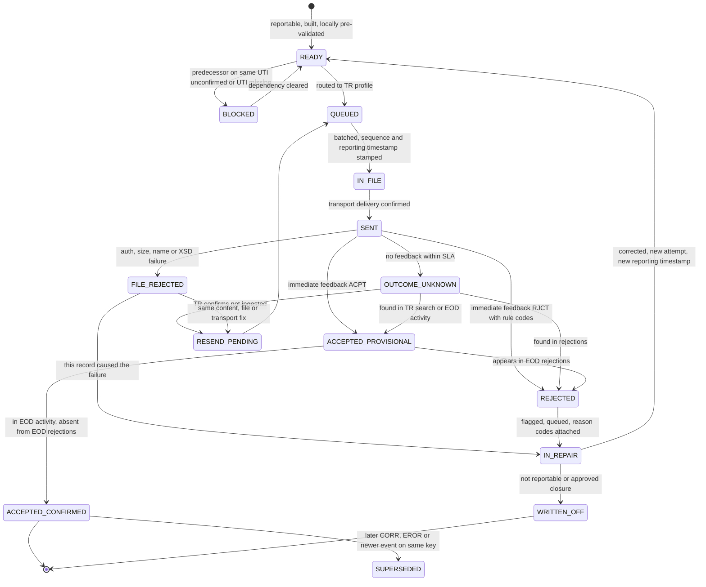

# 03 - Trade-repository regimes and the submission/response lifecycle

Research brief for the regulatory/financial reporting platform design spec. Prepared 2026-10-08. Confidence: H = read in a primary document or the TR's own documentation; M = vendor/law-firm summary or a primary page only partly readable; L = single weak source or inference. Source IDs (S1...) resolve to URLs and as-of dates in section 6. The web-search budget ran out late in the research, so some items (JFSA, parts of ASIC/CFTC/HKMA, ICE/CME/UnaVista connectivity) rest on earlier search summaries and are marked.

## 1. Summary

- Every derivatives TR regime has one shape: each counterparty (or its delegate) sends lifecycle events (new, modify, correct, terminate, error, revive, valuation, margin) for its own side of a trade; the TR validates, answers, reconciles the two sides and publishes end-of-day state. SFTR follows the same pattern with other messages. EU, UK, Australia, Singapore, Hong Kong and Japan use ISO 20022 XML; the US CFTC regime uses its own technical specification.
- TR feedback is a **three-tier ladder**, not one ack: (1) file level (authentication, size, file name, XSD failure "CRPT"); (2) record-level immediate feedback within 60 minutes (auth.092, all failed rule codes plus XPath); (3) end-of-day reports by 06:00 UTC next working day (accepted activity, rejections, warnings, state, reconciliation). Acceptance is provisional until end-of-day reports agree.
- The TR correlates feedback to a record by **business keys** (both LEIs, UTI, action type, reporting timestamp, event type, event date), not by an ID we choose. Our ledger must store exactly what was sent.
- The TR enforces its own duplicate and sequencing rules (one NEWT/POSC per reporting counterparty + UTI; only REVI after EROR; margin only after a derivative exists), so one rejected record blocks later events on the same UTI. The repair queue needs per-UTI ordering and dependency gating.
- Moving targets to absorb as configuration: EU reconciliation Phase II (Apr 2026), UK EMIR changes (26 Jan 2026) and UK Phase II (28 Sep 2026), EMIR 3 active-account reports to NCAs (first due 31 Jul 2026), ASIC CS 48 (proposed 1 Mar 2027), CFTC/SEC harmonisation request (Jun 2026), ESMA "report once" (earliest H2 2031).
- ISDA DRR ends at generating and pre-validating the reportable message; submission, response handling, repair and resend are our scope.

## 2. Key facts

| # | Claim | Src | As-of | Conf. |
|---|---|---|---|---|
| 1 | EU EMIR REFIT: auth.030 (trade) and auth.108 (margin) inbound; outbound auth.030/108 (activity), 107 (trade state), 109 (margin state), 092 (rejections), 091 (reconciliation), 106 (warnings); wrapped in head.003 + BAH head.001. KDPW lists versions 030.001.03, 108.001.01, 107.001.01, 109.001.01, 092.001.04, 091.001.02, 106.001.01. | S5, S6 | read 2026-10-08; Jul 2025 | H |
| 2 | ISO's May 2024 fast-track maintenance defines auth.030.001.04, 029.001.05, 091.001.03, 107.001.02, 108.001.02, 109.001.02; ASIC mandates 030.001.04 + 108.001.02. No EU/UK cut-over date found. | S4, S21 | May 2024; Oct 2025 | H (cut-over unknown) |
| 3 | TRs give immediate rejection feedback within 60 minutes of receipt and end-of-day rejection/warning/state/recon reports by 06:00 UTC (entities), 12:00 UTC (authorities), next working day. | S2 paras 605, 617, 626 | 23 Oct 2023 | H |
| 4 | Rejection categories: schema, authorisation, logical, business rule. XSD failure rejects the whole file ("CRPT"); a schema-valid file is "accepted" even if every record fails; a rejection lists all failed rule codes. | S2 paras 607-615; S6 p.54 | 2023; Jul 2025 | H |
| 5 | Error-code structure `EMIR-VR-<table digit><3-digit item>-<2-digit seq>` (EMIR-VR-1001-01, EMIR-VR-2151-03); generic EMIR-XML-001/002, EMIR-AUTH-001/002, EMIR-VR-0000-00. | S3 | page lists 6 Sep 2023 | H |
| 6 | Sequencing: first report per UTI is NEWT or POSC; one NEWT/POSC per Counterparty-ID + UTI accepted; after EROR only REVI; non-outstanding allows only EROR/REVI/MODI/CORR/VALU; REVI not allowed while outstanding. | S3 (field 2.151) | 2023 | H |
| 7 | Reporting timestamp must be <= TR receipt time, its date no earlier than the day before receipt, and >= execution timestamp. | S3 (field 1.1) | 2023 | H |
| 8 | Feedback identifies a record by both LEIs, UTI, action type, reporting timestamp, event type, event date, status ACPT/RJCT, rule id and XPath. | S2 Tables 90-91 | 2023 | H |
| 9 | Deadlines: end of the working day after conclusion/modification/termination; valuation and margin daily, by end of next working day; UTI generated and shared by 10:00 UTC on T+1. | S2 paras 168, 177-178, 193 | 2023 | H |
| 10 | REGIS-TR: REST (OAuth2, 4 MB inbound), SFTP (RSA-3072 keys, 1 GB inbound, upload under temp name then rename, 4-minute wait before a parallel connection, 14-day outbound retention), portal (50 MB per batch, 20 files); name `{account}_{S030\|S108}_{YYYYMMDD}_{HHMMSS}_{seq4}[_opt].xml`. | S6 | Jul 2025 | H (this TR only) |
| 11 | Reconciliation: pairing by UTI + both LEIs, then matching within tolerances; inter-TR through pairing request (auth.078) and auth.107 exchange; scope outstanding or outstanding in last 30 days; EROR removes unless REVI; two-working-day event-date lag. | S2 6.2; S6 p.71-72 | 2023; Jul 2025 | H |
| 12 | EU reconciliation Phase II went live Apr 2026 (DTCC/vendors 27 Apr; KDPW legal date 29 Apr, TR rollout weekend 25-26 Apr); UK Phase II 28 Sep 2026; +61 fields (to ~148); UK dropped underlying-index-name reconciliation. | S8, S10-S13 | 10-16 Apr 2026 | H (UK date) / M (counts) |
| 13 | UK EMIR amendments (Execution agent field, validation changes) apply from 26 Jan 2026; UK REFIT live 30 Sep 2024. | S8, S9 | 8 Aug 2025 | H |
| 14 | CFTC action types NEWT, MODI, CORR, EROR, TERM, REVI, PRTO, VALU, MARU; one action type per submission; Tech Spec v3.2 (implement by 29 Jan 2024); creation data due T+1 (SEF/DCM, SD/MSP/DCO) or T+2 (others). | S14, S15 | 1 Mar 2023; Nov 2020 | H |
| 15 | DTCC GTR (CFTC): four validation stages (schema, permission, core, jurisdictional); failure = NACK; up to 10,000 NACKs per batch report, 20 codes each; resubmit via same format/channel or sequence can break. | S18 | read 2026-10-08 | H |
| 16 | UTI = ISO 23897, pattern `[A-Z0-9]{18}[0-9]{2}[A-Z0-9]{0,32}` (max 52); EMIR uses ISIN (2.7) for venue-traded products, else ISO 4914 UPI (2.8, 12 chars, ANNA DSB). | S4, S2 para 240, S3 | 2024; 2023 | H |
| 17 | ASIC rules commenced 21 Oct 2024; CS 48 (27 Mar 2026) proposes 1 Mar 2027 commencement, EROR for collateral and a Subsequent position UTI. | S21, S22 | 2026 | H |
| 18 | EMIR 3 active-account reports go to competent authorities as CSV templates (Delegated Reg. (EU) 2026/305, in force 26 Feb 2026); first due 31 Jul 2026, then 31 Jan / 31 Jul. No TR-lifecycle change found. | S1, S23 | 13 Apr 2026 | H |
| 19 | ESMA's final report recommends a "report once" framework (optimistic: fully in place H2 2031) plus interim measures (wider delegated reporting, trimmer reconciliation fields, simpler errors-and-omissions regime). | S25 | 2 Jul 2026 | H |
| 20 | ISDA DRR covers generation and pre-validation of messages (ISO 20022 and CSV); firms still need architecture to submit and receive TR responses. | S26 | Nov 2025 | H |

## 3. Detailed findings

### 3.1 Regime map

| Regime | Live / latest change | Format and channel | Deadline | Notes |
|---|---|---|---|---|
| EU EMIR REFIT | 29 Apr 2024; Phase II recon Apr 2026; EMIR 3 AAR 2026 | ISO 20022 XML to EU TRs (REGIS-TR, DTCC GTR, KDPW_TR, LSEG seen in sources; ESMA register not retrieved) | T+1 working day | Dual-sided; trade and position level; daily valuation/margin for FC, NFC+, CCP |
| UK EMIR | 30 Sep 2024; 26 Jan 2026 changes; Phase II 28 Sep 2026 | UK-specific XSD and validation rules (FCA/BoE); TR-specific names (e.g. `auth.030.001.03_FCAUG_...`, L) | T+1 (L, not verified) | Diverges from EU on some fields |
| SFTR | Guidelines 2020; validation rules applicable 11 Sep 2023; no 2025-26 change on ESMA page | auth.052/070/071, state 079/085/086, status advice 084 | T+1 | Daily snapshots; pairing of loans only; 30-day recon tail; no REVI |
| CFTC 43/45 | Rewrite 5 Dec 2022; UPI Jan 2024 | SDR-specific to DTCC/CME/ICE SDRs | T+1 / T+2 | 2025 no-action letters (error notification relief below 5% of open swaps); joint CFTC-SEC request for comment, 91 FR 37877, 24 Jun 2026 |
| ASIC | 21 Oct 2024; amended 20 Oct 2025 | ISO 20022 auth.030.001.04, auth.108.001.02 | T+2, T+4 structured (M) | CS 48 pending |
| MAS | 21 Oct 2024 | ISO 20022 XML (M) | T+2 (M) | Interim UTI; FX swap link ID |
| HKMA/SFC | 29 Sep 2025 | ISO 20022 XML replaces CSV/FpML (M) | T+2 (M) | Global UTI mandatory for new trades |
| JFSA | 1 Apr 2024 (S26) | ISO 20022 (L) | not verified | Reports to a licensed TR (DDRJ) |

### 3.2 ISO 20022 message families

| Purpose | Message | Notes |
|---|---|---|
| Trade report (in) | auth.030 DerivativesTradeReport | Header (record count, pagination, optional new-TR id for porting) + 0..* TradData |
| Margin report (in) | auth.108 | Margin action types MARU, CORR |
| Rejections | auth.092 DerivativesTradeRejectionStatisticalReport | REGIS-TR file types I092 (immediate), S092 (EOD) |
| EOD activity | auth.030 / auth.108 ("TAR") | Accepted reports of the session |
| State | auth.107 ("TSR"), auth.109 ("MSR") | Latest state, event date up to 2 days earlier |
| Reconciliation | auth.091 | I091 immediate, S091 EOD; categories: reporting requirement, reporting type, pairing, reconciliation, valuation reconciliation, revived, further modifications |
| Warnings | auth.106 | No valuation/margin for 14 days; outliers; informational |
| Authority use | auth.029 query, auth.090 positions | Not firm-facing |
| Inter-TR | auth.078 pairing request | Per REGIS-TR handbook |
| Envelope | head.003.001.01 wrapper + head.001.001.01 BAH | head.003 is a SWIFT draft, not ISO-registered; BAH `BizSvc` carries environment |
| auth.031 | FinancialInstrumentReportingStatusAdvice | MiFIR/ARM feedback from authority to reporting agent; not an EMIR/SFTR TR message (M, S31). KDPW also lists an auth.031.001.01 as response to its proprietary auth.rlt.002.02 (L) |
| SFTR | auth.052/070/071 activity; 079/085/086 state; 084 status advice (rejections); recon status advice root `SctiesFincgRptgRcncltnStsAdvc` (auth.080 per a catalogue snippet, M) | 2020 guidelines cite 001.01 versions; newer exist (S27) |

ESMA says the schemas are free via ESMA and SWIFT MyStandards (registration only). "ULI": I found no standard so named in derivatives reporting; the nearest concepts are link fields (Prior UTI, Subsequent position UTI, PTRR ID, MAS FX Swap Link ID).

### 3.3 Identifiers and levels

- **UTI** (ISO 23897; CPMI-IOSCO guidance): LEI prefix + up to 32 characters. The ITS sets a generation waterfall (confirmation platform, agreed entity, FC over NFC, NFC+ over NFC-, last resort reverse-sorted LEI; order not fully verified). The receiver must use the UTI unaltered and must not invent its own after the 10:00 UTC T+1 cut-off; a late UTI means EROR the old and re-report (S2 paras 192-198).
- **UPI** (ISO 4914, ANNA DSB): where no ISIN. CFTC UPI live since 2024 for IR, FX, credit, equity.
- **Trade vs position**: a trade folded into a position is reported POSC at trade level; the position is a new UTI at level P, linked by Subsequent position UTI; afterwards only position-level events (para 115).

### 3.4 Action types and derivative status

EU codes: NEWT, MODI, CORR, TERM, EROR, REVI, VALU, POSC (trade); MARU, CORR (margin). ISO also lists COMP, OTHR, PRTO (S4). Rules (S2 paras 99-118, 168-186):

| Event | Action | Rule |
|---|---|---|
| Conclusion | NEWT | Same-day termination: NEWT then TERM; same-day inclusion in position: single POSC |
| Term change | MODI | Only when effective; never for corrections |
| Wrong data already reported | CORR | As soon as identified; event date = date the correction applies from |
| Never existed / duplicate | EROR | Per counterparty; other side unaffected |
| Early termination | TERM (same day) or MODI of maturity | Not at maturity |
| Reopen | REVI | From errored / mistaken termination / expired; must back-fill missed reports |
| Valuation / margin | VALU / MARU | Daily; past-day fix via CORR for that event date |

Status per reporting counterparty + UTI: Not reported -NEWT-> Outstanding; Outstanding -TERM/POSC-> Terminated; -EROR-> Errored; Errored/Terminated -REVI-> Outstanding or Terminated (by maturity); MODI/CORR/VALU/MARU never change status; reaching maturity ends outstanding status with no report. Late reports with past event dates are legitimate; TRs rebuild state in event-date order.

### 3.5 Valuation, collateral, margin

EU: FC, NFC+ and CCP report valuation and collateral daily for every outstanding derivative; event date = valuation/margin date; portfolio collateral first goes in as MARU and only after a covered derivative was reported; NFC- exempt and excluded from valuation reconciliation; auth.106 warns after 14 days without valuation or margin. SFTR: valuation, collateral, margin, reuse are full daily snapshots; no corrections for the current or previous day. CFTC: VALU and MARU as end-of-day reports.

### 3.6 TR feedback semantics

Order (S6, S2): authenticate sender -> file size/availability -> file name -> XSD (fail = CRPT, whole file) -> per record: permission (failure stops further checks on that record), logical, business rules -> immediate feedback (auth.092) with counts and per-record ACPT/RJCT, all failed codes and XPaths -> end-of-day set. Warnings never reject. If the failure concerns Counterparty 1/2 fields they may be missing in the rejection (S2 para 621), so correlate by file id plus position as fallback. TRs may withhold feedback from counterparties that are not TR users; the submitting entity must forward rejections and breaks to delegating parties (S2 para 92).

CFTC/DTCC: ACK/NACK per message; batch report limits above. ICE Trade Vault and CME TR REFIT-era response formats were not found publicly (legacy: ICE XML "Response" element; CME ack/nack file, duplicates rejected - L).

### 3.7 Reconciliation

Pairing precedes matching; only paired derivatives can be reconciled. Single-sided cases pair across TRs (auth.078) and exchange auth.107 detail. Runs daily, completes by 23:59:59 UTC on end-of-previous-day snapshots; a derivative leaves scope 30 days after ceasing to be outstanding or after EROR (unless REVI). Phase II adds valuation and more fields; ESMA's 2026 report intends a supervisory approach for field 2.16 (underlying index name). Reconciliation status belongs to a derivative side, never changes whether a report was accepted, and feeds a break queue.

### 3.8 Corrections, errors and omissions, delegation

- Rejected data must still be reported correctly by the deadline; accepted-but-wrong data is corrected as soon as found; historic misreporting and omissions are back-reported (S2 paras 175, 383). Counterparties keep records five years (S25 fn.16); TRs ten years.
- Significant errors must be notified to the NCA: many affected reports (threshold max{X, Y% of 12-month monthly average} per category: lifecycle, valuation, margin), total inability to report, or significant non-rejected errors (S2 paras 384-399). ESMA intends to simplify this (S25, recommendation 7).
- Delegation: reporting counterparty, ERR and RSE are separate fields (1.2-1.4); responsibility stays with the ERR; REGIS-TR models roles (Reporting Participant, Non-Reporting Entity, Third Party Internal/External) and requires delegation files confirmed by the delegating entity. Reporting to more than one TR is implied as allowed (S28). In full porting the old TR stops accepting lifecycle reports from the transfer start (S28 guideline 11).

### 3.9 TR connectivity (public information only)

| TR | Channels | Authentication | Naming / envelope | Limits / ack | Conf. |
|---|---|---|---|---|---|
| REGIS-TR (EU) | REST (SIX-hosted), SFTP, portal; paid CSV-to-XML converter | OAuth2 client credentials (token 3600 s); SFTP RSA-3072, max 5 keys, IP allow-list | head.003 + BAH + payload; ZIP outbound; responses reuse original name + I091/I092 | 4 MB API / 1 GB SFTP / 50 MB portal; outbound pages of 500,000 records; one ISO ack per file; quarantine folder 60 days | H |
| DTCC GTR | sFTP, MQ (FpML), web UI; simulator | Entitlements via Super Access Coordinators | Specs gated (EU message spec v1.7; ACK/NACK samples) | NACK semantics above; HK provider splits at 100,000 records | M |
| KDPW_TR | Browser (U2A), system (A2A) | Not public | head.003 + BAH + auth.xxx | auth.092/091 immediate; no separate ack for TAR found | M |
| LSEG (UnaVista / Regulatory Reporting B.V.) | UI, files; legacy SFTP spec (2013) with pre-agreed names, 25M-row cap | Not public | XML for REFIT; converter | Not public | L |
| ICE Trade Vault | Legacy HTTPS XML API with ICE certificate (2014); SFTP drops 05:00/11:00 UTC (2020) | Certificate | Not public | Not public | L |
| CME TR | Legacy SFTP incoming/outgoing folders, HTTPS web services (2016) | Account + password | Not public | Ack/nack file; duplicates rejected | L |

BME's ORK-TR SFTP guide (2017, MiFIR ARM) shows a `TMP_` upload prefix, MD5 suffix and GPG: a common pattern, not an EMIR spec.

### 3.10 Canonical lifecycle for the product

Entities: **Record** (one lifecycle event of one side of one derivative), **Attempt** (one transmission), **File** (what a TR acknowledges), **Derivative side** (CP1 + UTI: status and reconciliation state).

Keys:
- `record_key` = regime + TR profile + CP1 LEI + UTI + level + action type + event date (+ event type; + valuation/collateral timestamp for VALU/MARU), mirroring the TR's correlation tuple and duplicate rules.
- `content_hash` = hash of canonical payload excluding reporting timestamp, file id, BAH.
- `attempt_id` = file id + sequence + reporting timestamp actually sent.

**Record state machine**

| Trigger | Result | Side effects |
|---|---|---|
| I092 lists record ACPT | ACCEPTED_PROVISIONAL | Release dependent events |
| I092 lists record RJCT | REJECTED | Store all codes + XPath; owner from field table/item |
| 60-minute SLA + grace elapsed | OUTCOME_UNKNOWN | Poll TR (REST ingestions / portal); alert |
| EOD activity report contains key | ACCEPTED_CONFIRMED | Seal evidence pack |
| Regulatory deadline passes while REJECTED | breach flag | Feed errors-and-omissions counters |
| auth.106 warning | no state change | Open data-quality task |
| auth.091/107 break | derivative-side recon state only | Open break task; may produce a MODI/CORR record |

**File states**: BUILT -> SEALED (immutable bytes, hash, name, sequence) -> UPLOADING -> DELIVERED (HTTP 202 / rename done) -> REJECTED_AT_INGEST | CRPT | PROCESSED -> FEEDBACK_RECEIVED (counts reconcile with header record count) -> CLOSED when every member record is terminal. A PROCESSED file can hold zero accepted records.

**Partial acceptance**: record-level only; infer a record result from a file result only for CRPT or ingest rejection. Cross-check header `NbRcrds` against TR received/accepted/rejected counts.

**Duplicates and idempotency**: (a) retry transport only before delivery is confirmed; afterwards wait for feedback; (b) a second NEWT/POSC for the same CP1 + UTI is rejected (rule 2.151), so a duplicate-NEWT rejection against an already accepted record resolves to accepted (the specific sub-code is inferred); (c) repeated MODI/VALU/MARU are not rejected on that ground and add events, so allow at most one in-flight attempt per `record_key` and resend after OUTCOME_UNKNOWN only once the TR confirms non-ingestion or the next EOD report proves absence; (d) a resend re-stamps the reporting timestamp (rule 1.1 rejects a date older than the day before receipt).

**Rejected -> repair queue -> resend**: a repair item holds record, attempt history, rule codes, classification (XSD; authorisation/onboarding/delegation; field validation by table/item; sequencing; generic EMIR-VR-0000-00 -> TR support; reference data such as LEI status), regulatory due time with breach flag, and owner. After the fix, resend the **original action type** with corrected content (the TR never held the record); use CORR only for data the TR accepted. Dependents (later events on the UTI, margin for the portfolio) stay BLOCKED until the predecessor is ACCEPTED_PROVISIONAL, in event order unless legitimately late.

**Timing defaults (design proposals, not sourced)**: warn at 60 minutes; poll every 15 minutes to 120; hard checkpoint 06:00 UTC next working day (TARGET calendar for EU); transport retries 5x, exponential 2 s to 5 min with jitter; honour TR etiquette (REGIS-TR: four minutes before a parallel SFTP connection).

## 4. Design implications

1. **Separate concerns**: reportability/field derivation (rules, DRR), message build + pre-validation, and the lifecycle engine here. No regime logic inside the engine (R7, R8, R14).
2. **Ledger-first (outbox)**: persist record, attempt, file and raw bytes before sending; store every TR response raw; derive states from an append-only event log. Gives R4 evidence, R12 duplicate control, R13 recovery (replay, then resolve OUTCOME_UNKNOWN against TR queries).
3. **TR/regime profiles as data**: channel, credentials, file-name template, size and record limits, BAH values, XSD and validation-rule versions with effective dates, deadline calendars, feedback parsers. Needed for Phase II, UK divergence, a 030.001.04 cut-over, ASIC 2027.
4. **Rule-pack registry** (XSDs, ESMA/FCA workbooks, error-code to field map, tolerances); local pre-validation (R10) emits the same `EMIR-VR-nnnn-nn` codes the TR would.
5. **Correlate by business key**; keep the exact reporting timestamp sent; handle rejections with missing counterparty fields.
6. **Per-UTI sequencer** with dependency gating, head-of-line-blocking visibility and a local derivative-status model to predict sequence rejections.
7. **Clocks**: per-record regulatory deadline (T+1/T+2, calendars, UTI 10:00 UTC), 60-minute feedback SLA, EOD checkpoint, breach flags and errors-and-omissions volume counters by category against the 12-month average (R6, R9).
8. **Repair queue**: reason codes link to the legal field (table/item) for R9; bulk fixes for systemic causes; CRPT flow resends unchanged content.
9. **Reconciliation inbox**: ingest auth.091/107 into per-derivative-side state with its own break queue; never conflate with acceptance.
10. **Delegation model**: multi-LEI roles (RC, ERR, RSE), notifications to delegators, delegation-file handling, per-TR account mapping.
11. **Non-TR outputs** (EMIR 3 AAR CSV to NCAs, E&O notifications) reuse the ledger with another destination type and manual/no response.
12. **Resilience (R2, R13)**: single writer per TR channel, idempotent consumers, resumable SFTP, streaming XML (up to 1 GB inbound at REGIS-TR), paging of outbound reports (500,000 records), raw-response retention of at least five years.
13. **Replaceable submission layer**: ESMA's integrated framework and CFTC/SEC harmonisation will change formats while lifecycle states, ledger and repair workflow stay.

## 5. Risks and unknowns

- TR specs for DTCC, ICE, CME and LSEG/UnaVista are login-gated or old; names, ack formats, rate limits need onboarding documents. Only REGIS-TR is documented to implementation level (Jul 2025).
- Which versions of auth.030/091/107/108/109 each EU/UK TR accepts, and from when (001.03 vs 001.04), is unconfirmed. ESMA's EMIR page still shows XSD v1.0.0 (27 Nov 2023) and validation rules of 6 Sep 2023; it may lag TR practice.
- Phase II counts (61 new fields, ~148 total, 39 exact-match) are vendor-sourced; derive the authoritative list from the "Reconciliation start date" and tolerance columns of the validation workbook. Four new statuses were reported but not listed in any source I read.
- Sub-code to numbered-condition mapping (e.g. EMIR-VR-2151-03 = duplicate NEWT) is inferred from list order.
- Whether immediate feedback lists accepted records individually or only counts is TR-dependent (ESMA's example shows ACPT/RJCT per record).
- UK working-day calendar and UK T+1 wording unverified; the EU text cites TARGET2 (now T2).
- JFSA deadline/format, HKMA validation behaviour, ASIC T+2/T+4, CFTC letters 25-42/25-43 (Dec 2025) rest on vendor or search summaries.
- ESMA's TR page lists a REGIS-TR sanction dated 19 Feb 2026 (details not retrieved): TR operational risk is real; multi-TR readiness matters.
- Licence/reuse terms for ESMA/FCA workbooks and schemas not checked beyond "free via ESMA/MyStandards".
- "ULI" could not be identified as a standard; confirm intent.
- Future dates: ASIC 1 Mar 2027 (proposed, needs ministerial consent); next AAR report 31 Jan 2027 (inferred from the semi-annual schedule); EMIR 3 Art. 7d awaiting Level 2; integrated reporting H2 2031 (optimistic).

## 6. Source list

| ID | Source and URL | As-of |
|---|---|---|
| S1 | ESMA EMIR reporting page, https://www.esma.europa.eu/data-reporting/emir-reporting | read 2026-10-08 |
| S2 | ESMA Guidelines on reporting under EMIR (ESMA74-362-2281), https://www.esma.europa.eu/sites/default/files/2023-10/ESMA74-362-2281_Guidelines_EMIR_REFIT.pdf | 23 Oct 2023 |
| S3 | ESMA validation rules workbook (ESMA74-362-2683), https://www.esma.europa.eu/sites/default/files/library/esma74-362-2683_emir_refit_validation_rules_reconciliation_tolerances_and_template_for_notifications_of_dq_issues.xlsx | ESMA page date 6 Sep 2023 |
| S4 | ISO 20022 MDR Part 2, TR reporting fast-track maintenance, https://www.iso20022.org/sites/default/files/documents/messages/mdr_part_2/ISO20022_MDRPart2_FITRR_TradeRepositoryReporting_May2024_v1.pdf | May 2024 |
| S5 | KDPW_TR XML messages, https://kdpw.pl/en/xml-messages.html | read 2026-10-08 |
| S6 | REGIS-TR EMIR REFIT Client Handbook (mirror), https://kelerms2024.sensenet.com/api/Content/File?id=225521 ; REGIS-TR EMIR page, https://www.regis-tr.com/en/home/regulatory-reporting/emir.html | Jul 2025; 2026-10-08 |
| S8 | FCA UK EMIR news, https://www.fca.org.uk/markets/uk-emir/news | read 2026-10-08 (to 29 May 2026) |
| S9 | Bank of England PS, https://www.bankofengland.co.uk/paper/2025/ps/amendments-to-the-uk-emir-trade-repository-reporting-requirements-august-2025 | 8 Aug 2025 |
| S10 | KDPW TR+ news, https://www.trplus.kdpw.pl/en/news-and-events/new-emir-reconciliation-requirements-coming-this-april/56.html | 10 Apr 2026 |
| S11 | KDPW TR+ news, https://www.trplus.kdpw.pl/en/news-and-events/this-weekend-marks-an-important-milestone-for-kdpw-tr/57.html | 23 Apr 2026 |
| S12 | Kaizen Reporting, https://www.kaizenreporting.com/emir-inter-tr-reconciliation-phase-2-2026/ | 14 Apr 2026 |
| S13 | Point Nine, https://www.p9dt.com/news/uk-emir-reconciliation-phase-2-update/ | 2026 |
| S14 | CFTC Technical Specification v3.2, https://www.cftc.gov/media/8261/Part43_45TechnicalSpecification03012023CLEAN/download | 1 Mar 2023 |
| S15 | CFTC final rule 2020-21569, https://www.cftc.gov/LawRegulation/FederalRegister/finalrules/2020-21569.html | Nov 2020 |
| S16 | Skadden on CFTC error-notification relief, https://www.skadden.com/insights/publications/2025/08/cftc-provides-no-action-relief | Aug 2025 |
| S17 | CFTC/SEC request for comment, https://www.cftc.gov/PressRoom/PressReleases/9257-26 | 18 Jun 2026 |
| S18 | DTCC GTR CFTC validation page, https://dtcclearning.com/products-and-services/repository-services/gtr-cftc-canada-sec/2445-message-validation-and-exception-management-noa.html ; GTR EU page, https://dtcclearning.com/products-and-services/repository-services/eu-emir-refit-1.html | read 2026-10-08 |
| S20 | DTCC on HKMA rewrite, https://www.dtcc.com/insights/2025/the-path-to-readiness-for-hkmas-derivatives-reporting-rewrite | 2025 |
| S21 | ASIC reporting page, https://www.asic.gov.au/regulatory-resources/markets/otc-derivatives/derivative-transaction-reporting | amended 20 Oct 2025 |
| S22 | ASIC CS 48, https://www.asic.gov.au/regulatory-resources/find-a-document/consultations/cs-48-proposed-changes-to-the-asic-derivative-transaction-rules-reporting-2024 | 27 Mar 2026 (feedback summary 25 Sep 2026) |
| S23 | ESMA AAR templates, https://www.esma.europa.eu/press-news/esma-news/esma-releases-reporting-templates-and-instructions-active-account-requirement ; A&O Shearman on ESMA statement, https://finreg.aoshearman.com/esma-statement-on-upcoming-reporting-obligations-under-emir-3 | 13 Apr 2026; 11 Dec 2025 |
| S25 | ESMA Final Report on simplification of transaction reporting (ESMA12-1406959660-3235), fetched copy; URL not captured | 2 Jul 2026 |
| S26 | ISDA, Industry Perspectives on the ISDA DRR, fetched copy; URL not captured | Nov 2025 |
| S27 | ESMA SFTR page, https://www.esma.europa.eu/data-reporting/sftr-reporting ; SFTR Guidelines, https://www.esma.europa.eu/sites/default/files/library/esma70-151-2838_guidelines_on_reporting_under_sftr.pdf | read 2026-10-08; Dec 2020 |
| S28 | ESMA Guidelines on data transfer between TRs, https://www.esma.europa.eu/sites/default/files/2024-01/ESMA74-362-2351_Guidelines_on_data_transfer_between_trade_repositories_EMIR_SFTR.pdf | Jan 2024 |
| S29 | ESMA trade repositories page, https://www.esma.europa.eu/esmas-activities/markets-and-infrastructure/trade-repositories | read 2026-10-08 |
| S30 | LSEG, https://www.lseg.com/en/post-trade/regulatory-reporting/solutions/emir-reporting ; ECC, https://www.ecc.de/en/clearing/emir/trade-reporting-under-emir-refit ; BME ORK-TR SFTP guide, https://www.meff.es/docs/docsSubidos/MiFID_eng/Connectivity_Guide_and_Naming_SFTP_Ver_1_3.pdf ; ICE and CME legacy PDFs seen only in search results | 2017-2026 |
| S31 | iotafinance auth.031, https://www.iotafinance.com/en/SWIFT-ISO20022-Message-auth-031-001-Financial-Instrument-Reporting-Status-Advice.html ; auth.084, https://www.iotafinance.com/en/SWIFT-ISO20022-Message-auth-084-001-Securities-Financing-Reporting-Transaction-Status-Advice.html | read 2026-10-08 |
| S32 | MAS: Allen & Gledhill, https://www.allenandgledhill.com/sg/publication/articles/28296/changes-to-otc-derivatives-reporting-regime-under-securities-and-futures-reporting-of-derivatives-contracts-regulations-2013-to-adopt-cpmi-iosco-technical-guidance-to-take-effect-on-21-october-2024 (via search summary, M) | 2024 |

## Independent verification (2026-10-08)

Method: an independent fact-checker re-read the primary documents (ESMA Guidelines ESMA74-362-2281, text extracted from the PDF; the ESMA validation-rules workbook parsed sheet by sheet; ISO 20022 MDR Part 2 May 2024; the REGIS-TR EMIR REFIT Client Handbook July 2025; KDPW, FCA, BoE, DTCC, ESMA, ASIC and ISDA pages) rather than trusting the brief. The web-search budget was exhausted during the check, so everything below rests on direct page and document fetches; items I could not fetch are marked unverifiable. 12 claims were selected (related key facts merged): all load-bearing ones, plus the claims with medium confidence. Verdict summary: no claim refuted; 7 confirmed, 5 confirmed with a correction or caveat that matters for design.

| # | Claim (brief key fact) | Verdict | Correction / caveat | Evidence (as-of) |
|---|---|---|---|---|
| 1 | EU message set, KDPW versions, ISO May 2024 versions and action codes (facts 1, 2) | Confirmed | KDPW page (effective 29 Apr 2024, page itself undated) lists exactly auth.030 001.03, 108 001.01, 107 001.01, 109 001.01, 092 001.04, 091 001.02, 106 001.01 plus head.001 and head.003, inbound and outbound. ISO MDR May 2024 (SEG approval 18 Apr 2024) defines 029.001.05, 030.001.04, 091.001.03, 107.001.02, 108.001.02, 109.001.02 (auth.092 and auth.106 are not in that set). TransactionOperationType10Code holds COMP, CORR, EROR, MODI, NEWT, OTHR, POSC, REVI, TERM, VALU, MARU, PRTO. Caveat on auth.031: the ISO name is Financial Instrument Reporting Status Advice, but KDPW also lists auth.031.001.01 as the response to its own entity-relations message auth.rlt.002.02, so "not a TR message" holds for ESMA/ISO usage, not for KDPW's relationship workflow. ASIC's page lists 030.001.04 and 108.001.02 as the current message definitions (it does not use the word "mandated"). No EU/UK cut-over date to 001.04 could be found: ESMA's EMIR page still shows schemas v1.0.0 dated 27 Nov 2023; REGIS-TR's Jul 2025 handbook names no auth versions; FCA says UK XML schema updates were published Aug 2025 (version not stated). Treat as unknown. head.003 as a SWIFT draft not registered by ISO 20022 is confirmed by the REGIS-TR handbook. | https://kdpw.pl/en/xml-messages.html ; https://www.iso20022.org/sites/default/files/documents/messages/mdr_part_2/ISO20022_MDRPart2_FITRR_TradeRepositoryReporting_May2024_v1.pdf (May 2024) ; https://www.esma.europa.eu/data-reporting/emir-reporting (read 2026-10-08) |
| 2 | Feedback timing and reporting deadlines: 60 min, 06:00/12:00 UTC, T+1, UTI 10:00 UTC (facts 3, 9) | Confirmed | Paras 605 and 617/626 match. Detail: the 60 minutes run from the moment the file enters the TR system and the feedback goes to the report submitting entity; counterparties and ERRs get it only if on-boarded and interested (paras 606, 618). The TSR and reconciliation reports use the same 06:00/12:00 UTC pattern (Table 89, paras 595-597), and the text says TARGET 2 calendar, as the brief notes. Deadlines: para 168 (working day following), 177 (valuation by end of the working day following the valuation date), 193 (UTI by 10:00 am UTC on T+1). Para 178 says margin is "sent daily" and reported when effective; it does not itself state "next working day" (that comes from Art. 9). Errors and omissions: notification is by the ERR (or RSE) and assessed at ERR/RSE level; the threshold is max{X; Y% of the 12-month average} with X and Y "calibration constants" that ESMA "intends to specify" (Table 23 is an example), so no final numbers exist in the Guidelines. | https://www.esma.europa.eu/sites/default/files/2023-10/ESMA74-362-2281_Guidelines_EMIR_REFIT.pdf (cover date 23 Oct 2023) |
| 3 | Rejection categories, CRPT, accepted-file semantics, record identification (facts 4, 8) | Confirmed | Paras 607-615 and Tables 90-91 match: four categories; non-compliant XML = whole file "corrupted", counted as 1 file rejection; a schema-valid file whose records all fail counts as accepted (3 rejected, 0 accepted); a rejection carries all error codes with XPath (para 612). The record key in the XML is reporting counterparty LEI, submitting entity, entity responsible, other counterparty LEI, UTI, action type, reporting timestamp, event type, event date, status ACPT/RJCT, rule id, XPath; counterparty fields may be missing for field 1.4/1.9 failures (paras 621, 623). Addition for the state machine: CRPT is only an example value in ESMA's tables; REGIS-TR defines the file and record status codes ACPT, CRPT (schema error), INCF (incorrect file name), NAUT (not authorised), RJCT and WARN (record-level, "not controlled errors"). Model INCF and NAUT as TR-specific file or record outcomes, not just ACPT/RJCT/CRPT. | ESMA Guidelines (above) ; https://kelerms2024.sensenet.com/api/Content/File?id=225521 (REGIS-TR handbook, July 2025, p.58-60) |
| 4 | Error-code structure and generic codes (fact 5) | Confirmed; the caveat is reversed | Generic codes confirmed exactly: EMIR-XML-001/002, EMIR-AUTH-001/002, EMIR-VR-0000-00 (sheet "Non-Field-specific_Error_Codes"). The brief says the sub-code to condition mapping is "inferred from list order". It is in fact explicit: each field row lists the numbered conditions and a parallel numbered code list, e.g. field 2.151 conditions 1-6 map to EMIR-VR-2151-01 to -06, so EMIR-VR-2151-03 is the rule "only one NEWT/POSC per Counterparty ID-UTI is accepted". The two-digit suffix is confirmed in the workbook; ESMA's own example messages print "EMIR-VR-1001-6" (one digit), so the parser should accept both. The workbook is dated 6 Sep 2023 on ESMA's page (still the current file on 2026-10-08); it has nine sheets and no separate tolerance sheet (tolerance and start-date columns sit inside "Validations_Cpty_derivative"). | https://www.esma.europa.eu/sites/default/files/library/esma74-362-2683_emir_refit_validation_rules_reconciliation_tolerances_and_template_for_notifications_of_dq_issues.xlsx |
| 5 | Sequencing/duplicate rules (2.151) and reporting-timestamp rules; resend needs a fresh timestamp (facts 6, 7) | Confirmed; one inference overstated | 2.151 rules 2-6 confirmed word for word (first report NEWT or POSC; one NEWT/POSC per Counterparty ID-UTI; after EROR only REVI until REVI is accepted; non-outstanding allows only EROR, REVI, MODI, CORR, VALU; REVI not allowed while outstanding). Timestamp rules EMIR-VR-1001-02/-03/-04 confirmed; there is also a fifth rule, EMIR-VR-1001-05: the timestamp must be on or after 2024-04-29. Correction: rule -03 only fails when the date part is earlier than the day preceding receipt, so a same-day or next-day resend could legally reuse the original timestamp. The field is defined as the date and time of submission, so re-stamping on every attempt is still the right design and keeping it out of the idempotency key is sound, but "needs a fresh timestamp" is a design choice, not a rule. Margin: no rule literally says MARU is invalid without a prior derivative; the rules are EMIR-VR-3009-02 (portfolio code must pertain to at least one previously reported derivative, otherwise the field must be blank) and EMIR-VR-3010-02 (same for the UTI), plus Guidelines para 180. New fact from the workbook (general note 4): conditional validations that depend on fields absent from the report are evaluated against the last accepted report on top of the latest TSR, and only when the event date is T or T-1. | ESMA workbook (above), sheets Validations_Cpty_derivative and Validations_Margins |
| 6 | REGIS-TR connectivity numbers and file naming (fact 10) | Confirmed | All numbers match the July 2025 handbook: REST 4 MB inbound (REGIS-TR to entity 20 MB), SFTP 1 GB, portal 50 MB per batch and up to 20 files, OAuth token expires_in 3600, RSA 3072-bit keys (max 5 per account), temporary file name then rename, four minutes before a parallel connection from the same IP, FromREGISTR retention 14 days, quarantine folder 60 days, outbound files paginated at 500,000 records, one ISO 20022 acknowledgement per uploaded file, inbound name account_S030 or S108_YYYYMMDD_HHMMSS_seq4[_optional].xml (optional ID up to 50 characters), responses reuse the original name with I092 or I091. Caveats: single TR, July 2025 vintage, and the file is a mirror hosted on a third-party CMS (the REGIS-TR domain was not re-fetched); REGIS-TR also bans the characters ! \ @ # $ % * < > in inbound files (quarantine trigger). | https://kelerms2024.sensenet.com/api/Content/File?id=225521 (July 2025) |
| 7 | Reconciliation scope, pairing, inter-TR exchange, lag (fact 11) | Corrected (minor) | Pairing before matching (paras 654-655), EROR exclusion unless followed by REVI (para 591c) and the two-working-day event-date lag (para 595) are confirmed. Correction on scope: in scope means outstanding or outstanding in the last thirty calendar days (591d), while removal happens once a derivative has been non-outstanding for thirty-one calendar days or more (593); REGIS-TR's handbook says "30 days". Use 31 days as the exit rule. The inter-TR mechanism (pairing request auth.078, exchange of auth.107 detail, run complete by 23:59:59 UTC) comes only from the REGIS-TR handbook (p.71-72); the ESMA Guidelines do not name auth.078, so treat it as TR-specific. | ESMA Guidelines paras 591-597, 654-655 ; REGIS-TR handbook (above) |
| 8 | DTCC GTR four-stage validation, NACK limits, resubmission rule (fact 15) | Confirmed | Stages: schema, permission, core, jurisdictional; any failure yields a NACK; a batch download report holds up to 10,000 NACKs with up to 20 error codes each; corrected NACKs must be resubmitted in the same format and channel or the message sequence can break. Caveat: the page content is dated 4 Oct 2021 (site footer 2026), so the limits could be stale; confirm at onboarding. | https://dtcclearning.com/products-and-services/repository-services/gtr-cftc-canada-sec/2445-message-validation-and-exception-management-noa.html (content 4 Oct 2021, read 2026-10-08) |
| 9 | UTI pattern, ISIN/UPI identification, no "ULI" (fact 16) | Confirmed with a design-relevant caveat | The ISO schema datatype UTIIdentifier is exactly [A-Z0-9]{18}[0-9]{2}[A-Z0-9]{0,32} (ISO 23897:2020, max 52). But the EU validation rule for field 2.1 (EMIR-VR-2001-01/-02) allows up to 52 characters including four special characters (colon, full stop, hyphen, underscore), not at the start or end, for action types other than NEWT and POSC; only NEWT and POSC are restricted to A-Z and 0-9. Do not apply the strict ISO pattern to lifecycle events on older UTIs in local pre-validation. Whether the schema version actually deployed at EU TRs (001.03) enforces the pattern is unverified. ISIN 2.7: mandatory when the venue MIC is an RM/MTF/OTF or XOFF, optional for an SI; UPI 2.8: must be blank if 2.7 is populated, otherwise populated (12 characters, valid in the ANNA DSB database). No standard named "ULI" was found in any document read. | ISO MDR May 2024 (datatype 8.2.5.7) ; ESMA workbook rows 2.1, 2.7, 2.8 |
| 10 | ISDA DRR scope and ACK rates (fact 20) | Confirmed, caveat on the figures | Document: "Industry Perspectives on the ISDA DRR: Unlocking Efficiency, Accuracy and Strategic Value", November 2025 (direct URL not located; a cached copy was read). It states firms still need regulatory reporting architecture to send submissions and receive TR responses, and that DRR supports the process up to generation and pre-validation of messages (ISO 20022 and CSV). The 100% (MAS) and 98.2% (EMIR Refit) figures are single-bank interview anecdotes ("one bank", "another"), where ACK rate means the share of submissions acknowledged by the repository or regulator. They are not industry benchmarks and not record-level acceptance rates, and the brief's "at go-live" is right only for MAS (the EMIR figure is "following implementation"). | ISDA, Industry Perspectives on the ISDA DRR, Nov 2025 (https://www.isda.org/ ; exact URL not located) |
| 11 | EU Phase II reconciliation and UK dates (facts 12, 13) | Confirmed (counts vendor-sourced) | KDPW (10 Apr 2026): legal date 29 Apr 2026, TR rollout weekend 25-26 Apr, four new valuation fields, new reconciliation statuses unnamed, no total count. Kaizen (14 Apr 2026): 61 further fields, 148 reconcilable in total, no exact-match or new-status counts. The "27 Apr" vendor date was not rechecked. UK: the FCA validation-rules update of 16 Apr 2026 sets the reconciliation start date to 28 Sep 2026, removes reconciliation of Table 2 item 16 (Name of the underlying index) and aligns Report Tracking Number rules with Q&A 4.13; the FCA page does not use the term "Phase II". UK amendments: BoE PS of 8 Aug 2025 and Handbook Notice 132 give 26 Jan 2026 (moved from the proposed 1 Dec 2025); the FCA page says the validation rules and XML schemas were published in Aug 2025, not on 26 Jan 2026. UK REFIT application on 30 Sep 2024 is confirmed by the FCA page. Timing flag: as of 2026-10-08 both the EU (Apr 2026) and UK (28 Sep 2026) dates are already in the past, and the FCA page shows no item after 29 May 2026. | https://www.trplus.kdpw.pl/en/news-and-events/new-emir-reconciliation-requirements-coming-this-april/56.html ; https://www.kaizenreporting.com/emir-inter-tr-reconciliation-phase-2-2026/ ; https://www.fca.org.uk/markets/uk-emir/news ; https://www.bankofengland.co.uk/paper/2025/ps/amendments-to-the-uk-emir-trade-repository-reporting-requirements-august-2025 |
| 12 | SFTR message set and behaviour (section 3.2, medium confidence) | Confirmed; date corrected | ESMA SFTR Guidelines ESMA70-151-2838 confirm activity messages auth.052.001.01 (counterparty, loan, collateral), auth.070.001.01 (margin), auth.071.001.01 (reuse), state messages 079.001.01 (read as auth.079), auth.085.001.01, auth.086.001.01, and the end-of-day rejection report auth.084.001.01 with the same file/record logic as EMIR (serious schema error = 1 file rejection). Valuation, collateral and reuse are daily snapshots. The copy read is dated 29/03/2021, not Dec 2020 as the brief says. The reconciliation status advice root SctiesFincgRptgRcncltnStsAdvc as auth.080 rests only on the third-party iotafinance catalogue, which does not itself say SFTR: keep at medium or low. | https://www.esma.europa.eu/sites/default/files/library/esma70-151-2838_guidelines_on_reporting_under_sftr.pdf (29 Mar 2021) ; https://www.iotafinance.com/en/SWIFT-ISO20022-Message-auth-080-001-Securities-Financing-Reporting-Reconciliation-Status-Advice.html |

Incidental observations from reading the same sources (outside the 12 selected claims, so not counted above):

- ESMA final report ESMA12-1406959660-3235 is dated 2 Jul 2026 on its cover; para 154 says the fully integrated solution "could be expected" toward H2 2031; recommendation #6 is the field 2.16 supervisory approach (conditional on Phase II results); the E&O simplification is Level 2/3 recommendation #7 in the full report (ESMA's July 2026 factsheet numbers it #8, so cite the report, not the factsheet). Expanded delegated reporting is Level 1 recommendation #1 (needs legislation), so it is not a quick interim measure. The MiFIR back-reporting horizon cut (five to three years) is recommendation #3.
- CFTC Technical Specification v3.2 is dated 1 Mar 2023 with implementation by 29 Jan 2024 and lists the nine action types; the joint CFTC-SEC request for comment is press release 9257-26 (18 Jun 2026), Federal Register 91 FR 37877 (24 Jun 2026). Later specification versions were not checked.
- ASIC CS 48: released 27 Mar 2026, proposed commencement Monday 1 Mar 2027 subject to Ministerial consent, adds EROR for collateral and a Subsequent position UTI; the closing date was extended to 22 May 2026; ASIC released a feedback summary on 25 Sep 2026 (five confidential, seven non-confidential submissions). ASIC's reporting page was last amended 20 Oct 2025 and gives no explicit commencement date for the 2024 Rules (21 Oct 2024 is inferred from "2022 Rules until 20 Oct 2024").
- ESMA active-account (AAR) templates were published 13 Apr 2026, reports go to competent authorities, first submission 31 Jul 2026 for 25 Jun 2025 to 30 Jun 2026, then every 31 Jan and 31 Jul; Delegated Regulation (EU) 2026/305, in force 26 Feb 2026, is on ESMA's EMIR page. The AAR page does not say "CSV"; the templates are a zip plus an XLSX of instructions, so the CSV claim is unverified.

Corrections that would change a design decision:

1. Do not hard-code the strict ISO UTI regex as a blocking local rule for every action type. EU rule EMIR-VR-2001 permits ":", ".", "-" and "_" in the UTI of non-NEWT/POSC events; apply the strict pattern to NEWT/POSC only, and make the per-schema-version pattern part of the rule-pack data.
2. Treat "fresh reporting timestamp on resend" as a design choice (the field means submission time), not a validation requirement; the rule only rejects dates older than the day before receipt. The idempotency key still excludes the timestamp, but a same-day retry is not forbidden from reusing it.
3. The sub-code to condition mapping is explicit in the ESMA workbook (parallel numbered lists), so the error-code to rule and field map can be built mechanically and treated as authoritative, with a lenient parser for the one-digit suffix ESMA prints in its examples.
4. Model TR-specific file and record outcomes beyond ACPT/RJCT/CRPT: at least INCF (bad file name), NAUT (not authorised) and a non-rejecting record-level WARN, as defined by REGIS-TR; keep the status vocabulary in the TR profile.
5. The reconciliation exit rule is 31 days non-outstanding (Guidelines para 593) while scope uses "outstanding in the last thirty calendar days"; auth.078 pairing is a REGIS-TR mechanism, not an ESMA requirement. Do not build auth.078 handling into the core.
6. Local pre-validation must replicate the TR rule that dependent conditions are checked against the last accepted report plus the latest TSR only for event dates T and T-1 (workbook general note 4); backdated events skip those checks, so a locally predicted rejection and the TR result can differ.
7. The ISDA ACK-rate figures must not be used as a planning baseline for rejection volumes: they are single-bank anecdotes about acknowledgement rates, not record rejection rates.
8. Timing language: the EU Phase II and UK 28 Sep 2026 reconciliation changes are in the past on 2026-10-08. Remaining forward-looking items are ASIC 1 Mar 2027 (proposed, Ministerial consent needed; feedback summary already published), the next AAR report on 31 Jan 2027, and ESMA's "report once" framework toward H2 2031 (needs Level 1 change). Whether the UK date went live as planned was not checked after 29 May 2026.
