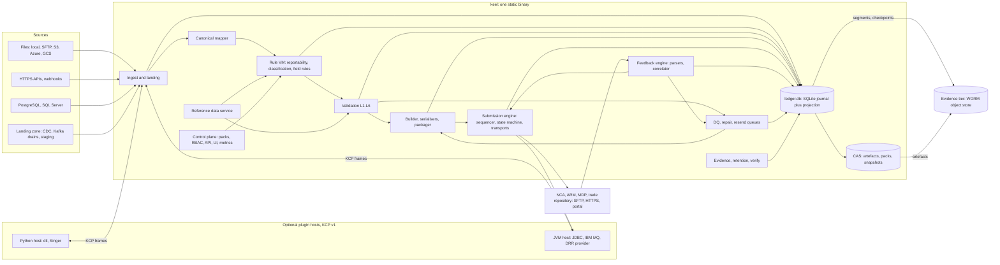

# Approach A: Lean single-deployable core (working name "Keel")

Design approach for the competitive review. As-of 2026-10-08. Design only: nothing is built or benchmarked, and figures marked "target" are hypotheses for the spikes in section 15. Where a brief has an "Independent verification" section, its corrections are used.

## 1. Thesis

One static binary, one data directory, one immutable evidence bucket: no database server, JVM, broker or scheduler to patch (R2). Everything that moves with regulation (rules, reason codes, citations, validation catalogues, destination profiles, schema pins) is **signed data** loaded at runtime. The binary changes for security patches and new capability families only.

Leanness costs no audit or recovery because of one invariant, the **durable-before-effect rule**: no external side effect (first byte to a destination, ack to a source, move of a source file) happens until the journal entry that justifies it is durable in the evidence tier. Recovery is then deterministic replay plus resolving in-doubt sends against each destination's own feedback.

A knowingly gives up built-in connector breadth, horizontal scale, automatic failover and in-process DRR.

## 2. Runtime and stack decision

**Choice: Rust (stable, edition 2024), one static binary, a workspace of small crates.** Logic crates (rules, validation, formats, state machine) have no I/O dependencies, so TDD loops stay fast despite Rust build times.

The stack brief recommends Java 25 (weighted 4.4; Go 3.2, .NET 3.6, Rust 3.0). Rust loses on DRR in-process, XSD, DB drivers and MQ clients. A moves each off the critical path instead of disputing the scores:

| Objection | A's answer |
|---|---|
| DRR runs only on the JVM | R7 says "a model like" DRR, which A incorporates natively (section 9). DRR MiFIR is not live; its licence is unsettled (docs: free for non-commercial use; ISDA PDF: "without modifications", Larger Work, broad indemnity); 7.14 is pinned to CDM 6.29 and Rune 9.95. DRR stays an optional out-of-process provider |
| XSD engines are thin | ESMA's MiFIR XSDs use no XSD 1.1 constructs. Facets compile into in-house per-record validators; the whole-file gate sits behind a `SchemaGate` trait (libxml2, pinned and statically linked: thinly maintained, five releases in the last year). Xerces-J/JAXP runs in CI only, as a differential oracle |
| Drivers and MQ need vendor clients | Plugin protocol (section 11); the JVM host is optional |

**Why Rust over Go:** no GC gives flat, predictable memory (R2), and exhaustive enums make the state machine and rule VM compiler-checked. Go wins on hiring, build speed, SFTP and driver maturity, and FIPS (native module, CMVP #5247). The brief's own sensitivity runs rank Go at or above Rust, so **this is A's most contestable choice.**

| Flip trigger | Flip to |
|---|---|
| DRR must run in-process, or most estates are Oracle/Db2/MQ | Java 25 jlink image, same contracts ("A-JVM") |
| FIPS 140-3, hiring or build time dominates, or spikes SP3/SP4 fail | Go |
| .NET mandated, or Rune C# (common-domain-model#5169) reaches DRR parity | .NET 10 |
| Synchronously replicated HA mandated | Rust plus a PostgreSQL `LedgerStore` |

The journal, plugin protocol, pack and profile formats are language-neutral specifications.

## 3. Components and packaging



**Data directory:** `ledger.db`, `cas/` (content-addressed, zstd), `refdata.db`, `config.toml`, signed packs. **Concurrency:** tokio for I/O; one writer actor owns ledger writes (group commit); a bounded CPU pool runs the VM, validation and XML build; one sender task per destination; bounded queues and 50k-record batches (target: RSS at most 512 MB for a 10M-record run). **Operator lifecycle:** upgrade is drain, replace binary, restart; the projection is rebuilt from the journal, not ALTERed; regulatory change is a pack activation. Dependencies are vendored and pinned, with a licence allow-list and a CycloneDX SBOM per release.

## 4. Data flow

1. A connector yields a batch plus an opaque checkpoint; raw bytes go to CAS, `BatchLanded` is journalled, and the source ack waits for `durable_seq`.
2. A mapping pack produces canonical `TxnEvent` rows; enrichment stamps reference-data snapshot ids onto the input (the VM does no I/O).
3. The VM emits a `DecisionRecord` for every candidate, including non-reportable ones. REPORT decisions get field rules and validation L1-L5; BLOCKERs go to the DQ queue; HOLD (instrument not yet in FIRDS) starts a timer.
4. The sequencer creates `report_version` rows, assembles files per destination profile, serialises, runs the XSD gate and seals the bytes into the evidence tier.
5. The submission engine sends (section 7); the feedback engine parses and correlates replies and feeds the repair and resend queues.

## 5. Ledger, journal and evidence tier

**One SQLite file (`ledger.db`, WAL, `synchronous=FULL`), single writer actor.** An append-only `journal` table and the projection tables commit in one transaction. We write no storage engine, and an auditor can open the file with any SQLite client.

- **Journal entry:** gapless `seq`, UTC micros, `kind`, `epoch`, actor, payload, `prev_hash`, `entry_hash = SHA-256(prev_hash || entry)`. Payloads are coarse (per file or 50k-record chunk), reference CAS objects by hash and hold no personal data.
- **Projection** (record state, decisions, versions, queues, cross-references) is a deterministic function of journal plus artefacts; a nightly `keel verify --rebuild` compares digests.
- **Watermarks:** `committed_seq` (local fsync) and `durable_seq` (shipped and verified). A shipper uploads signed segment objects every 5 s or 4 MiB; `flush_now(seq)` cuts one immediately. Signed checkpoints `{epoch, seq, head_hash}` every 1,024 entries go to the WORM store. This is tamper evidence, not tamper-proofing; Merkle proofs (RFC 9162) and RFC 3161 tokens are v1.1.
- **Durable-before-effect:** a send needs its `DeliveryIntent` and sealed bytes remotely durable first (fail closed); source acks wait on the periodic watermark. What dies with the disk never had an external effect and is re-derivable, because batches, packs and reference snapshots are durable CAS objects and the pipeline is deterministic.
- **Evidence tier:** S3 Object Lock compliance mode, Azure locked immutability, or an S3-compatible store with object lock; a plain directory for development only. Retention uses fixed, extend-only retain-until dates plus legal hold (S3 variable retention is not assumed: Cohasset coverage unverified). A `lease/current` compare-and-swap object, where conditional writes exist, fences a zombie node after restore. Natural-person data in CAS is envelope-encrypted so expiry can crypto-shred without breaking the chain.
- **Why not PostgreSQL?** The audit brief defaults to PostgreSQL 18 and accepts SQLite only if RPO above zero is tolerable; A removes that objection for external effects. It gives up synchronous standby, PITR tooling and `WITHOUT OVERLAPS`. Sizing target: about 300M live keys per file; beyond that, time-partitioned sealed files or sharding by executing-entity LEI.

## 6. Identity, idempotency and duplicate prevention (R12)

| Key | Definition |
|---|---|
| `ingest_key` | (source_id, source_record_id, version or content hash); files: path + size + mtime + SHA-256 |
| `bkey` (profile-defined) | MiFIR: (executing LEI field 4, TRN field 2), the NCA's own correlation tuple. EMIR family: (reporting counterparty LEI, UTI, level). SFTR: (counterparty, UTI) |
| TRN | `derive` policy: base32(HMAC-SHA256(tenant key, executing LEI, source system, source transaction id, leg)) truncated to at most 52 `[A-Z0-9]`, or `source` policy. Same transaction, same TRN; reused only for cancel-then-new correction |
| `report_version` | (destination, bkey, version_seq), monotonic, UNIQUE; carries `action` and `logical_hash` (canonical content excluding reporting timestamp, file name, envelope ids) |
| `delivery` | Partial UNIQUE index: at most one per (destination, bkey) in SENDING, AWAITING_ACK or IN_DOUBT |
| `file` / `attempt` | file = (destination, name, SHA-256), immutable; attempt adds the reporting timestamp actually sent. Re-stamping per attempt is a design choice (EMIR only rejects dates older than the day before receipt), hence excluded from `logical_hash` |

Rules: (1) a decision whose `logical_hash` equals the latest non-rejected version is suppressed and journalled; (2) versions on a key are strictly ordered, so a CANC must be ACPT or PDNG before the replacement NEWT is released (optionally after feedback, as the AFM requires); (3) a rejected record is resent as new with its original action, never cancelled; (4) a duplicate-NEWT rejection counts as acceptance only once the destination's state report confirms it; (5) a daily **completeness invariant** requires every REPORT decision to map to an ACCEPTED or CONFIRMED version or an open queue item, so nothing is silently dropped.

## 7. Submission state machine and transports (R6)

```
READY -> BLOCKED (predecessor on key unconfirmed) -> READY
READY -> IN_FILE -> SENDING (intent durable) -> AWAITING_ACK | IN_DOUBT
AWAITING_ACK -> ACCEPTED | PENDING | REJECTED | FILE_REJECTED | IN_DOUBT (no feedback past horizon)
PENDING -> ACCEPTED | REJECTED
IN_DOUBT -> ACCEPTED | REJECTED | RESEND_PENDING (proven not ingested)
FILE_REJECTED -> RESEND_PENDING (same content) | IN_REPAIR (a record caused it)
REJECTED -> IN_REPAIR -> READY (new report_version) | WRITTEN_OFF (approved)
RESEND_PENDING -> IN_FILE
ACCEPTED -> CONFIRMED (end-of-day agrees) | SUPERSEDED (later version)
```

- **Vocabulary is data.** Each destination profile maps native statuses (ESMA ACPT/PDNG/RCVD/RJCT, file CRPT/INCF; REGIS-TR NAUT and WARN; DTCC ACK/NACK) to canonical outcome classes.
- **No feedback is neither success nor failure.** `ack_deadline` and `feedback_horizon` come from the profile (EMIR: 60 min immediate, end-of-day files 06:00 UTC entities and 12:00 UTC authorities, T2 calendar; MiFIR: R+1, PDNG up to 7 days). Past the horizon the delivery is IN_DOUBT, never blindly resent.
- **Transport probes shrink IN_DOUBT.** SFTP uploads use a temporary name then rename, so the rename is the atomic delivery point and a directory listing shows delivered or provably not delivered (retry is safe).
- **Failure attribution.** Each version records its route (self, ARM, venue). Under Art. 26(7) the firm is not responsible for ARM or venue failures but must take reasonable steps to verify what was filed, so reconciliation against NCA or ARM feedback (or the UK MDP extract) is a scheduled, journalled control.
- **Breach clocks.** Every record has a due time on the NCA calendar; a rejected record is "not reported", and passing the deadline flags a breach and feeds errors-and-omissions counters.

## 8. Recovery algorithm (R13)

**A. Crash restart (every start).** Verify the chain tail and re-ship anything above `durable_seq`. For deliveries in SENDING, AWAITING_ACK or IN_DOUBT run the transport probe: no byte left means re-queue, otherwise IN_DOUBT. Journal each choice as `RecoveryDecision`; senders start afterwards.

**B. Disaster restore** (`keel restore --from <evidence> [--to seq]`):
1. Declare `restore_epoch+1`; restore into a segregated environment first (DORA Art. 12(3)).
2. Fetch the newest snapshot and later segments; verify continuity and signatures against the newest anchored checkpoint. Anything beyond the last durable segment had no external effect.
3. Replay to rebuild the projection; re-derive any unjournaled tail from landed batches with the pinned pack and snapshots.
4. Halt all outbound destinations; keep feedback ingestion running.
5. Build the in-doubt set: SENDING, AWAITING_ACK, IN_DOUBT and overdue items.
6. Resolve each item via the profile's `resolver` (directory probe, EMIR end-of-day files, NCA or ARM feedback, MDP extract, operator-imported TR report), matching on (bkey, action, version, artefact hash, file name). Evidence sets the state; a later queued version means SUPERSEDED; not found beyond the horizon means RESEND_PENDING; inside the horizon it stays IN_DOUBT. Forced resend needs two approvers.
7. Run `keel verify --deep`: no key with two in-flight deliveries; every ACCEPTED has a response artefact in the evidence tier; no sequence gaps; version continuity per key; counts agree with destination reports.
8. Release destinations whose in-doubt set is empty; write a signed restore report; emit affected-report lists for E&O notifications.

Targets: RPO 0 for external effects, RTO hours (inside T+1). v1 is one active node plus cold standby by restore; warm standby (replaying shipped segments, promotion by epoch) is v1.1, and DORA Art. 12 redundancy for non-micro entities needs that or a documented rationale. **Every crash point (after intent, after first byte, after rename, after response, mid-restore) is a fault-injection test** over trait-abstracted clock, filesystem, network and store.

## 9. Rule packs, reason codes, legal citations, and the DRR model (R7, R8, R9)

**Pack** (content-addressed, signed): `manifest.toml` (id, semver, jurisdiction, regime, `valid{from,to|event}`, `as_at_field`, `engine_min`, input-schema digest, imports by digest), `tables/`, `reasons.yaml`, `sources.yaml` (Legal Source Registry), `rationales.yaml`, `tests/` (golden cases), `CHECKSUMS`, and maker/checker/approver signatures verified against an out-of-band trust root.

```yaml
- { id: R030, priority: 30, when: "firm.role == 'TRANSMITTING' && txn.art4_met",
    outcome: DO_NOT_REPORT, reason: MIFIR.N07.TRANSMIT_NO_REPORT,
    cite: [{src: rts22, path: "art/3/par/2", role: BASIS}, {src: rts22, path: "art/4/par/1", role: BASIS}],
    interpretation: INT-0007 }   # optional pinned legal ruling, no release needed
```

- **Language.** Decision tables with explicit `priority` and `overrides` (not row order) plus a CEL-shaped, non-Turing-complete expression subset. No user functions; a vetted built-in library covers LEI mod-97, ISIN Luhn, dates and decimals. Static analysis finds gaps, overlaps and shadowed rows and enforces a cost ceiling.
- **Executors.** Production: a bytecode VM (typed stack ops, i128 scaled decimals, explicit UNDETERMINED policy rather than silent false, no clock or I/O), parallel across partitions. Reference: a slow AST interpreter for "show your working" and differential testing. **No DuckDB or vectorised executor in v1:** at 5 µs per record, 10M records is about 50 s per core (the rules brief's arithmetic); the executor sits behind a trait if the spike disagrees.
- **Decision record:** `{outcome, reason_code, rule_ids_hit, path, citation refs, pack_digest, input_digest, refdata_snapshot_ids}`. Outcomes: REPORT, DO_NOT_REPORT, REPORT_BY_OTHER, HOLD, UNDETERMINED (to the DQ queue).
- **Legal links.** Reason codes live in a registry. A citation is `{source_id, provision_path, role BASIS|EXCEPTION|INTERPRETATION|GUIDANCE, quote_sha256}` into the Legal Source Registry; our provision paths and quote hashes are the key, ELI a best-effort pointer. Art. 2(5)(m) (four conditions) and (i) (IPO carve-back) are structured conditions with a citation each.
- **Regime shape.** Separate lineages, not forks: `mifir.eu.rts22`; a pending `mifir.eu.review` (event-triggered; the EU date is unscheduled); `mifir.uk.mar14` from 2028-04-03 with its own 52-field schema (not "EU minus a list"). Rules carry `legal_in_force` plus a separate `supervisory_forbearance` window, since UK scope relief is forbearance until HM Treasury repeals the scope.
- **Lifecycle.** Git PR plus CI (schema, static analysis, golden tests, impact report), then signatures. Activation verifies signatures and swaps atomically between batches; a batch pins one digest; a failed check keeps the active pack; rollback re-activates the previous digest. Shadow mode runs a candidate without sending. **Impact analysis** replays the candidate over retained canonical inputs (5 years, zstd) and publishes a transition matrix; semver is verified from the diff.
- **DRR model, natively.** The body/corpus/provision hierarchy becomes the Legal Source Registry; `report` definitions become `report.toml` (the deadline rule drives breach clocks); Boolean eligibility becomes decision tables with reason and citations; `ruleReference` becomes `rule_ref` and `cite` per field; projections are a separate tested serialiser stage; test packs become golden packs regenerated with `keel pack test --update-expectations`; the Peer Review WG becomes maker-checker-approver attestation. A adds what DRR lacks: runtime lineage (R4), submission state (R6), keys (R12), hot-swap versions (R8).
- **DRR seam.** A `RegimeProvider` contract (event in; decision, fields with lineage, projection out) lets a JVM-hosted DRR answer later, gated on Legal reading the repo licence and a spike running target functions through `finos-cdm` Python to list `NotImplementedError` stubs. Meanwhile DRR is a golden-test oracle for EMIR-family packs and, licence permitting, its RTS 22 pipeline (186 samples, maturity unstated) for MiFIR. Nothing from DRR is embedded or forked before that read.

## 10. Validation pipeline and cross-references (R10, R11)

| Layer | Content |
|---|---|
| L1 Syntactic | Types, lengths, patterns, enums, digits, required-by-action matrix, compiled from XSD facets at import. XSDs are never shipped; customers fetch them, pinned by content hash (SWIFT MyStandards terms) |
| L2 Identifier | LEI mod-97, ISIN Luhn, CFI, MIC, BIC, UTI, UPI shape, CONCAT, FIGI (doubling at the 2nd, 4th, ..., 10th positions from the left of the 11-char payload; confirm against the OMG spec), with golden vectors |
| L3 Reference data | LEI status parameterised by (regime, role, as-of anchor, allowed statuses); FIRDS by venue class (EEA venue: ISIN+MIC+date; XOFF, SI or non-EEA: any EEA venue or SI, only when fields 47/48 are empty; XXXX: ISIN must be absent, CON-361) |
| L4 Conditional | Rulebook rows imported by CON code (96 distinct codes; rule to error code is one-to-many; 8 "not implemented in the XML schema" rows get our own severity), pinned by workbook hash. Conditions are **hand-transcribed** from prose; a dashboard shows which CON codes have a rule and a test |
| L5 Cross-record | TRN uniqueness, cancel-after-new (CON-023/024/025), EMIR action-type machine (strict UTI pattern for NEWT/POSC only), DEAL capacity |
| L6 Final | Exact-version XSD per message (auth.016 and auth.031 at ESMAUG_Reporting 1.1.0, head.001 at ESMAUG 1.0.0), file-name rules (UnaVista 40 characters including extension), records per file |

Severity is BLOCKER, WARNING or INFO; disposition is PASS, HOLD (with deadline) or QUARANTINE. The XSD is the hard gate for the basis-point conflict (XSD 18/17, rule text 18/5, kept as a WARNING). Local prediction cannot fully match the destination (conditional checks use the last accepted report only for event dates T or T-1), so predicted-versus-actual deltas are a metric.

**Reference data** arrives as sealed snapshots whose ids are stamped on every decision: GLEIF Golden Copy into our own LEI status-interval table (GLEIF keeps no history), FIRDS full plus delta (stream-parsed), MIC, ISO 4217/3166, CFI. `keel revalidate --as-of D --snapshot S` reproduces a past decision. **Cross-references** are bitemporal `xref_edge` rows in SQLite with recursive CTEs: entity parents, instrument underlyings, order to execution to allocation, UTI chains. No graph engine in v1.

## 11. Connector model and plugin protocol (R3)

**Keel Connector Protocol (KCP) v1:** child process over stdio pipes (portable to Windows), length-delimited protobuf envelopes, opaque payload (NDJSON by default). Source: `spec`, `check`, `discover`, `read(state, limits)` emitting `BATCH{stream, seq, payload, coordinates, checkpoint}`; the engine replies `ACK` only after `durable_seq` covers the landing; flow control is credit-based. Destination: `spec`, `check`, `send(file)`, `probe(file_id)`, `poll_acks()`, declaring `ack_model` in {sync-response, async-file, async-message, portal-only}. Evolution is additive; one conformance suite covers all connectors.

| Tier | Contents |
|---|---|
| A, built in | Files (local, SFTP, S3, Azure, GCS via `object_store`), HTTPS pull/webhook (OAuth2, mTLS), PostgreSQL, SQL Server; outbound SFTP (host-key pinning, temp-name-then-rename, ordered upload, response polling) and HTTPS; CSV, delimited and fixed-width TXT, streamed XML, NDJSON |
| B, plugin | JDBC (Oracle, Db2, Sybase, Teradata, Snowflake), IBM MQ/JMS, FIX, Singer/dlt; Airbyte images only after ELv2 licence review |
| C, landing zone | Customer-run Debezium, Kafka or Event Hubs drains, staging tables, which tier A consumes |

Database extraction favours business-date as-of extracts with control totals and stable keys over cursor polling. Secrets are references (`env://`, `file://`, `vault://`/`openbao://`), resolved at run time and never journalled.

## 12. Outputs, transfer, queues, operations (R5, R6)

- **Serialisers.** A schema-driven streaming ISO 20022 writer emits elements in XSD order from a compiled template (valid by construction, then gated): auth.016 `<New>`/`<Cxl>` with BAH first, EMIR auth.030/108 as profile data. CSV/TXT use templates. Message ids and versions are per-TR configuration.
- **Destination profile** (TOML, effective-dated): channel and credential refs; name, size and record limits; ordering (cancels first, separate files for new and cancel); calendar and cut-offs; ack model; **declarative feedback parsers** (extraction paths and status map, schema-driven XML, since ESMA mandates ISO 20022 for EMIR rejection feedback); resolvers; schema pins.
- **Three queues.** *Transport resend*: pre-first-byte failures and file-level rejects with identical content, retried with backoff and jitter. *Repair*: record rejects classified by cause (schema; onboarding or authorisation; field rule by table and item; sequencing; generic code to TR support; reference data), with due time, breach flag, owner and bulk fix. *DQ quarantine*: local BLOCKERs and UNDETERMINED decisions. Dependents on a key or UTI stay BLOCKED, so head-of-line blocking is visible; anything unaccepted past its deadline is flagged and aged.
- **Observability.** Structured logs; Prometheus metrics (delivery state by destination, oldest unaccepted age, deadline breaches, fsync and evidence lag, active pack digest, reference-data age, VM µs per record, RSS); health endpoints; optional OTLP (Rust OTel is beta); default alert rules.
- **Security and retention.** RBAC with maker-checker on pack activation, write-off and forced resend; mTLS; keys by reference. Retention keys to MiFIR Art. 25 (5 years), EMIR Art. 9(2), SFTR Art. 4(4) and CFTC 45.2 (termination-anchored), with 7 years as an NCA-request or legal-hold override; the back-reporting horizon (5 to 3 years) is a separate, effective-dated setting.

## 13. Deliberately NOT built in v1 (YAGNI)

HA and clustering (cold standby only); time-partitioned ledger files; Merkle proofs, RFC 3161, external witnesses; built-in Kafka and CDC; WASM or Starlark plugin lanes; DuckDB, Arrow or Parquet in the core; vectorised rules, DMN import/export, Datalog; EMIR, SFTR and CFTC packs (the structures support them); reconciliation inbox and auth.078; REGIS-TR REST without a current spec; AS2, SWIFT FileAct, PGP; an authoring UI (Git, CI and CSV/YAML only; spreadsheet round-trip in v1.1); automatic legal-text ingestion; a data-quality score formula; SaaS multi-tenancy; acting as an ARM or DRSP for third parties; JSON output.

## 14. Requirement coverage (honest ratings)

| Req | How A serves it | Rating |
|---|---|---|
| R1 performance | Streaming, bounded memory, native code; single-writer ceiling about 1M reports a day per entity; all unmeasured | adequate |
| R2 maintainability, lifecycle, efficiency | One binary, no DB server or JVM, regulation as signed data, projection rebuilt not migrated. Cost: Rust talent, bespoke journal and VM | strong |
| R3 many sources | Strong contract, thin built-ins; Oracle, Db2, Sybase and MQ need the JVM host or a landing zone (a second artefact). Weak at MVP | weak |
| R4 historical evidence | Hash-chained journal, WORM-anchored signed checkpoints, exact sealed bytes, offline-verifiable bundles | strong |
| R5 outputs and transfer | ISO 20022, CSV, TXT; SFTP and HTTPS; MQ, AS2, FileAct, PGP later; XSD gate relies on libxml2 | adequate |
| R6 acks and resend | Per-key lanes, probes, in-doubt handling, profile vocabularies, repair queue, completeness invariant | strong |
| R7 DRR-like model | Model native; DRR execution only via an optional, licence-gated, unproven JVM provider | adequate |
| R8 configurable rules | Signed hot-swap packs, shadow mode, impact analysis; v1 authoring is Git-based, not analyst-friendly | adequate |
| R9 classification, legal basis | Reason registry, citations with quote hashes, structured multi-condition exclusions, pinned interpretations, forbearance window | strong |
| R10 data quality | Six layers, CON-code coverage dashboard, bitemporal reference data; transcription manual, prediction imperfect | strong |
| R11 cross-references | Bitemporal relational edges; scale and authoring effort unproven | adequate |
| R12 duplicates, trackability | Deterministic TRN, `bkey`, hash uniqueness, single in-flight guard, no-op suppression | strong |
| R13 recoverability | Durable-before-effect, deterministic replay, in-doubt resolution, fault-injected drills; single node, no automatic failover | adequate |
| R14 superpowers method | Contracts become spec chapters; slices S0-S10 are the plan; pure crates, golden packs and crash-point tables suit subagent TDD | strong |

## 15. MVP vertical slice: MiFIR, one source, one destination, full loop

**Source:** a CSV execution extract on a local directory or SFTP. **Destination:** `keel-sim-nca`, a simulator of an EU NCA or ARM SFTP endpoint built from public ESMA artefacts (TRI v1.6 feedback model, validation workbook v1.7, XSDs): file ACPT/RJCT/CRPT/INCF, record ACPT/PDNG/RJCT with CON codes, a 7-day PDNG, R+1 feedback, fault injection. A real ARM or NCA is a profile swap once its onboarding spec is in hand.

Slices, each pure crate first, TDD: **S0** `ledger.db` writer, journal chain, CAS, evidence-store trait, signed checkpoints, crash-restart tests; **S1** CSV landing (local, SFTP), mapping pack, durable-before-effect gating; **S2** rule VM, AST interpreter, MiFIR pack N01-N08 with reasons, citations and golden cases; **S3** reference data (FIRDS, GLEIF intervals, MIC, ISO 4217) and snapshots; **S4** validation L1-L3, L5, L6, DQ queue, highest-impact CON codes; **S5** auth.016 writer, BAH, XSD gate, packager; **S6** sequencer, state machine, SFTP sender with temp-rename and probes; **S7** auth.031 parser, correlation on field 4 + field 2, PDNG timers, repair and resend queues, completeness invariant; **S8** `keel restore` against the simulator and the fault-injection matrix; **S9** evidence bundle export and offline `keel verify`; **S10** soak and spikes.

**Spikes:** SP1 ledger group commit under WAL; SP2 VM µs per record at 50, 500, 5,000 rules; SP3 XML writer MB/s and XSD gate throughput; SP4 Rust SFTP candidates (libssh2-based or pure Rust; not evaluated in the briefs); SP5 10M-record memory soak.

**Acceptance:** 1M executions end to end with 2% record rejects, one file-level reject, crashes at all five points, an evidence-store outage and a mid-run restore. Zero lost, zero duplicated, every record terminal or visibly queued, RSS target met, and a sampled transaction's evidence bundle verifies offline.

## 16. Key risks

1. **The plugin tier becomes load-bearing.** If most targets run Oracle, Db2 or MQ, A is a native core plus a JVM host and the single-deployable claim erodes.
2. **Bespoke code we must own:** the rule DSL and VM (null, decimal, error semantics) and the journal and shipper (crash correctness). Mitigation: differential tests, small specified formats, deterministic fault injection.
3. **Rust staffing and build times** versus "easily maintainable"; mitigated by crate layering, with a Go flip.
4. **Evidence-store coupling.** Sends and source acks fail closed if the WORM store is unreachable; a two-approver local-only waiver exists but accepts RPO above zero.
5. **XSD and licensing:** libxml2's thin maintenance; the EMIR XSD version is unverified; SWIFT terms bar bundling. The DRR licence may bar commercial use.
6. **Single-node ceiling and HA expectations** (DORA Art. 12); SQLite size at billions of rows is unmeasured.
7. **Regulatory churn outrunning engine primitives** (UK CSSR, new field types); mitigated by `engine_min` and versioned builtins.

## 17. Questions for the user

1. Deployment: customer-hosted, vendor-hosted or both? (Evidence tier, DORA third-party duties.)
2. Do we report only for our own investment-firm customers, or also act as an ARM or DRSP for others?
3. First regime and destination: EU home NCA via which ARM, or UK FCA MDP (2028-04-03)?
4. Volume: reports per day and peak, entities, retention years; does one entity exceed about 1M a day?
5. Customer estates: Oracle, Db2, IBM MQ, Kafka, cloud warehouses? (Sizes the plugin tier; decides the Java flip.)
6. Is "run ISDA DRR" a hard requirement for derivatives, or is a DRR-like native model plus an oracle acceptable? What is Legal's appetite for its licence?
7. Is a Rust core acceptable for hiring, security policy and FIPS, or is Java or Go mandated?
8. Who authors and approves rules: developers in Git, or compliance analysts needing a UI?
9. RPO, RTO, standby expectations, preferred immutable store and key management.
10. What does source data look like (OMS/EMS extracts, FIX drop copies, a warehouse), and can it be supplied as business-date extracts with control totals?
