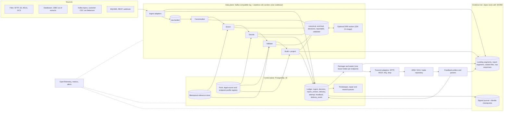
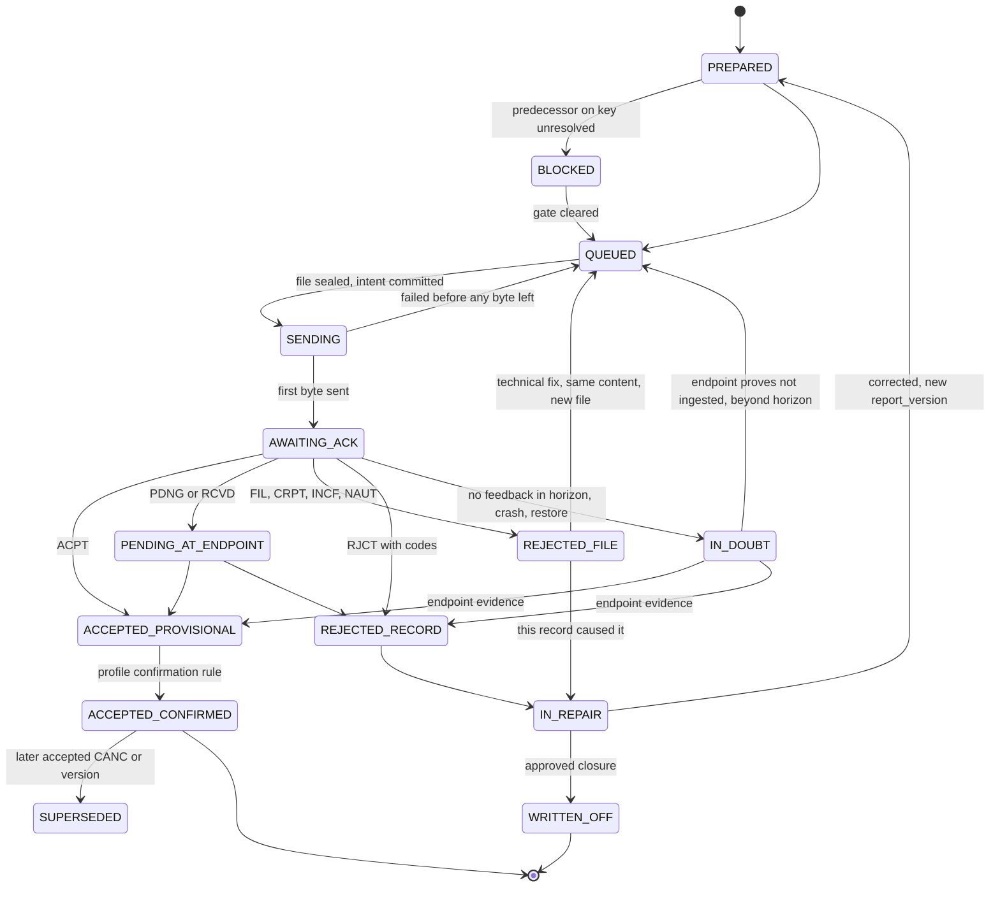

# Approach B: Streaming platform (log-centric data plane, ledger-anchored correctness)

Design-review submission, as-of 2026-10-08. Built on research briefs 01-08, cited as [01]...[08]. Where a brief has an "Independent verification" section, that section wins.

## 1. Thesis, and where B is honestly the wrong answer

B is a distributed pipeline. A Kafka-compatible log connects stateless workers, one role per stage. Bulk bytes sit in content-addressed object-store segments. A PostgreSQL ledger holds identity, state and constraints. A WORM tier holds evidence. Throughput scales by adding partitions and workers, and mature infrastructure (Kafka protocol, customer-run Debezium, Postgres, S3/Azure object stores, OpenTelemetry) does the undifferentiated work.

Five invariants hold everywhere:

- **P1. The log is transport and a replay window, never the system of record.** [05] is explicit: Kafka is not an event store (no per-entity query, no optimistic concurrency).
- **P2. Correctness comes from ledger constraints** (unique keys, a partial unique in-flight index, fenced endpoint leases), not from Kafka ordering or exactly-once semantics. Kafka transactions are not used in v1, so the design runs on Kafka, Redpanda, MSK or Event Hubs' Kafka endpoint (where transactions are only in preview [06]).
- **P3. Every stage is a pure function** `(event, pinned context) -> events` with deterministic output ids, so redelivery is harmless.
- **P4. Bulk bytes live in immutable content-addressed segments.** The log and ledger carry pointers and hashes.
- **P5. Everything upstream of the ledger is derivable.** Any topic can be rebuilt from landing segments plus the ledger. The ledger and WORM evidence are never rebuilt.

**What the log buys:** backpressure between fast ingest and slow stages (lookups, XSD, transport); scale-out by partition; side-consumers (evidence archiver, shadow pack runs) off the hot path; native landing for streaming and CDC sources; replay-at-scale for rule-change impact analysis. **What it does not buy:** correctness, or lower lifecycle cost.

**Fit test.** One firm is probably 1-50M records/day (Luxembourg alone had 24.0M MiFIR reports in 2025 [02]). 50M/day is about 580 records/s on average, and reporting is deadline-driven (T+1), so one well-built JVM process might cope. B is justified when most of these hold: the customer already runs Kafka and CDC; the platform is multi-tenant SaaS; intraday DQ feedback is wanted; slow stages need independent scaling. Otherwise B pays a lifecycle premium for unused capacity and a ledger-as-queue modular monolith is the better product.

## 2. Component view



## 3. Stack choice

**Java 25 LTS, PostgreSQL 18, Apache Kafka 4.x (KRaft) or a managed Kafka-protocol service, S3-compatible object store with Object Lock (or Azure locked immutable blob).** The stack brief [07] scores JVM 4.4, .NET 3.6, Go 3.2, Rust 3.0, and the ordering survives dropping the DRR criterion. B adds its own reasons: JAXP/StAX gives mature XSD 1.0 validation (the ESMA MiFIR XSDs use only XSD 1.0 constructs [04]); vendor-supported JDBC and IBM MQ clients cover every legacy source; `cel-java` is a canonical CEL implementation. B does not need the "a JVM exists anyway because of DRR" premise [06].

- **One codebase, one version, three image flavours:** `core` (all roles), `connectors` (adds vendor JDBC/MQ drivers), `drr` (JDK 21, DRR jars pinned to CDM 6.29.0 / Rune 9.95.x [01]). A role flag selects the process. This is the main lifecycle mitigation.
- **Avoided inside the product:** Kafka Streams, Flink, ksqlDB, Schema Registry, Kafka Connect, Kafka transactions, GraalVM native-image. Events are Protobuf, additive-only, checked in CI, with a schema fingerprint header.
- **Efficiency plan:** bounded micro-batches; compact object headers; virtual threads for I/O fan-out, bounded platform-thread pools for CPU work; IBM MQ in client mode; flat record handling, not per-record object graphs.
- **Broker:** Apache Kafka (Apache-2.0) by default. Redpanda (a non-JVM broker, from general knowledge, not the briefs) may lower operations, but its broker licence is not covered by the briefs and needs legal review. The broker is a configuration choice.
- **Flip conditions.** .NET 10 LTS if governance mandates .NET and DRR runs as a separate JVM role, or if the C# Rune implementation (finos/common-domain-model #5169) gains ReportFunction parity with a conformance suite. Go if DRR is outputs-only, footprint dominates, and XSD and legacy drivers can be isolated.

## 4. Data plane

| Stage (role) | Does | Emits / persists |
|---|---|---|
| Ingest | writes raw bytes to a content-addressed landing segment; one Postgres transaction records ingest row, checkpoint and outbox row; then acks the source | `raw.landed` (pointer, coordinates, hash) |
| Canonicalise | versioned mapping spec to canonical order/execution/transaction event; drift on reportable fields fails closed | `canonical.events` keyed by `lineage_key` |
| Enrich | micro-batch bulk lookups (distinct ISINs, LEIs, MICs per batch) in the bitemporal reference store; stamps `refdata_manifest_digest` | `enriched.events` |
| Decide | reportability pack, scalar CEL executor; writes a decision record for positive and negative outcomes | `decisions`; `reportable.<regime>` |
| Validate | validation pack layers 1-4: BLOCKER to quarantine, pending reference data to HOLD, PASS onward | `validated.<regime>` |
| Build | field derivation with rule lineage, deterministic report version, report segment | ledger `report_version` + `delivery` (PREPARED) with segment pointer |
| Package / Transmit / Feedback | claim from the ledger with `SKIP LOCKED` (section 6) | sealed files, attempts, responses |

- **Ordering.** Partition by `lineage_key`, then re-key by regime business key after Decide. Out-of-order source versions are checked against the ledger's last applied `source_version`; stale ones are flagged, not applied.
- **No silent drops.** A poison record gets bounded retries, then a DLQ entry plus a ledger repair item with a `due_at`. A dropped record is a missed report with a running T+1 clock.
- **Timers live in the ledger.** Kafka has no timers. Ack deadlines, HOLD re-drive (up to 7 days for pending reference data), T+1 breach, the 06:00 UTC EOD checkpoint and retry backoff are ledger rows read by a timekeeper.
- **Topics.** RF=3, `min.insync.replicas=2`, `acks=all`, idempotent producers, fixed partition counts, 14-day retention. Long-term replay comes from segments, not the broker.
- **Reference data.** Loaders (GLEIF, FIRDS, MIC, ISO 4217/3166, CFI) write bitemporal Postgres tables (PG18 `WITHOUT OVERLAPS`). We derive LEI status history ourselves because GLEIF publishes none [04].

## 5. Keys, idempotency and duplicate prevention

| Key | Definition | Enforced by |
|---|---|---|
| `ingest_key` | `(source_id, source_record_id, source_version or content hash)` | UNIQUE in ingest ledger; re-delivered rows are no-ops |
| `lineage_key` | `H(tenant, source_system, source_txn_id)` plus a `leg` discriminator (market-side vs client-side report) | stable identity across regimes and versions |
| `event_id` | `H(parent_event_id, stage, stage_version, pack_digest)` | deterministic, so a redelivered stage emits identical ids; downstream UNIQUE absorbs duplicates |
| `business_key` (MiFIR) | `(executing LEI, TRN)`. `trn_policy`: take the source TRN, or derive `base32(HMAC(secret, lineage_key \|\| leg))` truncated to 32 chars (within the 52-char limit) | same TRN across NEWT, CANC and re-NEWT of one transaction ([02], [05]), never reused for another |
| `business_key` (EMIR, post-MVP) | `(reporting CP LEI, UTI)` plus action type and event date | UTI taken from the agreed source, not generated by default; the strict ISO pattern applies to NEWT/POSC only [03] |
| `version_seq` | monotonic per `(endpoint, business_key)` | UNIQUE `(endpoint, business_key, version_seq)` |
| `logical_hash` | canonical report content excluding reporting timestamp, file id, BAH | an identical logical report creates no new version (re-stamping the timestamp on resend is our design choice, not a TR rule [03]) |
| `artifact_sha256` | exact bytes sent | ledger plus WORM |
| in-flight guard | at most one non-terminal delivery per `(endpoint, business_key)` | partial UNIQUE index `WHERE state IN (SENDING, AWAITING_ACK, IN_DOUBT)`; only the lowest unresolved `version_seq` is claimable |
| `endpoint_epoch` | lease counter per endpoint | a stale sender (GC pause, split brain) fails `UPDATE ... WHERE endpoint_epoch = :e` |

MiFIR gates: cancellations carry only fields 2, 4, 6; NEW and CANC go in separate files, CANC first; a correction is CANC then NEWT with the same TRN, and the NEWT stays BLOCKED until the CANC is not rejected; a rejected record is resent as NEW, never cancelled; silence never triggers a cancel.

## 6. Submission lifecycle, state machine, resend queue

The unit is a delivery (one `report_version` through one attempt chain). State is a projection of an append-only `delivery_event` table storing cause, evidence reference and actor.



- **Profiles own vocabulary.** For MiFIR, ACPT confirms immediately (WARN and ACPD are "not used" [05]) and reconciliation is a separate control. For EMIR the confirming step is the end-of-day activity report. TR-specific outcomes (INCF, NAUT, record-level WARN) live in the profile [03].
- **Silence is neither success nor failure.** `ack_deadline` is per profile (EMIR 60 minutes plus 06:00/12:00 UTC EOD files on the TARGET calendar; MiFIR R+1, PDNG within 7 days).
- **The resend queue is a query:** deliveries in `QUEUED` with attempt_no > 1, `IN_REPAIR`, HOLD and `IN_DOUBT`, ordered by `due_at`. The T+1 clock keeps running, and a breach raises an incident record. Automatic resend covers only transport failures and technical file rejections with unchanged content (same bytes, new file name, jittered backoff). Data rejections go to repair with an owner derived from the error code (rule-to-code is one-to-many) and always create a new `report_version`.
- **Liability attribution.** Reports carry `submitted_via` (SELF, ARM, VENUE); failures carry `attributed_to` (FIRM, ARM, VENUE, NCA, UNKNOWN). Art 26(7) relieves the firm of ARM or venue failures but requires "reasonable steps to verify" [02], so scheduled reconciliation runs against NCA/ARM feedback (UK: MDP extracts, one request per day) are first-class and leave `reconciliation_run` evidence.

## 7. Recovery

After any failure, check the restored ledger against external evidence before re-sending anything.

1. **Declare a restore epoch** (backup id, PITR target, operator, reason) and restore into a segregated environment (DORA Art 12). A synchronous Postgres standby with PITR gives RPO 0 for intent, attempt and response events.
2. **Verify integrity.** Recompute per-endpoint hash chains and the Merkle checkpoint; compare with the newest anchored checkpoint in WORM. If restored head < anchored head, replay the gap from signed WORM journal segments; if no journal covers it, widen the unknown window in step 4.
3. **Freeze outbound** with `endpoint.frozen` and a control-topic circuit breaker. Feedback ingestion keeps running.
4. **Build the in-doubt set:** deliveries in SENDING, AWAITING_ACK, IN_DOUBT or overdue at the restore point, plus any attempt visible only in endpoint-side evidence inside the loss window.
5. **Fetch authoritative endpoint state:** TR EOD rejection, activity and state reports; MiFIR ARM/NCA feedback files; UK MDP extract.
6. **Resolve each item** by matching `(business_key, action, artifact hash or reporting timestamp)`. Accepted: ACCEPTED with evidence attached. Rejected: repair. Pending: PENDING_AT_ENDPOINT. Newer version already accepted: SUPERSEDED (v1's fate is still recorded). Not found and beyond the feedback horizon: QUEUED with the same bytes, in key order. Not found but inside the horizon: stays IN_DOUBT, never resent early. A "duplicate" rejection on a resend proves acceptance only after the state report confirms it.
7. **Rebuild the log if Kafka is lost.** Re-emit `raw.landed` for every landing segment newer than the oldest non-terminal item; a progress reconciler compares each segment's record count with linked decisions. Deterministic ids make over-emitting safe.
8. **Run invariants, then release sending:** no key with two in-flight deliveries; every ACCEPTED has a response hash in WORM; no sequence gaps. Write a signed restore report to WORM; affected-report lists feed notification duties (RTS 22 Art 15(2), DORA).
9. **Drill it.** Fault injection at crash points (after intent, after first byte, after response, mid-restore, Kafka loss) gives the TDD fixtures and DORA Art 12 test evidence. The reproduction test (replay a day on pinned versions, compare artifact SHA-256) is also the determinism alarm.

## 8. Rules, reason codes, legal traceability, DRR

**Pack format (R8, R9).** Data, not code: YAML decision tables with CEL-shaped, non-Turing-complete conditions, compiled to an engine-independent IR, following [08]. B ships only the scalar executor in v1; scale-out comes from partitions, and the same interpreter drives replay.

```yaml
pack: mifir.reportability            # semver + SHA-256 of canonical form
version: 2.3.0
jurisdiction: EU
valid: { from: 2018-01-03, basis: LEGAL }     # UK forbearance rules use SUPERVISORY_FORBEARANCE
as_at_field: trade_date                       # per-regime manifest field, confirmed by Legal
rules:                                        # hit policy FIRST, explicit priority, gap/overlap analysis in CI
  - { id: R010, when: "txn.kind == 'SFT'", outcome: DO_NOT_REPORT,
      reason: MIFIR.N03.EXCLUDED.2_5_a, cite: [rts22#art/2/par/5/pt/a] }
  - { id: R030, when: "firm.role == 'TRANSMITTING' && txn.art4_all_conditions", outcome: DO_NOT_REPORT,
      reason: MIFIR.N07.TRANSMIT_NO_REPORT, cite: [rts22#art/3/par/2, rts22#art/4/par/1] }
  - { id: R040, when: "instr.in_scope", outcome: REPORT, reason: MIFIR.N08.IN_SCOPE_26_2_A,
      cite: [mifir#art/26/par/2/pt/a, mifir#art/26/par/2/pt/b, mifir#art/26/par/2/pt/c] }
  - { id: R900, when: "true", outcome: UNDETERMINED, reason: DQ.SCOPE_UNKNOWN }
pending:                                      # staged; activates on a recorded legal event, not a date
  - { id: R041, when: "instr.is_otc_deriv && !instr.in_art8a2 && !txn.on_venue", outcome: DO_NOT_REPORT,
      valid: { from_event: rts22-revised-applies }, cite: [mifir#art/26/par/2/pt/a@amended] }
```

- **Registries.** `ReasonCode{code, category, validity, owner}`; `Citation{source_id, provision_path, role BASIS|EXCEPTION|INTERPRETATION|GUIDANCE, quote_sha256, retrieved_at}`; `Rationale{text, author, approver}`. Our provision-path scheme plus quote hash is the key; ELI is a best-effort pointer [08]. Codes follow `MIFIR.<node>.<outcome>` for N01-N19 [02]. Multi-condition exclusions such as RTS 22 Art 2(5)(m) are `all_of` conditions, each with its own citation. Cumulative caps need cross-record aggregates; in v1 the source supplies the flag and the rule records it as an assertion.
- **Decision record** (negative outcomes too): `{decision_id, lineage_key, regime, pack digest, as_at, outcome, reason_code, rule_ids_hit, citations, input_digest, refdata_manifest_digest, engine_version}`. "Show your working" re-runs one record and renders the quoted provision. UNDETERMINED goes to the DQ queue, never silently to "do not report".
- **Effective dating.** Valid time resolves by `as_at_field` (deterministic regardless of worker timing); knowledge time comes from the activation log; `resolve(regime, as_at, AS_REPORTED | AS_CORRECTED)`. EU Review amendments activate on a recorded event, not a date [02][08]. The UK 2028 regime is a separate pack lineage with its own renumbered 52-field projection (not "EU minus a list"); forbearance is distinct from legal scope [02]. Back-reporting horizon is a per-regime setting separate from retention [05].
- **Activation across a fleet.** Signed packs (maker/checker/approver attestation, KMS-held key) are announced on a compacted `control.pack-activation` topic mirrored in Postgres. Workers verify against an out-of-band trust root and swap between micro-batches; a failed check keeps the active pack. Workers may skew, so every decision records the digest actually used. Rollback re-activates the previous digest.
- **Impact analysis is B's showcase.** A candidate pack runs in a shadow consumer group over archived landing segments and is diffed against the baseline (transition matrix, "reason changed, outcome same" list, missed-report and over-report consequences). It gates merge, and semver is verified from the diff (PATCH = zero diffs; MINOR = new reasons or fewer UNDETERMINED; MAJOR = any REPORT/DO_NOT_REPORT flip).
- **Numerics risk.** CEL numerics are likely int/double and decimal support is unverified [08]. Monetary and quantity values enter as scaled integers or via a vetted `dec` library; a spike decides before the DSL freezes.

**DRR (R7) as a model.** B adopts DRR's structure, not its code:

| DRR construct | B equivalent |
|---|---|
| body/corpus/segment/provision references | provision-path registry with quote hashes |
| eligibility, reporting and timing rules | decision table, field-derivation table, `due_at` rule |
| report type with per-field `ruleReference`; projections as a separate tested stage | projection spec with per-field rule id; golden XML |
| test packs, regenerate-and-review | golden cases committed beside each pack |
| absent in DRR: reasons, runtime lineage, effective dating, submission | ours (R4, R6, R9, R12) |

DRR itself is an optional, isolated `drr` image that reads CDM JSON from a topic and returns report JSON or ISO 20022 XML, pinned per regime (for example `drr.emir-eu@7.14.0+cdm6.29.0`). It serves derivatives regimes only. Our scoping pack still supplies entity/jurisdiction scoping and reasons, because DRR eligibility is Boolean [01]. The licence is a legal gate before any use ("without modifications and solely as part of a Larger Work", the s4(b) indemnity, and a repo `LICENSE.md` that could not be read and may say non-commercial [08]). MiFIR is native; do not wait for DRR MiFIR. If Legal permits, DRR's RTS 22 test pack (186 samples) is a differential oracle.

## 9. Validation, connectors, outputs

**Validation pipeline (R10).** Six layers [04]; severities BLOCKER, WARNING, INFO; dispositions PASS, HOLD (with deadline), QUARANTINE.

1. Syntactic: XSD facets, lengths, enums, M/C/O by action type.
2. Identifiers: stateless library with golden vectors (LEI mod 97-10, ISIN Luhn, FIGI left-position doubling, CONCAT).
3. Reference cross-check with bitemporal as-of lookups. LEI checks are parameterised by `(regime, role, as-of anchor, allowed statuses)`. The FIRDS lookup depends on venue class (EEA venue; XOFF/SI/non-EEA only when fields 47/48 are empty; XXXX requires the ISIN to be absent).
4. Per-regime conditional rules imported from the ESMA workbook by `CON` code, modelling three implementation types (XML schema, Application, Not implemented in XSD) and one-to-many rule-to-code.
5. Cross-record: TRN uniqueness and CANC-after-NEW (CON-023/024/025) against the ledger.
6. Final gate: whole-file XSD at seal. Per-record XSD runs on a one-record wrapper document so a bad record never reaches a file.

Workbooks and XSDs are pinned by content hash, not by the date on ESMA's page. The XSD facet is the hard gate where the rulebook disagrees (basis points 18/17 vs 18/5). XSDs are fetched at deploy with checksum pinning, not shipped, because the SWIFT MyStandards header restricts external end-user use; XML is written by a StAX projection driven by a data spec, so no schema-derived code ships either. Schema versions are pinned per message (the BAH is `head.001.001.01_ESMAUG_1.0.0`). JAXP validates; libxml2 stays out.

**Connector contract (R3).** `spec / check / discover / read(state, limits) -> Batch{stream, seq, bytes or rows, source_coordinates, checkpoint}`, plus `send / poll_acks` for destinations. Commit rule: landing segment, then ledger transaction, then upstream ack. v1 is an in-process Java interface; the out-of-process variant is specified, not built.

- **Tier A (native):** files (local, SFTP/FTPS, S3, ADLS Gen2, GCS) as CSV, delimited/fixed-width TXT, streaming XML, NDJSON; Kafka topics; JDBC as-of extracts with control totals and stable keys (not cursor polling); HTTPS pull and webhook.
- **Tier B (`connectors` image):** vendor JDBC (Oracle, Db2, SQL Server, jConnect) and IBM MQ/JMS. Camel only if a source demands it, since it adds a six-monthly LTS treadmill [06].
- **Tier C (the real ecosystem win):** CDC arrives as customer-run Debezium Server or Kafka Connect topics, consumed through the Kafka adapter. We never run a Connect cluster. Airbyte (ELv2), Redpanda Connect CDC (enterprise-gated) and Vault (BUSL) are not embedded.

**Outputs and transfer (R5).** Projection specs produce ISO 20022 XML, CSV or fixed-width TXT from the same logical report. Transmit adapters declare an `ack_model` (sync-response, async-file, async-message, portal-only) and cover SFTP (temp-name-then-rename, pinned host keys, ordered upload, response-file polling), REST (mTLS/OAuth2), MQ put with reply-queue correlation, and file drop for portals. Endpoint profiles are data: filename template and length (UnaVista-style limit is 40 characters including extension), ordering (CANC before NEW), max reports per file, BAH values, calendars, status vocabulary, parsers. Response parsers are schema-driven ISO 20022 XML, versioned as data, because ESMA mandates XML feedback and versions drift.

## 10. Evidence, retention, observability

- **Tier 1, the Postgres ledger:** insert-only, bitemporal, `supersedes_id` for corrections.
- **Tier 2, WORM object store:** landing and report segments, sealed outbound files (exact bytes), raw responses, signed journal segments, Merkle checkpoints (RFC 9162-style hashing; RFC 3161 later). Hash chains are per endpoint and per pipeline day, so there is no global single-writer bottleneck. Chains hold keyed hashes of ciphertext plus non-personal metadata, and payloads are envelope-encrypted so expiry and crypto-shredding never break verification (DPO sign-off needed).
- **Retention engine:** `retain_until` per regime and anchor event: MiFIR Art 25 (5y), EMIR Art 9(2) and SFTR Art 4(4) (5y after termination), CFTC 45.2. Seven years is a legal-hold override, not a general clock. S3 variable retention may fall outside the Cohasset assessment, so extend-only fixed dates are the fallback [05]. Compliance-mode WORM is irreversible, so non-production uses governance mode.
- **Evidence bundle** per report or date range: artifact, transport proof, feedback, decision with pinned versions, correction chain, reconciliation results, inclusion proof and anchor.
- **Ledger volume.** Rows are slim (identity, state, hashes, pointers), partitioned by day, with old partitions offloaded to WORM Parquet. Above roughly 10M records/day a sizing spike is needed: **compute stages scale out, but the ledger scales up.** Sharding by endpoint or tenant is the escape hatch and is not built.
- **Observability.** OpenTelemetry with `lineage_key` and `event_id` in Kafka headers. Alerts on: consumer lag and DLQ depth; oldest age per delivery state and `IN_DOUBT` beyond horizon; T+1 safety margin; rejection rate by rule code and source; reference-data and pack snapshot age; content-hash drift on ESMA/FCA artefacts (FCA draft schemas and CP26/34 watched separately [04]); WORM and anchor lag; certificate expiry; nightly reproduction mismatches; last restore-drill result.

## 11. Honest lifecycle cost

| Moving part | Burden | Mitigation |
|---|---|---|
| Kafka (3+ brokers) | TLS/SASL/ACLs, quotas, storage, several supported release lines, rolling upgrades | managed service if allowed; topics-as-code; no Streams/Flink/Registry/transactions |
| PostgreSQL 18 + sync standby | annual majors (18 supported to 2030-11-14), PITR, partition management | managed Postgres, or base backup + WAL with few tool dependencies (pgBackRest's 2026 scare) |
| Object store with WORM | retention mistakes irreversible | staged rollout, governance mode outside prod |
| JVM images | Java 25 to 29 move around Sep 2027; DRR image on JDK 21 | one codebase, one version, role flag |
| Secrets, observability | Vault is BUSL, OpenBao MPL-2.0 | references only in config; reuse customer stack |
| Optional: Debezium, Camel, DRR | each has its own release train | customer-run or deferred |

That is roughly eight independently versioned things versus about three in a ledger-as-queue monolith. This is B's main weakness, and why R2 is rated weak. The restore matrix is also larger: Kafka-only, Postgres-only, WORM-only and both-lost cases must each be drilled.

## 12. Deliberately NOT built in v1 (YAGNI)

Kafka Streams/Flink/ksqlDB; Schema Registry; Kafka transactions; an embedded Connect cluster; multi-region and MirrorMaker; a DuckDB/SQL batch executor, SMT rule equivalence, Datalog; WASM/Starlark plugins; Python connector host, Airbyte/Singer adapters, out-of-process connectors; authoring UI, DMN import/export, spreadsheet round-trip (git + YAML + review first); EMIR, SFTR, CFTC and UK-2028 packs (UK schema and rules still draft); the DRR adapter; EMIR reconciliation inbox and E&O counters; cumulative-threshold aggregates; ARM-mode submission (field modelled, flow not built); JSON output; SWIFT FileAct, AS2; RFC 3161 and external witnesses; graph database (typed nodes and bitemporal edges in Postgres, recursive CTEs, serve R11); sharded ledger; GraalVM native-image; DQ scoring beyond counts and rates.

## 13. Requirement coverage

| Req | Rating | How |
|---|---|---|
| R1 High performance | strong (throughput) | partition scale-out, backpressure, micro-batch lookups, scalar CEL (vendor claim: nanoseconds to microseconds per expression; unmeasured for our packs). Ceiling: the ledger scales up, not out |
| R2 Maintainable, minimal lifecycle, CPU/memory efficient | **weak** | about eight versioned moving parts; brokers cost CPU, RAM and disk; per-hop serialisation. Mitigated by one codebase, managed services and the no-extras list, but still the heaviest approach |
| R3 Many sources | strong (streaming/CDC), adequate (rest) | Kafka-native intake and customer Debezium; tier A/B connectors are our work in any approach |
| R4 Historical evidence | strong | ledger + WORM, pinned versions, segments, signed journal, reproduction test |
| R5 Formats and transfer | adequate | data-driven StAX projection and SFTP/REST/MQ/drop adapters; the log adds nothing here |
| R6 Acks, flag, resend | strong | state machine with IN_DOUBT, profile vocabularies, repair/resend queues, per-key gating, T+1 timers |
| R7 DRR-like model | adequate | DRR concepts mirrored; optional isolated DRR worker; licence gate; MiFIR native |
| R8 Configurable reportability | adequate | signed data packs, event-triggered activation, replay impact analysis; DSL still to build, CEL numerics unproven, fleet activation skew |
| R9 Reason + legal link | strong | first-class decision record, reason and citation registries, negative outcomes included |
| R10 Data quality | strong | six layers, workbook import by CON code, bitemporal reference data, XSD gate |
| R11 Cross references | adequate | typed nodes and bitemporal edges in Postgres; no graph engine |
| R12 Duplicate prevention | strong | deterministic TRN and ids, unique and partial-unique constraints, fenced leases, logical-hash suppression |
| R13 Recoverability | adequate | strong algorithm (in-doubt resolution, Kafka-loss replay, WORM journal) but more failure combinations to drill |
| R14 Superpowers method | adequate | stage-as-pure-function suits subagent TDD; heavier integration matrix (Kafka+PG+S3+SFTP), mitigated by an in-memory `Log` port and a deterministic fault simulator |

## 14. MVP vertical slice

**Goal:** EU MiFIR RTS 22 transaction reports, one source to one destination, with the complete evidence, ack and resend loop. In order:

1. **Walking skeleton on in-memory ports:** pack compiler, scalar interpreter, golden cases (N01-N09, N11, N13-N15, N17-N19 as inputs allow), Legal Source Registry, decision record.
2. **Real infrastructure:** Postgres ledger, one Kafka broker (three for pilot), S3-compatible store with Object Lock (governance mode in dev), one image with roles. Source: CSV/NDJSON drop on SFTP or S3, plus a synthetic generator.
3. **Reference data and validation:** FIRDS, GLEIF, MIC loaders; ESMA workbook v1.7 imported by CON code; XSD gate for `auth.016.001.01` and BAH.
4. **Build, package, transmit:** NEWT and CANC in separate files, CANC first, deterministic TRN.
5. **Destination double:** a simulated ARM/NCA built from ESMA TRI v1.6 and the workbook: SFTP in, `auth.031` ACPT/RJCT/PDNG/RCVD with FIL and CON codes, injectable faults (silence, partial rejection, duplicate TRN, PDNG turning RJCT on day 8). A real destination needs a signed specification (the FCA MIS is confidential).
6. **The loop:** reject, repair, resend as NEW; accepted-then-wrong gives CANC then NEWT; silence gives IN_DOUBT and query-before-resend; T+1 breach and incident record; evidence bundle export.
7. **Recovery and drift:** restore drill, Kafka-loss drill, reproduction test, pack-change impact report. Then a Kafka-topic second source.

**Exit gates:** byte-identical artifacts on replay; invariants pass at every crash point; a 10M-record synthetic day completes inside the T+1 margin with bounded RSS per worker (numbers set by the spike). **Spikes first:** CEL decimal semantics; XSD throughput on `auth.016`-sized batches; ledger insert and partition behaviour at target volume; JVM heap per worker.

## 15. Questions for the user

1. Deployment: multi-tenant SaaS or per-customer on-premises? Does the target customer already operate Kafka with a platform team? (This decides whether B is justified at all.)
2. Volume envelope: peak records/day per firm; is end-of-day batch acceptable, or is intraday feedback required?
3. Regulatory role: the firm's own reporting engine, or an authorised ARM/DRSP? (This changes DORA scope and Art 26(7) liability handling.)
4. First destination: which ARM, NCA or trade repository, and do we hold its specification?
5. Jurisdiction order: EU MiFIR first, or UK (go-live 3 Apr 2028, FCA draft schemas published 2026-10-02)? EMIR next?
6. DRR: who owns the ISDA licence review, and is derivatives coverage in scope before 2027?
7. Hosting: managed Kafka and Postgres allowed? S3 Object Lock, Azure immutability, or an on-premises WORM appliance?
8. Is Java acceptable, or is .NET mandated? Any tolerance for BSL-licensed brokers?
9. Which source system comes first: file drop, database, MQ or Kafka?
10. Legal and DPO: retention schedule per regime and the handling of natural-person data.

## 16. Key risks

- **Lifecycle and skills:** the heaviest operating model of the plausible approaches; this undermines R2 and R13.
- **Dual-truth drift:** teams treating Kafka as the system of record. Mitigated by P1/P2, invariant tests and a review checklist.
- **Ledger ceiling** at the top of the volume range, and **idempotency discipline everywhere**: redelivery and rebalance bugs are the classic failure, so the deterministic simulator and crash-point tests are mandatory.
- **Rule DSL cost:** the DSL, authoring UX and CEL numerics are unproven; analyst usability is the likeliest adoption failure.
- **Licensing:** DRR (indemnity, no-modification, possibly non-commercial text); SWIFT-restricted XSDs; Redpanda broker licence (not covered by the briefs); Airbyte ELv2; Vault BUSL.
- **Regulatory churn:** Art 2(5) exclusions are the most volatile content and can change at Level 2/3 without warning; UK schema final text pending; EU activation date unknown; the RTS 25 repeal is unverified, so field-28 granularity stays tied to current RTS 25.
- **Unmeasured performance:** no benchmark exists for DRR heap per trade, XSD throughput or CEL at scale; every efficiency claim here is an expectation.
- **Evidence weight:** regulators ask for reconstructability, not cryptography; the legal weight of hash chains is unproven in EU/UK supervision.
