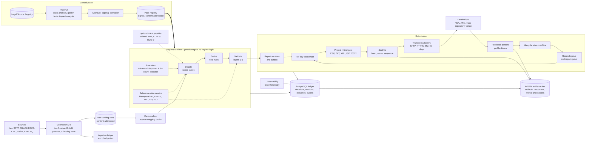
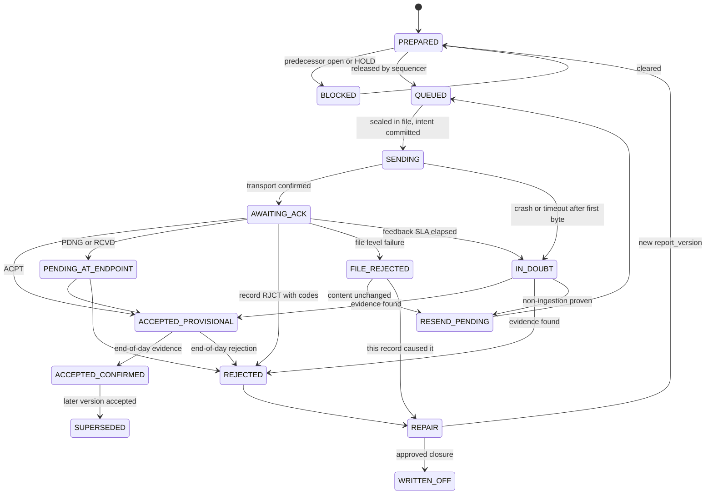

# Approach C: Model-driven (DRR-style) regulatory reporting platform

As-of 2026-10-08, built on research briefs 01-08 including their verification corrections. Design only.

## 0. The bet

Regulatory knowledge lives in a **Regime Pack**: a versioned, signed, content-addressed bundle of schemas, scope (reportability) tables, field rules, validations, lifecycle/key rules, destination profiles, reason codes, legal citations and golden tests. A **thin generic engine** loads packs and runs everything regime-agnostic: ingestion, ledger, submission state machine, queues, evidence, recovery. A new field, exclusion, TR or filename rule is a pack change with an impact report, not a code release.

The bet: regulatory churn is the dominant long-term cost (EU revised RTS 22 undated; a separate UK 52-field regime from 3 Apr 2028; Art 2(5) exclusions likely to change first; every TR/NCA differs). The price: we own a small language, a compiler and a pack control plane. That is this approach's weakest point (R2 lifecycle).

Three layers: the **engine** (code, rare releases: IR executors, stdlib of identifier algorithms and decimal/date maths, ledger, sequencer, state machine, queues, connectors, transports, evidence writer, control plane); the **Regime Pack** (data, pack release: all regulatory content including destination profiles); the **firm overlay** (data: parameters, interpretation pins, source mappings, endpoint instances).

## 1. Architecture and data flow



1. Connectors commit raw batch, ledger row and checkpoint together, then acknowledge upstream (at-least-once, idempotent landing). Source-mapping packs canonicalise; drift on reportable fields fails closed.
2. The runtime resolves pack digests for `(regime, as_at, mode)`. **Decide** classifies every candidate, negatives included; **Derive** builds records; **Validate** sets PASS, HOLD (deadline) or QUARANTINE. PASS writes a `report_version` and outbox row in one transaction. A batch pins one pack digest; activation swaps packs between batches only.
3. The sequencer releases per key; the assembler projects bytes, applies the exact-version XSD gate, seals and archives the file, commits the delivery intent, then sends.
4. Feedback is stored raw, parsed per profile and drives the state machine; transitions needing action insert their queue item in the same transaction.

## 2. The model

**Canonical model** (transaction-centric, because MiFIR is): Party, Instrument, Execution, Transmission, LifecycleEvent, typed `xref` edges. **Report schemas are separate, pack-owned, versioned**: `mifir.eu.rts22.table2@1.1.0` (65 fields) and `mifir.uk.mar14.table2` (52, renumbered, Boolean client indicators, package price fields), never "EU minus a list". Reuse is by importing field rules from a `common` pack at a pinned digest.

**One syntax**: YAML (CSV/XLSX round-trip) plus a CEL-shaped expression subset: bool, int, scaled decimal, string, UTC timestamp, date, enum, list; explicit absence (`has(x)`), no three-valued NULL, evaluation errors yield UNDETERMINED; no loops, I/O, clock or user functions; per-rule cost ceiling. No Rune-like textual language in v1.

```
mifir.eu.rts22-2.3.0/
  pack.yaml     id, semver, regime, legal/supervisory validity, as_at_field, engine_min, imports{pack@digest}
  model/ scope/ derive/ validate/   schemas (facets CI-checked against pinned XSD), tables N01-N19, field rules, layered rules
  lifecycle.yaml  endpoints/  refdata.yaml  reasons.yaml  sources.yaml  rationales.yaml  tests/
  IR.json  CHECKSUMS  ATTESTATION   (signed: maker, checker, approver, CI run, impact-report digest)
```

```yaml
- id: S-N03-2_5_e   node: N03   priority: 300           # scope table, hit policy FIRST
  when: "event.kind in ['NOVATION','ASSIGNMENT']"
  outcome: DO_NOT_REPORT   reason: MIFIR.N03.EXCLUDED.2_5_e
  cite: [{src: rts22, path: "art/2/par/5/pt/e", role: BASIS}]   rationale: RAT-0011
  valid: {legal: {from: 2018-01-03}, supervisory: null}
- id: V-040   layer: 3   severity: BLOCKER   disposition_on_fail: QUARANTINE   # validation
  regulator: {rulebook: "esma65-8-2594@sha256:...", rule: "014", codes: [CON-040], impl: APPLICATION}
  when: "t2.f5_investment_firm == true"
  assert: "lei.valid(t2.f4, role=EXEC_MIFID_FIRM, asof=[trade_date, submission_date])"
business_key: [t2.f4, t2.f2]                                                    # lifecycle
trn: {assign: once, derive: "base32(hmac(tenant_key, event.identity, leg))[:26]"}
correction: {unaccepted: new_version_NEWT, accepted: [CANC, NEWT], cancel_first: true, separate_files: true}
```

Firm overlays pick among options a base pack declares (for example a give-up interpretation pin with rationale and approver), set parameters and add mappings; they cannot delete or reorder base rules.

**DRR (R7).** We copy its architecture (regulatory hierarchy body/corpus/segment/provision, timing/eligibility/field rules, report definitions, separate projection stage, enrichment interface, shared common layers, regenerate-and-review golden packs) and add what Rune lacks: structured reason codes, event-triggered effective dating, runtime lineage, signed hot-swap packs, submission state. DRR itself is an **optional provider** behind the same `evaluate(event, context)` contract, in an isolated JVM pinned to CDM 6.29 / Rune 9.x, and not in v1: its MiFIR is undelivered (MiFID testing is Q4 2026) and the licence is unsettled (use "without modifications and solely as part of a Larger Work", broad s4(b) indemnity, docs say free for non-commercial use, repo LICENSE unread). We never copy DRR rule text; its RTS 22 pipeline (186 samples) could be a differential oracle if Legal permits.

## 3. Reason codes and legal basis (R9)

Each classification is `{outcome, reason_code, node, rule_ids, citations[], pack_digest, as_at}`. Outcomes: REPORT, DO_NOT_REPORT, REPORT_BY_OTHER (venue Art 26(5), Art 4 transmission), HOLD (automatic deadline, for example ISIN not yet in FIRDS, 7 days), UNDETERMINED (human queue, never silently "do not report"). Codes follow `MIFIR.<node>.<outcome>`.

- **Legal Source Registry**: `source_id`, version label, `retrieved_at`, `content_sha256`, best-effort ELI pointer, provisions `{path, quote, quote_sha256, status, role}`. Our path plus quote hash is the key (ELI fragments unverified). `role` separates BASIS/EXCEPTION (law) from INTERPRETATION/GUIDANCE (Guidelines, Q&A).
- **Dual effective dating**: `legal` and `supervisory` windows differ, because UK EU-only-instrument and FX relief is forbearance until HM Treasury repeals the scope. An `event` trigger stages EU packs without a date.
- Art 2(5)(m) is four cumulative conditions and (i) has an IPO/placing carve-back, so each is a separately cited condition.
- CI proves citations resolve and quote hashes match; it cannot prove the law was read correctly, so golden cases need a named Compliance owner.
- `explain(decision_id)` re-runs the pinned pack, input and reference snapshot through the reference interpreter and renders the firing row, why earlier rows did not fire, the quoted provision, rationale and approver.

## 4. Execution

One typed IR (canonical JSON); production loads IR only. (1) **Reference interpreter**: tree-walking, full trace, the executable specification (avoiding Rune's #1411 problem). (2) **Fast executor**: closures over 8k-row column chunks (primitive arrays, dictionary strings, decimals up to 18 digits as scaled longs); first-hit tables evaluate each rule only on unmatched rows; output is a rule-hit id per row, not an object graph.

Both are Java over one primitive library, so no cross-language numeric divergence. CI runs differential and mutation tests. A SQL/DuckDB executor waits until the benchmark gate fails or full-history replay is too slow.

Determinism is a recovery asset and a claim to test: pack digest, input, reference snapshot and engine build reproduce the same decision and byte-identical artifact; a nightly sample re-run raises a determinism or tamper alarm on mismatch. Proposed gates, unmeasured: 100k records/s/core on a 200-rule pack, bounded RSS at 50M records, p99 `explain` under 1 s.

## 5. Validation pipeline (R10)

| Layer | Checks | Notes |
|---|---|---|
| 1 Syntactic | types, lengths, charsets, decimals, enums, M/C/O/N by action | facets imported from pinned XSD, CI-checked equal. bps: XSD 18/17 is the gate, rulebook 18/5 a WARNING pending NCA confirmation |
| 2 Identifier | LEI mod 97-10, ISIN Luhn, CFI, MIC, BIC, UPI, CONCAT | stdlib with golden vectors. UTI strict pattern for NEWT/POSC only |
| 3 Reference data | LEI status/dates, MIC, FIRDS, ISO 4217/3166 | bitemporal, explicit as-of anchors. LEI check takes (regime, role, anchors, allowed statuses). FIRDS key depends on venue class (EEA venue; XOFF/SI/non-EEA any EEA venue or SI; XXXX needs ISIN absent). Misses become HOLD |
| 4 Regime conditional | mandatory-if tables, CFI matrix, ignored-if-populated (INFO) | importer skeletons rows from the ESMA workbook by CON code (96 codes, a rule may emit two, 8 "not implemented in the XSD" get explicit local severity); workbooks pinned by hash |
| 5 Cross-record | TRN uniqueness, cancel-after-new, DEAL capacity, EMIR action state machine, duplicate fingerprint | read-only `ledger.state(key)` |
| 6 Final gate | exact-version XSD on file and BAH, filename, counts vs manifest | pinned per message (`auth.016.001.01` 1.1.0, BAH `head.001.001.01` 1.0.0) |

Local validation emits the codes the destination would (`CON-nnn`, `EMIR-VR-tfff-nn`, lenient on one-digit suffixes). It cannot fully predict TR results (EMIR conditional checks use the last accepted report plus latest TSR only for event dates T and T-1), so each rule carries `predictability: full | partial`. A coverage report lists regulator rules with no implementation.

## 6. Identity, idempotency, duplicate prevention (R12)

| Key | Formula | Enforced by |
|---|---|---|
| `ingest_key` | (source, source_record_id, content_sha256) | UNIQUE in ingestion ledger |
| `event_identity` | pack-declared, for example (firm LEI, venue MIC, venue exec id) | UNIQUE; conflict goes to UNDETERMINED, never a silent merge |
| `business_key` | MiFIR (executing LEI, TRN). EMIR (reporting LEI, UTI, level) | UNIQUE(endpoint_epoch, business_key, version_seq) |
| `record_key` (EMIR) | business_key + action + event date (+ event type, valuation timestamp) | mirrors the TR correlation tuple |
| `version_seq` | monotonic per key; action chosen by lifecycle block | append-only; corrections never edit |
| `logical_hash` | canonical report minus `volatile` fields (reporting timestamp, file/BAH ids) | suppresses no-op resends |
| `artifact_sha256` | exact bytes sent | evidence, replay comparison |
| in-flight guard | partial UNIQUE(endpoint, business_key) WHERE state IN (SENDING, AWAITING_ACK, IN_DOUBT) | one attempt in flight per key |

TRN is assigned once and stored, so key rotation never changes it, and CANC then NEWT reuses it (ESMA Guidelines 5.18). It is derived, not counter-based, so a restore cannot reissue one. Re-stamping the timestamp on resend is a profile flag, a design choice and not a TR rule. `endpoint_epoch` covers TR change, porting, delegation change and M&A, the documented duplicate-risk events. `trace(business_key)` shows the full chain from source records to feedback.

## 7. Submission lifecycle, acknowledgements, queues (R6)



Files have their own states (BUILT, SEALED with immutable bytes/hash/name/sequence, UPLOADING, DELIVERED, REJECTED_AT_INGEST / CRPT / PROCESSED, FEEDBACK_RECEIVED with counts reconciled to the header, CLOSED). The engine implements the machine once; the **endpoint profile** supplies:
- **Status vocabulary**: MiFIR record ACPT/PDNG/RJCT/RCVD, file ACPT/PART/RJCT/RCVD/RMDR/INCF/CRPT/WARN; REGIS-TR INCF, NAUT, record WARN. `PDNG` resolves within 7 days.
- **Ack model** (sync, async file or message, portal-only with manual import), correlation keys, schema-driven parser.
- **Deadlines**: EMIR feedback within 60 minutes, end-of-day by 06:00 UTC (entities) and 12:00 UTC (authorities) on a TARGET calendar; MiFIR R+1.
- **File rules** checked before upload: name pattern and length (a UnaVista-style guide caps it at 40 characters), CANC before NEW, separate new/cancel files, max reports per file.
- **Resend policy**: rejected records go as **new** (the TR never held them); accepted-but-wrong goes CANC then NEWT.

No feedback is neither success nor failure and never stops reporting. Each record has a pack-computed `due_at`; unaccepted at `due_at` it gets a breach flag feeding errors-and-omissions counters. Each record carries `submission_route` (SELF, ARM, VENUE) and a failure-attribution field: under Art 26(7) the firm is not responsible for ARM or venue failures but must take reasonable steps to verify, so reconciliation against NCA feedback is a recorded, mandatory control on those routes.

**Two queues**, both ledger projections:
- **Resend queue**: content fine, delivery failed (file-level naming, authorisation or XSD failure not caused by this record, proven non-ingestion, failure before first byte). Same bytes, re-stamped per profile.
- **Repair queue**: content rejected. Items hold record, attempt history, all codes with XPath, class (XSD, authorisation/delegation, field validation, sequencing, reference data, generic to TR support), `due_at`, owner. The fix creates a new `report_version`; bulk fix handles systemic causes.

Later events on a key stay BLOCKED until the predecessor is ACCEPTED_PROVISIONAL, with head-of-line blocking visible. Transport retry happens only before delivery is confirmed (jitter, one writer per endpoint, TR etiquette such as REGIS-TR's 4-minute SFTP wait). EMIR reconciliation feedback (auth.091/107) is v1.1.

## 8. Evidence, storage, retention (R4)

**Two tiers.** (a) PostgreSQL 18: insert-only bitemporal `decision`, `report_version`, `delivery`, `attempt`, `feedback`, `delivery_event`; reference data with temporal constraints; synchronous standby; PITR. (b) WORM object store (S3 Object Lock compliance mode or Azure locked immutability): sealed artifacts, raw responses, landing batches, pack and registry snapshots, journal objects, signed RFC 9162-style Merkle checkpoints (optional RFC 3161 token; legal weight unverified). The DB is rebuildable from the evidence tier, never the reverse.

A decision row (key, outcome, reason id, rule-hit id, input digest; about 100 bytes, no PII) is partitioned by trade date. Field lineage is not stored per field: field to rule to citation is static per pack digest, and the dynamic part is recomputed by `explain`. The **evidence manifest** per report lists artifact hash, pack, registry, reference-data, mapping and XSD digests, engine build, transport proof, feedback, correction chain, reconciliation runs and Merkle inclusion proof; export is a signed bundle.

**Retention** keys to MiFIR Art 25 (5 years), EMIR Art 9(2) / SFTR Art 4(4) / CFTC 45.2 (termination-anchored) and national law; the 7-year NCA-request period is a legal-hold override, not an Art 16(6) clock. Back-reporting horizon (5 years; 3 in the UK from 2028) is a separate effective-dated setting. Termination clocks use fixed extend-only retain-until dates (S3 variable retention is not assumed Cohasset-covered, so no 17a-4(f) posture is claimed). Compliance-mode WORM is irreversible, so start in governance mode. **GDPR**: personal data only in envelope-encrypted artifacts, chain leaves hold HMACs, expiry by crypto-shredding (DPO sign-off needed). No immudb, KurrentDB or Kafka as ledger.

## 9. Recovery (R13)

**Process crash.** On start, scan SENDING/AWAITING_ACK. An intent with no transport result and any chance a byte left becomes IN_DOUBT; only "failed before first byte" is retryable. Where the profile defines a probe (SFTP temp-name-then-rename), probe first.

**Restore.**
1. Record a `restore_epoch`; restore into a segregated environment, verify, then promote.
2. Recompute the chain from the last checkpoint and compare with the newest WORM checkpoint. If restored head < anchored head, replay the gap from journal objects; if none covers it, widen the unknown window in step 4.
3. Freeze outbound per endpoint; keep feedback ingestion running.
4. Build the **in-doubt set**: deliveries in SENDING/AWAITING_ACK/IN_DOUBT or overdue at the restore point, plus attempts evidenced at the endpoint inside the loss window.
5. Fetch authoritative endpoint state per profile: TR end-of-day reports and search by key, NCA/ARM feedback files, MDP extract (1 per day), SDR messages.
6. Resolve each by `(business_key, version/action, artifact hash or stamp)`:

| Evidence | Resolution |
|---|---|
| Accepted found | ACCEPTED_PROVISIONAL, evidence attached, `resolved_by=restore` |
| Rejected / pending found | REJECTED then repair / PENDING_AT_ENDPOINT |
| Newer version already accepted | SUPERSEDED (v1's fate still recorded) |
| Not found, past profile's feedback horizon | RESEND_PENDING, same bytes, key order preserved |
| Not found, inside horizon | stay IN_DOUBT, re-check on schedule, never resend |
| Duplicate-NEWT rejection on a resend | acceptance only after confirming via state report |

7. Reconcile counts per endpoint and day; run invariants (no key with two in-flight deliveries, every ACCEPTED has a response hash in WORM, no sequence gaps).
8. Release each endpoint when its in-doubt set is empty or only inside-horizon items remain; write a signed restore report to WORM.
9. Produce affected-report lists for notification duties (RTS 22 Art 15(2), EMIR errors-and-omissions, DORA incidents).

**RPO/RTO proposal.** RPO 0 for intents, attempts, responses and sealed files (synchronous standby, one journal object per file event). Per-record decisions can lose up to 1 minute because they are re-derivable from landing zone, pack digest and reference snapshot. RTO in hours, inside T+1. Drills inject faults after intent, after first byte, after response and mid-restore, and double as TDD fixtures.

## 10. Connectors, outputs, transfer (R3, R5)

**Contract** (versioned, language-neutral): source `spec / check / discover / read(state, limits)` emitting batches with checkpoints; destination `spec / check / send(batch) / poll_acks()`; credit-based backpressure, opaque state, explicit ack. Tier A native first-party (conformance suite, SBOM); tier B child-process executables over stdio (IBM MQ, Sybase, Db2, long tail); tier C landing-zone manifests (customer-run CDC, Kafka Connect, warehouse extracts). Camel, NiFi, Airbyte and Redpanda Connect are not the connector layer (lifecycle, licence tiers, ELv2). Extracts are business-date as-of with control totals; credentials are references, never in evidence.

**After the MVP, inbound v1**: files from SFTP/S3/ADLS/GCS (CSV, delimited and fixed-width TXT, streaming XML, JSON), JDBC (Oracle, SQL Server, Db2, PostgreSQL, MySQL), Kafka. **Outbound v1**: SFTP (temp-name-then-rename, ordered upload, response polling), HTTPS (mTLS/OAuth2), file drop for portal-only. MQ and REST to TRs wait for confirmed specs (REGIS-TR REST was unavailable at UAT launch).

**Projections** are declarative: report model to CSV/TXT layouts or XML via a schema-driven StAX writer using pack path bindings and XSD element order, so a schema update is a pack change. Bytes are stored as sent. **Do not bundle ESMA XSDs**: the SWIFT MyStandards header restricts redistribution and external end-user use. Customers fetch them; we pin by content hash; Legal must sign off.

## 11. Pack change control (R8)

A maker opens a PR; CI runs schema check, static analysis (gaps, overlaps, shadowed rows, cost), golden and property tests, coverage gates (every row hit, reason code reachable, citation exercised), differential and mutation tests, and the **impact report**: replay baseline and candidate over stored canonical inputs with reference data as at each trade, giving a transition matrix by rule, provision, instrument class and period (newly reportable means missed reports and back-reporting; newly non-reportable but already reported means cancellations). Semver is verified from the diff (PATCH no outcome diffs, MINOR new codes, MAJOR any REPORT/DO_NOT_REPORT change). A checker reviews, Compliance approves MAJOR, a KMS key signs only after approvals, and the same digest is promoted dev, shadow, prod. Activation verifies the signature against an out-of-band trust root and swaps between batches; failure keeps the current pack; rollback re-activates the prior digest. `resolve(regime, as_at, AS_REPORTED | AS_CORRECTED)` returns what we told the regulator versus what should have applied. The version-selecting date (trade, due, submission, correction) is a per-regime Legal decision.

## 12. Observability

OpenTelemetry, structured logs without payload PII, correlation by file id and hashed key. Signals: queue depth and age, time-to-ack vs SLA, per-regime T+1 breach countdown, rejection rate by code and source, HOLD and IN_DOUBT age, determinism-sample results, chain head vs anchor lag, reference-data staleness, connector lag, drill results. Alerts on imminent breach, overdue IN_DOUBT, chain mismatch, signature failure, workbook or schema hash drift. The main view is a regulatory-clock board.

## 13. Language and runtime

**Java 25 LTS, one modular-monolith process** (hexagonal ports around reference data, validator, executors, connectors, transports), PostgreSQL 18, S3-compatible or Azure WORM, one container. JAXP/StAX streaming XSD 1.0 (the ESMA MiFIR zip has no XSD 1.1 constructs, verified; EMIR level unverified); no libxml2. Virtual threads for I/O fan-out, bounded pools for CPU work, compact object headers, no native-image baseline.

**Against the stack brief.** JVM scores 4.4 (.NET 3.6, Go 3.2, Rust 3.0). Under C, DRR is optional, so the relevant run is "DRR criterion dropped" (JVM 4.4, .NET 3.8, Go 3.4, Rust 3.2); the ranking holds on XSD tooling, supported JDBC/MQ, LTS cadence and hiring pool. The IR and golden corpus are language-neutral, so the choice is reversible at executor and connector level.

| Flip trigger | To |
|---|---|
| .NET mandated, or the C# CDM implementation (CDM #5169, with a Rune conformance pack, rune-dsl #1410) reaches DRR report parity | .NET 10 LTS (to 2028-11-14); packs port unchanged |
| Benchmark gate fails or footprint dominates | Rust executor behind the IR; a second runtime, so only if XSD and connectors stay isolated |
| Full-history replay dominates | keep Java, add DuckDB SQL executor behind the interface (DuckLabs joins AWS; MIT unchanged, so the interface is mandatory) |

## 14. When not to choose C, and what is not built in v1

Do not choose C if only one or two regimes will ever be supported, if no Compliance/engineering pair can author and approve packs, or if the firm will not fund a small language. Fallback if the spike shows authoring is not viable: keep the decision contract (record, reason registry, citations, pack digest, ledger) and write the expression layer as Java behind it. The contract is the real asset.

Not in v1 (YAGNI): SQL/DuckDB executor; authoring UI (git, editor, spreadsheet round-trip only); Rune-like language; user functions, Starlark/Wasm lanes, Drools/DMN; DRR execution and CDM mapper; UK, EMIR, SFTR, CFTC packs (EMIR is the second vertical, to prove generality); natural-person identifiers; Datalog or graph database; whole-domain event sourcing; Kafka as core; CDC, MQ and Wasm connectors; reconciliation inbox; UTI generation; data-quality scoring; SMT version equivalence; multi-tenant SaaS; JSON output; SQLite profile.

## 15. Requirement coverage

| Req | Rating | How, and honest caveat |
|---|---|---|
| R1 performance | adequate | chunked columnar executor, streaming XML, no per-record graphs. Unmeasured |
| R2a maintainable | strong | regulatory change is a signed pack release with an impact report |
| R2b minimal lifecycle | **weak** | we own a language, compiler, IR, registry, signing and impact tooling. The largest cost of this approach |
| R2c robust, efficient | adequate | one deployable, bounded memory by design; proof pending the spike |
| R3 sources | adequate | contract plus mapping packs ease onboarding; connectors themselves are conventional engineering, partly tier B/C |
| R4 evidence | strong | byte-exact artifacts, pinned manifests, deterministic `explain`, WORM and Merkle anchors. DRR's traceability tool covers development history, not runtime, so lineage is ours |
| R5 outputs/transfer | adequate | projections and XSD gate are strong; destination specs are gated, so adapters wait on onboarding |
| R6 acks/resend | strong | profile-driven state machine, queue item in the same transaction as the flag. Not a differentiator: any ledger design can do this |
| R7 DRR-like model | strong | DRR's architecture adopted with additions; DRR code deferred behind legal and coverage gaps |
| R8 configurable | strong | rules are data, effective-dated, hot-swappable, signed |
| R9 reasons/legal basis | strong | first-class registry, structured citations; legal correctness needs human owners |
| R10 data quality | strong | six layers, regulator ids verbatim, as-of anchors, HOLD. Transcribing prose conditions is manual |
| R11 cross-references | adequate | typed bitemporal edges in PostgreSQL, recursive CTEs where needed, no graph engine |
| R12 duplicates | strong | pack-declared keys, append-only versions, single-in-flight constraint |
| R13 recovery | strong | algorithm above; in-doubt resolution depends on endpoints offering queryable evidence, and some TRs are portal-only |
| R14 method | adequate | golden cases are the TDD unit; compiler, state machine and recovery are pure functions with crash-point fixtures; pack content is data, so subagent tasks stay small. TDD proves consistency with golden cases, not with the law |

## 16. MVP vertical slice

**MiFIR (EU, RTS 22 as in force) from one CSV-over-SFTP trade source to one SFTP destination, with the full evidence, ack and resend loop.** Universe: equities on EEA venues, DEAL/MTCH/AOTC, legal-entity clients with LEI; natural-person clients go UNDETERMINED with an explicit reason, exercising that path. The destination is first a **simulator** emitting auth.031 scenarios (ACPT, PDNG, RJCT, RCVD, file RJCT, CRPT, silence); a real ARM or NCA follows onboarding.

Increments, each a plan-and-TDD unit:
1. Walking skeleton: three scope rules through parser, type checker, IR, both executors, differential test, decision record.
2. SFTP CSV connector, landing zone, ingestion ledger, mapping pack.
3. Scope tables N01-N04, N06-N09, N17-N18 with registry entries and golden cases.
4. Derive and validate layers 1-5 (about 30-40 CON rules); FIRDS/LEI/MIC snapshots.
5. auth.016 + BAH projection, XSD gate, file assembler (NEW and CANC separate, cancel first), SFTP adapter, WORM write.
6. Ledger, outbox, state machine, auth.031 parser, resend and repair queues, breach timer.
7. Merkle checkpoints, `explain`, evidence export, determinism sample.
8. Recovery drills; one signed pack change with an impact report.

## 17. Key risks

1. **Language cost and authoring adoption.** Gate after increment 3: author ten rules and two fixes end to end; if that does not beat coding them, take the section 14 fallback.
2. **Model fidelity.** Open interpretations (give-ups, OTC with ToTV underlying after the Review, Art 4 for own-account dealing) need named Compliance owners.
3. **Generality unproven until the second regime.** If EMIR sequencing pulls logic into the engine, treat it as a design alarm.
4. **Executor divergence** (null, error, decimal): one host language, reference interpreter as specification, differential and mutation tests.
5. **Legal gates**: DRR licence and indemnity, SWIFT XSD distribution, undated EU revised RTS 22, unverified RTS 25 repeal (keep field 28 granularity tied to current RTS 25).
6. **Destination specs gated.** The simulator encodes our assumptions; fix the profile schema after real onboarding documents.
7. **Performance and determinism unproven**; determinism is only as good as the pinning of every input.
8. **Entity type undecided**: being an ARM or DRSP changes liability attribution and DORA scope.

## 18. Questions for the user

1. Product or in-house? Who authors regulatory content (vendor base packs, or the customer's Compliance team via overlays), and who signs MAJOR changes?
2. First regime and destination: EU MiFIR now or UK MAR 14 (2028)? Which NCA/ARM, and do you have onboarding specs, credentials and a test environment?
3. Volumes (peak records/day, history, source systems); do clients include natural persons?
4. Will Legal review the ISDA DRR licence and the SWIFT XSD terms? Is EMIR/DRR needed in year one?
5. Does the platform act as an ARM or submit on behalf of others (Art 26(7) attribution, delegation, DORA)?
6. Is Java acceptable, PostgreSQL permitted, SaaS or on-prem, S3 or Azure for WORM?
7. Which date selects the rule version per regime, and is there appetite to build a small DSL rather than code behind the same decision contract?
