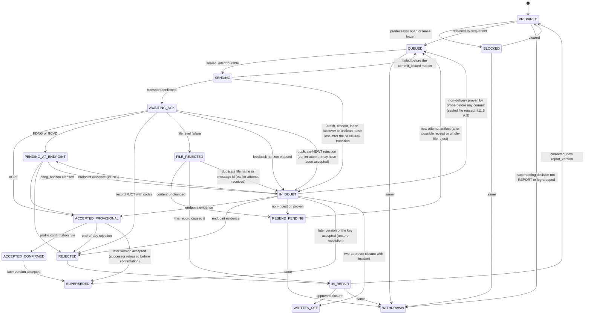

# Regulatory Reporting Platform: Design Specification

**Status:** Approved by the owner on 2026-10-09 (draft 3, revised after two independent reviews). Open owner items in section 17.4 remain and are needed by the plans named there.  
**Date:** 2026-10-08  
**Working title:** `regpack` (a placeholder; renaming is free until the first plan is written)  
**Approach:** "C+" (Regime-Pack platform), approved in brainstorming  
**Evidence base:** `docs/research/` holds eight independently fact-checked research briefs (`01`-`08`), three competing architecture documents (`approach-A/B/C.md`) and the synthesis `00-brainstorm-brief.md` ("the Brief"). This specification states the *approved design*. The Brief holds the reasoning, the alternatives that were rejected and the regulatory research; "Brief §x" cites it.

## Overview for the reviewer

**What it is.** A self-hosted regulatory reporting engine for one firm. It decides which transactions are reportable and records why, enriches and validates them, builds the regulator's file, delivers it, tracks every response, queues what was not accepted, and can prove afterwards what was sent and when. Release 1 covers EU MiFIR transaction reporting (RTS 22) to a simulated ARM/NCA. EMIR follows as the second regime.

**Main ideas.**

1. Regulation is signed data. A Regime Pack (decision tables, citations, validation catalogue, endpoint profiles) is approved by maker, checker and Compliance, signed by a separate `signer` process and activated without a redeploy. The Java 25 engine holds no regime logic.
2. The PostgreSQL 18 ledger enforces correctness: unique keys, one delivery in flight per key, fenced sender leases. The design does not rely on exactly-once messaging.
3. Durable before effect. Nothing is sent, acknowledged or deleted until its evidence is stored; if the evidence store is unreachable, sending stops.
4. Two evidence profiles. P-WORM (object lock) is tamper-resistant. P-SEALED (signed manifests, for sites without object lock) is tamper-evident only and needs a dual write for durability.
5. Silence is not success. An IN_DOUBT delivery is resolved from endpoint evidence, never by blind resend. Completeness is proven daily in both directions.
6. Restore means the database backup made current from the evidence tier.

**Ten decisions to check.**

1. Release 1 size, the milestones (only M3 can go live) and the cut lines and cut order (sections 15, 17.4, 18).
2. Evidence profile per environment and written acceptance of P-SEALED limits (5.4, gate G8).
3. The analyst editor as plan P11 after release 1, and its scope; the fallback if gate G-S3b fails (D7, 6.8).
4. A named Compliance owner, and Compliance approval of every outcome-changing rule change (G1, 6.5).
5. Approver credentials: attested hardware WebAuthn keys, user-verified credentials, or KMS-held keys (13, 17.4).
6. What "supported" means on Linux, Windows Server and Kubernetes (5.2, 14.5).
7. Enrichment providers and whether their licences allow storing responses (7.5, G5).
8. The release 1 universe: LEI clients, equities, natural persons routed to UNDETERMINED (D14).
9. Recovery posture: fail closed, RPO 0 only with the dual write on P-SEALED, cold standby (D15, 11).
10. Whether an incumbent or previously reported state exists, which decides whether the cut-over tooling is built (9.9, 17.4).

**Reading order.** Sections 0 to 2 (terms, scope, decisions); 4 (invariants); 5.1 and 5.4 (components, evidence profiles); 15 to 17 (increments, plans, gates, open items). Then the integrity core: 9.3, 10, 11.2 and 11.5. Then 6, 7, 8, 12, 13 and 14 as each plan needs them.

**Every performance and capacity figure here is an unmeasured placeholder** until the P1 spikes report.

## 0. How to read this document

- **Fact status labels** used wherever a regulatory or vendor fact that a design decision depends on is stated: **V** verified in a primary source by a second pass; **C** corrected by that pass (the corrected statement is given); **U** unverified; **F** future or scheduled (a date or plan that has not happened yet; never **V**). Nothing marked **U** is a design premise, except an assumption that the text names as tested by a spike or gate.
- **Release terms.** *Release 1* is the first production release and delivers everything in section 15. *MVP* and *v1* (in the Brief and in earlier drafts) mean release 1; *v1.1* means the release after release 1. Items deferred past release 1 are named as such and listed in section 18; those with a plan appear in P11 to P13 (section 16), the others are not scheduled. "R1" always means requirement R1, never a release.
- **Placeholder** means a number or interval that is a proposal until a spike or Compliance sets it. No performance or capacity figure in this document has been measured.
- **MUST / SHOULD** are normative. Everything else is explanation.
- Regulatory content in this document is a *design input*, not legal advice. Section 17 lists what a compliance expert must confirm before go-live.

## 1. Purpose and scope

### 1.1 Purpose

A reporting engine for financial institutions and trading firms that decides which transactions are reportable and why, validates them against the reporting requirements, produces the regulator-required output formats, delivers them to the right destination, tracks every response, queues anything not accepted for repair or resend, proves what was reported and when, never reports the same transaction twice, and can be restored after a failure.

### 1.2 In scope

Transaction-level, per-record regulatory reporting with a lifecycle (new, amend or correct, cancel), an acknowledgement or feedback loop, and a deadline per record.

| Regime family | Position |
|---|---|
| EU MiFIR transaction reporting (RTS 22) | **Release 1** |
| EMIR / UK EMIR (trade repositories), SFTR, CFTC-style, ASIC, MAS, HKMA, JFSA | Not built in release 1; the architecture keeps the lifecycle shape regime-agnostic. **EMIR is the second vertical** (plan P12) and proves the core is regime-agnostic; other regimes follow as packs |
| UK MiFIR (MAR 14, in force 3 Apr 2028 **F**) | After the EU pack, as its own pack lineage with its own schema |

### 1.3 Out of scope

Aggregate or template reporting (COREP/FINREP and other XBRL taxonomies, AnaCredit, Solvency II QRTs, MMSR, Form PF), MiFIR transparency publication (RTS 1/2), suspicious transaction and order reports (STOR), short-selling notifications, and US regimes (CAT, TRACE). These have a different shape (aggregation, templates, taxonomies, publication). Hosting them later would need a new pack kind and engine extension, not a pack. The firm reports **its own** transactions only; acting as an ARM or reporting service for third parties is out of scope (§17 gate G9).

### 1.4 Users

Operators (work the queues and batches), analysts (author rules as makers; a second analyst acts as checker; through version-controlled files in release 1 and through the web editor from plan P11 onward), Compliance approvers, auditors (read-only), administrators. Roles and separation of duties are in §13.

## 2. Decision record

Every row was confirmed by the user in brainstorming on 2026-10-08, except rows marked *default*, which were presented as assumptions and accepted when design section 1 was approved. Where a confirmed row contains a phrase marked *default* or says what this spec proposes, that phrase is a design assumption and not a user decision.

| # | Decision | Choice |
|---|---|---|
| D1 | Architecture approach | **C+**: signed Regime Packs plus a thin regime-agnostic engine; grafts from the lean single-binary and streaming alternatives (Brief §3.5). Rejected: A (Rust single binary), B (Kafka platform) |
| D2 | Stack | Java 25 LTS modular monolith, PostgreSQL 18, an evidence store (immutable under P-WORM, tamper-evident under P-SEALED, §5.4). The user delegated the choice to research; chosen on research (weighted score Java 4.4, .NET 3.6, Go 3.2, Rust 3.0: author judgement, not benchmarks; the order is unchanged if the DRR criterion is dropped or the efficiency weights are doubled). Flip conditions: §5.3 |
| D3 | Who operates | Single firm, self-hosted. No vendor distribution, no multi-tenant SaaS |
| D4 | Runtime targets | Linux, Windows Server and Kubernetes must all be supported ("supported" is defined in §5.2) |
| D5 | First regime | EU MiFIR RTS 22 first (release 1, §15). EMIR second: the next vertical, plan P12, built right after release 1 and not part of it. EU only in release 1; UK MiFIR and non-EU regimes are later pack lineages |
| D6 | Scale | Large batch plus intraday micro-batch (§7.8), 10-50M records/day at the high end. Sizing basis, a design assumption and not a user decision (*default*): 50M records/day (a record is one candidate, that is one decision row) arriving in a four-hour burst (about 3,470 records/s; 580/s over 24 h). *Placeholder* until spikes |
| D7 | Rule authoring | Compliance analysts through a **web UI editor**, built after the pack-format decision gate (§6.8). Placing the editor as plan P11, the first item after release 1, is a scheduling assumption (*default*) that the owner confirms in §17.4; in release 1 analysts use version-controlled files and the CSV round-trip |
| D8 | GUI | A web **operator console** is in release 1: records, batches, scheduling, responses, pre-validations, queues, evidence (§12) |
| D9 | First slice I/O | Files (CSV, XML, JSON) plus one relational-database connector in; a built-in simulated ARM/NCA out |
| D10 | Maintainers | Mostly the owner with AI assistance: favour simplicity, strict typing, strong tests, few moving parts |
| D11 | Enrichment | Records MUST be enrichable from external reference-data provider APIs and from databases (§7.5) |
| D12 | Evidence store | User constraint: object-lock storage is not available in every environment. This spec proposes **two profiles** (§5.4) |
| D13 | DRR (*default*) | A native DRR-style model; ISDA's DRR engine is an optional later provider and test oracle, gated by Legal (§6.7) |
| D14 | Release 1 universe (*default*) | Legal-entity (LEI) clients, equities on EEA venues, capacities DEAL/MTCH/AOTC. Natural-person clients are routed to UNDETERMINED with a reason |
| D15 | Recovery and operations (*default*) | RPO 0 for everything that has left the system (on P-SEALED only with the dual write of §5.4); RTO in hours; the system fails closed when the evidence store is unreachable; business-hours operation with an on-call for the T+1 window; cold application standby in release 1 |
| D16 | Rule-change roles (*default*) | Analyst authors (the maker), a second analyst checks, Compliance approves anything that can alter a reporting outcome |
| D17 | Role (*default*) | The firm reports its own transactions only; acting as an ARM or reporting service for third parties is out of scope (§1.3; gate G9 is its revisit trigger) |

## 3. Requirements and where they are satisfied

| Req | Requirement | Satisfied by | Honest rating |
|---|---|---|---|
| R1 | High-performance reporting | Streaming micro-batches, per-batch distinct-key lookups, scalar executor with a benchmark gate, StAX streaming XML, virtual threads for I/O (§5, §6.6) | Adequate, **unmeasured** |
| R2 | Maintainable, minimal lifecycle, robust, efficient | Regulation as signed data, thin engine, three versioned runtime components, one codebase and one image (the `signer` role runs as a separate process) (§5) | Maintainability strong; lifecycle adequate, weighed against D10 and the §5.5 register including key-lifecycle cost; efficiency adequate (JVM) |
| R3 | Many data sources | Connector contract and tiers; enrichment connectors (§7) | Adequate: delivered as a supported-source matrix (§7.1) with conformance suites, not an "all databases" promise |
| R4 | Historical logging evidencing what was reported | Insert-only ledger plus evidence store (tamper-resistant under P-WORM, tamper-evident under P-SEALED), evidence manifest per report, offline `verify` (§11) | Strong with P-WORM; adequate with P-SEALED (tamper-evident only) |
| R5 | Financial-industry output and transfer | Declarative projections (ISO 20022 XML, CSV, TXT), SFTP/HTTPS/file-drop transports (§9.1) | Adequate: destination specs are partly gated |
| R6 | Responses; unaccepted records queued for resend | State machine, three queues, in-doubt handling, completeness invariant (§9) | Strong |
| R7 | A model like ISDA DRR | Regime Pack mirrors DRR constructs and adds reason codes, runtime lineage, submission state (§6.7) | Strong for the model; generality unproven until EMIR |
| R8 | Configurable reportability logic | Rules as data, change control, impact analysis (§6) | Strong; the analyst editor (plan P11) follows release 1 and the G-S3b decision |
| R9 | Classification with legal reason | Decision record with reason code and structured citations (§6.3-6.4) | Strong, subject to a named Compliance owner |
| R10 | Data-quality pre-validation | Six-layer pipeline, XSD gate, identifier library (§8) | Strong |
| R11 | Cross references | Typed reference tables with validity ranges (§7.6) | Adequate |
| R12 | Trackability; no duplicate reporting | Key model, unique constraints, sender lease, version ordering (§10) | Strong |
| R13 | Restore after failure | Durable-before-effect, recovery decisions, restore algorithm with in-doubt resolution (§11) | Strong on design, adequate on operations; on P-SEALED, restore correctness also depends on the §5.4 dual write |
| R14 | Built with superpowers | This spec, per-subsystem plans, TDD with oracle independence (§14, §16) | Adequate to strong |

## 4. Design invariants

Each invariant is testable and maps to named evidence (§14.4).

| # | Invariant |
|---|---|
| I1 | **Durable before effect.** No first byte to a destination, no acknowledgement to a source and no move or delete of a source file happens until the record that justifies it is durable (ledger committed with synchronous-standby acknowledgement, and bytes or journal objects acknowledged by the evidence store as durable, §5.4). The system fails closed. |
| I2 | **Correctness comes from ledger constraints** (unique keys, partial unique in-flight index, fenced leases), not from messaging semantics or exactly-once claims. |
| I3 | **Reproducible.** Every stage is a deterministic function of pinned inputs: pack digest, overlay, interpretation pins, reference-data snapshots, enrichment responses, mapping version, Firm Profile version and engine build. Rules use no wall clock, randomness or locale; UTC and decimal arithmetic only. Enrichment snapshots are durable before any decision cites them (§7.5). **Replay compares** decisions, derived fields, validation results and `logical_hash`. Sealed bytes are reproduced only by re-projecting with the artefact's stored volatile inputs (file sequence, header id, creation instant, file name, projection version), which are stored with the artefact. |
| I4 | **Regulation is data.** Rules, reason codes, citations, validation catalogues, destination profiles and schema pins are signed, versioned data. Regime logic found in engine code is a design alarm. |
| I5 | **Every candidate gets a decision with a reason and citation, negatives included.** UNDETERMINED never silently becomes DO_NOT_REPORT. |
| I6 | **Silence is neither success nor failure.** No blind resend. Automatic resend is limited to content the destination provably never processed (not received, or rejected whole at file level). |
| I7 | **Completeness is proven daily in two directions.** Downstream: every REPORT decision maps to an accepted version or an open queue item, and every REPORT_BY_OTHER decision to CONFIRMED_BY_OTHER or an open NOT_CONFIRMED item (the exact classes are in §9.5). Upstream: every expected source record maps to an ingested record and a decision, proven against an independent population where one exists and labelled UNPROVEN where not. |
| I8 | **Production and non-production never mix.** A non-production credential, destination or acknowledgement can never satisfy a production completeness, acceptance or retention rule. |
| I9 | **One sender per endpoint.** A lease with a fencing token, expiry and pre-commit re-check narrows the window for a second sender; it cannot close it. Harm from a late sender is bounded by the in-flight index, `logical_hash` suppression, destination duplicate rejection and the IN_DOUBT rules (I6). |
| I10 | **The evidence tier is never rebuilt; the database is restored from backup and made current from the evidence tier.** Everything that gated an external effect is reconstructable from the evidence tier. The database is restored from a base backup with PITR and brought current by journal gap replay and re-derivation of the unjournaled tail (§11.5.B). A full rebuild from the evidence tier alone is a degraded secondary path that recovers only what journal objects and landing batches cover; its time is measured by SP-L, and state that is neither journalled nor re-derivable (for example queue assignments and comments) is bounded by the backup RPO and listed in the restore report. |

## 5. Architecture

### 5.1 Components

```mermaid
flowchart LR
  SRC["Sources: files, SFTP, object stores, JDBC, HTTPS, Kafka"] --> CON["Connector SPI"]
  CON --> LZ[("Landing zone: content-addressed batches (a namespace of the evidence store)")]
  CON --> ING["Ingestion ledger and checkpoints"]
  LZ --> CAN["Canonicaliser: source-mapping packs"]
  CAN --> ENR["Enrich: reference data, provider APIs, databases"]
  subgraph RT["Regime runtime: generic engine, no regime logic"]
    ENR --> DEC["Decide: scope tables"] --> DER["Derive: field rules"] --> VAL["Validate: layers 1-5"]
  end
  subgraph CP["Control plane"]
    REG[("Pack, overlay and legal-source registry")] --> CI["Pack CI: analysis, golden tests, impact report"] --> APR["Approve: maker, checker, Compliance"] --> SIGN["Signer service: separate process, role signer (pack and manifest signing)"] --> ACT["Activate"]
    SIGN -.-> KMS[("KMS / HSM: pack-signing and manifest-signing keys")]
  end
  ACT ==> RT
  VAL --> VER["report_version + outbox (sync commit)"]
  subgraph SUB["Submission"]
    VER --> SEQ["Per-key sequencer"] --> ASM["Assembler: project, per-record XSD, file gate"] --> SEAL["Seal: bytes to evidence tier, intent journal"] --> TX["Sender: SFTP, HTTPS, file drop (lease-fenced)"]
    FBK["Feedback engine: profile parsers, correlator"] --> SM["State machine"] --> Q["Queues: resend, repair, DQ/HOLD"]
  end
  TX --> DST["NCA / ARM / trade repository / venue"] --> FBK
  Q --> SEQ
  TIM["Timekeeper"] -.-> SM
  PG[("PostgreSQL 18 + sync standby: ledger, reference data, xref")]
  EV[("Evidence store: object-lock or sealed-file profile")]
  RT --> PG
  SUB --> PG
  SEAL --> EV
  FBK --> EV
  PG -. "after-the-fact journal objects (async), signed manifests" .-> EV
  UI["Web console and API"] --- PG
  OBS["OpenTelemetry, metrics, regulatory-clock board"] -.- PG
  DRR["Optional DRR provider (drr image, Legal-gated)"] -.-> DEC
```



### 5.2 Runtime and packaging

- **One codebase, one version, one process by default.** A role flag (`ingest`, `engine`, `assembler`, `sender`, `feedback`, `timekeeper`, `control-plane`, `console`, `signer`) selects roles; all run in one JVM except `signer`. The web console and API are served by this process. The `timekeeper` role also fires source schedules and manual runs (§7.8); a due run is a `timer` row. The `signer` role is the one deliberate exception to "one process": the same image and release run as a separate process under its own workload identity, the only identity with use permission on the pack-signing key and on the manifest-signing key (two separate KMS keys, each under its own policy), so that the application and CI never hold either key and the application identity can invoke neither. The role has two functions. *Manifest signing* (minimal version in plan P3; used by both evidence profiles, §5.4) signs only a manifest that the signer builds itself from the ledger's write-time hashes and the store listing, never an arbitrary payload. *Pack signing* (plan P9b, §6.5 step 5) performs the attestation check and then the signature; packs may be activated unsigned before increment S8 only as §6.5 step 6 states. The `signer` counts as a role of the application image, not as a fourth versioned component.
- **Ports and adapters.** Every external dependency sits behind an interface with an in-memory test adapter: `LedgerStore`, `EvidenceStore`, `Clock`, `Transport`, `Executor`, `Expression`, `ReferenceData`, `EnrichmentSource`, `RegimeProvider`. This is what makes TDD and the deterministic destination simulator possible.
- **Port contracts.** `LedgerStore` is a unit-of-work API: every "same transaction" rule in this document is one call on the port, so the in-memory and PostgreSQL adapters share one invariant suite. `Transport` is the destination side of the connector contract (`send`, `probe`, `poll_acks`) and `EnrichmentSource` is its `lookup` kind: there is one SPI, defined in P0. A `Batch` payload is bytes plus media type plus manifest; a JDBC extract is serialised to canonical NDJSON before landing. The connector, transport and `EvidenceStore` conformance suites assert checkpoint resume, backpressure, idempotent redelivery and fault injection. Method signatures are P0 deliverables reviewed by the owner.
- **Image flavours:** `core`; `connectors` (adds vendor JDBC and MQ drivers); `drr` (JDK 21, optional, Legal-gated).
- **One active sender per (entity partition, endpoint)**, enforced by a lease row with a fencing token, expiry and heartbeat (I9, §10). Release 1 runs one active node with a **cold standby** restored from the database backup and the evidence tier (§11.5); a warm standby follows in a later release. The system scales **up** (cores, memory, tuned PostgreSQL), not out. Fencing is best effort in release 1: conditional-write fencing of every journal PUT and per-statement fencing are deferred to the warm standby (Brief T2).
- **Upgrade:** drain, replace, restart. Database migrations are forward-only (expand/contract). A regulatory change is a pack activation, not a deployment.
- **Targets:** Linux (systemd service or container), Windows Server (Windows service), Kubernetes (Helm chart, health probes; one active replica plus cold standby, not horizontal scale-out). "Supported" means that the same signed build installs and passes the smoke run, a restore and `verify --deep` on each target at the release-candidate tier (§14.5). Platform-specific behaviour (file-completion detection, move-to-rejected, SFTP rename, KMS and secrets options) is covered by the connector and transport conformance suites, which run on every target at the tiers of §14.5.
- **Moving-parts budget:** three versioned runtime components (one application image, whose `signer` role runs as a second process; PostgreSQL with standby; one evidence store) plus the operational dependencies of §5.5, which are the larger part of the load. Adding a runtime component, or a Mandatory row to the §5.5 register, triggers a design review.

### 5.3 Stack

| Layer | Choice | Notes |
|---|---|---|
| Language/runtime | Java 25 LTS (Temurin or another OpenJDK build) | Virtual threads for I/O, bounded pools for CPU; no preview features; no native-image baseline |
| Ledger | PostgreSQL 18, quorum synchronous standby, PITR from base backup plus WAL | Behind the `LedgerStore` port; backups are held by the §5.5 backup tooling, not in the evidence tier |
| Evidence | S3 Object Lock (or S3-compatible with object lock) or the sealed-file profile (§5.4) | Behind the `EvidenceStore` port; the firm owns the account and keys |
| XML/XSD | JAXP/StAX streaming, XSD 1.0 (**V** for the ESMA MiFIR schemas, which use XSD 1.0 constructs only, research 04; **U** for the EMIR auth.030/108 schemas until SP-E) | XSDs fetched and hash-pinned at deploy, not shipped |
| Expressions | `cel-java` behind the `Expression` port, pending spike SP-R; in-house CEL-shaped subset over `BigDecimal` as fallback | |
| Observability | OpenTelemetry (Java) and Prometheus metrics | |
| Supply chain | CycloneDX SBOM, dependency scanning, licence allow-list in CI | |
| Console UI | TypeScript single-page app; one minimal-dependency framework, chosen in P10a within these constraints: built in CI and embedded in the application artifact (no Node.js at runtime, no CDN assets), lockfile-pinned, covered by the SBOM, scanning and licence gate | A second ecosystem; keep its dependency count small (D10) |
| Not used in release 1 | libxml2, DuckDB/DataFusion/Arrow in the core, Kafka as data plane, Camel/NiFi/Airbyte as connector layer, immudb, Litestream as primary store | |

**Flip conditions** (when the stack decision should be reopened):

- .NET is mandated, or the C# Rune/CDM implementation reaches parity: flip to .NET 10 LTS (packs, golden corpus and ledger schema port unchanged).
- A single binary with no database server is mandated *and* sources are files, PostgreSQL and SQL Server only *and* DRR execution is not required: Rust or Go with a PostgreSQL or SQLite `LedgerStore`.
- FIPS 140-3, hiring or build time dominates, or JVM memory spikes (SP-M) fail: Go.
- Spike SP-R fails: add faster executors in this order: closure-compiled scalar, then chunked columnar.
- PostgreSQL cannot hold the volume (SP-L): offload old partitions to immutable Parquet, then shard by endpoint.
- A destination requires XSD 1.1: stay on the JVM (Xerces-J or Saxon-EE behind the validator port).
- The firm already runs Kafka and CDC and needs independent stage scaling: introduce a log behind a `Log` port; the ledger stays PostgreSQL.

### 5.4 Evidence store profiles

The evidence store holds landing batches, sealed outbound files (exact bytes), raw responses, enrichment responses, pack and reference snapshots, archived engine builds, journal objects, signed manifests, restore reports and evidence bundles. It has two profiles behind one port, and **the evidence grade (the active profile and lock mode, for example `P-WORM/compliance`, `P-WORM/governance`, `P-SEALED`) is shown on every console screen and stamped into every evidence manifest**; a pack activated unsigned adds the stamp `unsigned` (§6.5 step 6). Only P-WORM is called immutable or tamper-resistant; P-SEALED is tamper-evident.

| Profile | Mechanism | What it proves | Use |
|---|---|---|---|
| **P-WORM** | S3 Object Lock (governance mode outside production, compliance mode in production), an S3-compatible store with object lock, or Azure immutable blob (a post-release-1 adapter that needs its own spike; see Brief §5.10 for its limits) | Tamper-**resistant** where the lock cannot be bypassed: verified for S3 Object Lock compliance mode, which no user including root can shorten or remove (**V**); governance mode (non-production only) can be bypassed by principals holding the bypass permission; an S3-compatible store (spike SP-O, §16) or Azure immutable blob (its own spike) counts as P-WORM only after its lock semantics are verified (**U**). Compliance-mode retention is irreversible, so production rollout is staged | Production wherever available (default); governance mode is not accepted for production |
| **P-SEALED** | Append-only files on ordinary storage; each object is hash-sealed. A **separate signer** (the manifest function of the `signer` role, §5.2: a different trust domain whose key the application identity cannot invoke) builds a signed manifest from the write-time hashes recorded in the ledger (`object_manifest`) and its own storage listing, every `manifest_interval` (placeholder 15 minutes, never longer than one send window) and at least daily. An object found in the listing with no ledger row (a crash orphan, §7.2) is recorded in the manifest as `ledger_ref: NONE` with its hash and first-seen time and is not refused; a recovery or daily sweep adopts it (a redelivered landing batch gets its row) or classes it `ORPHAN_HARMLESS` with a reason. Each manifest embeds the previous manifest's hash, the ledger head and the `restore_epoch`; a regression of the embedded ledger head is valid only at an epoch boundary and only if the first manifest of the new epoch carries the digest of the signed restore report (§11.5 B.9). The signed manifest is copied to a second location under a different administrative domain that is append-only for the application | Tamper-**evident**: any alteration or deletion that a manifest covers is detectable by `verify`, which reports UNEXPLAINED for an object that predates a signed manifest and is not listed in it, ORPHAN for an unswept `ledger_ref: NONE` object (a `DeliveryIntent` orphan is in-doubt input, §11.5 B.5) and any break in the manifest chain. It does **not** stop someone with storage access from deleting or rewriting files. Objects newer than the last signed manifest are not covered: within that interval a storage administrator could delete or forge journal objects undetected. The SP-W statement lists these residual risks and the G8 acceptance covers them. An unreachable or unverifiable manifest fails closed. Manifest lag (the age of the last signed manifest) above 2 x `manifest_interval` raises alert (4) with a runbook; above a maximum uncovered interval (placeholder 4 x `manifest_interval`, set in the G8 acceptance) the send gate fails closed | Environments without object lock (for example some Windows Server sites). Added after the Brief; requires spike SP-W |

Rules for both: the firm owns the account and keys; retention periods are recorded as fixed and extend-only, with legal hold modelled separately (P-WORM enforces them in the store; on P-SEALED a violation is only detectable by `verify`, and only for manifest-covered objects); an evidence-store outage fails the system closed (§11.3).

**Durability.** An evidence write is acknowledged only when it survives the loss of one disk, volume or host. P-WORM on AWS S3 relies on the service's multi-AZ replication (**V** for AWS). Any other S3-compatible store counts as P-WORM only if it is configured to survive the loss of one disk, volume or host with synchronous acknowledgement (erasure coding or replication across failure domains); the P3 evidence-store acceptance and the G8 record check and state this configuration, and a store that cannot do it has RPO above zero, like an under-provisioned P-SEALED. P-SEALED MUST write synchronously to two independent volumes or hosts (or to synchronously replicated storage) and acknowledge after both are fsynced. The second-location manifest copy is an integrity control, not a durability control. A P-SEALED deployment that cannot do this has RPO above zero for sealed bytes, journal objects and landing batches (D15 does not hold for it), and the G8 acceptance MUST say so.

**Claims that hold only for P-WORM:** immutability, store-enforced retention, and RPO 0 for sealed bytes and journal objects on AWS S3, and on other stores only where the durability configuration above is verified. On P-SEALED, retention is detected rather than enforced and RPO 0 needs the dual write above.

**Landing zone and retention classes.** The landing zone is a namespace of this port (a single write path) and holds one object per micro-batch. Each object class (landing batch, enrichment response, sealed file, journal, bundle) has a retention class set by Legal. Production evidence is not written for an object class until Legal has confirmed its retention and compliance mode is enabled for it (gate G8); governance mode is used in non-production environments only. The irreversible compliance-mode rollout is staged by environment (conformance before production), never by running production under governance mode. An orphan enrichment snapshot (§7.5) takes the retention class and anchor of its micro-batch.

### 5.5 Operational dependency register

These operational dependencies come on top of the three-component count (PostgreSQL and the evidence store are repeated for their failure impact). R2 is rated against this list, not against the count alone.

| Dependency | Release 1 status | Failure impact |
|---|---|---|
| JVM runtime (Java 25; the next LTS is a secondary-sourced **F**/**U** date) | Mandatory | Security exposure; no regulatory function lost on a delayed upgrade |
| PostgreSQL 18 (supported to 2030-11-14 **F**) major upgrades, with the contrib extension `btree_gist` that the `WITHOUT OVERLAPS` keys of §8.4 require | Mandatory | Ledger unavailable: sends stop (fail closed) |
| Evidence store | Mandatory | Sends stop (fail closed); outage alert |
| KMS/HSM (pack signing and manifest signing, both used only by the `signer` role with a separate key and policy each; envelope KEKs) | Mandatory | No new pack activations or evidence writes; running packs unaffected |
| Secrets manager (OpenBao or a cloud secret manager) | Mandatory | Sends fail on credential resolution |
| Git and CI for pack releases | Mandatory for pack changes | No pack changes; running packs unaffected |
| Signer service in front of the two signing keys (role `signer`, same image, one separate process; manifest signing from plan P3, pack signing from plan P9b; §5.2) | Mandatory | No new signed packs and no new signed manifests: on P-SEALED sends stop once the maximum uncovered manifest interval lapses (fail closed, §5.4); on P-WORM the daily manifest is delayed |
| Identity provider (OIDC/SSO), firm-owned | Mandatory | Console and API logins fail; automated stages and sends continue; break-glass only (§13) |
| Time source (NTP/PTP) | Mandatory | Clock-offset gate fails closed: sends stop (§8.4) |
| P-SEALED prerequisites: second manifest location in a different administrative domain, independent signer host, dual-volume write (§5.4) | Mandatory only if P-SEALED is chosen; G8 confirms they exist before the choice | Manifest copy unavailable: fail closed |
| Offline root and M-of-N escrow custody (§11.6) | Mandatory | No trust-list change, key ceremony or key recovery |
| Observability stack and alert routing | Mandatory | Blind operation; the alert path must itself be monitored |
| Backup tooling | Mandatory | No restore path |
| SFTP egress proxy with static IPs | Where a destination requires it | Destination blocks the source address |
| `connectors` image (vendor JDBC/MQ drivers) | Optional | One source type unavailable |
| Destination simulator | Test only | None in production |
| `drr` image | Optional, Legal-gated | None unless adopted |

Release-engineering obligations that are spec items: a stated security-release process, Java and PostgreSQL upgrade playbooks, versioning of the pack format and `engine_min`.

Key lifecycle cost: §11.6 lists six key classes. The key ceremony, rotation and escrow runbooks are plan P9b deliverables and part of the R2 "lifecycle adequate" rating.

### 5.6 Capacity model (placeholders)

- Sizing is **burst-bound**: 50M records in a four-hour window is about 3,470 records/s, roughly six times the 24-hour average of about 580/s.
- Decision rows: planning figure 300-500 bytes including indexes, so 15-25 GB/day and about 27-46 TB over five years for decisions alone (50M rows/day x 300-500 B x 1,826 calendar days; business days only would give about 19-32 TB; second legs and superseding decisions are not counted and SP-L measures them), before report versions, deliveries, attempts and feedback. Rows carry no personal data and are partitioned by trade date. Raw inputs and enrichment responses in the evidence tier add bytes per day, objects per day (one per micro-batch) and PUT/s; these are SP-L and SP-M outputs next to the decision-row figure.
- Rule evaluation is not expected to be the bottleneck; XML build, XSD validation, reference lookups, enrichment calls, ledger writes and evidence-store PUTs are.
- An end-to-end latency budget per stage (arrival, landed, enriched, decided, validated, versioned, assembled, sealed, sent) is an output of spike SP-X in plan P1; the sum MUST fit between feed arrival and `due_at` minus `hold_margin`.

## 6. Regime Packs and the decision engine

### 6.1 Pack anatomy

A pack is versioned (semver), content-addressed (SHA-256 of canonical form), signed and immutable once published.

```
mifir.eu.rts22-2.3.0/
  pack.yaml        id, semver, regime, jurisdiction, valid{legal}, as_at_field, engine_min,
                   input-schema digest, supersedes, report definitions (schema, scope tables, endpoint profiles)
  model/           report schemas (field facets CI-checked equal to the pinned XSD), canonical input schema
  scope/           decision tables (is this reportable?), hit policy FIRST, explicit priority
  route/           competent authority, cardinality, submission route
  derive/          field-derivation rules, each with rule_ref and citations
  enrich/          enrichment plan (§7.5)
  validate/        layered rules with regulator ids (CON-nnn, EMIR-VR-tfff-nn), severity, disposition, predictability
  lifecycle.yaml   business_key, TRN policy, correction rules, successor_gate, due_at rule
  endpoints/       destination profiles (§9.2)
  refdata.yaml     datasets and as-of anchors used
  reasons.yaml  sources.yaml  rationales.yaml  interpretations.yaml
  tests/           golden cases (with provenance) and property tests
  CHECKSUMS  ATTESTATION   (maker, checker, Compliance approver where §6.5 step 4 requires one, CI run,
                            impact-report digest; emergency form: maker, independent approver,
                            `emergency` flag, `expires_at`)
```

An illustrative rule (the citation is a placeholder; real content comes from the Compliance-reviewed pack):

```yaml
- id: S-N03-example
  node: N03
  priority: 300
  when: "event.kind in ['NOVATION','ASSIGNMENT']"
  outcome: DO_NOT_REPORT
  reason: MIFIR.N03.EXCLUDED.<provision>
  cite: [{source_id: rts22, provision_path: "art/2/par/5/pt/<x>", role: BASIS}]
  rationale: RAT-0011
  valid: {legal: {from: 2018-01-03}}
```

**Regime lineages** are separate packs, not forks: `mifir.eu.rts22` (in force); a staged `mifir.eu.review` activated by a recorded legal event (the EU application date of a revised RTS 22 is **U**); `mifir.uk.mar14` from 2028-04-03 (**F**) with its own 52-field schema (**C**: not "EU 65 fields minus a list"). Shared logic lives in `common` packs imported by pinned digest (after release 1). Firm **overlays** choose among options a base pack declares, set parameters and add source mappings (format: §7.4); they cannot delete or reorder base rules.

**Release 1 pack-schema scope.** Release 1 implements the `legal` validity window and `AS_REPORTED` resolution. `supervisory` and `event` windows, `common` imports and overlay machinery beyond three declared MiFIR options are built with the second regime or the first remediation run (reserved, RSV-6, §18).

### 6.2 Rule language

YAML decision tables plus a CEL-shaped, non-Turing-complete expression subset: bool, int, scaled decimal, string, UTC timestamp, date, enum, list; explicit absence (`has(x)`); evaluation errors yield UNDETERMINED; no loops, I/O, clock or user-defined functions; a per-rule cost ceiling; a vetted built-in library (LEI mod 97-10, ISIN Luhn, CFI, MIC, dates, decimals) versioned and pinned through `engine_min`. CI always enforces a mandatory catch-all row per table (default outcome UNDETERMINED, I5), unique priorities and the coverage gates; full static analysis for gaps, overlaps, unreachable and shadowed rows (plan P2b) is built if gate G-S3b passes (§6.8). There is no Rune-like textual language in release 1.

### 6.3 Decision record and reason codes

Every candidate gets exactly one *current* decision, negatives included:

```
{ decision_id, decision_seq, supersedes_decision_id, event_identity, regime,
  decision_context_id,   // pack digest, overlay digest, interpretation pins, reference and enrichment snapshot ids,
                         // firm_profile_version, mapping_version, engine_build, executor
  as_at, evaluated_at,
  outcome: REPORT | DO_NOT_REPORT | REPORT_BY_OTHER | UNDETERMINED,
  flags[], reason_code, node, rule_ids_hit[], path[], citations[],
  legs[],                // N11 output, REPORT only: MARKET | CLIENT | ALLOCATION
  input_digest }
```

- Reason codes follow `MIFIR.<node>.<label>[.<provision>]`, where `<node>` is a node of the MiFIR reportability decision tree (N01-N19, Brief §1.2; N17 and N18 are exercised from `lifecycle.yaml`), `<label>` is a short mnemonic (for example EXCLUDED) and `<provision>` an optional provision slug; the outcome is stored in the registry, not in the code. A `ReasonCode` has a label, a category (EXCLUSION, INCLUSION, OUT_OF_SCOPE, DATA_QUALITY, DEFAULT), a default outcome, validity and an owner. The node-to-pack-folder-to-increment mapping is Brief §7.2.1. `GC-Nxx-k` names golden case k for node Nxx; the GC-N09 cases cover the reference-data classes of §8.3.
- The `decision` table is **insert-only**. A re-evaluation inserts a superseding row with a higher `decision_seq`; the current decision is the highest `decision_seq` of a (`regime`, `event_identity`) chain. A decision's unique key is `(event_identity, decision_context_id, input_digest)`, so a redelivered stage, which reuses its batch context (§6.5 step 6), is a no-op. `input_digest` is the SHA-256 of the canonical decision input (including the stored enrichment response hashes) concatenated with the `ingest_key` it came from (source version or ordering value): a redelivered stage reuses the same ingest row and gets the same digest, while a source state that recurs at a later version (A, B, A) gets a new digest and a new decision. PostgreSQL requires every unique index on a partitioned table to contain the partition key, so chain linearity is enforced on an unpartitioned `decision_head(regime, event_identity, decision_seq, decision_id)`, advanced by compare-and-set in the same transaction as the decision insert: the insert fails unless the head's `decision_seq` is the new seq minus 1, and a loser re-reads the head and re-evaluates against the latest inputs. The partitioned `decision` table carries only partition-local unique keys (the idempotency key above is one, because a redelivery repeats the trade date it was first decided under). The P3 schema design (§11.1) lists every partitioned table and shows how each unique constraint satisfies the partition-key rule, and the invariant suite includes a cross-partition duplicate-seq case (a correction that changes trade date). A source record reportable under two regimes yields two independent chains (§10). A HOLD-expiry action that finds a superseding decision for the held input is a no-op, journalled.
- Decisions are per candidate (`event_identity`). A REPORT decision's `legs[]` create `report_subject` rows (`event_identity` + `leg`, §10) at the derive step; each has its own derive, validate and version chain. DO_NOT_REPORT, REPORT_BY_OTHER and UNDETERMINED decisions create none. A superseding decision whose outcome is not REPORT, or whose `legs[]` drop a leg, withdraws the unsent versions of the affected subject in its own transaction and has a sent or accepted version cancelled or resolved first (state `WITHDRAWN` and the full rule: §9.3).
- **HOLD is not a decision outcome** (§8.3). UNDETERMINED goes to the data-quality queue and never silently to DO_NOT_REPORT.
- Field lineage (field to rule to citation) is static per pack digest. `explain(decision_id)` has two tiers. Tier 1 is rendered from the stored decision (path, rule hits, citations, input digest) and carries the p99 gate (§6.6). Tier 2 (full re-evaluation trace) runs on the current engine when its `engine_build` is replay-compatible with the stored one (same major version and built-in library version; P2a defines the rule), otherwise in a short-lived subprocess started from the archived build. **Every production engine build is archived** in the evidence tier as the application jar(s) plus dependency lock (plus the image digest where containerised), and the rule-hit id per record is always stored. The nightly determinism sample (§6.5 step 8) restores and runs one archived build.

### 6.4 Legal Source Registry and effective dating

- **Legal Source Registry:** `source_id`, version label, `retrieved_at`, `content_sha256`, a best-effort ELI pointer, and provisions `{path, quote, quote_sha256, status, role}`. `role` separates BASIS and EXCEPTION (the law) from INTERPRETATION and GUIDANCE (Guidelines, Q&A, NCA material), so a decision distinguishes "the law says" from "we interpret". Multi-condition provisions are separately cited conditions. CI proves that citations resolve and quote hashes match; it cannot prove the law was read correctly, which is why a named Compliance owner is a gate (G1) that must be met before the pack content is authored (plan P6a).
- **Version selection:** `resolve(regime, as_at, mode)`; release 1 implements `AS_REPORTED` (the pack actually active, what was told to the regulator). `AS_CORRECTED` arrives with the first remediation run (after release 1, §9.8). The date that selects the version (trade, due, submission or correction date) is a per-regime manifest field `as_at_field` and a **Legal decision** (§17).
- **Interpretation pins:** `INT-xxxx` records (rationale, approver, date) activate a pinned option without a pack release; they are signed overlay records that appear on every affected decision.

### 6.5 Change control

1. A **maker** opens a change (tables, citations, rationale).
2. **CI** runs schema checks, static analysis, golden and property tests, coverage gates (every row hit, every reason code reachable, every cited provision exercised) and produces an **impact report**: baseline and candidate replayed over retained canonical inputs with reference data as at each trade; a transition matrix by rule, provision, instrument class, entity and period; and the consequences (newly reportable means missed or back-reportable reports; newly non-reportable but already reported means cancellations or error handling). Release 1 replays the golden corpus plus a retained stratified sample; the sample's source, stratification keys, size, retention and personal-data handling are a plan P9b deliverable. *Enrichment in the replay:* unchanged plans replay the stored response snapshots (§7.5). Where the candidate adds or changes a plan (source, key, precedence, fallback), the affected fields have no stored answers; the impact report lists them as a **coverage gap**, and the change is MAJOR. Compliance may accept the gap or require a read-only candidate fetch, whose values are labelled non-evidence and are licence-checked (G5). In release 1 the consequences of a MAJOR change are executed manually: the impact report's consequence list is the work list, acted on through ordinary source corrections or queue actions under §9.5 and §13 (bulk fix or resend: one approver who is not the requester; write-off or forced resend: two approvers), with the dry-run listing as the artefact.
3. **Semver is the maximum of the structural diff and the corpus diff.** Classification is a whitelist, not an equivalence proof. **PATCH:** edits to non-evaluated metadata only (rationale text, labels, citation quote-hash repairs, added tests), and the host, credential-reference and send-cadence fields of an endpoint profile (§9.2). **MINOR:** additive and outcome-neutral (new reason codes on existing outcomes, new WARNING or INFO validation rules with disposition PASS, new golden cases). **MAJOR:** everything else, by construction, including any edit to a scope row's `when`, `outcome`, `priority` or validity window, any derivation change that can alter a field value, and any change under `route/`, `enrich/`, `validate/` (severity, disposition, predictability) or `lifecycle.yaml` (business key, TRN policy, `successor_gate`, `due_at`). A corpus replay can only escalate the class. A MAJOR with an empty corpus diff is flagged as a coverage gap.
4. A **checker** independent of the maker reviews the diff and impact report. **Compliance approves** (a) any MAJOR, (b) any scope-table row, overlay option, Firm Profile field or interpretation pin that can alter a REPORT, DO_NOT_REPORT or REPORT_BY_OTHER outcome, and (c) any source-mapping change that §7.4 describes as outcome-affecting. Approval classes are defined by the registry (versioned with the engine build), never by the pack under review. By default every change under `scope/`, `route/`, `derive/`, `enrich/`, `validate/`, `endpoints/`, `refdata.yaml` or `lifecycle.yaml`, and every overlay, Firm Profile or interpretation-pin change, needs Compliance approval. Closed registry lists need the checker only: the PATCH items of step 3 (provably outcome-neutral edits such as labels, rationale text, comments and added golden cases, and the host, credential-reference and send-cadence fields of an endpoint profile, §9.2) and source-mapping changes that §7.4 does not call outcome-affecting. Step 4(a) applies to MAJOR as classified in step 3. The step-5 attestation carries the Compliance signature wherever this rule requires it.
5. **Signing** is done by the pack-signing function of the **signer service** (the `signer` role, §5.2) in front of the KMS/HSM pack-signing key. It verifies the approval attestation (the required distinct approvals of maker, checker and, where step 4 requires it, Compliance approver, each a WebAuthn assertion whose challenge binds the pack digest, the impact-report digest and an approval request, §13, from a credential registered in the signed trust list) and the separation-of-duties rules *before* it requests a signature. The CI pipeline identity holds no approver role and no signing permission.
6. **Activation** verifies the signature and `engine_min`, then records the activation in the ledger `pack_activation` row, which is the sole authority for the active digest (in-memory state is reconciled to it at start-up). Before increment S8 the pack-signing function does not exist: a pack may then be activated unsigned only in SIMULATOR or CONFORMANCE profiles (§9.7), such an activation is stamped `unsigned` into the evidence grade (§5.4) and the decision context, it is refused in PRODUCTION and PARALLEL profiles, and the P6b pack is signed once P9b exists. Each batch pins a **batch context** when it is admitted: pack, overlay, interpretation-pin and Firm Profile digests plus reference snapshot ids; enrichment snapshot ids are appended when each enrichment phase seals (§7.5, §7.8). The batch context governs the decide, derive and validate L1-L5 stages of that batch, including crash replay and redelivery, and an activation applies only to batches admitted after it. A rollback or an emergency expiry also re-pins to the reverted digest every admitted batch that has committed no decision (a journalled re-pin; its enrichment snapshots are kept); a batch with decisions already committed finishes under its pinned context and is listed in the impact report. Sequencing and assembly of already-versioned reports are unaffected. The sequencer, assembler, L6 gate, sender and feedback classification resolve the endpoint profile in force at that moment from `pack_activation` and stamp its version on each delivery, attempt and feedback row (§9.2, §9.7), so crash replay of those stages does not use the admission-time profile; if the projection version changes before sealing, L6 runs on the new bytes and a failure routes the record to repair. Re-evaluating an unchanged input under a different context for a subject that already has a sent version happens only through a source correction or a `remediation_run` (§9.8; manual in release 1, step 2). The digest used is recorded on every decision. Activation, rollback and emergency expiry are performed by a Compliance approver (or, for a checker-only change under the step 4 closed lists, by the checker, who is not the maker; defined terms in §13), under step-up authentication and signed with the performer's own credential; the expiry of an emergency pack executes the reversion that its attestation pre-authorised. Rollback is allowed only to a digest listed in the registry that passes the signature, trust-list and `valid.legal` checks at the time of rollback. A rollback or an emergency expiry opens an impact report for the decisions taken in the interval. Activation never re-evaluates decisions by itself: held, parked and UNDETERMINED items are re-evaluated on their own triggers under the pack active at that time (stamped in `decision_context`), and items already decided and queued or sent keep their decision until a source correction or a remediation run replaces it (what a replacement does to unsent and sent versions: §6.3, §9.3). Plan P9b carries a fixture for a pack swap with items in each state and for a rollback with batches admitted, partly decided and undecided.
7. **Emergency path:** the signer applies the same attestation check in a reduced form: the maker plus one independent approver, who must hold the Compliance approver role when the change can alter an outcome; the checker's review is done retrospectively and recorded at ratification. The signer accepts this two-signature form only for packs flagged `emergency`. The emergency pack carries an `expires_at` and auto-expires, reverting to the previous signed digest, unless ratified through the normal path. A single approver is not available at any severity.
8. A past date re-run with the pack that was active MUST reproduce the stored decisions exactly; a mismatch is a determinism or tamper alarm (nightly sample). `EXEC_CIRCUIT_OPEN` decisions (§7.3) are excluded from the sample and counted.
9. **"Applied easily" (R8) is measurable:** an exclusion-row or parameter change goes from request to active in under one working day including approvals; a non-engineer edits a row through a CSV round-trip and obtains the impact report without engineering help (acceptance test AT-8). *Targets, validated on the Git/CI path at gate G-S3b and on the full pipeline in increment S8.*

### 6.6 Execution

One typed IR (canonical JSON). Release 1 has **one executor behind an `Executor` port: the reference interpreter**, a tree-walking evaluator with an optional full trace; it is the executable specification, used by production, by `explain` and by golden tests. Before the S3b gate it evaluates the YAML tables directly. The expression layer is `cel-java` if SP-R shows its numeric, date, null and error behaviour is adequate for scaled decimals and timestamps, otherwise a minimal in-house subset; both sit behind the `Expression` port. A faster executor is added **only if the benchmark gate fails**. Proposed gates (placeholders): at least 10,000 records/s/core on a 200-rule pack, bounded memory at 50M records, p99 `explain` under one second. Each record runs under a per-record executor budget counted in deterministic cost units (interpreter steps plus list-length and string-size limits) enforced inside the interpreter, so the same input always gives the same outcome. A wall-clock watchdog may raise an alarm but never changes a decision.

### 6.7 Relationship to ISDA DRR

The Regime Pack mirrors DRR's constructs one for one and adds what DRR lacks.

| DRR construct | Here |
|---|---|
| Body, corpus, segment, provision references; rationale | Legal Source Registry; `Citation{source_id, provision_path, role, quote_sha256}`; `Rationale` |
| `eligibility rule` (Boolean), `reporting rule` (value), timing rule | Scope decision tables with reasons and citations; field-derivation tables; `due_at` rule driving breach clocks |
| `report ... when ... with type` | `pack.yaml` report definitions binding schema, scope tables and endpoint profiles |
| `ruleReference` per attribute | `rule_ref` and `cite` per field |
| Projection namespace | Declarative projection spec per output format, tested against golden output |
| `common` namespaces | `common` packs by pinned digest |
| Test packs, regenerate-and-review | Golden projection files are regenerated by a CLI flag and reviewed as diffs; rule-outcome goldens are authored from source evidence (O1-O2) and never regenerated |
| Peer-review working group | Maker/checker/approver attestation |
| *Absent in DRR* | Structured reason codes, event-triggered effective dating, runtime lineage persistence, submission state, idempotency keys, hot-swap signed packs |

Facts that shaped this decision: ISDA's infohub (2026-10-08) lists EU/UK MiFIR as in progress and no delivered MiFIR rule set is recorded (**V**); a FINOS CDM roadmap file (`ROADMAP26.md`, undated) plans a MiFID II test for 4Q 2026 (**F**); the DRR 7.0.0 key-concepts page lists an "ESMA / MIFIR RTS22" pipeline with ten test packs and 186 samples (**V**), its maturity and status are unknown (**U**), and the 7.0.0 scope page names no MiFIR or RTS 22 (**V**); DRR is built on CDM 6.29 and Rune 9.95 with JDK 21 (**V**); the ISDA DRR License allows use "without modifications", only within a Larger Work and with a broad indemnity, and defines "ISDA DRR" as methodology and documentation, so coverage of the code artefacts is unclear (**V**); the DRR docs home page calls the product proprietary and free only for non-commercial use, and the repository `LICENSE.md` it links could not be read (**U**).

The `RegimeProvider` contract (`evaluate(event, context)` returns decision, fields with lineage, projection) lets a JVM-hosted DRR answer for derivatives regimes later. Gates before any use: Legal reads the licence and the ISDA terms (G4); a spike (SP-D) checks the target report functions. Until G4 clears, no DRR artefact, sample or test pack is used, even as an oracle. Afterwards DRR is a candidate golden-test oracle for EMIR-family packs and, if its RTS 22 pipeline proves mature, for the MiFIR pack (§14.2 O4). **Nothing is copied from DRR.**

### 6.8 The analyst editor and gate G-S3b

The analyst web editor (decision D7) is a front end over the same maker/checker/CI pipeline of §6.5; it cannot bypass approvals. It is built **after** the G-S3b decision and after release 1 (plan P11), whichever way the gate goes (D7 holds on both branches):

- **The gate:** author about ten real MiFIR scope rules and at least five derivations (decimal rounding, microsecond timestamp formatting, conditional blanking, GBX-to-major-unit conversion, string building) in the pack format; fix two seeded defects; compare effort with coding the same rules; record time to production and whether a non-engineer completed a CSV edit.
- **Pass:** build the type checker, full static analysis and IR canonicalisation (plan P2b), then the editor (plan P11).
- **Fail:** fall back to Java expressions behind the same decision contract. They ship as signed rule-module jars (digest and manifest recorded in `decision_context`, loaded in an isolated classloader behind the `Executor` port) inside the pack, so activation stays a pack activation; tables and parameters remain signed data, and the editor is still built (plan P11, D7) but limited to them. The signer's pack-signing function, impact tooling and structural semver (plan P9b, increment S8) are built in both branches.

**Pack format freeze (on a pass only).** G-S3b passed, together with the SP-R and SP-G reports, freezes the pack format (grammar, IR, `engine_min` semantics), and the editor then works on the frozen format including expressions. A fail does not freeze the expression grammar, and the editor is limited to decision-table rows and parameters (the Fail bullet). The outcome of the gate is an input to P6b, P9b, P10b and P11.

**Editor scope (plan P11, after release 1).** Edit scope and derivation decision-table rows and parameters (on a pass including the `when` expressions of the rows, in the frozen grammar; on a fail the rows and parameters only); rule modules of the fail branch (Java jars) are not editable in the UI; pick citations from the Legal Source Registry; author golden cases with provenance; view the impact report; submit and act in the §6.5 maker/checker/Compliance workflow. The editor writes maker change sets to the pack repository through a service identity that holds no approver role. The registry remains the approval record and Git/CI remain the release path (§5.5), so there is one source of truth.

Until the pack viewer exists (plan P10b), rules are read from the repository and with `pack explain`, and decisions are visible in the Records view from plan P10a; rule changes go through version-controlled files with Git review and CI tests until the editor of plan P11 exists; the §6.5 impact report, signer attestation and activation arrive with increment S8. The gate's time-to-production figure is measured on that Git/CI path; AT-8 measures the full pipeline.

## 7. Ingestion, canonical model, enrichment and cross references

### 7.1 Connector model (R3)

- **Contract** (versioned, language-neutral in specification, in-process Java interfaces in release 1): source `spec`, `check`, `discover` (schema and stable keys), `read(state, limits)` emitting `Batch{stream, seq, payload, source_coordinates, checkpoint}`; credit-based backpressure; opaque state; explicit acknowledgement. Destination: `spec`, `check`, `send(file)`, `probe(file_id)`, `poll_acks()` declaring its `ack_model`. Enrichment sources use a `lookup` kind (§7.5).
- **Tier A (native):** files on local/NAS, SFTP/FTPS, S3, ADLS Gen2, GCS in CSV, delimited and fixed-width TXT, streaming XML and JSON/NDJSON (Avro, Parquet and Excel after release 1, plan P13); JDBC as-of extracts; HTTPS pull and webhook (OAuth2, mTLS); a Kafka-protocol consumer as a **source adapter only**.
- **Tier B (`connectors` image):** Oracle, Db2, SQL Server, Sybase, Teradata, Snowflake through vendor JDBC drivers; IBM MQ/JMS in client mode; FIX. Built after release 1 (plan P13) on demand.
- **Tier C (landing zone):** manifests for firm-run CDC (Debezium, Kafka Connect), warehouse extracts and BigQuery/Databricks drops. Built after release 1 (plan P13) on demand.
- **Supported-source matrix (R3).** "All types of databases" means the tiers above: relational databases through JDBC, and NoSQL or document stores through Tier C exports, with a native connector a post-release-1 item on demand. Streaming is the Kafka-protocol source adapter (Tier A), delivered after the release 1 set.
- **Release 1 set (D9):** the file connector (local/SFTP) reading CSV, XML and JSON (XML and JSON through mapping packs, §7.4) and one JDBC as-of extract, plus the enrichment `lookup` sources of §7.5 (one HTTPS reference-data provider and one JDBC database). The file and JDBC connectors pass the shared connector conformance suite; the `lookup` sources pass the `lookup` conformance suite (distinct-key batching, timeout, rate limit, circuit breaker, provenance). Further sources are built after release 1 (plan P13) unless named earlier.
- **Extraction strategy:** business-date as-of extracts with control totals and stable keys, not cursor polling on commit order. Intraday increments use windowed as-of extracts (§7.8). CDC only where the firm already runs it.
- **Scheduling and micro-batches:** schedules, manual runs and the micro-batch closing rules are in §7.8.
- Credentials are references (`vault://`, `openbao://`, `awssm://`, `azkv://`, `gcpsm://`, `file://`, `env://`) resolved at run time and never written to the evidence log. Every connector ships an SBOM.
- No third-party framework (Camel, NiFi, Airbyte, Redpanda Connect, Vector) is adopted wholesale.

### 7.2 Commit rule

Order, per micro-batch (§7.8): (1) write the batch to the landing zone (content-addressed, idempotent) and PUT its `BatchAdmitted` journal object (§11.2); (2) one PostgreSQL transaction records the ingest row, checkpoint and outbox row; (3) acknowledge the source. A crash between steps leaves a harmless orphan object and a redelivered batch that is a no-op through `ingest_key`. Delivery is at-least-once; the acknowledgement follows durability (I1) and idempotent landing through `ingest_key` makes redelivery a no-op (I2).

### 7.3 Ingest faults and poison data

A bad file or record MUST NOT silently vanish, block the batch behind it, or stall the executor.

| Fault | Disposition |
|---|---|
| File still being written | WAIT. A source supplies a completion marker (manifest or `.done` naming size and SHA-256); otherwise size and mtime must be unchanged across consecutive polls. If not complete by `completion_deadline`, raise a data-quality item (dashboard and notification hook) |
| Unparseable, wrong encoding, truncated or oversized | REJECT_FILE: landed and hash-sealed as evidence of what arrived, not canonicalised, a `BATCH_REJECTED` data-quality item with first-error coordinates; the source is moved to a rejected area so it is not re-polled |
| Control-total mismatch | QUARANTINE_BATCH: no record proceeds; release only by redelivery or a two-approver "release with exceptions" |
| Record malformed | QUARANTINE_RECORD to the data-quality queue; counted in the expected-versus-ingested reconciliation; the batch continues |
| Record throws or overruns the executor | Decision is UNDETERMINED (`EXEC_ERROR` / `EXEC_BUDGET`) carrying (rule_id, error class, cost units, §6.6); a poison counter per rule; after N `EXEC_*` outcomes in M records (defaults set by SP-R) the rule's circuit opens, and affected records get reason `EXEC_CIRCUIT_OPEN` and a data-quality item (dashboard and notification hook), and are re-evaluated by a superseding decision when the circuit closes |
| Transient fault | Bounded retries with backoff; deterministic faults are never retried automatically |
| Schema drift on an unreferenced column | WARNING in batch metadata. Drift on a *reportable* field fails closed |
| Duplicate or replayed file | No-op through the record-level `ingest_key` (§10); a re-delivered file gets its own file-level key and is recorded as a re-delivery, journalled |
| Head-of-line blocking | Micro-batches are independent (§7.8); ordering is enforced per business key by the sequencer, and successors of an affected key are visibly BLOCKED |

### 7.4 Canonical model

Transaction-centric because MiFIR is. Entities and natural keys:

| Entity | Natural key |
|---|---|
| Party (legal entity, natural person) | LEI; country plus national ID or CONCAT. Natural-person data is envelope-encrypted |
| Instrument | ISIN plus MIC listing; UPI for OTC. CFI, FIGI, issuer LEI, underlying |
| Venue | segment MIC with parent operating MIC |
| Order | order id, linked to executions |
| Execution | firm LEI plus venue MIC plus venue execution id (the `event_identity`, declared in the source mapping below) |
| Transmission | transmitting firm plus order |
| LifecycleEvent | event type plus source version (NEW, AMEND, CANCEL, CORRECTION) |
| Allocation / Package | allocation id; package or complex-trade id |
| Report schemas | **Pack-owned and versioned**, not canonical: the EU RTS 22 Table 2 (65 fields **V**) and the UK 2028 schema (52 fields, renumbered **C**) are separate |

Canonical values: scaled decimals, UTC timestamps, explicit enumerations, explicit absence (no three-valued NULL). The canonical model is transaction-centric, so EMIR (trade versus position level, valuation and collateral records, UTI chains) needs an extension; the paper exercise SP-G tests the pack format against it before the grammar freezes.

**Source mapping.** A source mapping is a versioned, digest-pinned part of the firm overlay (`mapping_version`), owned by plan P7a. It maps source columns or paths to canonical fields using only rename, cast, enum map, constant, concatenation, and date and decimal parsing with an explicit zone and format; business logic stays in scope and derive tables. Each mapping MUST declare: `source_record_id`; `source_version` or `ordering` (§10 rule 6); the `event_identity` tuple of canonical fields; control-total fields; `expected_population` (§7.7); null and absence handling; timestamp zone and format. It ships with golden fixtures (input file and expected canonical output). Changing `event_identity`, `source_version` or `ordering` for a source already in use, or any field read by a scope, route or derive rule, is **outcome-affecting**: Compliance approves (§6.5 step 4), and CI requires a replay over retained inputs showing that no already-reported event changes identity. Any other mapping change needs maker and checker only.

### 7.5 Enrichment (decision D11)

Enrichment is its own stage between canonicalisation and decision. Rules themselves perform **no I/O** (§6.2, I3).

| Aspect | Design |
|---|---|
| Sources | Reference-data provider APIs (HTTPS with OAuth2 or mTLS), firm databases through JDBC lookups (client LEIs, account and desk mappings, static data), and files. Each is an `EnrichmentSource` (a `lookup` connector) |
| Declared in the pack | An **enrichment plan** (`enrich/`): for each target field, the source, the lookup key, the precedence between sources, the fallback, the maximum staleness, and the miss behaviour |
| Plan entry | Per target field: `sources` in precedence order, each with its `key` and `max_staleness`; `on_miss` (the miss behaviour below); and `needed_by: SCOPE \| DERIVE \| VALIDATE`. Chained lookups (account to client LEI to parent LEI) are dependent entries resolved in order within the batch. Example: `- {field: client.lei, needed_by: SCOPE, sources: [{source: static-data-db, key: account_id, max_staleness: P1D}, {source: refdata-api, key: client_name_norm, max_staleness: PT1H}], on_miss: UNDETERMINED}` |
| Placement | Only lookups with `needed_by: SCOPE` run before the decision; the others run after a REPORT outcome, so provider APIs are not called for DO_NOT_REPORT records. The §5.1 Enrich stage therefore runs in two phases; each phase seals its own snapshot, which the first stage that consumes it cites |
| Contract | `lookup(keys[], context)` returns per key HIT, MISS or ERROR with an as-of and a canonical serialisation whose SHA-256 is the response hash; partial results are allowed; timeout, batch size and rate limit come from the source configuration. The SPI is the `lookup` kind defined in P0 |
| Efficiency | Lookups are batched per micro-batch on distinct keys, with caching, rate limits, timeouts and a circuit breaker. Credentials are references into the secrets manager |
| Provenance | Every enriched value records source, source version or as-of, request key and response hash |
| Boundary with reference data | `ReferenceData` (§8.4) serves the public regulatory datasets as sealed, as-of snapshots, and L3 validation and the §8.3 classification evaluate only against them. `EnrichmentSource` supplies firm and vendor attributes the source record lacks (client LEI, account and desk mappings, vendor static data). Enrichment may fill an absent attribute but never overrides a value that a sealed snapshot validates; a disagreement with a snapshot is a WARNING and both values are recorded. Two enrichment sources disagreeing is handled the same way: the pack's precedence picks one, a WARNING is raised and both values are recorded. A provider's current-state answer carries the provider's own as-of in its provenance and is never stamped with a snapshot id |
| Commit order | Response objects are PUT and acknowledged by the evidence tier as the batch's sealed snapshot, then the `enrichment_response` rows commit, and only then may a decision whose `decision_context` cites the snapshot commit (as in §7.2). A crash earlier leaves harmless orphan objects and the batch re-enriches on redelivery, because nothing external depends on it. A decision therefore never cites a snapshot that restore cannot read |
| Replay | The sealed snapshot maps each request key to its response hash and is pinned to the batch. A crash, retry or redelivery reuses a sealed snapshot whose `enrichment_response` rows have committed and never calls the provider again for it; a snapshot object without committed rows is an orphan (§5.4) and is ignored, and the batch re-fetches, because nothing external depends on it (see Commit order). A re-enrichment after a miss (an UNDETERMINED decision or a HOLD) seals a new snapshot that the superseding decision's context references. A replay reads the stored answers and never calls the live provider; restore step 3 treats a tail with no stored snapshot as a first fetch |
| Change control | Any edit under `enrich/` is MAJOR and in the Compliance approval class (§6.5 steps 3-4). Impact replay uses the stored snapshots for unchanged plans; an added or changed plan has no stored answers and is a coverage gap in the impact report (§6.5 step 2) |
| Miss or outage | Per target field the plan names a miss behaviour `on_miss`: `FLAG` (submit with a flag), `HOLD`, `UNDETERMINED` or `QUARANTINE`. Misses, provider failures and over-stale values are `ENRICHMENT_PENDING` (§8.3). For `needed_by: SCOPE` fields the only legal `on_miss` values are `UNDETERMINED` and `QUARANTINE` (no REPORT decision exists yet, so nothing can be flagged or held as a decision; a bounded wait is the UNDETERMINED decision sitting in the data-quality queue, superseded on re-enrichment); `FLAG` (and the `SUBMIT_WITH_FLAG` expiry action) and `HOLD` apply only to DERIVE and VALIDATE fields. The plan-schema check in pack CI enforces this. A reference-data lag is submitted with a flag, or held to the next FIRDS load, per `refdata_wait` (§8.3). A miss on a field that a scope condition reads yields UNDETERMINED with an `ENRICH_MISS` reason code unless the row handles absence explicitly with `has(x)`; it never becomes DO_NOT_REPORT (I5). A hold never silently blocks |
| Licensing | Some providers restrict storing or redistributing responses. Each provider's terms MUST be checked before its responses enter the evidence tier (§17 gate G5; spike SP-N), and the outcome is recorded in the enrichment-source profile as a **storage mode**, a required field with no default, set from the SP-N and G5 outcome: `FULL_RESPONSE`; `EXTRACTED_VALUES` (the values the plan uses plus provenance; the engine can replay them, but the raw response is not kept); `HASH_ONLY` (provenance and response hash only). Under `HASH_ONLY` the field is `NOT_REPLAYABLE`: replay and the evidence manifest say so, and replay never calls the live provider for it. Because replay (I3) and restore (§11.5 B.3) need the stored answer, a `HASH_ONLY` source MUST NOT supply a field that affects a decision, a validation outcome or a reported value, unless the same data is loaded under licence into a stored reference snapshot (§8.4), in which case the snapshot is the source of the value. A `HASH_ONLY` source may appear in a plan only as a verification source (a disagreement is a WARNING, never the value used). Pack CI rejects a plan whose precedence can select a `HASH_ONLY` source for a SCOPE, DERIVE or VALIDATE field, and the runtime refuses to load such a plan. Storage rights are a condition of onboarding such a provider |
| Release 1 sources | A generic REST/JSON lookup client and a JDBC lookup client, driven by configuration and tested against a stub provider simulator; the first real provider (§17.4) is configuration, not code |

### 7.6 Cross references (R11)

Release 1 uses typed relational reference tables with validity ranges, which meet every release 1 check for equities and LEI clients: LEI to parent, instrument to listings and underlying, venue segment to operating MIC, order to execution to allocation. The console shows each record's links. The target model, built when a rule needs multi-hop traversal, is typed nodes plus bitemporal `xref_edge` rows in PostgreSQL traversed with recursive CTEs. No graph database.

### 7.7 Source completeness

Omission, a reportable trade that never reaches the engine, is the dominant real-world failure and is invisible to the downstream check alone.

1. **Three counts per (source, business date):** expected (from an independent population), ingested (landed and canonicalised, including quarantined), decided. A day is `CLOSED_RECONCILED` only when expected = ingested = decided with every exception explained; otherwise it stays `OPEN_UNRECONCILED` and alerts. A source labelled `UNPROVEN_COMPLETENESS` (item 3) has no expected count: its day closes as `CLOSED_UNPROVEN` when ingested = decided with every exception explained. `CLOSED_UNPROVEN` never raises alert (5) (§13) but is shown on the clock board and in evidence bundles, and `expected` is never derived from the engine's own feed. Counts are of distinct source records at their latest accepted source version; explained exceptions are quarantined records, STALE versions and no-op duplicates. While a day is processed as micro-batches (§7.8) it stays open until the FINAL extract reconciles.
2. **Layer 1:** per-batch control totals (§7.3).
3. **Layer 2:** an independent population the engine did not consume as its feed (drop copies, venue or CCP confirmations, clearing statements, broker confirms, blotter). Each source declares its `expected_population`. If none exists the source is labelled `UNPROVEN_COMPLETENESS` on the dashboard and in evidence bundles.
4. **Two kinds of `reconciliation_run`:** `SOURCE_COMPLETENESS` (items `MISSING_AT_ENGINE`, `EXTRA_AT_ENGINE`, `MATCHED`) and `DESTINATION_FEEDBACK` (ledger against NCA/ARM data: the Art. 26(7) "reasonable steps to verify" control).

### 7.8 Micro-batches, stage handoff and scheduling (D6)

**Micro-batch.** A micro-batch is the unit of work from landing to version, and the unit of ingestion, enrichment, decision and assembly: one landing object, that is a file, a bounded slice of a large file or JDBC extract cut at a record boundary, or an intraday arrival window. It closes at the first of a completion marker, a size cap of N records or a time cap of T seconds, each set per source in its source profile (N and T are placeholders set by SP-L, SP-X and SP-M). Its id is the landing digest plus the slice number. Micro-batches are independent (§7.3); order is enforced per business key by the sequencer. A micro-batch pins the admission part of its **batch context** (pack, overlay, interpretation pins, Firm Profile, reference snapshot ids; §6.5 step 6) when it is admitted, that is when the §7.2 transaction commits; enrichment snapshot ids are appended per phase when the Enrich stage seals each (§7.5).

- **Files:** each arriving file is one micro-batch under the §7.3 completion rules; a file larger than N records is cut into slices.
- **JDBC:** an intraday window reads rows whose `source_version` (or declared `ordering` basis, §10 rule 6) lies above the last closed window, under one consistent snapshot, with an overlap of N minutes (placeholder) so late commits are not missed. `ingest_key` makes the overlap a no-op. Each window has its own control totals. A `FINAL` full-day as-of extract is reconciled with the sum of the windows; a difference keeps the day `OPEN_UNRECONCILED` and raises a data-quality item.
- **Completeness (§7.7)** stays per (source, business date): the day is open during intraday processing and closes only after the FINAL extract reconciles.
- **Send policy:** per endpoint profile, a micro-batch is sealed as its own file or aggregated up to `max_reports` and a cadence; cancels precede news per key (§9.2).

**Stage handoff.** Stages run in one process and stream records within a micro-batch. Persisted state is limited to: the ingest, checkpoint and outbox rows (synchronous, §7.2); decisions and validation findings (bulk, asynchronous commit, re-derivable, §11.4); enrichment responses (evidence tier, §7.5); and, for REPORT outcomes, the decision row, `report_version`, `delivery` and an outbox row in one synchronous transaction per micro-batch. The sequencer and assembler claim outbox rows (`FOR UPDATE SKIP LOCKED`; no broker). A crash re-runs any micro-batch whose outbox row is unprocessed, and the decision unique key makes the re-run a no-op (§6.3). Bounded queues between stages give backpressure, and memory per stage is bounded by N and measured in SP-M. The pipeline roles are logical: in release 1 they share one JVM (the `signer` role is the one separate process, §5.2), and the sender lease TTL exceeds the worst GC pause measured in SP-M (§10).

**Scheduling.** A `schedule` is data: source, calendar or cron rule in a stated time zone, business-date expression (which also parameterises a JDBC as-of extract), overlap policy (SKIP or QUEUE), catch-up policy for missed runs, and completion deadline. The `timekeeper` role fires due schedules by inserting a run row and a `timer` row, idempotent by (schedule, business date), on the injectable Clock with the §8.4 calendars. A manual run takes the same path under the operator role and is journalled. A run that does not start within its window is flagged as missed and raises a data-quality item (dashboard and notification hook). File sources are polled at a configured interval. Release 1 uses no external scheduler library. Entities: `ingest_schedule` and `ingest_run` (§11.1). `ingest_schedule` rows are ledger data, edited by the operator role with an audit event; they are not pack content and a schedule edit is not a pack change (§6.5).

## 8. Validation and data quality

### 8.1 Six layers

| Layer | Checks | Default severity / disposition |
|---|---|---|
| L1 Syntactic | Types, lengths, charsets, decimals, enums, mandatory/conditional by action type; facets compiled from the pinned XSD and CI-checked equal to it | BLOCKER |
| L2 Identifier | **Release 1:** LEI mod 97-10, ISIN Luhn, MIC, ISO 4217 and 3166, CFI, TRN and UTI shape (strict UTI pattern for NEWT/POSC only **C**). **Backlog:** FIGI, BIC, UPI shape, national-ID check digits, CONCAT, ISO 18774 FISN, ISO 24165 DTI, ISO 20275 ELF | BLOCKER |
| L3 Reference data | LEI status and dates by (regime, role, as-of anchors, allowed statuses); (ISIN, MIC) by venue class; MIC, currency, country valid on date; CFI exists. A miss is classified by §8.3 | BLOCKER, or WARNING with flag, or bounded HOLD |
| L4 Regime conditional | Mandatory-if tables by action type, instrument class and venue; CFI matrix; imported **by CON code** (96 distinct codes **C**; 8 rulebook rows "not implemented in the XML schema" receive an explicit local severity; a rule can emit two codes); timestamp plausibility. Release 1 imports the CON codes that apply to the D14 universe; the rest appear in the coverage report as "not implemented", with the local severity above | per rule |
| L5 Cross-record | TRN uniqueness and cancel-after-new, DEAL capacity, EMIR action-type state machine, duplicate fingerprint | BLOCKER or WARNING |
| L6 Final gate | Exact-version XSD on the serialised file and business application header, file-name rules, record counts against the manifest | BLOCKER (gate before transmission) |

### 8.2 Severity, disposition, predictability

- **Severity:** BLOCKER, WARNING, INFO. **Disposition:** PASS, HOLD (with a deadline), QUARANTINE. Local codes mirror the destination's (`CON-nnn`, `EMIR-VR-tfff-nn`, lenient on one-digit suffixes).
- **Per-record XSD:** every record is validated on a one-record wrapper before file assembly (default on; SP-X decides whether it stays on for every record at scale or becomes sampled). If the whole-file gate still fails, the file is **bisected** to the offending records, which are quarantined with an incident and become a new golden case.
- **Hard gates and known conflicts:** where ESMA's artefacts disagree, the XSD facet is the hard gate (basis points: XSD 18/17 against rule text 18/5; the 18/5 rule is a WARNING until the receiving NCA confirms).
- **Predictability:** each rule carries `predictability: full | partial`. Local validation cannot fully predict a destination's verdict (EMIR conditional checks run against the last accepted report). The platform measures the predicted-versus-actual rejection delta, and the CON-code coverage report lists regulator rules with no implementation or test.
- **Score:** release 1 reports per-dimension counts and rates (completeness, validity, consistency, timeliness, uniqueness); there is no composite score.

### 8.3 Reference-data outcomes: flagged submission versus hold (C)

A same-day trade's ISIN is structurally absent from ESMA FIRDS: day-T reference data is available no earlier than T+1 by 08:00 CET (**V**, TRI v1.6 para 24; newer revisions not checked). The FIRDS delta and cancellation files are published daily at 09:00 CET per the FIRDS download instructions rev 3 (research 04; to be re-checked), so `refdata_wait` = NEXT_PUBLICATION releases on the actual FIRDS load, never on 08:00. A "pending" status is a state the **national authority** enters *after* on-time submission and is feedback, not a decision outcome. A local hold beyond the deadline would itself be the breach. Therefore:

| Concept | Meaning |
|---|---|
| **NCA pending** | Delivery state `PENDING_AT_ENDPOINT`. Submitted on time; tracked to the profile's `pdng_horizon` |
| **Flagged submission** | Decision flag `REFDATA_LAG_EXPECTED` with disposition PASS and a WARNING: our snapshot does not yet know the instrument and the trade date is inside the publication lag. Submitted by `due_at`, immediately or after a soft HOLD, per `refdata_wait` below |
| **Local HOLD** | A validation disposition only (never a decision outcome or delivery state) for a condition with a **recovery path inside the window**. Bounded by `hold_deadline = min(profile hold_max, due_at - hold_margin)` |

| Class | Example | Disposition | Expiry action |
|---|---|---|---|
| `REFDATA_LAG_EXPECTED` | ISIN/MIC absent, trade date inside the lag | Per `refdata_wait`: NONE = submit immediately flagged; NEXT_PUBLICATION = soft HOLD until the next FIRDS load | SUBMIT_WITH_FLAG |
| `REFDATA_UNKNOWN` | Still absent after the lag window | PASS with flag and a WARNING task | n/a |
| `SNAPSHOT_STALE` | Snapshot older than its maximum age | HOLD until refreshed | Validate against the stale snapshot, stamp `stale=true`, SUBMIT_WITH_FLAG |
| `ENRICHMENT_PENDING` (DERIVE and VALIDATE fields; a SCOPE field is UNDETERMINED or QUARANTINE per `on_miss`, §7.5) | A firm-side or provider enrichment is not yet available, timed out, or older than its maximum staleness | HOLD, or the plan's other `on_miss` behaviour (§7.5) | If a mandatory field is still absent so a certain reject would result: QUARANTINE with an incident; otherwise SUBMIT_WITH_FLAG |

`refdata_wait` (endpoint profile; Compliance-owned default, placeholder NONE) selects the `REFDATA_LAG_EXPECTED` disposition: NONE submits at once as PASS with a WARNING; NEXT_PUBLICATION is a soft HOLD until the next FIRDS load is processed, bounded by `hold_deadline`, and ends in SUBMIT_WITH_FLAG if the instrument is still absent.

Rules: a hold never silently blocks; every expiry is journalled with the action taken and shown with its remaining time on the clock board; re-evaluation of a held item inserts a superseding decision; local prediction of PENDING is a flag, not a verdict.

### 8.4 Reference-data service, calendars, clock

- **Sealed snapshots with ids stamped on every decision.** GLEIF Golden Copy files are current-state snapshots and ESMA's FIRDS instructions tell NCAs to build their own LEI status history (**V**, rev 3, 2022), so the Golden Copy is ingested into our own **LEI status-interval table**, which reproducibility needs in any case; ESMA FIRDS full plus delta (valid-from/valid-to plus latest flag); ISO 10383 MIC list; ISO 4217, 3166, CFI. PostgreSQL `WITHOUT OVERLAPS` enforces non-overlapping validity. A snapshot id is a monotonic load sequence of a dataset's interval tables, not a file copy. Every lookup takes explicit as-of dates (trade date and submission date). `revalidate --as-of D --snapshot S` reproduces a past decision.
- **Staleness policy per dataset** fixes a maximum age, loader integrity checks and the behaviour when stale or missing, stamped on the decision. `max_age` defaults to twice the publication cadence plus loader time (*placeholder*). GLEIF publishes three times daily; its Golden Copy spec v2.2 (2022) retains delta files for 31 days (**V**; no newer spec found). For a gap beyond that, rebuilding from GLEIF's field-modifications API is untested (**U**; a backfill test is a P5 task), so until it is proven the affected interval is recorded `UNKNOWN`, dependent validations drop to WARNING with a stamp, and the next full file re-bases history.
- **Business calendars are sealed reference data** (TARGET2/T2, NCA holidays, DST rules for cut-offs). Every `due_at` stamps the `calendar_version` it used; an unexpected closure creates a new version and re-evaluates open timers, journalled.
- **Clock-offset gate.** `due_at`, cut-offs and T+1 depend on the host clock. The platform measures offset against NTP/PTP at start-up and before every send window; beyond the tolerance (*placeholder*) the **send gate fails closed** and alarms. Durations use a monotonic clock.

## 9. Submission, responses and queues

### 9.1 Outputs and transfer (R5)

- **Projection.** A declarative projection spec per output (pack path bindings plus XSD element order) drives a StAX writer for ISO 20022 (auth.016 `New`/`Cxl` with the business application header first; EMIR auth.030/108 as profile data) and templates for CSV and fixed-width TXT. A schema update is a pack change. Bytes are stored exactly as sent. **Release 1 ships two projections** (auth.016 plus header, and an ARM-style CSV) so the projection layer is proven format-neutral.
- **XSDs** are fetched at deploy and pinned by content hash, not shipped (SWIFT MyStandards terms); Legal MUST sign off even on the firm's own fetching.
- **Transports:** SFTP (key or certificate, host-key pinning, temp-name-then-rename with a no-clobber rename (never `posix-rename`) and file names derived from the sealed sequence; the rename is the delivery point only where the destination server treats it as atomic (**U**, confirmed by SP-S for the client library and by gate G6 per destination; REGIS-TR documents temp-name-then-rename, July 2025, **V** for that EMIR TR only, and NCA and ARM behaviour is **U**), ordered upload, response-file polling); HTTPS with mTLS or OAuth2 and idempotency keys where the destination supports them; file or object-store drop for portal submission. MQ put with reply-queue correlation and REST to repositories wait for confirmed specifications. Egress goes through a configurable proxy with per-destination identity.

### 9.2 Endpoint profile (data, effective-dated)

Channel and credential references (`channel.upload` is `temp_name_then_rename` or `direct`); `probe_proof` (`none` or `retains_delivered`: whether delivered files stay visible to the transport probe, §11.5 A.3); file name pattern and length; ordering (cancels before news); separate new/cancel files; maximum reports per file; calendar and cut-offs; **status vocabulary** mapped to canonical outcome classes; `ack_model` in {sync-response, async-file, async-message, portal-only}; `ack_deadline`; `feedback_horizon`; `pdng_horizon`; `successor_gate`; `correlation`; `refdata_wait`, `hold_max`, `hold_margin`; `implicit_accept` (default **false**); `restamp` (EMIR-family only); `environment`; `accepted_schemas` with a dual-version window; `transfer_basis` for cross-border destinations; `drain` policy and `DESTINATION_DOWN` thresholds; feedback parser and resolver names; schema pins per message. Message identifiers and versions are onboarding data, not constants.

Endpoint profiles are pack content (`endpoints/`), signed and effective-dated like any pack file (I4). Every change, including one requested from the Admin view, is a §6.5 change. Fields that decide what counts as accepted, rejected or in doubt (`vocabulary`, `implicit_accept`, `ack_model`, `successor_gate`, the horizons, `environment`, `probe_proof`, `resolvers`) are in the Compliance approval class of §6.5; host, credential references and send-cadence fields are PATCH-class and need maker and checker only (§6.5 steps 3-4); ingest schedules are ledger data, not profile content (§7.8). Every delivery, attempt and feedback row stamps the profile version, and replay of classification uses it.

```yaml
# illustrative values only; real values come from each destination's onboarding documents
endpoint: mifir.eu.<nca-or-arm>.sftp
valid: {from: <date>, to: null}
environment: CONFORMANCE            # SIMULATOR | CONFORMANCE | PRODUCTION | PARALLEL
submission_route: ARM               # SELF | ARM | VENUE
channel: {type: sftp, host_key_pin: ref://..., credentials: vault://..., upload: temp_name_then_rename,
          probe_proof: none}        # none | retains_delivered
file: {name_pattern: "...", max_name_len: 40, max_reports: 100000, order: [CANC, NEWT], separate_files: true}
correlation: [business_key, file_id]
ack: {model: async-file, feedback_horizon: P1D, pdng_horizon: P7D,
      successor_gate: {mode: FEEDBACK_ACCEPTED, max_wait: "<Compliance-owned>", on_expiry: ESCALATE}}
vocabulary: {record: {ACPT: ACCEPTED, PDNG: PENDING, RJCT: REJECTED, RCVD: PENDING},
             file: {CRPT: FILE_REJECTED, INCF: FILE_REJECTED}}
resolvers: [sftp_directory_probe, nca_feedback_file]
schemas: {"auth.016": "<version>@sha256:...", "auth.031": "<version>@sha256:...", "head.001": "<version>@sha256:..."}
```

`feedback_horizon` is the TRI v1.6 norm of R+1 (**V**, paras 13 and 26; re-check the pinpoints against the PDF at pin time and drop any that do not match). The same table (para 13) allows up to R+7 when an instrument is missing in reference data: the NCA reports a pending status once, on the first day, and does not repeat it while the record stays pending (para 28), which moves the delivery to `PENDING_AT_ENDPOINT` and `pdng_horizon`; silence while a record is pending is expected and is not a signal. Para 26 also admits feedback delays (incomplete instrument reference data), so a profile may set a longer `feedback_horizon` for records flagged REFDATA_LAG_EXPECTED or REFDATA_UNKNOWN where an NCA withholds even the interim answer (onboarding data, §17.3 item 13). The NCA-specific "contact if silent" value (for example AFM 6 hours) is a separate profile item.

**Release 1 profile schema.** Required: channel, file naming and limits, ordering, status vocabulary, `ack` (model, horizons, successor_gate), `correlation`, hold parameters, environment, schema pins and resolvers; the schema carries a version field and is validated in CI. `correlation` names the keys that match feedback to deliveries (MiFIR: executing-entity LEI and TRN, that is `business_key`, plus file name or message id for file-level results). `restamp` (EMIR-family), `transfer_basis` enforcement and `accepted_schemas` dual windows (reserved, RSV-3, §18) and `drain` (reserved, RSV-2, §18) are optional. In release 1 each message family has one hand-written parser (`Auth031FeedbackParser`) and each resolver kind one class, selected by name behind `FeedbackParser` and `Resolver` interfaces; a declarative parser DSL is introduced only when a second feedback format exists.

### 9.3 State machine



HOLD is a pre-version validation disposition only. BLOCKED is a delivery state. In PENDING_AT_ENDPOINT silence is expected (the NCA sends no repeat status, §9.2); only `pdng_horizon` moves the delivery on. The diagram is the single edge list: the §14.4 consistency test reads it, and every resolution of the §11.5 B.7 table is an IN_DOUBT edge of it.

**WITHDRAWN** (a superseding decision makes a version no longer due). When a superseding decision's outcome is not REPORT, or its `legs[]` drops a leg, the same transaction that writes the decision sets every version of the affected subject (or of the dropped leg) that is in PREPARED, BLOCKED, QUEUED, RESEND_PENDING or IN_REPAIR to WITHDRAWN (a state-conditional update, so a sender that already holds the row wins the race). A file already sealed for a withdrawn member is not sent as it stands: the remaining members are rebuilt as a new attempt artifact (§9.4). A version in SENDING or later follows its normal resolution first (an IN_DOUBT version is resolved before anything else), and once ACCEPTED_* a CANC version is created for it; a rejected version needs no CANC. A dropped leg that was sent is cancelled the same way. WITHDRAWN is terminal and is counted by the completeness job (§9.5).

**File states:** BUILT, SEALED (bytes, hash, name and sequence fixed), UPLOADING, DELIVERED, REJECTED_AT_INGEST / CRPT / PROCESSED, FEEDBACK_RECEIVED (counts reconciled to the header record count; a mismatch is `COUNT_MISMATCH` and keeps the file open), CLOSED when every member is terminal.

| Trigger | Result | Side effects (same transaction) |
|---|---|---|
| Record ACPT in feedback | ACCEPTED_PROVISIONAL (MiFIR profile: also CONFIRMED) | Release dependent versions per `successor_gate` |
| Record RJCT | REJECTED | Store all codes and XPath; classify; repair item with owner and `due_at` |
| Record RJCT that is a duplicate-NEWT rejection | IN_DOUBT | The earlier attempt may have been accepted: held IN_DOUBT until the endpoint's state report arrives (§10 rule 3); never sent to repair on the rejection alone |
| Feedback horizon passed | IN_DOUBT | Poll or probe per profile; alert (3); never blind resend |
| `pdng_horizon` passes while PENDING_AT_ENDPOINT | IN_DOUBT | Same handling as a passed feedback horizon |
| `due_at` passes while not accepted | breach flag | Opens an incident record (`LATE_REPORT`) with the affected-report list and produces the notification artefact (§9.6) |

**Non-ingestion proof** (used by IN_DOUBT to RESEND_PENDING and by restore step 7) is positive evidence from the endpoint that it did not receive or ingest the artefact: an authoritative state or activity report whose endpoint-supplied as-of timestamp (the endpoint's clock, stored with the evidence object) is not earlier than the attempt's `commit_issued` time plus `feedback_horizon`, and which lists no entry matching the §11.5 B.7 tuple (file name or message id, or business_key plus action, version and artifact hash). The report as-of, the matching tuple and the evidence hash are recorded in the `RecoveryDecision`. A report without an endpoint as-of is not proof. A directory probe, silence or an absent feedback file is never proof (a probe proves only that no byte was delivered, for the pre-send case in §11.5 A.3). Each profile declares which of RECEIVED, REJECTED, PENDING and NOT_RECEIVED its resolvers can establish; a profile that cannot establish NOT_RECEIVED (portal-only) never resends automatically. For such items, and for any item still IN_DOUBT when `due_at` passes, an operator imports the endpoint's own report (an evidence object accepted by a second person, §11.5 B.6) and two approvers record one outcome: received (ACCEPTED_PROVISIONAL or REJECTED), not received (RESEND_PENDING with a new attempt artefact) or closed (WRITTEN_OFF with an incident). Simulator scenarios cover both silence cases.

### 9.4 Feedback handling and file-reject diagnosis

| Anomaly | Handling |
|---|---|
| Header record count differs from the feedback's count | File stays `FEEDBACK_RECEIVED`, flagged `COUNT_MISMATCH`, not closed; absent records are treated as no feedback; a persistent mismatch opens an incident |
| PART file with implicit acceptance | `implicit_accept` defaults to false: an unlisted record is unknown, not accepted |
| Feedback for an unknown key | Kept raw as an `UNMATCHED_FEEDBACK` item in the DQ queue (§9.5), never dropped; matched later if the delivery appears; ARM-originated cancels and corrections create an external version with `origin = ARM` |
| Conflicting feedback for one record | The transition table is the source of truth; undefined transitions or a downgrade of ACCEPTED_CONFIRMED raise a `FEEDBACK_CONFLICT` incident |
| Out-of-order or replayed feedback | Identical raw bytes are de-duplicated; semantic replays are ordered by the endpoint's own timestamp or sequence; an older status after a newer terminal one is ignored and journalled |

**File-level reject diagnosis.** The endpoint does not say which record broke a file, so the platform decides locally: (1) non-content codes that mean nothing was processed (authentication, malformed name, size, INCF/NAUT style): fix the cause and go to `RESEND_PENDING` with a new attempt artifact. A duplicate file name or message id implies an earlier receipt: it is not a transport reject; the earlier attempt is re-opened as IN_DOUBT and nothing is sent until its resolvers answer; (2) for XSD, header or corruption-type rejects, re-validate every record of the sealed artifact against the exact-version XSD; (3) if all pass, raise a `VALIDATOR_DEFECT` incident and hold the resend until two approvers decide; (4) if some fail, route those records to `IN_REPAIR` and rebuild the file without them as a new attempt artifact.

### 9.5 Queues and the resend loop (R6)

| Queue | Contents | Handling |
|---|---|---|
| **Transport resend** | Content is fine, delivery failed: failure before the first byte, whole-file rejects not caused by this record, proven non-ingestion after IN_DOUBT | Automatic with backoff and jitter. A file the endpoint provably never received reuses the sealed file; any resend after a whole-file reject, or after non-ingestion was proven following possible receipt, creates a **new attempt artifact** (fresh message id, file name and timestamp per profile) linked to the original by `logical_hash` |
| **Repair** | Content rejected: record RJCT with codes and XPath. Each item holds the record, attempt history, class, `due_at`, breach flag and owner | The fix is made at the source and re-ingested as a new `source_version` or ordering value (a same-version change is not accepted, §10 rule 6); release 1 has no in-platform override of report content (a later override would be a signed, pinned input with maker and checker, recorded in the decision context). It creates a new `report_version` resent as new with its original action (**never CANC**); bulk fix for systemic causes; write-off needs two approvers |
| **DQ quarantine and HOLD** | Local BLOCKERs, UNDETERMINED decisions (executor errors, orphaned lifecycle events), quarantined records and batches, HOLD with a `hold_deadline`, unmatched feedback, expired `PARKED_ORPHAN` events, `SOURCE_CONFLICT` items (§10 rule 6) | The input arrives and a superseding decision is written, the hold's expiry action fires, an owner repairs, or two approvers release a batch with exceptions |

Queue operations: states `OPEN`, `ASSIGNED`, `IN_PROGRESS`, `WAITING_EXTERNAL`, `RESOLVED`, `WRITTEN_OFF`; an owner and a `due_at` derived from the report's; **escalation timers** as fractions of the time remaining to `due_at` (owner, then queue lead, then Compliance); **bulk actions** only for a systemic cause (a shared rejection code or rule id above a configured count), each an `operator_command` with a `command_id` (idempotency key), a frozen item set of (`item_id`, `state_hash`) fixed by the dry-run listing and its digest, and an expiry. Approvers sign (`command_id`, listing digest); execution re-checks each item's `state_hash`, skips items that changed and records per-item status in `operator_command_item(command_id, item_id, state_hash, status PENDING | DONE | SKIPPED_CHANGED)`, UNIQUE (`command_id`, `item_id`). An item's effect and its DONE status commit in one transaction, and where the effect is gated (forced resend, write-off) a class (a) `OperatorAction` is PUT per item before the effect (§11.2). A replay executes only the remaining PENDING items until the expiry and is a no-op once none remain. The requester is never an approver; write-off, forced resend and release with exceptions need two approvers; notification hooks on open, escalate and breach (one webhook in release 1; ticketing and further hooks: reserved, RSV-4, §18); and a **status API** so an upstream system can ask whether a trade was reported, rejected or is waiting. Every queue item is inserted in the same transaction as the flag that created it.

**Completeness invariant (I7, downstream):** a daily job places the latest version of every `report_subject` of a current REPORT decision (§6.3) in exactly one class: `ACCEPTED_CONFIRMED`; `ACCEPTED_PROVISIONAL` (shown with its age); `IN_PIPELINE` (PREPARED, BLOCKED, QUEUED, SENDING, AWAITING_ACK, PENDING_AT_ENDPOINT or IN_DOUBT, each with its timer and `due_at`); `OPEN_ITEM` (an open queue item); `WITHDRAWN` (known not-due: a superseding decision made the version no longer reportable, §9.3; shown separately); or `WRITTEN_OFF`. `WRITTEN_OFF` is reported separately as known-unreported, needs an approved incident record, is shown on the clock board and in evidence bundles, and is never counted as reported. A subject in no class is **unaccounted**. A subject whose latest decision is not REPORT, or a leg that a superseding decision dropped, is accounted only through `WITHDRAWN` or, once a version was accepted, through a CANC version in one of the classes above. The job checks that counts agree with the endpoint's activity or state reports where the profile declares a resolver for them (EMIR trade repositories do; none was found for an EU MiFIR ARM or NCA, where counts are reconciled to the feedback files only and the destination count check is labelled `UNPROVEN_DESTINATION_COUNT`), and publishes the count of unaccounted items (alert (5) above zero). REPORT_BY_OTHER has its own lifecycle: `EXPECTED`, then `CONFIRMED_BY_OTHER` or `NOT_CONFIRMED` (counted by alert (5) at `due_at` plus a grace period); every REPORT_BY_OTHER decision is in one of these states.

### 9.6 Incident record and notification artefact

A minimal incident record has an id, a type (`DESTINATION_OUTAGE`, `LATE_REPORT`, `REJECTED_BACKLOG`, `DATA_DEFECT`, `VALIDATOR_DEFECT`, `FEEDBACK_CONFLICT`), the affected-report list (a ledger query), a timeline, `attributed_to` (FIRM, ARM, VENUE, NCA, UNKNOWN), decisions taken, links to remediation runs (from plan P13), and three classification flags (platform incident severity, regulatory-reporting incident, DORA major-incident candidate). The **notification artefact** for RTS 22 Art. 15(2) is a template plus the affected-report CSV; submitting it to the NCA is manual and out of band in release 1. The wording and numbering of Art. 15 were read on the UK as-adopted copy only (**U** for the EU consolidated text).

**Liability and verification.** Every version records `submitted_via` (SELF, ARM, VENUE); every failure records `attributed_to`. Under Art. 26(7) the firm is responsible for completeness, accuracy and timely submission; where it reports through an ARM acting on its behalf or a trading venue it is not responsible for failures attributable to that ARM or venue (subject to Art. 66(4) MiFID II), but must take reasonable steps to verify what was filed for it (**C**: the earlier wording "firm stays liable" was wrong; read on the ESMA ISR page, consolidated EUR-Lex text not read, **U**), so the `DESTINATION_FEEDBACK` reconciliation (§7.7) is a scheduled, journalled control.

### 9.7 Destination outage, environments, profile cut-over, correction timing

- **Destination outage.** A profile enters `DESTINATION_DOWN` after a configured number of consecutive send or probe failures or on operator action; if any queued `due_at` is at risk, `BREACH_IMMINENT` fires and an incident record opens. The backlog drain policy: cancel-first per key, oldest `due_at` first, per-file and per-connection caps and pacing from the profile, a dry-run listing, and a journalled drain. The `drain` policy is reserved in the profile (reserved, RSV-2, §18). A **route change** (ARM to direct, or to another ARM) is never automatic: it needs Compliance approval, and it starts a new `endpoint_epoch`. Pre-acceptance deliveries to the old endpoint are resolved first under IN_DOUBT rules (PENDING_AT_ENDPOINT items are resolved or written off, not waited out); this precondition applies to every epoch increment and is enforced by the registry (§10).
- **Environments.** Every profile has `environment` in {SIMULATOR, CONFORMANCE, PRODUCTION, PARALLEL}. Production credentials and hosts can be referenced only from PRODUCTION profiles (enforced by pack CI and a runtime check); secret paths are namespaced per environment; the ledger stamps `environment` on every delivery, attempt and feedback row (I8).
- **Profile and schema cut-over.** The batch context does not pin the endpoint profile for the late stages (§6.5 step 6). The projection version is bound to the attempt and is the one the profile in force at send time selects. A sealed-but-unsent file expires at a cut-over and is re-projected as a new attempt artifact. A channel change (host, protocol, credentials) on the same route, LEI and authority is a profile cut-over on the same endpoint: same epoch, same lease, same in-flight index (§10).
- **Correction timing (`successor_gate`).** The pack's `lifecycle.yaml` holds the regime default `successor_gate`; an endpoint profile overrides it. The default "wait for the CANC feedback before the NEWT" is an NCA-specific rule (**U** for most NCAs), but a correction found near its deadline cannot wait for feedback without breaching timeliness. The gate is a per-profile policy `{mode, max_wait, on_expiry}` with a Compliance-owned default; `max_wait` is capped at `due_at - hold_margin`; on expiry the action is `ESCALATE`, `PROCEED` (only where the NCA's rule allows) or `HOLD_FOR_APPROVAL`. `PROCEED` sets `gate_released` on the predecessor delivery as a journalled ledger event. It is allowed only while the predecessor is AWAITING_ACK (never IN_DOUBT) and only where the profile declares the NCA rule allows it. The sequencer still sends the CANC file first and the NEWT file second, in profile order, so both are in flight together (§10 in-flight guard).

### 9.8 Remediation and late trades

- **`remediation_run`** (after release 1, plan P13; the table is reserved, RSV-5, §18. In release 1 the impact report's consequence list is the manual work list, acted on through ordinary source corrections or queue actions under §9.5 and §13, §6.5 step 2) is created from a trigger (defect fix, a MAJOR pack change with newly reportable or non-reportable items, a late or backdated correction, a reconciliation break): scope query, a **dry run** listing the intended CANC and NEWT per key (frozen the same way as a bulk action, §9.5), **two-approver release** (a Compliance approver plus an operator-role holder, §13), throttled execution through the normal sequencer and `successor_gate`, evidence linking back to the trigger, a completion report.
- **Late trades (`LATE_T1`, release 1, increment S6b):** a trade first seen after its `due_at` is reported immediately (only hard BLOCKERs stop it), opens a `LATE_REPORT` incident with a lateness reason, and is flagged on the notification artefact.

### 9.9 Onboarding, cut-over and parallel run

The ledger starts empty, so an amend or cancel of a trade reported before go-live would have no TRN or status, and early runs could double-report. The design provides: an **opening-state import** creating a `report_version` with `origin = IMPORTED` for every previously reported report (`trn: source`, never re-derived; the incumbent's epoch; last known status with its evidence hash); a **cut-over rule** (pre-go-live trades belong to the incumbent; later amends use the imported TRN and keep the epoch if route and submitting entity are unchanged); a **parallel-run mode** that runs the whole pipeline to sealing with sending disabled and compares each sealed output per trade with the incumbent's (identical, different, only-in-incumbent, only-in-platform), exiting after a Compliance-chosen number of consecutive days with zero unexplained differences; and a **go-live checklist** (profile promoted through conformance, credentials, opening-state counts reconciled, parallel-run exit, source-completeness green, restore drill executed on the production target platform, runbooks accepted, the evidence store in P-WORM compliance mode or P-SEALED accepted per G8, every gate of §17.1 that applies at go-live closed (G1, G2, G3, G5, G6 and G7; G8 recorded), Compliance sign-off, rollback plan). Whether an incumbent exists is an open item (§17.4); if none exists and no previously reported state has to be imported or suppressed, release 1 builds only the go-live checklist and rollback plan.

## 10. Identity, idempotency and duplicate prevention (R12)

| Key | Definition | Enforced by |
|---|---|---|
| `ingest_key` | Records: (source_id, source_record_id, source_version or, for an unversioned source, its declared `ordering` value per rule 6); the content hash is stored and compared but never used alone as the version. Files: path + size + mtime + SHA-256, hashed only after the completion marker | UNIQUE in the ingestion ledger |
| `event_identity` | Stable trade identity declared in the source mapping (§7.4) (for example firm LEI, venue MIC, venue execution id); the same for the original and every amendment, correction or cancellation. Every key and chain derived from it is scoped by `regime` (the report definition): the decision head and decision key (§6.3), `report_subject` UNIQUE (`regime`, `event_identity`, `leg`) and the completeness job. A source record reportable under two regimes yields two independent chains; `trn_assignment` is unaffected because its uniqueness is (executing LEI, TRN) | UNIQUE (`event_identity`, `source_id`, `source_version`) |
| `source_version` | The source system's own version of the trade event, or a declared `ordering` basis; one version space per (`event_identity`, `source_id`) | part of the above |
| `report_subject` | `event_identity` + `leg` (market side, client side, allocation), created at derive from a REPORT decision's `legs[]` | UNIQUE (`regime`, `event_identity`, `leg`) |
| `business_key` | MiFIR: (executing-entity LEI, TRN). EMIR: (reporting counterparty LEI, UTI, level). **Definition is pinned to `endpoint_epoch`** | UNIQUE (endpoint_epoch, business_key, version_seq) |
| `trn` | **Assigned once at the first `report_version` and stored with its key version; never re-derived.** Policy `derive` (base32 of HMAC(firm key at key id, event identity, leg)) or `source`. Same TRN for NEWT, CANC and re-NEWT; never reused | UNIQUE (executing LEI, TRN) and UNIQUE (`report_subject`) on `trn_assignment` (§11.1); `report_version` references it; the scope is the executing LEI across all epochs and endpoints |
| `version_seq` | Monotonic per key, assigned at commit; corrections append, never edit | append-only |
| `logical_hash` | Canonical report content excluding volatile fields; a decision whose hash equals the latest non-rejected version is suppressed and journalled | no-op suppression |
| `artifact_sha256` | Exact bytes sent | evidence; re-projection comparison |
| In-flight guard | At most one delivery per (endpoint, business_key) in SENDING, AWAITING_ACK or IN_DOUBT, except a predecessor released by a journalled `successor_gate` PROCEED while it is AWAITING_ACK (§9.7) | **partial UNIQUE index** `WHERE state IN (...) AND NOT gate_released` |
| `endpoint` / `endpoint_epoch` | An endpoint is (environment, submission route, submitting-entity LEI, destination authority). The transport channel (host, protocol, credentials) is profile data stamped on each attempt, not part of the identity; a channel change on the same route, LEI and authority is a profile cut-over (§9.7) on the same endpoint: same epoch, same lease, same in-flight index. The epoch increments on TR change, porting, delegation change, M&A and route change. The EMIR Guidelines (para 46) name TR change, M&A and delegation change as duplicate-risk events (**V** for EMIR); treating porting and any route change (ARM to direct, ARM to ARM) as epoch events for MiFIR keys is a design choice pending Compliance (§17.3 item 16). The registry refuses an increment while any delivery of the old epoch is in a non-terminal pre-acceptance state: QUEUED, SENDING, AWAITING_ACK, PENDING_AT_ENDPOINT, RESEND_PENDING or IN_DOUBT. An operator first resolves each one or writes it off through the §9.3 rules. A PENDING_AT_ENDPOINT predecessor blocks its successors through `successor_gate`, not through the in-flight guard | part of every key |
| Sender lease | One `lease` row per (entity partition, endpoint) with a fencing token and an expiry on the database clock (`lease_ttl`, placeholder 60 s) renewed by heartbeat; another node may acquire only after expiry or a clean release. The token is the pair (`restore_epoch`, counter), compared as a whole and incremented at each acquisition; the first acquisition in a new epoch starts a new epoch pair, so no token issued before a restore can equal one issued after it. The SENDING transition and the `commit_issued` marker (§11.2 step 4) are compare-and-set on `lease_token = :t`; the sender re-checks the token before the first byte and again immediately before the marker; a sender that cannot renew within `lease_ttl / 2` (monotonic clock) aborts the upload and never commits (this is the one statement of that rule). A takeover moves the endpoint's SENDING deliveries to IN_DOUBT in the transaction that increments the token (§11.5 A.2). A restore flag is checked at start-up. "Lease frozen" (§9.3) means the lease has no live holder (takeover wait or restore freeze): no delivery of the endpoint may enter SENDING | narrows the stale-sender window; cannot stop a process stalled inside a transport call |

Rules:

1. Versions on a key are strictly ordered; a successor stays BLOCKED until the predecessor satisfies the profile's `successor_gate`.
2. A rejected record is resent as new with its original action, never cancelled.
3. A duplicate-NEWT rejection counts as acceptance only after the endpoint's state report confirms it; the delivery is held IN_DOUBT until the state report arrives (§9.3).
4. Only one attempt is ever in flight per key, and a resend after IN_DOUBT waits for proof.
5. `trace(business_key)` shows the full chain from source records to feedback.
6. **Version ordering:** the version space is per (`event_identity`, `source_id`). A lower `source_version` arriving after a higher one is ignored and journalled as STALE; the same `source_version` with the same content hash is a journalled no-op (insert `ON CONFLICT DO NOTHING`, then compare hashes); with a different content hash it is UNDETERMINED with a data-quality item (never a silent merge). Such an item is cleared only by a new `source_version` or ordering value from the source (a re-extract that carries it); there is no in-platform override in release 1 (§9.5). A higher version creates a new `report_version`. A mapping MUST declare `source_version` where the source has one. A source that carries no version MUST declare `ordering: SOURCE_EVENT_TIME | BATCH_SEQUENCE` in its source mapping (§7.4); CI rejects a mapping that declares neither. `SOURCE_EVENT_TIME` may be declared only for a source whose event time changes on every correction, and `BATCH_SEQUENCE` is a monotonic value supplied by the source (a sequence in the file name or control record, or a column of the extract), never assigned by the platform; both are confirmed at onboarding and covered by a golden fixture. A redelivered or re-dropped older file therefore carries its old value, hits the existing `ingest_key` and is a no-op, or is STALE if a higher value was already ingested. A record whose content equals an earlier state but arrives with a later ordering value (A, B, A) is a new version; no-op suppression compares only with the latest non-rejected version. Each event class has one source of record, declared in the source mapping; the same `event_identity` arriving from another source is journalled as a `SOURCE_CONFLICT` item in the data-quality queue and is never ingested as a version or compared for STALE. The shared connector conformance suite includes an A, B, A fixture and a stale-redelivery fixture (F1 with A, F2 with B, F1 re-dropped: no change) for the file connector and the JDBC as-of extract.
7. **Out-of-order lifecycle events:** an amend or cancel arriving before its NEW is parked (`PARKED_ORPHAN`) with a deadline, released in `source_version` order when the NEW arrives, and on expiry becomes UNDETERMINED with a data-quality item, never a silent drop.

## 11. Ledger, evidence, recovery

### 11.1 Logical schema

`source_snapshot/ingest` (UNIQUE ingest_key); `ingest_schedule` (source, cadence or calendar rule, window rule, owner, enabled) and `ingest_run` (schedule, trigger SCHEDULED | MANUAL | FILE_ARRIVAL, window, state, counts, batch ids, missed-run flag); `decision` (insert-only, bitemporal, partitioned by trade date) and the unpartitioned `decision_head` (§6.3); `decision_context` (dictionary of pinned digests); `enrichment_response` (provenance and response hashes); `validation_finding` (one row per BLOCKER or WARNING plus the per-record pass digest); `report_subject` (`regime`, `event_identity`, `leg`; UNIQUE, §10); `report_version`; `trn_assignment` (report_subject, executing LEI, TRN, key id, assigned_at; written in the same transaction as the first `report_version`); `artifact/file` and `file_member`; `delivery` (partial UNIQUE in-flight); `attempt` (intent row committed before I/O); `feedback` (idempotent ingest keyed by endpoint and raw sha256); `delivery_event` (append-only; `delivery.state` is a projection); `queue_item`; `operator_command` and `operator_command_item` (§9.5) and `approval` (§13); `endpoint` / `endpoint_epoch` (the registry of §10); `timer` (ack deadlines, `due_at`, HOLD re-drive, backoff, certificate expiry, using an injectable Clock and calendars); `reconciliation_run/item`; `object_manifest` (write-time hashes of evidence objects and the signed manifests built from them, §5.4); `incident`, `remediation_run` (reserved, RSV-5, §18), `opening_state`, `access_event`, `firm_profile_version`; `retention`; `restore_epoch` and `lease`; `pack_activation`, `overlay`, `interpretation_pin`; reference snapshots and cross-reference tables. Archived engine builds are evidence-tier objects indexed in `object_manifest`. Each row carries `entity_id` (a constant while the firm has one reporting entity); row-level security per entity: reserved, RSV-1, §18.

**Placement and shape.** The first P3 deliverable is a schema design reviewed by the owner before coding: an ER diagram plus, per table, primary key, foreign keys, unique and partial-unique constraints, partition key, expected rows per day, retention class and PII flag; for every partitioned table it shows how each unique constraint satisfies the PostgreSQL rule that a unique index contains the partition key (§6.3). Binding defaults (SP-L may amend them): a `delivery` is one `report_version` in one `artifact/file`, linked by `file_member`, so file states and record states (§9.3) are separate; an `attempt` is one send of one file; the derived report body lives on `report_version` (natural-person columns envelope-encrypted, §11.6); validation stores one row per BLOCKER or WARNING finding plus a per-record pass digest, not one row per rule per record; canonical and enriched values are not stored per record and the Records view re-derives them from the landing batch (by the stored source coordinates), the mapping and the stored enrichment responses; the non-personal identifier index for record search (trade id, TRN, LEI, ISIN; written at ingest and version time) is part of the schema.

### 11.2 Seal-and-send procedure (I1)

1. The assembler seals the file: bytes, SHA-256, name, header id, sequence.
2. PUT the sealed bytes and a `DeliveryIntent` journal object to the evidence tier. The journal key is (endpoint, `restore_epoch`, `type`, `subject_id`, `ordinal`) as defined below, with the `DeliveryIntent` subject being the `attempt_id`, allocated from a ledger sequence before the PUT, so an unmatched intent object is an orphan handled by §11.5 B.5, never a silent gap.
3. One synchronous PostgreSQL transaction: delivery to SENDING (carrying `WHERE lease_token = :t`), attempt intent row, manifest entry.
4. Sending. Before the first byte the sender re-checks the lease fencing token and reads the current restore-epoch marker from the evidence tier, and refuses to send if the marker differs from its own epoch (an unreadable marker fails closed). Immediately before the first destination-visible byte of the transport (SFTP temp-name upload: the rename; single-request HTTPS, MQ put, file or object drop and SFTP `upload: direct`: the first byte) the sender commits the `commit_issued` marker synchronously as a compare-and-set: `UPDATE attempt SET commit_issued = true WHERE attempt_id = :a AND lease_token = :t`, joined to `delivery.state = SENDING`; zero rows means abort and send nothing. The rename or first byte follows only a successful CAS. A crash after the marker is IN_DOUBT unless §11.5 A.3(b) applies. Lease rules: §10.
5. After the transport result: a `TransportResult` journal entry and the PostgreSQL update.

For per-message REST or MQ destinations, intents are batched into one evidence-tier flush per short window. Source acknowledgement waits on landing durability in the same way.

**Journal objects.** A journal object is a small evidence-tier object recording one fact at delivery, attempt or micro-batch level (never one per record). Envelope: `{endpoint, restore_epoch, type, schema_version, clock_instant, payload_sha256}` plus `seq` (class b) or `subject_id` and `ordinal` (class a). Types in release 1: `DeliveryIntent`, `BatchAdmitted`, `TransportResult`, `FeedbackReceived`, `RecoveryDecision`, `OperatorAction` (approval, write-off, forced resend, route change, pack activation, rollback and expiry) and `VersionAssigned` (TRN, version_seq). Payloads are the canonical-JSON form of the matching ledger event row; the `DeliveryIntent` payload carries business_key, TRN, version_seq, action, logical_hash, artifact_sha256 and the context ids. P3 fixes the schemas and adds a journal-format contract test that includes a `RecoveryDecision` for an attempt that already has an intent.

Class (a), effect-gating: `DeliveryIntent`; any `OperatorAction` or `RecoveryDecision` that authorises an external effect; and, because re-derivation of the unsent tail (§11.5 B.3) needs them, `BatchAdmitted` and the pack-activation, rollback and expiry `OperatorAction`s. A class (a) object is PUT before the PostgreSQL commit that depends on it, keyed by (`scope`, `restore_epoch`, `type`, `subject_id`, `ordinal`), where `scope` is the endpoint for endpoint-scoped objects (`DeliveryIntent`, `RecoveryDecision`, and an `OperatorAction` on a delivery) and the fixed value `control` for `BatchAdmitted` and the pack `OperatorAction`s (the envelope field `endpoint` carries the same `scope` value; sequence-continuity checks read one `scope` prefix at a time), and where `subject_id` is the `attempt_id` for `DeliveryIntent`, the `delivery_id` for `RecoveryDecision`, the `delivery_id` (per item) or the `command_id` for an operator `OperatorAction`, the activation id for a pack `OperatorAction` and the micro-batch id for `BatchAdmitted`, and `ordinal` is a per-subject counter. A `BatchAdmitted` object (micro-batch id and batch-context digests) is PUT before the §7.2 transaction commits, and that transaction re-checks that the active pack digest is still the one the object names; the pack `OperatorAction`s are PUT before `pack_activation` commits (rare, so the extra PUTs are negligible). An object with no database row is in-doubt input (§11.5 B.5). After a restore, `attempt_id` allocation resumes above the maximum `attempt_id` found in the evidence tier for the endpoint, and B.5 matches an orphan intent to a database row by (`attempt_id`, `artifact_sha256`, `restore_epoch`).

Class (b), after-the-fact (all other types): written with their `delivery_event` row in the same transaction and shipped asynchronously, keyed by (endpoint, `restore_epoch`, `seq`). `seq` is allocated from a per-(endpoint, `restore_epoch`) counter row updated in the same transaction as the `delivery_event` row and held to commit, so `seq` order equals commit order and a rollback leaves no gap; the shipped watermark is the highest acknowledged `seq`. This serialising row is acceptable only because class (b) objects are never per record: `TransportResult` is per attempt (file), `FeedbackReceived` per feedback file, and `VersionAssigned` is one batched object per micro-batch listing its assignments. Shipping is idempotent by key: the store treats a put of an existing key with the same `payload_sha256` as success and a put with a different hash as an integrity alarm (no reliance on S3 conditional writes, which are deferred, §5.2), so a restart re-ships above the watermark safely (§11.5 A.1).

The no-duplicate and no-lost-send guarantee depends only on class (a); class (b) narrows the in-doubt set. Elsewhere in this document "journalled" means a ledger event or audit row; it means a journal object only where this paragraph says so.

### 11.3 Fail-closed behaviour

No first byte leaves while the evidence tier cannot acknowledge the sealed bytes and journal object. First line of defence: replicated or multi-zone object storage (P-WORM) or the dual-volume write (P-SEALED, §5.4); on P-SEALED an unreachable or unverifiable manifest also fails closed. Second: an alert on outage age against the earliest `due_at`. Third: a **manual runbook** in which Compliance decides on a documented late or limited submission, and the incident record and notification artefact are produced. A two-approver, time-boxed local-spool waiver (RPO above zero) is **specified in the Brief (§5.10, "W1") but not built in release 1** (plan P13); build it only if an availability analysis shows the residual risk is unacceptable.

### 11.4 RPO and RTO (proposal, not a legal number)

RPO 0 for intents, attempts, responses, sealed files, landing batches and enrichment snapshots (synchronous standby for ledger rows, and class (a) journal objects PUT before the effect, §11.2; class (b) objects ship asynchronously and only narrow the in-doubt set). On P-SEALED this holds only with the §5.4 dual write; without the dual write, landing batches, sealed bytes and journal objects have RPO above zero (§5.4). Without further measures the zero holds for these objects on P-WORM only where the §5.4 durability configuration is verified. Per-record decisions that gate no external effect, and validation findings, may lose up to about one minute because they are re-derivable (decisions of REPORT outcomes commit with their `report_version`, §7.8). RTO in hours, inside T+1; the measured restore RTO per ledger size (backup restore plus gap replay, and the secondary full rebuild from evidence) is a spike (SP-L) output.

### 11.5 Recovery

**A. Process crash or restart (every start).**
1. Verify class (b) journal-object sequence continuity (no gaps in `seq`) and the last signed manifest (on P-SEALED an unreachable or unverifiable manifest fails closed); re-ship any journal object above the shipped watermark (idempotent put, §11.2). A gap that remains after the shipper has caught up fails the endpoint closed until an operator records it in the restart report.
2. Acquire the sender lease (incrementing the fencing token). The takeover moves the endpoint's SENDING deliveries to IN_DOUBT in the transaction that increments the token, so a late marker commit by the old holder fails (§11.2 step 4). Step 3 may requeue such a delivery only after `lease_ttl` plus a maximum-stall bound (placeholder 15 minutes) has elapsed and the probe still shows no commit for that attempt. Because the marker is a fenced compare-and-set, the bound only has to cover the interval between a successful marker CAS and the rename or first byte, an interval the marker already turns into IN_DOUBT.
3. For every delivery in SENDING, AWAITING_ACK or IN_DOUBT, run the profile's **transport probe**. Non-delivery is proven only if (a) the attempt has no `commit_issued` marker (the marker precedes the first destination-visible byte on every transport, §11.2 step 4; a temp-name upload is invisible to the destination, and the temp-name convention is agreed at onboarding), or (b) the profile declares `probe_proof: retains_delivered` and the transport conformance suite shows that delivered files stay visible to the probe. Then requeue the sealed file (the IN_DOUBT to QUEUED edge of §9.3). Otherwise the delivery is IN_DOUBT and is resolved through the profile's resolvers. A missing file in a directory the destination empties after pickup never proves non-delivery, and for a profile with `upload: direct` the probe cannot prove non-delivery, so the delivery stays IN_DOUBT; unless (b) applies, a crash after the marker always leaves the delivery IN_DOUBT, on every transport.
4. Journal a `RecoveryDecision` per delivery; senders start only afterwards.

**B. Disaster restore (`restore --from <evidence> [--to seq]`).** Primary path: restore the database from the PITR backup (held by the §5.5 backup tooling, not in the evidence tier) and make it current by gap replay from journal objects (steps 2-3). Fallback when no usable backup exists: a full rebuild from landing batches and journal objects, which loses operator state that is not journalled (queue ownership and notes, incident notes, access events).
0. **Trust anchors first:** restore or confirm the KMS keys and the secrets store and verify the signing trust list. Without the KEKs the evidence tier is unreadable. Approver credentials are bound to an rpId and origin that §13 pins to a stable name; this runbook and the standby-takeover runbook (plan P9b) keep or re-point that name, because a changed console hostname invalidates every approver credential, and re-enrolment is a two-person break-glass step with the offline root.
1. Declare max(ledger `restore_epoch`, highest epoch marker in the evidence tier) + 1 in the ledger and as a marker object in the evidence tier; every node checks the restore flag at start-up; confirm the old node is stopped or network-isolated (a checklist step recorded in the restore report). The pre-send restore-epoch marker check of §11.2 step 4 is the backstop; conditional-write fencing of every journal PUT is deferred to the warm standby (Brief T2). Restore into a segregated environment first; verify backup integrity.
2. Compare the restored database against the signed manifests and journal objects; replay the gap from journal objects. Objects adopted from the evidence tier by replay get `object_manifest` rows with provenance ADOPTED_AT_RESTORE, covered by the first post-restore manifest (`verify --deep` checks both, with the epoch-boundary rule of §5.4). Beyond the last durable journal object nothing external can have happened (I1); on P-SEALED this holds only up to the last signed manifest, because later objects are not tamper-evident (§5.4).
3. Re-derive any unjournaled tail from landing batches with the pack, overlay, snapshots, enrichment responses and mapping that the `BatchAdmitted` objects and the pack-activation, rollback and expiry `OperatorAction` objects name (class (a), §11.2); restore first confirms the active pack digest against those activation objects. TRNs are read from stored assignments, never freshly derived: for sent deliveries restore rebuilds `trn_assignment` and the `report_version` identity (business_key, TRN, version_seq, action, logical_hash) from the `DeliveryIntent` and the sealed artifact, and only unsent items are re-derived.
4. Freeze outbound for the affected endpoints; keep feedback ingestion running.
5. Build the **in-doubt set**: deliveries in SENDING, AWAITING_ACK, IN_DOUBT and PENDING_AT_ENDPOINT past its `pdng_horizon` (which §9.3 treats as IN_DOUBT) at the restore point, plus any intent journal object with no matching database row. Each member of the in-doubt set is first moved to IN_DOUBT and journalled in a `RecoveryDecision`; the B.7 resolutions are IN_DOUBT edges of §9.3.
6. Fetch authoritative endpoint state through each profile's `resolver` (end-of-day rejection, activity and state reports, search by key, feedback files, directory probes, operator-imported reports). An operator-imported report is an evidence object (SHA-256, importer, retrieval channel and time, logged as an `access_event`); a second person MUST accept it before it moves a delivery to ACCEPTED_PROVISIONAL or RESEND_PENDING.
7. Resolve each item by matching (business_key, action, version, artifact hash, file name), using the values stored in the `DeliveryIntent` and the sealed artifact, never re-derived ones:

| Evidence | Resolution |
|---|---|
| Acceptance found | ACCEPTED_PROVISIONAL, evidence attached, `resolved_by = restore` |
| Rejection found | REJECTED, then repair |
| Pending found | PENDING_AT_ENDPOINT |
| Newer version accepted | SUPERSEDED (this version's fate is still recorded) |
| Newer version only queued or BLOCKED | no supersession; this version is resolved by evidence first, and the successor stays BLOCKED (§10 rule 1) |
| Not found, beyond the feedback horizon, non-ingestion proven (§9.3) | RESEND_PENDING with a new attempt artifact, key order preserved |
| Not found, inside the horizon | stays IN_DOUBT, re-checked on schedule, never resent |
| Not found, beyond the horizon, proof not obtainable | stays IN_DOUBT; the manual resolution of §9.3 applies |
| Duplicate rejection on a resend | acceptance only after the endpoint's state report confirms it; the delivery is held IN_DOUBT until the state report arrives (§10 rule 3) |

A forced resend outside these rules needs two approvers.

8. Run `verify --deep`: no key with two in-flight deliveries; every ACCEPTED has a response artifact hash in the evidence tier; no sequence gaps; version continuity per key; counts per endpoint and day agree with endpoint reports where the profile declares them; the completeness invariant holds.
9. Release each endpoint whose in-doubt set is empty or contains only inside-horizon items blocked from resend; write a signed restore report to the evidence tier.
10. Emit affected-report lists for notification duties.

**Limit.** Resolution depends on destinations offering queryable evidence. Portal-only endpoints may not, and items then stay IN_DOUBT inside the horizon; the manual resolution of §9.3 applies beyond it.

**Drills.** Fault injection at five crash points (after intent, after first byte, after rename, after response, mid-restore), a crash between a provider call and the enrichment snapshot PUT (§7.5), an evidence-store outage, a mid-run restore, a crash after the request left on a single-request HTTPS transport, a sender stalled after the token check that resumes after a lease takeover (its marker CAS must fail), a network partition during upload, a zombie node after restore (including a stale token against a restored lease row), duplicate delivery and duplicate feedback, a single-volume loss on P-SEALED, and forward and backward clock steps inside a send window, over abstracted clock, filesystem, network and store with the deterministic destination simulator, is both the TDD fixture set and resilience-test evidence. Scheduled restore drills publish a last-drill gauge; a key-loss drill runs alongside. `verify --deep` is a release gate.

### 11.6 Evidence manifest, tamper evidence, retention, privacy

- **Evidence manifest per report:** artifact hash; pack, overlay, registry, reference-data, enrichment, mapping and XSD digests; engine build; transport proof; feedback; correction chain; reconciliation runs; its entry in the signed manifest; the evidence profile and mode (P-WORM governance or compliance, P-SEALED). Export is a signed bundle, encrypted to the recipient's key, verifiable offline by `verify` without the platform; it carries the signed trust-list history (see Key management) and, for every attestation it cites, the stored approval assertions (credential id, authenticatorData, clientDataJSON and signature, §13).
- **Tamper evidence (release 1):** every evidence object carries its SHA-256; a **signed manifest** of object hashes (at least daily; on P-SEALED every `manifest_interval`, built by the manifest-signing function of the `signer` role from the ledger's write-time hashes, §5.2, §5.4) is itself written to the evidence tier; `verify` recomputes hashes, checks the signatures, checks sequence continuity and the manifest chain, and reports any break in the manifest chain. It distinguishes ORPHAN (an unswept `ledger_ref: NONE` object, which the signed manifest lists: a crash orphan, §5.4) from UNEXPLAINED (an object that the signed manifest does not list). A regression of the ledger head embedded in a manifest is accepted only at a `restore_epoch` boundary whose first manifest carries the digest of the signed restore report (§5.4, §11.5 B.9). Per-lane hash chains, Merkle checkpoints and RFC 3161 tokens come after release 1. The legal weight of cryptographic proofs is unproven; the design depends on reconstructability, not cryptography, for compliance.
- **Retention engine:** `retention(artifact, regime, anchor_event, retain_until, legal_hold)`. MiFIR Art. 25(1): 5 years **V**; EMIR, SFTR and CFTC: 5 years after termination (anchor not known at write time); a 7-year NCA-request override is **U**. Retain-until dates are recorded as fixed and extend-only; legal hold is separate. P-WORM enforces them in the store; on P-SEALED a violation is only detectable by `verify`, and only for manifest-covered objects (§5.4).
- **Personal data (GDPR):** present in release 1 (investment-decision and execution-within-firm fields can identify traders; natural-person clients add IDs). Ledger decision rows carry no personal data; reported natural-person columns are envelope-encrypted with per-entity data keys; raw batches, sealed files and enrichment response snapshots use per-object keys wrapped by the entity KEK (separate per-entity KEKs: reserved, RSV-1, §18; one entity KEK until then). `enrichment_response` ledger rows hold provenance and response hashes only, never response content. Enrichment snapshots are covered by the data-subject index and crypto-shredded at the end of retention, anchored to the retention of the report that cites them. Erasure inside the retention period is neither possible nor required (GDPR Art. 17(3)(b)); keys are destroyed at expiry (crypto-shredding). A data-subject index of keyed hashes serves access requests. DPIA screening is a spec deliverable decided by the DPO.
- **Key management:** pack-signing key (HSM/KMS, used only by the `signer` role) with a trust list signed by an offline root and escrowed M-of-N; manifest-signing key (a second KMS key held by the same `signer` role under its own policy, which the application identity cannot invoke, §5.2, §5.4); TRN HMAC keys (retained as long as any derived TRN is within retention); envelope KEKs with mandatory escrow; destination credentials rotated with an overlap window; approver credentials (per person, WebAuthn, §13). Revoking a key or credential (leaver, role change, compromise) ends its authority from `revoked_at`. "When a signature was made" is taken from independent evidence and never from the signer's claimed time: the evidence store's write time of the manifest object (P-WORM) or its position in the second-location append-only copy (P-SEALED), or the ledger time of the `approval` row for an attestation. A signature by a later-revoked key stays valid only if that anchor precedes `revoked_at` (for a compromise, `compromised_since`, set by the revoking approvers) according to the signed trust-list history. A revocation is a two-approver, step-up signed record that the signer and `verify` honour at once; the offline root folds it into the trust list at its next ceremony. The trust-list history ships in the evidence bundle so offline `verify` can check old manifests and attestations. A revocation never invalidates signatures whose anchor precedes it.

## 12. Operator console

### 12.1 Approach

A single-page web application served by the application process and built on the same API that external systems use; no second deployable. It uses the firm's OIDC/SSO. The framework is chosen in plan P10a within the constraints of §5.3. Personal data is masked by default; every sensitive read is logged (§13). A header strip on every screen shows the environment and the evidence grade (profile and mode, §5.4).

**API.** Contract-first: an OpenAPI 3.1 document in the repository is the source of truth (`/v1`, cursor pagination, problem+json errors, request ids); the console uses a generated client. Humans authenticate by OIDC; upstream systems by OAuth2 client credentials or mTLS with a scoped read-only status role. State-changing calls carry an idempotency key (`command_id` for operator commands, §9.5). The **status** resource is keyed by `(source_id, source_record_id)` or TRN and returns the decision outcome and reason code plus one delivery status from {PENDING_SEND, SENT_AWAITING_FEEDBACK, ACCEPTED, REJECTED_IN_REPAIR, IN_DOUBT, WRITTEN_OFF}, with no personal data. The mapping from §9.3 states is fixed and tested by AT-15: PREPARED, BLOCKED, QUEUED, SENDING, RESEND_PENDING give PENDING_SEND; AWAITING_ACK and PENDING_AT_ENDPOINT give SENT_AWAITING_FEEDBACK; ACCEPTED_PROVISIONAL and ACCEPTED_CONFIRMED give ACCEPTED; REJECTED, FILE_REJECTED and IN_REPAIR give REJECTED_IN_REPAIR; IN_DOUBT and WRITTEN_OFF map to themselves; SUPERSEDED and WITHDRAWN take the status of the latest version of the key (none if no version remains). A DO_NOT_REPORT, UNDETERMINED or REPORT_BY_OTHER decision carries its outcome and reason code with a null delivery status (REPORT_BY_OTHER also shows EXPECTED, CONFIRMED_BY_OTHER or NOT_CONFIRMED). Webhooks carry an HMAC-signed envelope with an event id and are at-least-once. `verify` and `restore` run offline; `explain`, `trace`, `revalidate` and queue commands are API clients. Console and API reads use an asynchronous read replica that is not part of the synchronous commit quorum, so they do not slow commits; reading from the synchronous standby is allowed only after SP-L measures replay conflicts and lag under console load (**U**). Record search by trade id, TRN, LEI and ISIN uses the non-personal identifier index of §11.1.

### 12.2 Views

| View | Content |
|---|---|
| **Regulatory-clock board** (home) | T+1 breach countdown per regime, oldest unaccepted age, queue depth and age, IN_DOUBT ages and HOLD ages by class (§8.3) with remaining time, daily completeness status including WRITTEN_OFF items and `CLOSED_UNPROVEN` days (§9.5, §7.7), last restore drill |
| **Batches and scheduling** | Landing batches (micro-batches, §7.8) with control totals; quarantined input; schedules for extracts and ingests with calendars and run history; manual runs; missed runs |
| **Records** | Search by trade id, TRN, LEI, ISIN. Record page: source data, enriched values with provenance, the decision with reason, citations and explain path, validation results per layer, versions, files, feedback, cross references, full trace |
| **Pre-validation** | Results by rule code and severity; quarantined records with the failing rule; ESMA rule-code coverage; predicted versus actual rejections |
| **Responses** | Raw and parsed feedback per file and record; reconciliation runs; unmatched feedback (a filtered view of the `UNMATCHED_FEEDBACK` items in the DQ queue, §9.4) |
| **Queues** | Resend, repair and data-quality items with owner, due date, escalation; bulk actions with a frozen dry-run listing; actions that need approvals (§13) |
| **Rules** | Pack versions, decision tables, impact reports, approvals and activation history. Rule content is read-only in release 1 (approval actions are available from increment S8b); the analyst editor is plan P11 (§6.8) |
| **Evidence and audit** | Evidence manifests, signed bundle export, `verify` results, access log, restore reports, trust-list history |
| **Admin** | Connectors and enrichment-source connections, users and roles (§13), environment indicator. Endpoint profiles are viewed here and change only through a §6.5 change |

Every view is served by the API of §12.1 and honours the role-action matrix of §13.

### 12.3 Sequencing

Plan P10a builds the read views incrementally as their data sources exist (increment S6c): records, explain and batches after P3 and P9a (visible at milestone M1); pre-validation after P5; responses and the clock board after P8; evidence and audit and the read-only admin view (profiles, connectors, enrichment sources, roles) after P3 and P9a. Reconciliation and restore-report views show empty states until P4 exits (a) and (b) (§16). P10a also delivers the approval-free operator actions, which need only the P9a role matrix: working queue items and manual runs of a schedule. Plan P10b (increment S8b, after P9b) adds the actions that need an `approval` record or pack governance: bulk fix or resend, write-off, forced resend, release with exceptions, route change, schedule edits, approvals, the pack viewer, evidence export, and user and role administration. The analyst editor is plan P11, after release 1 and the G-S3b decision.

## 13. Security, privacy, observability, third-party obligations

- **Authentication and roles.** Users sign in through the firm's identity provider (OIDC/SSO) with MFA enforced there; there are no local accounts except a sealed break-glass account. Roles: operator, maker, checker, Compliance approver, auditor (read-only), administrator, and a separate `pii_read` entitlement granted per use. "Analyst" in §1.4 and D16 means an analyst acting as the maker, or as the checker when a second analyst reviews. Queue ownership and queue lead are assignments of operators, not roles. **Defined terms.** *Approver* in an attestation or a two-approver action is a holder of the Compliance approver role, except that the second approver of an operator action (write-off, forced resend, release with exceptions, route change, bulk fix or resend) may hold the operator role, and the "operations" side of a remediation release is an operator-role holder; the initiator and the requester are never an approver. *Activation, rollback and emergency expiry* are performed by a Compliance approver or, for a checker-only change (the closed lists of §6.5 step 4), by the checker who is not the maker; the attestation carries the Compliance signature only where step 4 requires it. The ATTESTATION file of §6.1 uses *approver* in the first sense; the emergency path states its own rule (§6.5 step 7). Services use short-lived workload identities; upstream systems use OAuth2 client credentials or mTLS with a scoped read-only status role (§12.1).
- **Separation of duties** is enforced by the registry: maker, checker and Compliance approver are different people; an administrator cannot approve; the CI identity holds no approver role. Approver actions (pack approval, pack activation or rollback, interpretation pin, Firm Profile change, write-off, forced resend, release with exceptions, bulk fix or resend, route change) require step-up authentication.
- **Approver signature.** In release 1 an approval is a WebAuthn assertion from the approver's registered credential (user verification required), made under step-up authentication, whose challenge is H(action, subject digests (pack digest and impact-report digest, or `command_id` and listing digest, §9.5), target environment or endpoint set, `approval_request_id`, nonce, `not_after`). Each request is a row of the append-only `approval` table; the assertion (credential id, authenticatorData, clientDataJSON, signature) is stored with it and journalled as an `OperatorAction`. An assertion is single-use for its request and is rejected after `not_after`; activation, rollback and emergency expiry each need their own fresh request, distinct from the pack approval. The signer verifies that the required distinct approvals are present and valid against the registered credentials of the signed trust list, that the separation-of-duties rules hold, and (with the registry) that no credential is revoked and no signCount regressed at use time, before it requests a KMS signature. Role grants and the enrolment, rotation and revocation of approver credentials are two-person, step-up actions journalled to the evidence tier. A credential is bound to one IdP subject (one human, one identity), and the signer verifies credentials against a trust list signed by the offline root (history and revocation semantics: §11.6). Hardware backing is enforced only if registration attestation is checked against an authenticator allow-list (AAGUID) and backup-eligible (synced) credentials are refused; this enforcement is **U** until a P9b exit test on the chosen authenticators. If Compliance does not require it (§17.4), the approval record proves a user-verified per-person credential, not hardware backing, and says so in the evidence. The rpId and origin are pinned to a stable name that survives restore and standby takeover; the restore and takeover runbooks (§11.5 B.0, plan P9b) keep or re-point that name, and re-enrolment of approver credentials is a two-person break-glass step with the offline root.
- **Two-approver actions** (write-off, forced resend, release with exceptions, route change, remediation release): two different people, neither the initiator, at least one a Compliance approver (remediation release: Compliance plus operations, §9.8); the initiator, approvers and reason are journalled. These are defaults that Compliance may tighten. A bulk fix or resend needs one approver who is not the requester.

| Action | Initiated by | Approvals | Step-up | Recorded as |
|---|---|---|---|---|
| View records, batches, queues, rules, evidence (personal data masked) | operator, maker, checker, Compliance approver, auditor | none | no | `access_event` for sensitive reads |
| View personal data fields | holder of a `pii_read` entitlement | granted per use | yes | `access_event` |
| Work queue items; manual run of a schedule | operator | none | no | audit event; manual run journalled |
| Bulk fix or resend | operator | one approver, not the requester | yes | `operator_command`, `approval` |
| Write-off, forced resend, release with exceptions, route change | operator | two approvers (see above) | yes | `operator_command`, `approval`, `OperatorAction` |
| Pack change (tables, citations, mapping, profile fields) | maker | checker (different person); Compliance approver wherever §6.5 step 4 requires it | for the approvals | registry change, `approval` |
| Pack activation, rollback; emergency expiry | Compliance approver (or the checker for a checker-only change) | own fresh approval request; Compliance signature wherever outcomes can differ | yes | `pack_activation`, `OperatorAction` |
| Interpretation pin, Firm Profile or overlay change | maker | checker and Compliance approver | yes | registry change, `approval` |
| Emergency pack | maker | one independent approver (Compliance when the change can alter an outcome); checker retrospectively | yes | `approval`, ratification record |
| Role grant; approver-credential enrolment, rotation, revocation | administrator | two approvers | yes | `OperatorAction`, trust-list history |
| Break-glass | sealed break-glass account | two people, time-boxed | yes | `access_event`, post-review |
| Evidence bundle export | operator, auditor | none; bulk export alerts | no | `access_event` |

The full role-action matrix (every API operation by role: required approvals, step-up, entity scope, audit event) is a plan P9a deliverable. Authorisation tests are generated from it, and CI fails if an API operation is missing from it.

- **Read audit and break-glass.** Reads of report content, decisions containing personal data, `explain`/`trace` output, queue items, evidence bundles and exports are written as `access_event` rows; bulk export alerts. Break-glass is two-person, time-boxed, tagged, auto-expiring and reviewed afterwards.
- **Entity partition.** One reporting legal entity (identified by its executing or submitting-entity LEI) per partition, several per deployment possible. Ledger rows, queue items, overlays, Firm Profile versions and evidence prefixes carry `entity_id` (a constant while the firm has one reporting entity). Row-level security and per-entity keys, which isolate entities from each other, are not built in release 1 (reserved, RSV-1, §18). **Firm Profile register:** a versioned, effective-dated, approved register of firm facts (own LEIs, MiFID status, branches and NCAs, ARM/venue submission agreements, transmission agreements, direct-electronic-access flags); every decision stamps `firm_profile_version`.
- **Transport:** mTLS between components and to destinations; secrets by reference; no personal data in logs, metrics or traces (a log-scrubber test in CI).
- **Cross-border transfers and residency:** each endpoint profile carries a Legal-owned `transfer_basis`; residency constraints are taken from the environment (region of PostgreSQL, evidence store and KMS).
- **Supply chain:** SBOM per release, dependency scanning, mirrored repository, licence allow-list (BSL, ELv2 and similar licences need explicit legal approval).
- **Observability:** OpenTelemetry with correlation by file id and hashed key. The release 1 alert set is **eight alerts, each with a runbook:** (1) oldest unaccepted age per delivery state against the `due_at` margin; (2) T+1 safety margin of anything not yet sent; (3) IN_DOUBT beyond its horizon; (4) evidence-tier outage age against the earliest `due_at` or, on P-SEALED, manifest lag (§5.4); (5) completeness count above zero (both directions); (6) rejection rate by rule code and source; (7) certificate and credential expiry; (8) reference-data snapshot age against its maximum. The clock-offset gate raises its own alarm. Alerts named elsewhere map to this set: BREACH_IMMINENT and DESTINATION_DOWN to (1) and (2); a REPORT_BY_OTHER NOT_CONFIRMED to (5); ingest `completion_deadline` misses, missed schedule runs and rule-circuit-open events are incident or data-quality items surfaced on the dashboard and through queue notification hooks, not additional alerts. Everything else is a dashboard panel or scheduled report until operations need an alert.
- **DORA and third parties.** DORA applies since 17 Jan 2025 (**V**); which obligations attach depends on the firm's entity type and a Legal reading (**U**; article text was read on a mirror only). For a single-firm self-hosted deployment that reports its own transactions, the Brief reads the platform as covered by the firm's own ICT risk framework (**U**, Legal to confirm, §17.3 item 14); if the firm ever acts as an ARM (DORA Art. 2(1)(m)) the platform itself falls in scope (gate G9). The design supports it with: restore documentation and drill reports (which double as Art. 12 evidence), an incident taxonomy that classifies one event three ways (§9.6), an exit bundle (ledger export in an open format, pack registry, evidence objects with manifests and the offline `verify` tool, profiles, key-handover procedure) and an annual exit drill. The firm owns the evidence account (or storage) and keys, so exit needs no data movement.

## 14. Testing strategy

### 14.1 TDD units

Pure-logic modules (decision tables, validators, identifier checks, key derivation, state machine, projections, recovery decisions) are unit-tested against in-memory ports. Integration tests run the whole pipeline against the deterministic destination simulator.

The invariant tests available at each plan (§14.4, §16) and, from P4, the full invariant suite (I1-I10), together with the port-contract suites for `LedgerStore` and `EvidenceStore`, run unchanged against the in-memory adapters and against real PostgreSQL 18 and both evidence profiles (P-SEALED and an S3-compatible store with object lock). Constraint-dependent behaviour (a duplicate in-flight insert is rejected, a stale lease token updates 0 rows, overlapping validity ranges are rejected, row-level security, if built, cannot be bypassed) is proven only by the real-store run. Integration tests and AT-1 use the real stores. A traceability row (§14.4) for I1, I2, I9 or I10 that cites only an in-memory test does not count.

Executor budget tests count cost units (§6.6), never wall-clock time: the same input hits the same budget on every run, and a seeded over-budget rule gives `EXEC_BUDGET` and opens its circuit deterministically. The console has a component-test layer and a small end-to-end suite, run against the in-memory ports, for role-based access, PII masking, read-audit rows and step-up authentication flows.

### 14.2 Oracle independence

TDD proves consistency with golden cases, not with the law. When agents implement the product, the same agent could author both a rule and the expected outcome that "proves" it. Therefore:

- **O1 Provenance.** Every golden case records its source (a regulator workbook rule row, an ESMA Q&A id, a Guidelines section or example, an ARM/NCA sandbox response, or an anonymised real trade with the real rejection) and a named human reviewer. A case without provenance is labelled `consistency-only`.
- **O2 Separation.** Implementation agents may write rule content but never both write a rule and approve its oracle. Golden cases are authored from the source evidence by a different author than the rule's, and the reviewer of a scope rule is a human.
- **O3** Consistency-only cases (regenerated expected outputs) cannot satisfy a traceability row.
- **O4 Differential oracles** where available: the validation workbook rule texts, an ARM sandbox, and DRR's EMIR-family report pipelines (and its MiFIR functions once ISDA publishes them, §6.7), only after Legal clears the licence (G4).
- **O5 Real data.** Whether anonymised real trades and past ARM/NCA rejections exist is an open item (§17); without them oracle strength is limited and the risk register says so.

### 14.3 Destination simulator

A deterministic simulator built from public ESMA artefacts (technical reporting instructions v1.6 **V**, validation workbook v1.7 **V**, XSDs) emits auth.031 scenarios: ACPT, PDNG then ACPT, PDNG turning RJCT on day 8, RJCT with CON codes, RCVD, file RJCT/CRPT/INCF, duplicate TRN, silence (both cases of §9.3), the §9.4 feedback anomalies, a skewed clock, and fault injection. A real ARM/NCA is a profile swap after onboarding. The simulator encodes *our assumptions*; real onboarding documents may differ.

Enrichment has its own deterministic fakes behind the `EnrichmentSource` port: a provider-API simulator and a database-lookup fake with scripted latency, rate-limit responses, timeouts, conflicting answers and stale values, driven by the same fault harness.

### 14.4 Traceability

A file in the repository maps each requirement R1-R14 and each invariant I1-I10 to named evidence: a test, a benchmark or spike report, a gate record, or a review checklist with a named owner (for example R2 and R14). **CI fails if a row has none**, or if the referenced artefact is missing or has no recorded pass status. A consistency-only case (O3) never counts. Rules that keep the file honest:

- Each row names the plan whose exit closes it: I1, I2, I9 and the ledger half of I6: P3; the resend and in-doubt half of I6: P4 and P8; the storage half of I10: P3 and the restore half: P4; I7: P4; I3: P5 (replay of decisions and validation) and P8 (re-projection of sealed bytes); I8: P8; I4: P9b (signed activation) and P12 (no regime logic added to engine code); I5: P2a and P6a. Until a plan exits, the invariant is shown as open.
- For I1, I2, I9 and I10 the evidence includes a real-store run (§14.1).
- The I9 row names a test with two concurrent senders and a lease takeover during an in-progress upload, a stall-after-token-check that resumes after a takeover (the marker compare-and-set must fail, §11.2 step 4) and a restore-then-zombie case (a stale token against a restored lease row, §10).
- The I6 row covers both cases: sealed-file reuse only when the content was never received, and a new attempt artifact for a whole-file reject or for proven non-ingestion after possible receipt.
- The I3 row compares decisions, derived fields, validation results and `logical_hash`, and re-projects sealed bytes from the stored volatile inputs (I3).
- A test that checks the §9.3 diagram edges (including the WITHDRAWN and duplicate-NEWT edges) and the §11.5 B.7 resolution table describe the same relation; the diagram source is the one edge list.
- Fault tests cover more than crash-stop: pause-and-resume, partition, zombie node, duplicate delivery and clock steps (§11.5 Drills).

### 14.5 Acceptance tests (release 1)

| Test | Scenario |
|---|---|
| AT-1 | 1M executions (a record is one candidate) end to end, on the real stores, with 2% record rejects, one file-level reject, a PDNG that turns RJCT, crashes at all five points, a stall-resume across a lease takeover, an evidence-store outage (fail closed then resume), a single-volume loss on P-SEALED and a mid-run restore: zero lost, zero duplicated accepted versions (a late transmission is detected and reconciled), the completeness invariant holds (including a seeded written-off item and a seeded in-flight item), replay reproduces every decision, derived field and `logical_hash`, and re-projection from the stored volatile inputs reproduces the sealed bytes, memory within the bound fixed by the P1 SP-M report (the plan exit fails if no number exists) |
| AT-2 | A deliberately omitted trade raises `MISSING_AT_ENGINE`; a batch with a bad trailer is quarantined and the Art. 15(2) notification artefact lists the affected reports; an `UNPROVEN_COMPLETENESS` source closes its day as `CLOSED_UNPROVEN` without alert (5) |
| AT-3 | A same-day ISIN not yet in FIRDS is submitted by T+1 flagged under both `refdata_wait` settings (cases GC-N09-1 to 4; node N09 is the reference-data class, Brief §5.6.1); a PDNG answer moves a flagged record to PENDING_AT_ENDPOINT rather than IN_DOUBT |
| AT-4 | An evidence bundle verifies offline, including signatures made by a since-revoked key (trust-list history, §11.6); a forged back-dated signature by a revoked key fails |
| AT-5 | The §7.3 ingest faults; a scheduled run, a manual run and a missed schedule each behave as specified (one batch per run; a missed run raises a data-quality item), plus a DST change and an overlapping run |
| AT-6 | The §9.4 feedback anomalies |
| AT-7 | Parallel run on a recorded day against an incumbent output (only if §17.4 confirms an incumbent or previously reported state); all differences are classified; the opening-state import reconciles |
| AT-8 | Rule change lead time and a non-engineer CSV round-trip, on the full pipeline from increment S8 |
| AT-9 | A skewed clock trips the send gate; forward and backward clock steps inside a send window |
| AT-10 | Environment separation |
| AT-11 | Intraday: a day delivered as many micro-batches (files and JDBC windows), with an amend and a cancel arriving in later batches than their NEW, a late-committed row inside the overlap and one window with a control-total mismatch: per-key order preserved, no duplicates, the FINAL extract reconciles |
| AT-12 | Platform targets: the same signed build installs and runs a 100k-execution subset of AT-1 with one crash point, one restore and `verify --deep` on Linux (systemd), Windows Server (service) and Kubernetes (Helm, kind or k3d, one active replica plus cold standby); P-SEALED passes `verify` on Windows Server |
| AT-13 | Enrichment against the provider simulator: provider timeout and open circuit breaker, each miss behaviour (§7.5), an outage giving bounded HOLD then SUBMIT_WITH_FLAG or QUARANTINE per §8.3, two disagreeing sources giving a WARNING with both values recorded, a stale value, a scope-condition miss yielding UNDETERMINED, a provider answering differently on retry (the sealed snapshot is used), replay with the live provider unreachable giving identical decisions, provenance in the evidence bundle, and a crash between provider call and snapshot PUT (the redelivered batch re-fetches and the decision cites the new snapshot, not the orphan one) |
| AT-14 | Console, authorisation and data protection: each §12.2 view loads under each role and shows the evidence-grade strip; role and PII-mask tests; every API operation appears in the role-action matrix; a two-approver action refuses the initiator as approver; a replayed `command_id` executes only the remaining items and a crash mid-command (for example 40 of 100 items done) resumes without double effects (§9.5); `access_event` rows are written for sensitive reads; the log-scrubber test; after a test key is destroyed the affected objects cannot be decrypted and `verify` still passes |
| AT-15 | Status API and hooks: an upstream client with the scoped read-only role queries by `(source_id, source_record_id)` and by TRN and receives only the six status values (the §12.1 mapping is the oracle: every §9.3 state maps as stated) and no personal data; the contract tests pass; a webhook delivers at least once with a valid HMAC and event id |

**CI tiers.** *Every build:* unit tests, the invariant and port-contract suites on the in-memory adapters and on real PostgreSQL with both evidence profiles, and the P0 smoke run on all three targets. *Nightly:* the S7 fault matrix and a reduced AT-1 (about 10k records, all five crash points) on Linux, alternating P-SEALED and P-WORM. *Release candidate and again before go-live:* full AT-1 and AT-4 on both profiles and AT-12 on all three targets; D4 "supported" (§5.2) is satisfied at this tier. A traceability row (§14.4) names the tier of its evidence. Capacity is proven by spikes SP-L and SP-X at a 50M-per-day-equivalent rate, not by the 1M-record test, and is re-confirmed on the release candidate before go-live.

## 15. Release 1

**Scope:** EU MiFIR transaction reporting (RTS 22 as in force) for the D14 universe, from file sources (CSV, XML and JSON) and one JDBC as-of extract, enriched from at least one API-based and one database-based source, to the simulated ARM/NCA, with the full evidence, acknowledgement, resend, restore, source-completeness and cut-over loop, and the operator console read views, queue actions and scheduling. Which file formats the first source system actually delivers is an open item (§17.4).

The increments are vertical slices; the plans of section 16 are the horizontal work packages. The Plans column says which plan delivers each increment.

| Increment | Content | Plans |
|---|---|---|
| S0 | Walking skeleton on in-memory ports: ledger, store, clock, transport; destination simulator skeleton; CI on Linux and Windows Server; packaging skeleton for the three targets; three scope rules run to a decision record and `explain` | P0, P2a |
| S1 | PostgreSQL ledger and the evidence-store adapters (P-SEALED first, then P-WORM in governance mode) with durable-before-effect, the journal-object format, the daily signed manifest (the manifest function of the `signer` role, §5.2), the key hierarchy and envelope encryption, and the crash-point harness | P3 |
| S2 | File landing (CSV; XML and JSON through mapping packs), mapping pack, ingestion ledger, ingest fault taxonomy, control-total check; JDBC as-of extract with intraday windows (§7.8); source scheduler and run history | P7a |
| S3 | MiFIR scope tables and classification with golden cases carrying provenance | P2a, P6a |
| **S3b** | **Derivation slice and decision gate G-S3b** (§6.8) | P2a, P6a |
| S4a | Reference snapshots (LEI status intervals, FIRDS, MIC, ISO), calendars, clock-offset gate | P5 |
| S4b | Enrichment sources (REST and JDBC lookup, with the provider simulator), validation L1-L5 (L4 limited to the D14 universe and the CON codes that apply to it, about 30-40 rules first), §8.3 classification, bounded HOLD and data-quality queue | P5, P6b |
| S5 | auth.016 plus header and an ARM-style CSV projection, per-record wrapper XSD, L6 whole-file gate with bisect, assembler, seal, SFTP sender | P5 (L6 library), P8 |
| S6 | State machine, auth.031 parser, correlation, PDNG timers, resend and repair queues, breach timer, completeness invariant, feedback anomaly scenarios, environment flag | P3, P8 |
| S6b | Reconciliation and incident record (control totals, `SOURCE_COMPLETENESS` run with an omitted trade, `DESTINATION_FEEDBACK` run, Art. 15(2) notification artefact), `LATE_T1` handling | P4, P7a |
| S6c | Console read views, delivered incrementally as their data exists (§12.3): clock board, records and explain, batches and schedules, responses, pre-validation; evidence and audit (manifests, `verify` results, access log, restore reports); a read-only admin view (profiles, connectors, enrichment sources, roles); the approval-free operator actions (working queue items, manual runs) | P9a, P10a |
| S7 | Recovery and evidence: `RecoveryDecision`, probes, restore with step 0, fault matrix (crash-stop, pause-and-resume, partition, zombie node, duplicate delivery, clock steps, and a single-volume loss on P-SEALED), `verify --deep`, evidence bundle and offline verify, retention enforcement, nightly determinism sample, key-loss drill | P4 |
| S8 | One signed pack change: golden tests, replay diff, structural semver, maker/checker/approver, signer attestation, atomic activation, AT-8 | P9b, P2a (P2b if G-S3b passed) |
| S8b | Console action views that need approvals or pack governance (§12.3): bulk fix or resend, write-off, forced resend, release with exceptions, route change, schedule edits, approvals, pack viewer, evidence export, user and role administration | P10b |
| S9 | Cut-over: go-live checklist and rollback plan; the opening-state import and parallel-run comparator only if an incumbent or previously reported state exists (§17.4) | P7b |

S4 means S4a and S4b. S6c is delivered incrementally: its records, explain and batches views are the console shell of M1 and the rest follows as the data exists. S6c and S8b are additions to the Brief's increment list, made for decision D8; the S4a/S4b split is made for effort (S4 bundled reference data, calendars, enrichment and five validation layers).

**Milestones.** M1 "decide" = S0, S1, S2, S3, S3b (with gate G-S3b), S4a and the first S6c views: files and JDBC in, durable decisions and `explain` out, with a console shell for batches, records and explain; nothing is sent; non-production. M2 "send, evidence, restore" = S4b, S5, S6, S6b, S6c and S7: a day's reports reach the simulator, are sealed, evidenced, answered, reconciled and restorable (`verify --deep`); the first sandbox release candidate; non-production (packs are signed only once P9b exists, §6.5 step 6). M3 "governed" = S8, S8b and the go-live checklist and rollback plan of S9 (§9.9): signed packs, approvals, action views and the go-live gate; the first production candidate. M4 = the rest of S9 (opening-state import and parallel-run comparator; conditional on an incumbent or previously reported state). Each milestone is a checkpoint at which the owner can stop and review; only M3 can go live. After P0 and S0 the owner records owner-hours and agent effort and re-estimates the remaining plans before committing to P3; the cut order of §17.4 is the lever if the re-estimate overruns. Other plans are estimated when written. Which parts of release 1 are built or only reserved in the schema is the "release-1 cut lines" open item (§17.4).

## 16. Build plan decomposition

Each plan is written with the superpowers `writing-plans` skill, one at a time, and produces working, testable software. Plan P0 and P1 are written first. Release 1 is plans P0 to P10b (P2b and P7b are conditional); P11 to P13 follow it (section 18). A spike or gate named under "Depends on" as an *entry* must have reported before the work it gates starts.

| Plan | Scope | Exit criterion | Depends on |
|---|---|---|---|
| P0 | Foundation and walking skeleton: repository, build, CI with SBOM and licence gate and a matrix on Linux and Windows Server runners (build, unit and in-memory integration suites); ports with in-memory adapters, including the connector, transport and `EnrichmentSource` `lookup` contracts (§5.2) and the secrets and KMS ports; canonical types; golden-test harness with provenance fields; deterministic fault simulator; destination simulator skeleton; the `LedgerStore` and `EvidenceStore` port-contract suites (run against the in-memory adapters here and against real stores in P3); packaging skeleton for the three targets (systemd unit, Windows service wrapper, Helm chart with probes) | Three scope rules run in memory to a decision record and `explain`; a toy crash test is deterministic; the contract suites pass on the in-memory adapters; the smoke test passes on Linux, Windows Server and Kubernetes | none |
| P1 | Time-boxed spikes (below; SP-V and SP-D run only when their trigger occurs, and SP-O runs once per object-lock store the firm will use). Each spike runs on a stated reference environment with a deterministic synthetic data generator, is time-boxed by the owner when P1 is written, and its code is disposable | A written report per spike with the measured result against its criterion, including the per-stage latency budget of §5.6; the owner records the spec freeze (below) | P0 |
| P2a | Rule-pack core: pack format and parser, YAML decision tables, bought expression layer, reference interpreter, pack CI checks (schema, catch-all and unique-priority, and coverage gates), Legal Source Registry, reason-code registry, decision record, `explain`, interpretation pins, golden harness with provenance, `engine_min`, Firm Profile register and overlay registry (versioned, effective-dated, stamped on every decision), CSV import and export of decision tables (the AT-8 round-trip) | `pack test` and `pack explain` run on a sample pack; the golden harness enforces provenance fields; a decision table survives a CSV export and re-import unchanged; the replay-compatibility rule for `engine_build` (§6.3) is defined | P0. Entry: SP-R and SP-G reports before the grammar freezes |
| P2b | Language tooling, built **only if gate G-S3b passes**: type checker, full static analysis (gaps, overlaps, unreachable and shadowed rows), IR canonicalisation. The signer (manifest function in P3, pack function in P9b), impact tooling and structural semver are not here: they are built whatever the gate result (the last two in P9b) | Static analysis finds seeded gaps, overlaps and shadowed rows; the type checker rejects seeded type errors | P2a; gate G-S3b passed |
| P3 | Ledger and submission core: schema design reviewed by the owner first (§11.1), keys and constraints, TRN assignment, sequencer, outbox, delivery state machine, lease fencing, timekeeper, three queues, durable-before-effect sealing, journal-object format, completeness invariant; the real PostgreSQL `LedgerStore` adapter; `EvidenceStore` adapters with one shared contract suite and `verify`: P-SEALED first (it runs on every target and in CI), then P-WORM in governance mode against an S3-compatible object-lock store (compliance mode is the same adapter, enabled per retention class in production, §5.4); key hierarchy, envelope encryption, crypto-shredding and the data-subject index; `retention` rows; the minimal `signer` role (manifest-signing function only, tested against the in-memory KMS adapter from P0 and then a real KMS key) and signed manifests (daily, and every `manifest_interval` on P-SEALED; P-WORM manifests are signed by it too). The `EvidenceStore` contract suite includes a put of an existing key (same hash succeeds, different hash fails, §11.2) and the durability-configuration check of §5.4, and runs against the P-SEALED and S3-compatible/object-lock adapters | The ledger- and evidence-level invariant tests (I1, I2, I9, the ledger half of I6, the storage half of I10) pass on the in-memory adapters and on real PostgreSQL 18 and both evidence profiles (the full I1-I10 suite is the P4 exit); constraints reject seeded duplicates, including a cross-partition duplicate `decision_seq` (§6.3); fixtures pass for STALE, parked-orphan, same-version-different-hash, A-B-A (including the A-B-A decision fixture: the third decision is a new row with `decision_seq` 3 whose outcome and `report_version` reflect A), lower-version, DEAL/MTCH/AOTC/DO_NOT_REPORT, a TRN shared by NEWT, CANC and re-NEWT (a second subject with that TRN is rejected), a source correction to DO_NOT_REPORT with a QUEUED version and one with an ACCEPTED version (§9.3 WITHDRAWN), a seeded written-off item and a seeded in-flight item in the completeness job, and a correction at its deadline with slow CANC feedback; the journal-format contract test passes. Two internal checkpoints: (1) ledger and evidence (increment S1): schema, the real `LedgerStore` and `EvidenceStore` adapters, journal-object format, keys, the signer's manifest function, the timekeeper (timer rows, injectable Clock, schedule firing) and `verify`; (2) state machine and queues (increment S6): delivery state machine, sequencer, lease, three queues and the completeness job | P0. Entry: SP-L before schema sizing; SP-W before the P-SEALED adapter is used outside tests; SP-O before a non-AWS store is called P-WORM or compliance mode in production (until it reports, such a store is not graded P-WORM: it is non-production only and graded `P-WORM/governance (unverified)`) |
| P4 | Recovery and evidence verification (built after S6): restart and restore algorithms, fault matrix (against the `Transport` port and the simulator), offline verify, evidence-bundle export, retention enforcement, the nightly determinism sample, reconciliation runs, incident record, `LATE_T1` handling and Art. 15(2) artefact, key-loss drill | Two staged exits. (a) Increment S6b, milestone M2: the reconciliation run finds the omitted trade, the Art. 15(2) artefact is generated, and a late trade opens a `LATE_REPORT` incident. (b) Increment S7, milestone M2: restore passes all five crash points (and a crash after the request left on a single-request HTTPS transport), the key-loss drill and the pause-and-resume, partition and zombie-node scenarios of §11.5 against the simulator; an evidence bundle verifies offline; the full invariant suite I1-I10 is green on the real stores (I4 closes at P9b and P12, §14.4) | P2a, P3, P5, P7a, P8 |
| P5 | Reference data, enrichment and validation: reference-data service, calendars, clock-offset gate and `revalidate`; enrichment sources (REST and JDBC `lookup` clients on the P0 SPI) with provenance and an enrichment-source simulator; identifier library with golden vectors (release 1 vectors come from the ISO and GLEIF specifications); validation layers L1-L5 and the L6 validator library (facet, header, file-name and count checks over bytes, tested on golden files); §8.3 classification; ESMA workbook importer by CON code; coverage dashboard | `validate` over a sample file with a CON coverage report; GC-N09-1 to 4; stale-snapshot, clock-gate and enrichment-simulator cases pass, including a provider that answers differently on retry (the decision uses the sealed snapshot); the `lookup` conformance suite passes | P0, P2a, P3. Entry: gate G3 before any XSD is fetched or any XSD- or workbook-derived content (facets, rule text, golden files) enters a pack, fixture or repository; SP-N and gate G5 before a real provider is configured |
| P6a | MiFIR RTS 22 pack, first part: scope and classification tables, reasons, citations, golden cases with provenance, and the S3b derivation slice; owned by the named Compliance owner | The scope tables pass pack CI (every row hit, every reason code reachable, every cited provision exercised); every golden case has provenance and a named human reviewer or is labelled consistency-only | P2a; gate G1 (and gate G3 if a golden case quotes workbook text) |
| P6b | MiFIR RTS 22 pack, remaining content for the D14 universe: derivations, lifecycle and TRN policy, `route/`, `enrich/`, `validate/` content including the release-1 subset of CON codes, endpoint profile content; field-coverage table (field, derivation rule, golden case, provenance, selected CON codes) | The pack passes CI coverage gates and is signed once P9b exists; the field-coverage table is complete for the D14 universe | P5, P6a; the G-S3b outcome |
| P7a | Connectors and ingestion: connector contract, landing zone, ingestion ledger, fault taxonomy, file connectors (CSV, XML, JSON), JDBC as-of extract, windowed as-of extracts and micro-batch closing rules (§7.8), mapping packs, scheduler for extracts and ingests (calendars, manual runs, run history) on the P3 timekeeper, connector conformance suite | Ingest-fault and schedule fixtures pass (missed run, DST change, overlapping run); a control-total mismatch quarantines the batch; checkpoints are crash-safe; the file and JDBC connectors pass the conformance suite including the A-B-A fixture, the stale-redelivery fixture (§10 rule 6), the A-B-A decision fixture and a same-version-different-hash fixture; the AT-11 fixture passes | P0, P3 (checkpoint 1, which includes the timekeeper). Entry: SP-L, SP-M and SP-X for the micro-batch N and T |
| P7b | Conditional on an incumbent or previously reported state (§17.4); otherwise only the go-live checklist and rollback plan. Cut-over tooling: opening-state import, parallel-run comparator, go-live checklist support | The opening-state import reconciles on a recorded day; the comparator classifies seeded differences (when built); the go-live checklist and rollback plan are accepted | P3, P7a, P8, P6b |
| P8 | Output, transfer and feedback: projections, per-record wrapper XSD, assembler, L6 whole-file gate with bisect-on-failure, XSD fetch-and-pin, seal and send, SFTP transport, endpoint profile schema, feedback parser and correlator, anomaly handling, simulator scenarios, transport conformance suite | Every §9.4 anomaly and §14.3 scenario drives the state machine; XML and CSV projections match goldens; the file gate bisects a seeded bad record; environment-separation tests pass; the transport conformance suite passes including no-clobber rename, `probe_proof` and a crash-after-request fixture on a single-request HTTPS transport (the delivery stays IN_DOUBT, §11.5 A.3) | P3, P5, P6a (P6b for the full field set), P7a. Entry: SP-S and SP-E; SP-X for the per-record XSD policy and the file-gate throughput; gate G3 before XSDs are fetched |
| P9a | Platform services: OIDC login, RBAC with separation of duties and the role-action matrix (§13), `access_event` read audit and break-glass, API skeleton (contract-first, error model, status API), CLI shell (`trace`, `explain`, queue listing), notification hooks | Role-action-matrix, separation-of-duties and read-audit tests pass; API contract tests pass (AT-14, AT-15) | P3 |
| P9b | Control plane: pack registry, maker/checker/approver and the `approval` record (WebAuthn assertions, §13), the pack-signing function and attestation check added to the `signer` role built in P3, activation and rollback, impact analysis and structural semver, approvals of Firm Profile, overlay and pin changes, archiving of every production engine build (jar, dependency lock, image digest) into the evidence tier as part of the release pipeline, alerts and runbooks; packaging and operations completed for the three targets: image flavours, systemd unit, Windows service wrapper, Helm chart, supported KMS and secrets-manager options per platform, and the upgrade, backup, key-ceremony and security-release playbooks of §5.5. Built whatever the G-S3b result | One signed change is promoted with its impact report (AT-8); the signer rejects an unattested pack; semver classification tests pass, including a host-only endpoint-profile edit (PATCH, checker only); a pack-swap fixture with items in each state and a rollback with batches admitted, partly decided and undecided (§6.5 step 6) pass; the approver-credential tests on the chosen authenticators (registration attestation, AAGUID allow-list and backup-eligibility refusal, if Compliance requires them, §13, §17.4) and the restore and standby-takeover runbooks that keep the rpId and origin pass; the eight alerts fire in drills with runbooks | P2a, P3 (the signer role), P9a, the G-S3b outcome; the alerts need P4, P5 and P8 |
| P10a | Console read views, built incrementally as their data sources exist, and the approval-free operator actions (§12.3). Reconciliation and restore-report views show empty states until P4 exits (a) and (b) | One UI smoke test per read view and role (AT-14) | P3 (checkpoint 1), P9a; the responses and clock-board views also need P3 checkpoint 2 and P8, pre-validation needs P5 |
| P10b | Console action views that need approvals or pack governance (§12.3) | One UI smoke test per action view and role; every action view requires its approvals | P9b, P10a, the G-S3b outcome |
| P11 | Analyst rule editor with the scope of §6.8 (after release 1, first) | A non-engineer changes a scope row in the editor and takes it through impact report, checker, Compliance approval and activation in a conformance environment in under one working day (AT-8 repeated through the editor), and cannot bypass approvals. Pass variant: the editor works on the frozen format including expressions. Fail variant: the editor is limited to decision-table rows and parameters; the same one-working-day and no-bypass criteria apply | P10b; the G-S3b outcome (§6.8) |
| P12 | EMIR second vertical (D5): EMIR pack content (NEWT, MODI, TERM, EROR, REVI, VALU), auth.030/108 projections as profile data, canonical-model extension from SP-G, TR endpoint profile with simulator scenarios, `DESTINATION_FEEDBACK` reconciliation for the TR, golden corpus with provenance | The EMIR pack passes CI and the simulator lifecycle suite with no regime logic added to engine code | P4, P6b, P7b, P10b; SP-G |
| P13 | Other items after release 1 (section 18): reconciliation inbox, UK MAR 14 pack, remediation runs and `AS_CORRECTED` resolution, DRR provider adapter (Legal-gated), warm standby, local-spool waiver, additional connectors, input formats and evidence-store adapters (Azure immutable blob), natural-person identifier validation (with spike SP-V, when natural persons enter scope, §17.3 item 8), the opening-state import and parallel-run comparator if P7b was reduced (trigger: a later migration), the items reserved in the schema (RSV-1 to RSV-6, §18) | Each item gets its own plan with an exit criterion when it is scheduled | P10b; the DRR adapter also needs P12, G4 and SP-D |

**Dependency notes.** P4 is built after S6: its reconciliation, tail re-derivation and resolvers need ingestion, validation and feedback, and its fault matrix runs against the `Transport` port and the simulator. The assembler-dependent L6 whole-file gate and bisect live in P8, so P5 does not depend on P8 (P8 depends on P5 for the L6 validator library). If gate G-S3b fails, P2b is not built, P6b, P9b, P10b and P11 follow the fallback of §6.8, and nothing else in the table changes.

**Ownership rule.** Anything in sections 9, 11 or 13 that is not owned by a plan row above or listed in section 18 is a spec defect to be assigned.

### Spikes (each must report before the work named in its Entry clause; the design freeze is defined below)

| Spike | Question | Proposed exit criterion (placeholder) |
|---|---|---|
| SP-R | Do `cel-java` semantics (decimal, date, null, error) suffice, and does the reference interpreter meet the gate? | At least 10k records/s/core on a 200-rule pack; p99 `explain` under 1 s; pack hot-swap time measured; defaults for the poison-counter circuit (N `EXEC_*` outcomes in M records, §7.3). Fail: faster executor or in-house expression subset |
| SP-L | PostgreSQL ledger insert and group-commit with a synchronous standby; partitions; restore RTO (backup restore plus gap replay) and the secondary full rebuild from evidence | **Run at a 50M-per-day-equivalent burst (about 3,470 records/s; a record is one candidate, legs per candidate and the amend/cancel ratio, default 2%, are parameters).** "Burst-equivalent" means the sustained rate for a time-boxed run, not a full 50M-record day, with the extrapolation to a full day stated; capacity on the release candidate is re-confirmed before go-live (§14.5). Measured restore RTO for 10M and 100M keys, both backup-plus-gap-replay and full rebuild from evidence; ledger size per day against the 300-500 byte figure; the micro-batch N and T (§7.8); raw-input and enrichment-response bytes, objects per day and PUT/s (§5.6), counted at the journal granularity of §11.2 (one `BatchAdmitted` and one batched `VersionAssigned` object per micro-batch, `TransportResult` per file, the counter-row serialisation of class (b) `seq`); replay conflicts and lag of a read replica and of the synchronous standby under console load (§12.1) |
| SP-X | XML writer MB/s, per-record wrapper XSD versus sampled, whole-file gate throughput | At the same burst (burst-equivalent as defined for SP-L): a whole day inside the T+1 margin, and the per-stage latency budget numbers (feeds §5.6); the micro-batch N and T; the per-record XSD policy |
| SP-M | 10M-record soak; JDBC extraction of a 100M-row table | Bounded memory per role, with the memory slope of the 10M-record soak checked against the 50M bound of §6.6; the worst GC pause (sets the lease TTL, §7.8); the micro-batch N and T; the memory number AT-1 uses |
| SP-S | Java SFTP library: temp-name-then-rename with no-clobber rename, resumable upload, host-key pinning, directory probe, 1 GB file | Pass the transport conformance suite, including no-clobber rename and `probe_proof` |
| SP-E | Open the ESMA EMIR artefact zips (and re-confirm the MiFIR zip at pin time): XSD 1.0 only? headers? | One hour |
| SP-V | Confirm Annex II country formats against EUR-Lex | Golden vectors sourced from primary documents; runs in P13 when natural persons enter scope (§17.3 item 8); not a release 1 dependency |
| SP-G | Paper exercise and **spec-freeze gate:** encode EMIR NEWT, MODI, TERM, EROR, REVI and VALU in the pack format and sketch the canonical-model extension | A written list of pack-format breakages, each fixed before the grammar freezes; an explicit check that the EMIR and MiFIR decision and `report_subject` chains for one execution coexist (the `regime` scope of §10) |
| SP-W | Sealed-file evidence profile: tamper-evidence guarantees, Windows Server file semantics (fsync, locking, rename atomicity), external signing and second-location copy | A written statement of what the profile proves and its residual risks (§5.4), a passing `verify` against seeded tampering (including a crash between PUT and commit, which must show as ORPHAN and not as UNEXPLAINED), and fsync, dual-volume write and single-volume-loss tests with restore from the surviving copy |
| SP-O | Object-lock semantics of the S3-compatible store the firm will use (and AWS S3 for the conditional-PUT point): governance versus compliance bypass, retention extend-only, versioning and delete markers, behaviour of a put of an existing key | A written statement of verified semantics; one day per store. Gates calling a non-AWS store P-WORM/compliance in production and is cited in the G8 evidence (§5.4) |
| SP-N | Enrichment: provider API latency, rate limits, licence terms for storing responses, circuit-breaker behaviour | At the §5.6 burst: p99 lookup latency per provider, the cache hit ratio needed to sustain about 3,470 records/s under the provider's rate limit, circuit-breaker thresholds, and the per-provider storage-mode decision (§7.5). Until a provider is chosen it runs against the provider simulator (latency and rate-limit modelling only); the per-provider measurement and storage-mode decision run when the first provider is chosen and before G5 |
| SP-D | (Only if DRR execution is pursued) run target DRR report functions and list unimplemented stubs | Decide whether the `drr` image is needed |

**Spec freeze and wiring.** The Entry clauses in the plan table above are the one statement of which spike blocks which work. **Spec freeze** is the owner's recorded decision, taken after the P1 reports for SP-R, SP-G, SP-L and SP-X exist, that the pack-file structure (§6.1), the ledger and journal-object contracts and the executor choice are fixed. Until then P2a to P5 proceed on the parts the spikes do not touch. The expression grammar and IR are not frozen by the spec freeze; they freeze only at a G-S3b pass (§6.8), and a fail leaves them unfrozen.

## 17. Gates, risks and open items

### 17.1 Gates

| Gate | When | Content |
|---|---|---|
| G-S3b | At increment S3b; before P2b and P6b, and as an input to P11 (the editor is built on either outcome) | Derivation-fitness decision (§6.8). A pass also freezes the pack format together with SP-R and SP-G; the outcome is an input to P6b, P9b, P10b and P11 |
| G1 | Before P6a and increment S3 start | A named Compliance owner for rule content, Firm Profile, interpretation pins and MAJOR pack approvals, and the human reviewers of golden cases (§14.2) |
| G2 | Before go-live | Compliance-SME confirmation of the items in §17.3 |
| G3 | Before any XSD is fetched, or any XSD- or workbook-derived content (facets, rule text, golden files) enters a pack, test fixture or repository (before P5 and increment S4b) | Legal sign-off on SWIFT-licensed ESMA XSD terms and on shipping derived facet metadata or workbook-derived text inside packs (fallback: packs reference the XSD by hash and the facets are generated at deploy) |
| G4 | Before any DRR use | Legal reading of the DRR licence: commercial use, whether code artefacts are covered, the indemnity, and use as a test oracle |
| G5 | Before each provider's responses enter the evidence tier (before S4b uses a real provider) | Provider licence check (§7.5), after SP-N |
| G6 | Before go-live | Real ARM/NCA onboarding documents; the simulator is replaced by a conformance profile |
| G7 | Before go-live | DPO review (DPIA screening, data-subject handling, transfer basis per destination) |
| G8 | Before production data is written to an evidence store | Evidence-profile decision per environment: P-WORM in compliance mode (citing SP-O for a non-AWS store, and the durability configuration of §5.4), or P-SEALED with its tamper-evidence and durability limits and residual risks accepted in writing (§5.4), including the maximum uncovered manifest interval and confirmation that the P-SEALED prerequisites of §5.5 exist; governance mode is not accepted for production; retention classes agreed before compliance mode is enabled |
| G9 | Revisit trigger | If the firm decides to report for third parties (it does not today, D17), §1.3, the liability model (§9.6) and the DORA position (§13) are reopened |

The go-live checklist (§9.9) closes the gates that apply at go-live: G1, G2, G3, G5, G6 and G7, with G8 recorded.

### 17.2 Top risks

1. **Language and authoring cost.** The heaviest R2 cost; adoption by analysts is unproven. Mitigation: bought expression layer, scalar executor only, gate-first sequencing, funded fallback.
2. **Rule correctness.** Tests prove consistency with golden cases, not with the law. Mitigation: named Compliance owner, interpretation pins, oracle independence.
3. **Capacity unmeasured.** Mitigation: spikes at burst scale, partition offload, flip conditions.
4. **Destination specs are assumptions** in the simulator. Mitigation: profile schema fixed only after real onboarding documents.
5. **Source omission** is the dominant real-world failure. Mitigation: control totals, independent populations, UNPROVEN labelling, AT-2.
6. **Generality unproven until the second regime.** Mitigation: EMIR as the second vertical; SP-G.
7. **Evidence-store coupling.** Fail-closed sending makes the evidence store a dependency of timeliness. Mitigation: replicated storage, outage alert, runbook.
8. **The P-SEALED profile is weaker** than object lock (tamper-evident only, and durable only with the dual write) and was not researched. Mitigation: spike SP-W, explicit labelling, written acceptance (G8).
9. **Cut-over duplicates** from a pre-existing reporting solution. Mitigation: opening-state import, parallel run.
10. **Stack lifecycle:** Java and PostgreSQL upgrades, dependency vulnerabilities. Mitigation: LTS-aligned plan, SBOM, scanning, security-release process.
11. **Release 1 is large** for a team that is mostly one person with AI assistance: 15 increments, 16 plans (P2b and P7b conditional), ten release-1 spikes (SP-R, SP-L, SP-X, SP-M, SP-S, SP-E, SP-G, SP-W, SP-O, SP-N) and eight release-1 gates (G-S3b, G1, G2, G3, G5, G6, G7, G8); no effort estimate exists until the calibration of §15. Mitigation: the re-cut milestones (§15, only M3 can go live), the effort calibration after P0 and S0, the cut order of §17.4, and per-plan exit criteria (§16).
12. **Late owner decisions.** The Compliance owner (G1), the incumbent, the home ARM/NCA and the first enrichment source each block early plans if they arrive late. Mitigation: the needed-by dates in §17.4.

### 17.3 Regulatory facts and interpretations a compliance expert must confirm

Condensed from Brief §8.1 (28 items). The principal ones:

1. The date that selects the rule version per regime (trade, due, submission or correction date).
2. Art. 26(7): what "reasonable steps to verify" requires (frequency, sample, evidence), whether the NCA accepts failure attribution to an ARM or venue, and how Art. 66(4) MiFID II interacts.
3. Interpretations pinned as INT records: give-ups and give-ins, OTC derivatives with an underlying on a trading venue after the MiFIR Review, Art. 4 transmission for own-account dealing.
4. The current consolidated text of RTS 22 Art. 2(5) on EUR-Lex (read only from a pre-amendment copy).
5. Whether RTS 25 was repealed by Delegated Regulation 2025/1155 and from when (**U**).
6. The EU application date for a revised RTS 22 and the recorded legal event that activates the staged pack (**U**).
7. Retention: whether the 7-year NCA-request period applies to transaction records.
8. Natural-person identification (Annex II priority tables, CONCAT) for when natural persons enter scope.
9. FIRDS lookup semantics by venue class, MIC `XXXX`, treatment of a lapsed LEI by role.
10. Basis-point precision conflict (XSD 18/17 against rule text 18/5).
11. NCA and ARM specifics: behaviour when silent, national cut-offs, whether identical re-sent files are accepted, incident forms; cancel-then-new sequencing.
12. Art. 15(2) notification: what counts as an error or omission, form and channel per NCA (EU consolidated text not read).
13. Reference-data lag practice: whether NCAs expect submission by T+1 for an instrument absent from FIRDS, how they treat flagged submissions, and whether a FIRDS download-instructions revision newer than rev 3 (2022) changes the T+1 timing (08:00 CET in TRI v1.6 against 09:00 CET for the FIRDS delta and cancellation files, §8.3).
14. DORA: which obligations attach to the firm's entity type, and how platform incidents map to major ICT-related incidents.
15. GDPR roles, DPIA outcome, transfer basis per destination (including the UK adequacy decision's current term).
16. Late-trade practice (`LATE_T1`) and cut-over treatment by an NCA or ARM of re-submission under a new route.

### 17.4 Open items for the owner

Each item has a needed-by point (the cut order is needed only if the calibration of section 15 triggers it); the plans of section 16 can be written before most of them are answered.

- A name for the project (working title `regpack`). Needed before the first plan is written.
- The accountable Compliance owner (gate G1). Needed before P6a and increment S3 start; golden cases stay consistency-only without named human reviewers.
- Whether an incumbent reporting solution exists and whether already-reported state can be exported (affects cut-over, §9.9). Ask the owner before P3. If no incumbent exists and no previously reported state has to be imported or suppressed (for example through an earlier ARM service), P7b reduces to the go-live checklist and rollback plan; the opening-state import and parallel-run comparator move to P13 with the trigger "a later migration", and AT-7 is dropped from release 1.
- Whether the analyst editor (D7) is plan P11 after release 1. Pulling it into release 1 adds a UI plan and months of scope (Brief Q6). Needed before P10b.
- Whether anonymised real trades and past ARM/NCA rejections exist for golden cases (§14.2 O5). Needed before S3; otherwise golden cases stay consistency-only and the risk register says so.
- The home NCA and ARM, once known, replace the simulator profile. Needed before go-live (gate G6); the simulator profile is used until then.
- Which enrichment sources (provider APIs, internal databases) are needed first (§7.5). Needed before the P5 enrichment tasks; release 1 builds the generic REST and JDBC lookup clients meanwhile.
- The number of reporting legal entities in scope (Brief Q4 iii). Needed before the P3 schema design. With one entity in release 1 the `entity_id` column stays on every row, while row-level security and per-entity KEKs can be deferred (reserved, RSV-1, §18).
- Which file formats the first source system actually delivers (CSV only, or also XML and JSON). Needed before S2; if CSV only, the XML and JSON readers move to after release 1 (P13).
- Whether Compliance requires attested, non-synced hardware-backed per-person approver credentials (AAGUID allow-list), or accepts user-verified platform or synced credentials, or KMS-held keys bound to step-up authentication (affects key-management effort and what the approval record proves, §11.6, §13). Needed before P9b.
- **Release-1 cut lines.** Confirm for RSV-1 to RSV-4 (section 18) that each is only reserved in the schema in release 1, or is to be built. RSV-5 and RSV-6 are reserved without a confirmation offered. Needed before P3 (RSV-1), P8 (RSV-2, RSV-3) and P9a (RSV-4). Also open: whether the S9 parallel run needs its own PARALLEL environment value or can run under CONFORMANCE (§9.7, §9.9); needed before P8, and only if P7b is built in full.
- **Cut order if the post-P0/S0 calibration (§15) shows overrun.** Each is a deferral, not a removal of a control, and needs the owner's recorded confirmation: (1) the console coverage dashboard becomes a CLI report, and the predicted-versus-actual rejection view waits until real feedback exists (§12.2); (2) explain Tier 2 runs on the current engine only, with every build still archived and used by the nightly determinism sample, until the first engine change that is not replay-compatible (§6.3); (3) the key-destruction job at retention expiry (§11.6) is built before the first retention expiry of any class, while per-object keys, the key hierarchy and the data-subject index stay in P3; (4) the GLEIF field-modifications backfill test (§8.4) waits until a gap beyond 31 days occurs, the UNKNOWN-interval fallback applying meanwhile. Never cut: durable-before-effect, the class (a) journal, the fenced lease and the partial unique in-flight index, the completeness job, signer attestation, the restore step 7 table, and the fail-closed gates.

## 18. Deliberately not built in release 1

Release 1 is defined in section 0 and delivered by section 15. The items below are outside it. Items with a plan are scheduled after release 1; the others are not scheduled.

**Planned after release 1.** The analyst editor (plan P11, after the G-S3b decision). The EMIR pack as the second vertical (P12). In P13: the EMIR reconciliation inbox and errors-and-omissions counters; the UK MAR 14 pack (SFTR and CFTC packs follow later as pack lineages); remediation runs and `AS_CORRECTED` resolution (release 1 keeps `LATE_T1` handling and the manual consequence lists of §6.5 step 2); the DRR provider adapter (Legal-gated, after SP-D); warm standby, with conditional-write fencing of every journal PUT and per-statement fencing; the local-spool waiver; the Azure immutable-blob evidence adapter; Tier B and Tier C connectors, the Kafka-protocol source adapter and a native NoSQL connector, on demand; Avro, Parquet and Excel input; natural-person identifier validation (spike SP-V; needs §17.3 item 8); the opening-state import and parallel-run comparator if P7b was reduced (§17.4).

**Reserved items.** These are in the schema or the profile format, and not built in release 1. Each is referenced elsewhere as "(reserved, RSV-n, section 18)". The owner confirms RSV-1 to RSV-4 in the release-1 cut lines (§17.4); RSV-5 and RSV-6 are not offered for confirmation.

| Id | Reserved item | Release 1 behaviour |
|---|---|---|
| RSV-1 | Row-level security and per-entity KEKs | One entity KEK and a constant `entity_id` until built |
| RSV-2 | Backlog `drain` policy (§9.7) | A route change stays a manual, Compliance-approved procedure that starts a new epoch |
| RSV-3 | `accepted_schemas` dual windows, `restamp` and `transfer_basis` enforcement (§9.2) | Optional profile fields, not enforced |
| RSV-4 | Notification hooks beyond one webhook (§9.5) | One webhook |
| RSV-5 | The `remediation_run` table (§9.8; plan P13) | The impact report's consequence list is the manual work list (§6.5 step 2) |
| RSV-6 | `supervisory` and `event` effective-dating windows, `common` pack imports and overlay machinery beyond three declared MiFIR options (§6.1) | `legal` window and `AS_REPORTED` only |

**Not scheduled.** Kafka or any broker in the core; a worker fleet; the chunked executor and DuckDB/SQL/Arrow executors (until the benchmark gate fails); the out-of-process connector protocol (specified, not built); DMN import/export, Datalog, Starlark and Wasm rule lanes; a Rune-like textual language and user-defined functions; a CDM mapper and DRR execution beyond the P13 adapter; cumulative-threshold aggregates; ARM-mode submission for third parties; a declarative feedback-parser DSL (until a second feedback format exists); an in-platform override of report content, or acceptance of a same-version replacement record (a later override would be a signed, pinned input, §9.5; a later two-approver `ACCEPT_REPLACEMENT` command would clear a same-version-different-hash item, §10 rule 6); spreadsheet round-trip tooling beyond the CSV import and export of P2a; automatic legal-text ingestion; a composite data-quality score; RFC 3161 tokens, lane hash chains and Merkle checkpoints; multi-region operation; SaaS multi-tenancy; JSON output; AS2, SWIFT FileAct, PGP; a SQLite ledger profile; GraalVM native-image; the generic `xref_edge` graph; shadow mode and mutation testing; FIGI, BIC, UPI and national-ID validators; per-stage deterministic event ids; a 20-plus alert catalogue.

## Appendix A: Glossary

**ARM** approved reporting mechanism. **NCA** national competent authority. **TR** trade repository. **TRN** transaction reference number. **UTI / UPI** unique trade / product identifier. **LEI** legal entity identifier. **FIRDS** ESMA's Financial Instruments Reference Data System. **CON code** an ESMA validation-rule code. **TOTV** traded on a trading venue. **WORM** write once, read many. **P-WORM / P-SEALED** the object-lock and sealed-file evidence profiles (§5.4). **Release 1** the first production release, delivering everything in section 15 (§0). **Micro-batch** the unit of ingestion, enrichment, decision and assembly (§7.8). **Firm Profile** the versioned register of firm facts stamped on every decision (§13). **Plan, increment, spike, gate** a build work package (P-n, §16), a vertical slice (S-n, §15), a time-boxed investigation (SP-x, §16) and a go/no-go condition (G-n, §17.1). **Signer** the `signer` role: a separate process of the application image with two functions and two KMS keys, manifest signing and pack signing (§5.2). **RSV-n** a reserved item, in the schema but not built in release 1 (§18). **RPO / RTO** recovery point / time objective. **DEK / KEK** data / key encryption key. **IN_DOUBT** a delivery that may or may not have been received. **Endpoint epoch** a generation of the reporting route, incremented on events that create duplicate risk.

## Appendix B: Research index

| File | Content |
|---|---|
| `docs/research/00-brainstorm-brief.md` | Synthesis, requirement map, recommendation, full architecture, 28 SME items, risk register |
| `01-isda-drr-cdm-rune.md` | DRR, CDM and Rune |
| `02-mifir-reportability.md` | MiFIR reportability decision tree and legal citations |
| `03-trade-repository-lifecycle.md` | Trade-repository regimes, message families, lifecycle |
| `04-data-quality-standards.md` | Identifier standards, XSD and validation rules |
| `05-audit-idempotency-recovery.md` | Evidence, idempotency, recovery patterns |
| `06-connectivity.md` | Connector strategy |
| `07-technology-stack.md` | Stack comparison matrix |
| `08-rules-engine.md` | Rule-engine options and legal-basis traceability |
| `approach-A/B/C.md` | The three competing architectures |

Each research brief ends with an "Independent verification" section that wins over the brief body where they differ.
